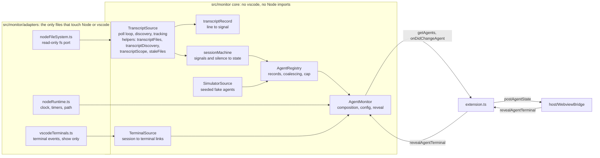
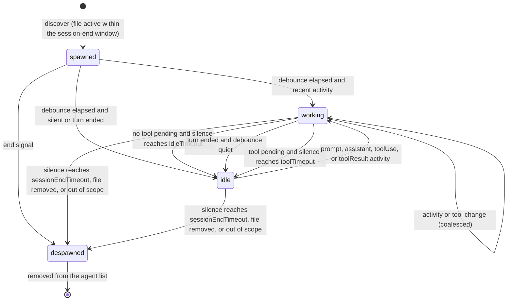

# Agent detection

Purpose: how the host's read-only monitor finds Claude Code sessions, turns transcript activity into the agent states `spawned`, `working`, `idle`, and `despawned`, links sessions to terminals for reveal, and simulates agents when there are none. `src/monitor/` implements this document; if they disagree, fix one of them in the same change.
Related: [ADR 0005 transcript watching](adr/0005-transcript-watching.md), [M3 plan](plans/m3-monitor.md), [security and safety](security-and-safety.md), [host-webview protocol](host-webview-protocol.md), [architecture overview](overview.md), [ADR 0002 no hero health](adr/0002-no-hero-health.md), [ADR 0007 allow-list protocol](adr/0007-allow-list-protocol-pull-handshake.md), [coding standards](../engineering/coding-standards.md), [glossary](../glossary.md), [CLAUDE.md](../../CLAUDE.md).

## 1. Principles

- **Observe only.** The monitor reads files and listens to VS Code terminal events. It never writes a file, never creates one, never takes a lock, never signals a process, and never sends input to or closes a terminal (Core invariant 3). Its only outward action is `Terminal.show()` for `focusAgent`.
- **Five fields.** From transcripts it derives only session id, name, state, tool name, and timestamp. Everything else it parses is dropped inside the parse call (Core invariant 7).
- **The monitor is the only source of hero lifecycle.** States change only on transcript activity, silence thresholds, file removal, scope changes, and the simulator's own schedule. Nothing from the webview or the game reaches it (Core invariant 2).
- **Contained failure.** Every timer callback, event listener, and async step catches its own errors; the extension keeps running with whatever the monitor last knew (Core invariant 4).

## 2. Components

| Module | Layer | Responsibility |
|---|---|---|
| `ports.ts` | core | narrow interfaces the core depends on: `ReadOnlyFileSystem`, `PathOps`, `Clock`, `TimerPort`, `TerminalPort`, `MonitorLogger`, `MonitorDisposable` |
| `monitorConfig.ts` | core | the settings table (`MONITOR_SETTINGS`) and `readMonitorConfig`, which clamps every value |
| `monitorLog.ts` | core | `safeErrorCode` and a rate-limited logger; the only way monitor code describes an error |
| `projectPaths.ts` | core | transcript root resolution, project directory encoding, containment checks, session file names |
| `agentNames.ts` | core | agent name and tool name normalization to the protocol limits |
| `transcriptLines.ts` | core | splits a byte buffer into complete lines with a bounded line length |
| `transcriptRecord.ts` | core | classifies one line into a fixed signal; the only code that looks inside a transcript record |
| `sessionMachine.ts` | core | pure state machine for one transcript session |
| `AgentRegistry.ts` | core | the agent records, emission coalescing, the agent cap, the `AgentInfo` snapshot |
| `TranscriptSource.ts` | core | the poll loop, root condition and status, discovery of candidates into tracked sessions, removal and scope ends; delegates to the four helpers below |
| `transcriptFiles.ts` | core | reading one tracked file: `lstat`, identity and size checks, bounded reads, the discovery tail summary, lines into session inputs (`INITIAL_TAIL_BYTES`, `MAX_READ_BYTES_PER_POLL`) |
| `transcriptDiscovery.ts` | core | finding session files: lists in-scope project directories, sets aside stale files, returns fresh untracked candidates, most recently modified first |
| `transcriptScope.ts` | core | which project directories are in scope (workspace folder encodings, or the cached root listing in `all` scope; `ALL_SCOPE_RESCAN_MS`) and the directory-name comparison key |
| `staleFiles.ts` | core | the set-aside list of known but untracked session files with bounded, round-robin re-checks (`STALE_RECHECK_MS`, `STALE_RECHECK_BATCH`) |
| `TerminalSource.ts` | core | links sessions to terminals and resolves a reveal |
| `SimulatorSource.ts` | core | deterministic simulated agents (`auto`, `on`, `off`) |
| `AgentMonitor.ts` | core | composes the sources and registry; the object `extension.ts` uses |
| `adapters/nodeFileSystem.ts` | adapter (Node) | implements `ReadOnlyFileSystem` with `node:fs/promises` read APIs and `node:os` `homedir` |
| `adapters/nodeRuntime.ts` | adapter (Node) | system clock, unref'd timers, `node:path` as `PathOps` |
| `adapters/vscodeTerminals.ts` | adapter (vscode) | implements `TerminalPort` over `vscode.window` terminal events; `show()` only |

Core modules import only `src/shared/**` and each other, so they are unit tested under `node:test` with in-memory fakes, like `src/host/`. Adapters are the only monitor files allowed to import Node built-ins (`nodeFileSystem.ts`, `nodeRuntime.ts`) or `vscode` (`vscodeTerminals.ts`); the core never imports an adapter. `extension.ts` builds the adapters and passes them in. Import rules are in [coding standards section 3](../engineering/coding-standards.md#3-bundle-boundaries).

## 3. Sources

### 3.1 Transcript source

**Root.** `pixelAgents.transcriptPath`, or `<home>/.claude/projects` when empty (`home` from `os.homedir()`). A leading `~/` (or `~\` on Windows) expands to the home directory. Any other relative path is invalid: the transcript source stays off and one error line is logged (`monitor: transcriptPath invalid (not absolute)`). The root is resolved with `realpath` at the start of every scan, so the root itself may be a symbolic link (for example a dotfiles checkout); nothing below it is followed.

**Scope** (`pixelAgents.projectScope`):

| Value | Project directories read | Privacy implication |
|---|---|---|
| `workspace` (default) | only `<root>/<encode(folder)>` for each `file:` workspace folder of this window, matched for both the folder's path and its `realpath` (macOS `/var` versus `/private/var`), case-insensitively on Windows and macOS. Sessions started in a subfolder of a workspace folder have their own encoded directory and are not matched (assumption: exact match only, because a prefix match would also match sibling folders such as `proj-old`). An empty window reads nothing. | The panel shows only sessions for the folders open in this window. Transcripts of other projects are never opened. |
| `all` | every directory directly under the root | Every project's sessions on this machine appear in every VS Code window, and their transcripts are read (five fields only; nothing leaves the machine). Agent names then include a project label derived from the encoded directory name, which can contain parts of a local path. |

`encode(path)` replaces every character outside `[A-Za-z0-9]` with `-` (for example `/Users/me/My Repo` becomes `-Users-me-My-Repo`, `C:\work\app` becomes `C--work-app`). This mirrors Claude Code's layout as observed; it is an assumption verified by the M3 manual check ([ADR 0005](adr/0005-transcript-watching.md#consequences)).

Both settings are `machine`-scoped: they can be set in user (or remote) settings only, never by a workspace's `.vscode/settings.json`.

**Session files.** Inside a project directory only regular files named `<uuid>.jsonl` (`/^[0-9a-f]{8}-[0-9a-f]{4}-[0-9a-f]{4}-[0-9a-f]{4}-[0-9a-f]{12}\.jsonl$/i`) are sessions. Subagent files (`agent-*.jsonl`), other files, subdirectories, and symbolic links are ignored. The session id is the lower-cased base name; it always matches the protocol's `AGENT_ID_PATTERN`.

**Discovery.** A scan lists the in-scope project directories (each must `lstat` as a directory, not a link) and their entries. In `workspace` scope every poll rescans; in `all` scope the root is listed every 5 s and a project directory is re-listed only when its `mtimeMs` changed. A file whose `mtimeMs` is older than the session-end window is remembered as stale (name and mtime only) and re-checked at most every 10 s, at most 500 stale files per scan, round-robin. A live file becomes a tracked session: the source checks that its `realpath` is inside the resolved root, records its identity (`ino`, `dev`), starts reading at `max(0, size - 64 KiB)` (skipping the first partial line), classifies the lines it reads to learn the last tool name and whether a tool is pending, and reports `discovered` with the file's `mtimeMs` as the last activity time. Files that existed at the first scan are "startup" sessions; files that appear later are "new" sessions (this matters for terminal linking, section 3.2).

**Polling.** One `setTimeout` chain per source, scheduled after the previous poll finishes, so polls never overlap. Each poll, for every tracked file:

1. `lstat`. `ENOENT` means the file was removed: report `ended (fileRemoved)` and stop tracking. A symbolic link or non-file: stop tracking and report `ended (fileRemoved)`.
2. If `ino`/`dev` changed (both non-zero) or `size < offset`, the file was rotated or truncated: reset `offset` to `max(0, size - 64 KiB)` and skip the first partial line. The session continues; nothing is reported for the reset itself.
3. If `size > offset`, read `min(size - offset, 1 MiB)` bytes at `offset` through `readRange`, which opens the file read-only (`O_RDONLY | O_NOFOLLOW` where defined), checks `fstat` against the recorded identity, reads, and closes.
4. Split into complete lines (`transcriptLines.ts`). Advance `offset` past the last newline only. A trailing partial line is not consumed; it is read again next poll, so no transcript text survives between polls. If no newline appears within 256 KiB of the line start, the line is oversized: enter "skip to next newline" mode (only the offset is kept), report one `activity (assistant)`, and never parse it.
5. Classify each complete line (section 3.1.1) and report each non-ignored signal as `activity` in order.

After the file loop the poll calls the registry's `tick(now)` (silence thresholds) and schedules the next poll. A scope or root change (setting or workspace folders) rescans immediately and reports `ended (outOfScope)` for sessions no longer in scope.

#### 3.1.1 Line classification

`classifyTranscriptLine(line: string): TranscriptSignal` is the only code that looks inside a record. It reads at most these properties and nothing else:

| Record | Read | Signal |
|---|---|---|
| not valid JSON (`JSON.parse` throws) | nothing; the error object is discarded unread | `unparseable` |
| not a plain object, or `type` not `assistant`/`user` (for example `summary`, `system`, `file-history-snapshot`) | `type` | `ignored` |
| `type: 'assistant'` with a `message.content` block `{ type: 'tool_use', name }` | `message.content[i].type`, `.name` (first 256 blocks; the last `tool_use` wins) | `toolUse` with `toolName` = the name if it passes `TOOL_NAME_PATTERN` and the length limit, else `null` |
| `type: 'assistant'`, no `tool_use`, `message.stop_reason === 'end_turn'` | `message.stop_reason` | `turnEnd` |
| `type: 'assistant'`, otherwise | | `assistant` |
| `type: 'user'` with a `message.content` block `{ type: 'tool_result' }` | `message.content[i].type` | `toolResult` |
| `type: 'user'`, otherwise | | `prompt` |

The returned signal is a new object with exactly `kind` and `toolName`. Lines from subagent sidechains inside the session file count as the session's own activity. A user interrupt is a `prompt` like any other (its text is never read); the session goes idle by the silence rule.

`unparseable` and oversized lines are counted, and a rate-limited trace line (`monitor: transcript line skipped (unparseable)` or `(oversized)`) is written at most once per minute per reason. Neither ever includes the line, the error message, or the path.

### 3.2 Terminal source

Terminals are used for reveal only; they never change an agent's state ([decision H-2 in the M3 plan](plans/m3-monitor.md#10-decisions-for-the-human)).

- The adapter gives each `vscode.Terminal` a numeric key and reports opens, closes, and the active terminal. It reads `window.terminals`, `window.activeTerminal`, `onDidOpenTerminal`, `onDidCloseTerminal`, and `Terminal.exitStatus`, and calls only `Terminal.show()`.
- **Linking rule** (assumption, conservative): when a **new** session is discovered (its file appeared after the first scan), link it to the active terminal if that terminal is not already linked to a live agent; if there is no active terminal, link it to the most recently opened unlinked terminal opened within the last 30 s. Startup sessions and simulated agents are never linked. A terminal is linked to at most one live agent.
- On terminal close the link is removed; the agent is not despawned.
- On agent despawn its link is removed.
- `revealAgentTerminal(agentId)` (called by the bridge only for a live, listed agent): if the agent has a link and the terminal is still open (`exitStatus === undefined`), call `show()` once; otherwise trace `monitor: reveal skipped (no terminal)`. Never throws.

Names do not come from terminals (terminal names are mostly shell names such as `zsh`).

### 3.3 Simulator source

Fake agents for a zero-configuration demo and for tests. Controlled by `pixelAgents.simulator`:

| Mode | Behaviour |
|---|---|
| `auto` (default) | After the first transcript scan completes, if there is no real agent, start the simulator. When the first real agent spawns, every simulated agent despawns. When the last real agent despawns, restart the simulator after 10 s. If the transcript source is unavailable (no root, unreadable, invalid path), the simulator runs. |
| `on` | Always run, beside real agents. |
| `off` | Never run. |

Simulated agents are clearly labelled: ids are `sim-<slot>-<generation>` (the `sim-` prefix is reserved for simulated agents; real ids are UUIDs) and names are `Sim <Name>` from a fixed list (`Ada`, `Brom`, `Cyra`, `Dorn`, `Elin`, `Fenn`, `Gale`, `Hask`, then `Sim 9` and up). `pixelAgents.simulatorAgentCount` (1-16, default 3) sets the number of slots.

The schedule is deterministic: a mulberry32 PRNG with a fixed seed (`DEFAULT_SIMULATOR_SEED`, injectable for tests). Slot `i` first spawns `1.5 s x i` after start. A lifetime is 2-3 cycles of a working phase (15-30 s, tool changes every 2-5 s from `Read`, `Grep`, `Edit`, `Bash`, `Write`, `Glob`, `WebFetch`, `Task`) and an idle phase (6-15 s), then `despawned`; the slot respawns 3-6 s later with `generation + 1`. Simulated agents enter the registry with explicit states (they do not use the transcript state machine), through the same normalization, coalescing, and cap.

## 4. Session state machine

`sessionMachine.ts` is a pure reducer for one transcript session: `(session, input, config) => session`. Inputs are `discover`, `activity(kind, toolName)`, `tick`, and `end(reason)`, each with the monitor clock's `now`.

Per-session fields: `state`, `toolName` (last tool, kept through `idle`), `lastActivityAt`, `toolPending`, `turnEnded`, `spawnedAt`.

| Input | Effect |
|---|---|
| `discover(lastActivityAt, toolName, toolPending, turnEnded)` | `state = spawned`. Ignored if `now - lastActivityAt >= sessionEndTimeout` (stale file). |
| `activity(prompt \| assistant \| toolResult)` | `lastActivityAt = now`; `turnEnded = false`; `prompt` and `toolResult` clear `toolPending`. Target `working`. |
| `activity(toolUse, name)` | as above, plus `toolPending = true` and `toolName = name` when `name !== null`. |
| `activity(turnEnd)` | `lastActivityAt = now`; `toolPending = false`; `turnEnded = true`. |
| `tick` | `silence = max(0, now - lastActivityAt)`. From `spawned`, once `now - spawnedAt >= debounce`: `working` if not `turnEnded` and silence is below the applicable idle threshold, else `idle`. From `working`: `idle` when `turnEnded` and `silence >= debounce`; when not `turnEnded`, no tool pending, and `silence >= idleTimeout`; or when a tool is pending and `silence >= toolTimeout`. From any live state: `despawned` when `silence >= sessionEndTimeout`. |
| `end(fileRemoved \| outOfScope)` | `despawned`. |

`despawned` is final for that record: the registry emits it and deletes the record. If the same file later shows activity, the source reports `discover` again and a new lifecycle starts with the same id. A future `mtimeMs` (clock skew) counts as zero silence.

Thresholds (every one a `pixelAgents.*` setting; section 6): `debounce` = `debounceMs`, `idleTimeout` = `idleTimeoutSeconds`, `toolTimeout` = `toolTimeoutSeconds`, `sessionEndTimeout` = `sessionEndTimeoutMinutes`. `readMonitorConfig` enforces `toolTimeout >= idleTimeout` and `sessionEndTimeout >= toolTimeout` by raising the later value.

## 5. Registry, emission, and the agent list

- `AgentRegistry` holds one record per live agent (transcript or simulated), in insertion order. `getAgents()` returns a cached, frozen array of `AgentInfo` built through the protocol's `toAgentInfo`; it never throws and never includes `despawned` agents.
- `AgentInfo.timestamp` is the monitor clock (epoch ms) at the agent's last change of `state` or `toolName`.
- **Coalescing** (`debounceMs`): per agent, at most one emission per `debounceMs`. A change inside the window schedules one trailing emission of the latest snapshot; a snapshot equal to the last emitted one (same `state` and `toolName`) is not emitted. `spawned` is emitted immediately (it is the first emission). `despawned` cancels any pending emission and is emitted immediately. With `debounceMs = 0` every change is emitted.
- **Cap**: at most `MAX_AGENTS` (64) live agents, at most 48 from transcripts (most recently active win at discovery) and at most 16 simulated. Beyond the cap a session is not tracked and one rate-limited trace line is written.
- Listeners registered with `onDidChangeAgent` are called synchronously, in registration order, each inside its own try/catch. `extension.ts` forwards each `AgentInfo` to `WebviewBridge.postAgentState`.
- Every emission writes one trace line, `monitor: agent <id> <state>`, plus `(<toolName>)` after a space when set: only allow-listed fields.
- After `dispose()` nothing is emitted, not even `despawned` (the extension is shutting down; the webview is rebuilt from the snapshot on the next start).

## 6. Configuration

All under `contributes.configuration` in `package.json`, mirrored by `MONITOR_SETTINGS` in `monitorConfig.ts` (a test keeps them equal). Changes apply live through `onDidChangeConfiguration`.

| Setting | Type | Default | Range | Scope | Meaning |
|---|---|---|---|---|---|
| `pixelAgents.simulator` | `auto` \| `on` \| `off` | `auto` | | window | simulated agents (section 3.3) |
| `pixelAgents.simulatorAgentCount` | integer | 3 | 1-16 | window | simulated agent slots |
| `pixelAgents.projectScope` | `workspace` \| `all` | `workspace` | | machine | which project directories are read (section 3.1) |
| `pixelAgents.transcriptPath` | string | `""` (`~/.claude/projects`) | absolute path or `~/...` | machine | transcript root |
| `pixelAgents.idleTimeoutSeconds` | integer | 60 | 5-3600 | window | silence before a working agent with no pending tool is idle |
| `pixelAgents.toolTimeoutSeconds` | integer | 300 | 30-86400 | window | silence before a working agent with a pending tool is idle |
| `pixelAgents.sessionEndTimeoutMinutes` | integer | 30 | 1-1440 | window | silence before a session counts as ended (despawned) |
| `pixelAgents.debounceMs` | integer | 750 | 0-10000 | window | spawn-to-first-state delay, turn-end quiet time, and emission coalescing window |
| `pixelAgents.pollIntervalMs` | integer | 1000 | 250-10000 | window | transcript poll interval |

Rationale for the defaults: 60 s idle tolerates long generations that write nothing; 300 s covers most builds and test runs while letting a session waiting on a permission prompt drift to idle; 30 min lets an idle hero rest at the campfire rather than vanish during a coffee break; 750 ms hides tool-switch flicker; 1 s polling feels live at negligible cost.

`readMonitorConfig(get)` is total: a wrong type, `NaN`, or infinity falls back to the default; numbers are rounded and clamped to the range; an unknown enum value falls back to the default.

## 7. Errors and logging

- Monitor code logs through `MonitorLogger` (`trace`, `error`; the "Pixel Agents" log channel). Every message is a fixed reason string, optionally followed by allow-listed fields (agent id, state, tool name, counts) or `safeErrorCode(error)`.
- `safeErrorCode(error)` returns `error.code` if it matches `/^E[A-Z0-9_]{1,31}$/` (for example `ENOENT`, `EACCES`, `EPERM`, `ELOOP`, `EMFILE`), else `error.name` if it matches `/^[A-Za-z]{1,40}$/` (for example `SyntaxError`, `RangeError`), else `unknown`. It never reads `message` or `stack`. Monitor code never interpolates an error object, never calls `String(error)` or `JSON.stringify`, and never logs a path.
- Expected conditions log at trace once per change of condition: root not found (`ENOENT`, Claude Code never ran), file removed, reveal skipped. Unexpected ones log at error, rate-limited to once per minute per reason: root unreadable (`EACCES`, `EPERM`), file unreadable, poll failed, invalid `transcriptPath`.
- Per-file errors affect only that file: `ENOENT` and `ELOOP` end the session; `EACCES`/`EPERM` skip the file this poll (the session ages out by the silence rule if it persists); an identity mismatch from `readRange` is handled as rotation.
- `getAgents()` and `revealAgentTerminal()` never throw, so the bridge's own error logging (which includes `error.message`) never sees a monitor error.

## 8. Platform notes

- **Windows.** Paths are compared with `path.relative` (a result that is absolute, or starts with `..`, is outside). Comparisons of project directory names are case-insensitive. `O_NOFOLLOW` is not defined, so containment relies on `lstat` plus `realpath`. `ino` can be `0` on some file systems; identity checks are skipped when either value is `0`. Files are opened only for the duration of one read, and libuv opens them with full sharing, so Claude Code can always write, rename, or delete them.
- **macOS.** Temp and some home paths resolve through `/private`; workspace matching tries both the folder path and its `realpath`. APFS is usually case-insensitive.
- **Linux.** Case-sensitive comparisons.
- **Remote windows (SSH, WSL, containers).** The extension runs as a workspace extension next to Claude Code, so `~` is the remote home.
- **Symbolic links.** The root may be a link; nothing below it is followed. A file whose `realpath` leaves the resolved root is never opened.
- **Permissions.** Transcripts are usually mode `600` and owned by the user; an unreadable root or file is logged by code and skipped, never retried in a tight loop.
- **Other extensions.** The monitor never reads or writes `~/.claude/settings.json`, hook scripts, or any directory other than the transcript root's project directories. Hooks installed by other extensions (for example `pablodelucca.pixel-agents`) neither help nor hinder it.

## 9. Limits (constants, not settings)

| Constant | Value | Why |
|---|---|---|
| `INITIAL_TAIL_BYTES` | 64 KiB | bound the first read of an existing transcript |
| `MAX_READ_BYTES_PER_POLL` | 1 MiB per file | bound work per poll |
| `MAX_LINE_BYTES` | 256 KiB | bound one parse; larger lines are skipped |
| `MAX_CONTENT_BLOCKS` | 256 | bound the scan of one record's content array |
| `ALL_SCOPE_RESCAN_MS` | 5000 | root listing interval in `all` scope |
| `STALE_RECHECK_MS`, `STALE_RECHECK_BATCH` | 10000, 500 | bound re-checks of old transcripts |
| `MAX_TRANSCRIPT_AGENTS`, `MAX_SIMULATED_AGENTS` | 48, 16 | together equal the protocol's `MAX_AGENTS` (64) |
| `LINK_WINDOW_MS` | 30000 | terminal linking fallback window |
| `SIMULATOR_RESUME_MS` | 10000 | `auto` mode restart delay |
| `LOG_RATE_LIMIT_MS` | 60000 | repeated reason strings |

Like the protocol limits, these are safety bounds, not user thresholds ([M2 plan section 9](plans/m2-protocol.md#9-risks-assumptions-defaults)).

## 10. Known limitations

- State is inferred from activity and silence; see [ADR 0005 consequences](adr/0005-transcript-watching.md#consequences).
- Terminal links are heuristic. A session started while another terminal is active links to that terminal, and reveal shows the wrong terminal; it never does anything else to it.
- In `all` scope, two windows show the same sessions, and a new session from another window may link to this window's active terminal.
- No persistence: offsets and links are rebuilt on every activation from the tail of each live transcript.
