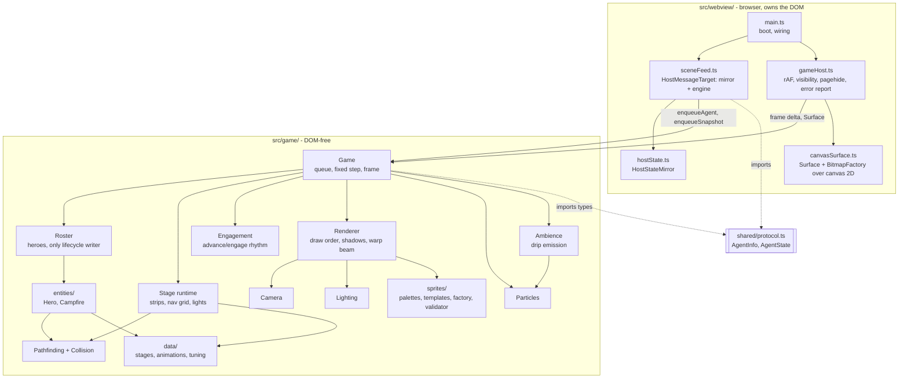
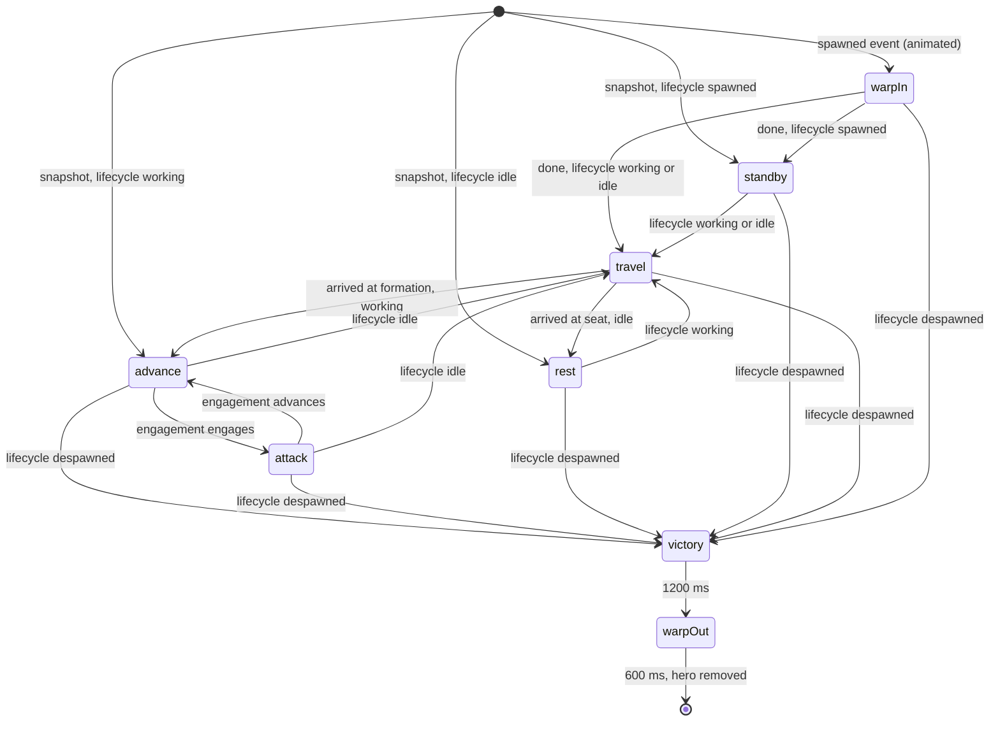

# Game engine

Purpose: the design contract for the webview game runtime in `src/game/**` and its thin webview host: components, room layout, the fixed-step loop and crash isolation, how host agent events drive heroes, the hero phase machine, rendering order, lighting, particles, pathfinding, sprite consumption, and the performance budget. Written for M4 (engine); later milestones extend it at the seams named in section 14.
Related: [architecture overview](overview.md), [host-webview protocol](host-webview-protocol.md), [data model](data-model.md), [M4 plan](plans/m4-engine.md), [ADR 0002 no hero health](adr/0002-no-hero-health.md), [ADR 0003 procedural sprites](adr/0003-procedural-sprites.md), [ADR 0008 DOM-free engine](adr/0008-dom-free-engine-behind-ports.md), [ADR 0009 hero lifecycle isolation](adr/0009-hero-lifecycle-isolation.md), [ADR 0010 split room layout](adr/0010-split-room-stage-layout.md), [security and safety](security-and-safety.md), [art style guide](../design/art-style-guide.md), [sprite spec](../design/sprite-spec.md), [testing strategy](../engineering/testing-strategy.md), [coding standards](../engineering/coding-standards.md), [glossary](../glossary.md), [CLAUDE.md](../../CLAUDE.md).

Status: M4 as built (synced to commit b320b00 on `feat/m4-engine`; drift is listed in [M4 plan section 13](plans/m4-engine.md#13-as-built-drift-checked-against-commits-081732d-to-b320b00)). Where this file and the code disagree, fix one of them in the same change.

## 1. Principles

- **Heroes are invulnerable and follow the host.** A hero stores exactly one fact about its agent, `lifecycle` (`spawned`, `working`, `idle`, `despawned`), and it changes only through host agent-state events (Core invariants 1 and 2, [ADR 0009](adr/0009-hero-lifecycle-isolation.md)).
- **The engine is DOM-free and clock-free.** It draws through a `Surface` port, creates bitmaps through a `BitmapFactory` port, receives time as a frame delta, and uses seeded randomness ([ADR 0008](adr/0008-dom-free-engine-behind-ports.md)).
- **The engine cannot reach the host.** It has no host channel. Its inputs are agent events and frame deltas; its outputs are pixels and an error callback (Core invariants 3 and 4).
- **Crash isolation at three levels.** Per entity, per frame, and per animation-frame callback; the next frame always renders.
- **No per-frame allocation in hot paths.** Pools, preallocated arrays, cached bitmaps. Allocation on state transitions (a path request, a new hero look) is fine.
- **Everything visual is procedural** (Core invariant 5): palette-indexed templates rasterized once; light, warp beams, particles, and shadows are drawn from rectangles and generated bitmaps.

## 2. Components



| File | Responsibility | Touches DOM |
|---|---|---|
| `src/game/ports.ts` | `Surface`, `Bitmap`, `BitmapFactory`, `OffscreenSurface`, `ErrorSink` | no |
| `src/game/layout.ts` | buffer size, tile rows and zones, foot-y band, campfire position, nav constants, slot functions (`formationPosition`, `seatPosition`, `entrancePosition`), `computeIntegerScale` | no |
| `src/game/rng.ts` | `mulberry32`, `hashId` (FNV-1a over UTF-16 units) | no |
| `src/game/Game.ts` | event queue, fixed-step accumulator, `frame`, `heroSnapshot`, crash isolation | no |
| `src/game/Roster.ts` | hero map, event application, snapshot reconcile, removal rules | no |
| `src/game/Engagement.ts` | the party rhythm (advance, engage); M4 timed, E1 enemy-driven | no |
| `src/game/Renderer.ts` | draw order, y-sort, shadows, warp beam, strip blits | no |
| `src/game/Camera.ts` | corridor scroll, parallax offsets, integer snapping | no |
| `src/game/Lighting.ts` | light list, low-resolution light map, multiply composite | no |
| `src/game/Particles.ts` | pooled particles (ember, spark, drip, splash) | no |
| `src/game/Pathfinding.ts`, `Collision.ts` | grid A*, AABB tests | no |
| `src/game/Ambience.ts` | stage ambient effects (M4: drip emission into `Particles`); cosmetic, particles only | no |
| `src/game/Stage.ts` | build a runtime from a `StageDef`: strips, nav grid, lights, drip points, solid props; validate stages | no |
| `src/game/entities/Hero.ts`, `Campfire.ts`, `Prop.ts`, `Entity.ts` | entities (all extend `GuardedEntity`) and the per-entity guard | no |
| `src/game/data/stages.ts`, `animations.ts`, `tuning.ts` | typed tables and constants ([data model](data-model.md)) | no |
| `src/game/sprites/palettes.ts`, `spriteTemplates.ts` (and other template files) | art data (pixel-artist) | no |
| `src/game/sprites/artSet.ts` | `SHIPPED_ART`: gathers the artist's exports into the `ArtSet` (developer glue) | no |
| `src/game/sprites/spriteFactory.ts`, `spriteValidator.ts` | template to bitmaps, layer compositing, swaps, validation | no |
| `src/webview/canvasSurface.ts` | `Surface` and `BitmapFactory` over `CanvasRenderingContext2D` | yes |
| `src/webview/gameHost.ts` | the frame loop over an injected `FrameScheduler` (`main.ts` passes `requestAnimationFrame`), pause when hidden, error reporting | no (browser functions injected) |
| `src/webview/sceneFeed.ts` | `HostMessageTarget` that updates the mirror and the engine | no |

## 3. Room layout

Fixed geometry from [ADR 0010](adr/0010-split-room-stage-layout.md); every stage reuses it.

```text
x:   0                 128 144                          320
y:   +------ alcove -----+D+------- corridor ------------+
 0   | back wall  (8 rows, 128 px)   backdrop shows through
     |                     |o|  transparent wall pixels  |
128  +---------------------+o+----------------------------+
     | floor band (2 rows, 32 px): heroes walk here       |
     |  campfire (x 64)  seats        formation slots     |
160  +----------------------------------------------------+
     | foreground row (1 row, 16 px), then 4 px fill      |
180  +----------------------------------------------------+
```

| Constant | Value | Meaning |
|---|---|---|
| `INTERNAL_WIDTH`, `INTERNAL_HEIGHT` | 320, 180 | the only buffer size |
| `TILE` | 16 | tile edge |
| wall rows | 8 (y 0-127) | row 0 `wallTop`, rows 1-6 `wallMid`, row 7 `wallBase` |
| floor rows | 2 (y 128-159) | row 0 `floorBack`, row 1 `floorFront` |
| foreground | y 160-175, then fill to 180 | `foreground` tile row, then the stage clear color |
| alcove | x 0-127 | static; campfire at x 64, foot y 152 |
| door | x 128-143 | the `door` zone: one column with its own 16x180 strip and exactly one non-solid wall prop (the door frame) at its x 0 |
| corridor | x 144-319 | draws a repeating 24-tile (384 px) segment shifted by the scroll |
| foot-y band | 140-158 | where a hero's feet may be (kept by the slot formulas in `layout.ts`) |
| floor band | y 128-159 | where a floor prop's foot y may be (the stage validator rule) |
| campfire | x 64, foot y 152 | `CAMPFIRE_X`, `CAMPFIRE_FOOT_Y` |

Placement zones are `alcove`, `door`, and `corridor`. Solid props exist only in the alcove (the corridor scrolls, so a solid there would have to move its nav cells; the validator rejects it). Corridor props scroll and repeat every 384 px.

Tile variants are picked by a deterministic hash of the tile cell, the zone, and the stage index (`hashCell`), so the picture is stable across reloads. Wall tiles may contain transparent pixels; the parallax backdrop shows through them. The barred-opening wall variants appear only in wall row 3, never in the first or last column of a zone, never in the door zone, never adjacent, and for about one cell in six.

## 4. The loop and crash isolation

`Game.frame(deltaMs, surface)` is the only per-frame entry point. It never throws.

```mermaid
sequenceDiagram
  participant Raf as gameHost (rAF callback)
  participant G as Game
  participant R as Roster
  participant E as Entities
  participant Rn as Renderer
  participant S as Surface
  Raf->>Raf: schedule next rAF first
  Raf->>G: frame(delta, surface)
  G->>G: accumulate min(delta, 100 ms)
  loop up to 5 fixed steps of 16.67 ms
    G->>R: drain event queue (apply lifecycle)
    G->>E: each entity update, own try/catch
    E-->>G: fault count, report once
  end
  G->>Rn: render(surface)
  Rn->>S: layers, entities by foot y, light, particles
  Note over Raf,S: any throw is caught at the entity, the step, the render, or the rAF callback;<br/>the next frame runs normally
```

- **Fixed step.** `STEP_MS = 1000 / 60`. The accumulator adds `min(delta, MAX_FRAME_MS = 100)` (a `NaN` or non-positive delta adds 0; `Infinity` clamps to 100); at most `MAX_STEPS_PER_FRAME = 5` steps run per frame, and leftover time beyond that is dropped (a long stall must not cause a burst of catch-up). Rendering is not interpolated: positions are snapped to whole pixels, and a display faster than 60 Hz simply redraws the same state.
- **Levels of try/catch.** (1) `guarded(entity, 'update' | 'draw')` around each entity call; (2) a try/catch around each fixed step and around render in `Game.frame`; (3) the `gameHost` rAF callback, which schedules the next frame **before** doing any work, so even a bug in the host cannot stop the loop.
- **Quarantine.** Update and draw faults are counted separately. An entity whose `update` throws increments `faults`; a clean call resets it. At `FAULT_LIMIT = 3` consecutive update faults the entity is frozen: skipped by `update`, still drawn. Three consecutive `draw` faults (`drawFaults`) stop it being drawn. A host lifecycle event applied to a hero (`applyAgentState`) clears `faults`, `drawFaults`, and `frozen`; the campfire and solid props receive no lifecycle event, so their quarantine lasts until the webview reloads (see "Decorations stay quarantined" below). Errors are reported through `ErrorSink(error, scope)` once per distinct message per entity, once per distinct `scope:message` per `Game` (at most 64), and once per page load by the webview's single crash reporter. Faults never change `lifecycle` or remove a hero ([ADR 0009](adr/0009-hero-lifecycle-isolation.md)).
- **Decorations stay quarantined until reload, by design.** The campfire and props have no lifecycle events, so nothing clears their `faults`, `drawFaults`, or `frozen`. A decoration that faults three times stays frozen (no embers or flicker) or hidden until the webview reloads. This is cosmetic, isolated from agents, and accepted: adding a reset path from game or host events would couple decorations to the lifecycle channel for no user benefit ([M4 plan section 13.4](plans/m4-engine.md#134-flags-nothing-violates-a-core-invariant)).
- **Light pass guard.** `Lighting` is built and composed outside the per-entity guard, so `Renderer.#guardedLightPass` wraps it in its own try/catch. A fault is reported once through the `ErrorSink` with scope `'render'`, increments a fault counter, and resets the composite to `source-over` and alpha to 1 so a half-finished multiply cannot darken what follows; entities, foreground, and particles still draw that frame. After `LIGHT_FAULT_LIMIT = 3` faults the light pass is skipped for the rest of the page's life (the scene is drawn unlit). It never touches hero state.
- **Error text.** Messages thrown in `src/game/**` are fixed strings; they never include agent names, tool names, or ids (these could not be transcript text, but the rule keeps logs payload-free).
- **Pause when hidden.** `gameHost` cancels the animation frame on `visibilitychange` to hidden and on `pagehide`, and resumes on visible with the last timestamp cleared, so the first resumed frame has delta 0. With `retainContextWhenHidden: false` a hidden panel usually destroys the document, but this also covers a visible-but-occluded document.
- **Dispose.** `pagehide` removes every listener and calls `Game.dispose()` (clears the queue and pools).

## 5. Events in, heroes out

Host messages reach the engine through `SceneFeed`, a `HostMessageTarget` that forwards each call to the `HostStateMirror` and then to `Game`:

| Host message | `SceneFeed` | `Game` |
|---|---|---|
| `agentState` | `mirror.applyAgent`, then `game.enqueueAgent(agent)` | append to the event queue (cap 256) |
| `agentList` | `mirror.replaceAgents`, then `game.enqueueSnapshot(agents)` | replace the queue with one snapshot marker |
| `config` | `mirror.applyConfig` | none in M4 |

The queue is drained at the start of each fixed step. Rules in `Roster`:

| Input | Effect on the roster |
|---|---|
| `spawned`, id unknown | create the hero (animated entry: `warpIn`) |
| `working` or `idle`, id unknown | create the hero already in that lifecycle (a missed `spawned` is tolerated, as in the mirror), no warp-in |
| any state, id known | `hero.applyAgentState(info)`; `phase` follows on later updates |
| `spawned`, `working`, or `idle`, id known and the hero is exiting (lifecycle `despawned`, mid-victory or `warpOut`) | exiting heroes are replaced, never revived: `Roster.#updateOrReplace` removes the old hero (freeing its slot) and creates a fresh one, instantly for `working` and `idle`, with warp-in for `spawned`. `Hero.applyAgentState` stays the only lifecycle writer and cannot leave `despawned` |
| `despawned`, id unknown | ignored |
| snapshot | **instant rebuild**: for each listed agent, create or update without warp-in and place it by lifecycle (`working` in its formation slot, `idle` in its seat, `spawned` in standby at the door); a listed `despawned` agent that is unknown creates nothing; an exiting hero listed as live is replaced; an existing hero missing from the list gets a synthetic `despawned` (same exit animation) |
| queue overflow | the event that finds 256 queued clears the queue and flags a resync; the next step reconciles from `GameDeps.agentSource()` (the mirror's list, which already holds every event because `SceneFeed` updates the mirror first). A later snapshot supersedes a pending resync |

Removal rule: a hero leaves the roster only when its lifecycle is `despawned` and its exit animation finished, or `EXIT_FAILSAFE_MS = 5000` of game time passed since the event (`Hero.exitClockMs`, ticked by `Roster.update`; covers a frozen entity), or never otherwise. `Roster` also exposes `countFighting()` (heroes in `advance` or `attack`, which drives `Engagement`) and `countResting()` (heroes in `rest`, which drives the campfire); `lookFor(id)` derives the stable look. `Game.heroSnapshot()` returns `{ id, lifecycle, exiting }` for each hero; it is read-only and is how tests and the dev tooling observe state.

**Scene rebuild on webview reload** is the same code path: a new document boots, `ready` is sent, the host answers `config` then `agentList`, `SceneFeed` forwards the snapshot, and the next step builds the same set of heroes in the same lifecycles. Positions are a function of the stable slot index each hero gets (lowest free index at creation), so a rebuilt scene matches the previous arrangement whenever the list order matches.

## 6. Hero behavior

A hero has `lifecycle` (host-driven, section 5) and `phase` (cosmetic, derived). Animation names are exactly the [sprite spec](../design/sprite-spec.md) names; there is no hurt, downed, or death animation.



The diagram is cosmetic. Every arrow labelled "lifecycle ..." is evaluated by the hero's own `update` comparing its stored `lifecycle` with the phase it should be in, never by a combat, boss, or stage event.

| Phase | Animation | Meaning |
|---|---|---|
| `warpIn` | `idle` | 600 ms: a light beam and sparkles at the door while the sprite is revealed bottom-up by region draws |
| `standby` | `idle` | `spawned` and waiting; stands at the door |
| `travel` | `walk` | follows an A* path to the goal (`entrance`, `formation`, or `seat`); 40 px/s; faces its movement; re-paths if the desired goal changed. An unreachable goal leaves the hero in `standby` and retries after `PATH_RETRY_MS` (1 s); never an error or a removal |
| `advance` | `walk` | in its formation slot, walking in place while the corridor scrolls |
| `attack` | `attack` | in its formation slot, swinging at nothing (no enemies in M4), staggered 0-400 ms per hero |
| `rest` | one of `sit`, `eat`, `sleep`, `polish`, `read`, `warmHands` | at its seat, facing the fire; starts on `sit` (a snapshot rebuild starts on a hash-chosen non-sleep pose); pose changes every 9-16 s (seeded); `sleep` only after 30 s of rest |
| `victory` | `victory` | 1200 ms in place when `despawned` |
| `warpOut` | `victory` | 600 ms: beam and sparkles, sprite hidden top-down; then removal |

- **Non-interruptible phases.** `warpIn`, `victory`, and `warpOut` finish before any other phase, except that a `despawned` lifecycle interrupts `warpIn` and `travel` at once. A `working` or `idle` event during `warpIn` updates `lifecycle` immediately; the hero begins to travel when the warp finishes.
- **Identity.** Skin tone (4) and hair color (6) come from `hashId(id)` (`lookFor`); the class-less base hero uses `accent: null` (the master `a` colour; H1 passes a CSS `#rrggbb` that overrides `a`). `Hero` exposes `x`, `y`, `faceRight`, `warpBeam`, and a protected `heroLayers(world)` hook that class subclasses override. Name labels are not drawn in M4 (no pixel font until U1; the M7 roster shows names).
- **No gauges, no health, no hit reactions.** Nothing is drawn over or under a hero except its fixed-size shadow, which the renderer draws. Hero drawing calls only `drawBitmap`/`drawBitmapRegion`.

## 7. Campfire, seats, formation

- **Campfire** (entity, drawn identically across stages): logs and stones base, a 4-frame flame loop in two sizes (small, large), embers, and a flickering warm light. `restingCount` (heroes in `rest` phase) selects the flame: large from 3 resting; emission rate and light radius scale with the count. It has no state a hero can read except `restingCount`.
- **Slots.** Each hero gets a stable `slot` index (lowest free, freed on removal). Defaults (tunable constants, `tuning.ts`):
  - Formation slot `i`: `col = i % 8`, `row = floor(i / 8) % 4`, `x = 168 + col * 18 + (row % 2) * 9`, foot `y = 156 - row * 5`.
  - Seat `i`: `side = i % 2 == 0 ? -1 : +1`, `ring = floor((i % 8) / 2)`, `x = 64 + side * (16 + ring * 12) + (row % 2) * 6 * side`, same row rule; the hero faces the fire.
  - Entrance (`spawned`, standby): x 136 (the door column centre), foot `y = 146 + (slot % 3) * 4`.
  - For `i >= 32` the slot wraps with a 6 px x-offset per wrap (overlap accepted, [ADR 0010](adr/0010-split-room-stage-layout.md)).
  - The slot functions live in `layout.ts` and write into a caller-supplied point (no allocation). `Stage` validation checks every seat and formation cell is open and reachable from the entrance.
- **Engagement** (`Engagement.ts`) owns the party rhythm and exposes `scrollPxPerS` and `isEngaged`. M4 `TimedEngagement`, fed `Roster.countFighting()`: while at least one hero is in `advance` or `attack` (working and in the corridor), `advance` for 5 s (scroll 24 px/s with 300 ms ease) then `engage` for 2.4 s (scroll stops, working heroes attack); with no working hero the corridor does not scroll. E1 replaces the timer with enemy presence behind the same interface.

## 8. Rendering

`Renderer.render(surface)` draws in this order. Environment layers are lit; entities are not.

1. Clear with the stage clear color.
2. Backdrop, parallax 0.25: static behind the alcove and the door, sliding behind the corridor view.
3. Environment strips: alcove (x 0), door (x 128), corridor view (x 144). Static wall and floor props are baked into the strips.
4. Live props: animated props (torches, ripples), clipped to their zone; corridor props are drawn at the scroll offset and at plus and minus one segment.
5. **Light pass**: `Lighting.compose(surface)` multiplies the environment (steps 2-4) by the light map. Torch lights flicker; the campfire light is added last.
6. Shadows, then entities sorted by foot y (heroes, campfire, solid alcove props), stable order. A warp beam is drawn right after the hero it belongs to.
7. Foreground: `nearForeground` (alcove and door) and the corridor foreground view.
8. Particles.

- **Strip caching.** At stage load, `Stage` pre-renders three environment strips: alcove (128x180), door (16x180), and one corridor segment (384x180), plus two foreground strips (`nearForeground` 144x20 and `corridorForeground` 384x20). Per frame the renderer blits the alcove and door once and the corridor view as one or two region draws of the same strip (the second only where the view wraps the 384 px seam). Animated props (torches) and solid floor props that must sort with heroes are drawn live.
- **Integer coordinates.** Every draw position is `Math.floor`ed. Mirroring uses the anchor: unflipped `dx = x - anchor.x`, flipped `dx = x - (w - 1 - anchor.x)`.
- **Shadows.** A flat 2-row translucent rectangle under each hero at a fixed width; not a gauge and not tied to any hero field except position.
- **Integer scaling and the canvas.** `computeIntegerScale(viewW, viewH, dpr)` (moved from `main.ts`) picks the largest integer device-pixel scale that fits, minimum 1; `canvasSurface.ts` applies it to the canvas style and keeps `imageSmoothingEnabled = false` after any resize.

## 9. Camera

`Camera` holds `scrollX` (corridor travel in pixels, advanced by `Engagement.scrollSpeed`) and returns whole-pixel offsets: `corridorOffset()` (`scrollX` mod segment length), `parallaxOffset(factor)`. Nothing follows a hero. E1 adds a shake offset (amplitude and decay) applied to the final blit. M7 reduces or disables shake and scroll for reduce-motion.

## 10. Lighting

- Sources: stage prop lights (torches) and the campfire (dynamic). A source is `{ x, y, radius, intensity, colorChar }`; at most `MAX_LIGHTS = 16` per frame, extras ignored.
- A low-resolution **light map** (80x45, a quarter of the buffer) is an `OffscreenSurface`. Each frame: fill with the stage ambient color, draw each source's pre-built banded radial bitmap with composite `lighter`, then draw the light map scaled 4x onto the main surface with composite `multiply` and smoothing off. The 4 px blocks and 3-4 intensity bands match the art style; no gradients.
- Radial bitmaps (a few radii, per light color) are generated once from pixel math in `Lighting`, not drawn from art. Torch flicker changes the radius by plus or minus 4 px (half a band) from a hash of the light index and the render-clock tick (`TORCH_FLICKER_MS` 140), not from the seeded generator; the campfire flickers by half a band on a 120 ms timer using the seeded generator. Neither uses the wall clock. Corridor lights are placed at the scroll offset and at plus and minus one segment so they scroll past.
- Heroes and the campfire are drawn after the pass and are not darkened.

## 11. Particles

`Particles` is a fixed-capacity pool (`PARTICLE_CAPACITY = 384`) in parallel typed arrays plus a free list: x, y, vx, vy, age, life, kind, ramp index. `emit` returns `false` when full (the emission is dropped). Kinds: `ember` (campfire), `spark` (warp), `drip` and `splash` (Stage 1 ambient). Color is read from `PARTICLE_PALETTE[kind]`, a ramp of palette characters from bright to dim by age. Each particle is a 1 px (or 2 px) `fillRect`. Emission rates are `tuning.ts` constants; M7 scales them for reduce-motion. `Ambience` (called from `Game.step`) turns the stage's `drip` effect into `drip` particles at the stage's drip points (every `puddle` prop); when a drip expires, `Particles` spawns two `splash` particles itself (dropped silently if the pool is full).

## 12. Pathfinding and collision

- `NavGrid`: 8 px cells over the floor band (40 columns by 4 rows, origin y 128). `Stage` marks cells blocked from the footprints of alcove `solid` props and the campfire pit box (x 56, y 144, 16x8). Corridor props never block.
- `findPath(grid, from, to, out)`: A* with octile cost, 8 neighbors, no corner cutting, a binary heap on preallocated typed arrays. It writes cell centers into a reusable buffer; an unreachable goal returns 0 and the hero stays where it is in `standby`, retrying after 1 s (never an error, never a removal). Paths are computed on goal changes, not per frame.
- `Collision` in M4 is `Aabb` and `overlaps`/`contains` used to build the nav grid and test zones. The spatial hash for hits arrives with `Combat` in E1 (no speculative code in M4).
- Heroes do not collide with each other; they are y-sorted and may overlap while passing.

## 13. Sprites

[ADR 0003](adr/0003-procedural-sprites.md) and the [sprite spec](../design/sprite-spec.md) define the format. The engine consumes it as follows.

- **Templates** (`SpriteTemplate`, `Palette`) and the art data are exported by the pixel-artist's `palettes.ts` and `spriteTemplates.ts`; the exact A0 exports are listed in the [M4 plan](plans/m4-engine.md#10-art-needs-batch-a0). The factory never reads hex from templates: characters resolve through the palette.
- **`spriteFactory.ts`** (developer): `rasterize` template rows to RGBA (pure), then `BitmapFactory.fromRgba` to a `Bitmap`. A `SpriteCache` caches by key. Hero sprites are built lazily per `HeroLook` (skin index, hair index, accent): the layers `body`, `head`, `gear` (optional), `weapon` are composited in that order, aligned on `anchor`, over the union bounds of all layers and frames, with the skin and hair swap palettes overriding the characters they define.
- **`ArtSet`** is the one object the engine reads art from. `sprites/artSet.ts` exports `SHIPPED_ART` built from the artist's files; it includes `stageTileChars`. `HeroLook.accent` is a CSS `#rrggbb` that overrides the `a` character, or `null`. Hero bitmaps are cached by skin, hair, accent, and layer ids.
- **`spriteValidator.ts`** (developer): row lengths, frame sizes, characters in the palette, at most 12 colors per template and per composited default hero, required hero animation names and frame counts, equal frame counts across layers, anchor inside bounds, and no animation name matching hurt, downed, death, or dead (Core invariant 1 at the asset level). Tests run it over all shipped art (`validateArtSet(SHIPPED_ART)`); invalid art fails the test, not the user's panel. The engine does not run it at boot.
- **Boot failure.** `Game`'s constructor validates the stage table (`validateStages`, including connectivity) and builds the stage and campfire sheets. If that throws (`RangeError`, fixed text), `main.ts` reports it once, skips the game (`SceneFeed` gets a `null` sink), and keeps mirroring host state; the canvas keeps its boot clear colour (palette `n`) and agents are unaffected. Hero bitmaps and `Lighting` are built lazily on first draw and fall under the draw and render guards instead.

## 14. Seams for later milestones

| Milestone | Seam | What it adds |
|---|---|---|
| H1-H3 | `HeroFactory` in `GameDeps`; `HeroLook.accent`; hero layer sets per class | class subclasses override `update`/`draw` behavior only, never `lifecycle`; `ability` animation |
| E1 | `Engagement` interface; `World` gains enemies; `Combat.ts`; spatial hash in `Collision.ts`; `Camera` shake | enemies, bosses, hit flash on heroes (cosmetic fields only), persisted progress ([data model](data-model.md)) |
| E1-E5 | `StageDef` rows and `AmbientEffect` union members | new stages are data plus art |
| M7 | `ConfigSnapshot` fields, `Particles` density, `Camera` motion scale | reduce-motion, UI overlay drawn after particles |
| M8 | `Game` event callbacks (engine to webview audio only, never to the host) | sound |

## 15. Performance budget

Target: 60 fps with 8+ heroes (M4) and 30+ enemies (E3 onward), 320x180 internal.

| Budget | Value (8 heroes, Stage 1) |
|---|---|
| `drawBitmap` + `drawBitmapRegion` calls per frame | at most 120 (strip blits 3, backdrop 2-4, 8 heroes, flame, props, torches, light blit 1) |
| `fillRect` calls per frame | at most 450 (shadows, warp beams, particles at capacity) |
| fixed step plus render CPU on the reference machine | under 4 ms median, no frame over 33 ms in 60 s |
| per-frame allocations | none in `update`, `render`, `Lighting`, `Particles`, `Pathfinding` steady state |
| boot (sprites, strips, light bitmaps) | under 100 ms |
| webview bundle (production, minified) | watched; assumption: under 300 KB through E5 |

Measured with the DevTools Performance procedure in [testing strategy section 8](../engineering/testing-strategy.md#8-performance-benchmarks); draw-call counts and step cost are asserted in `node:test` against a counting fake `Surface`.
