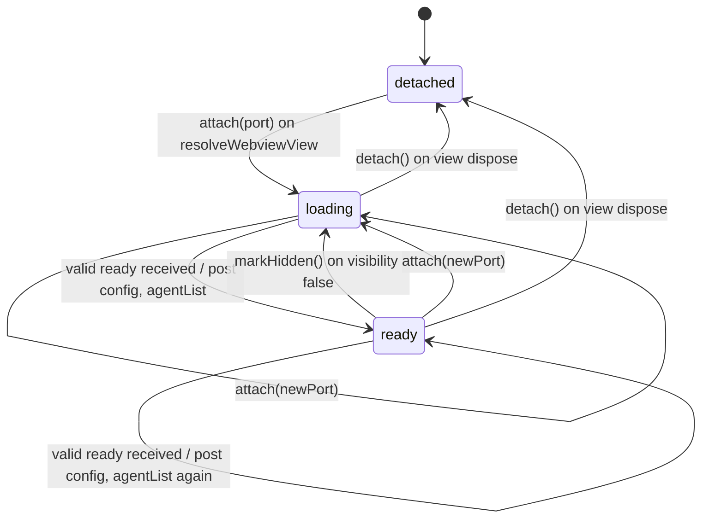
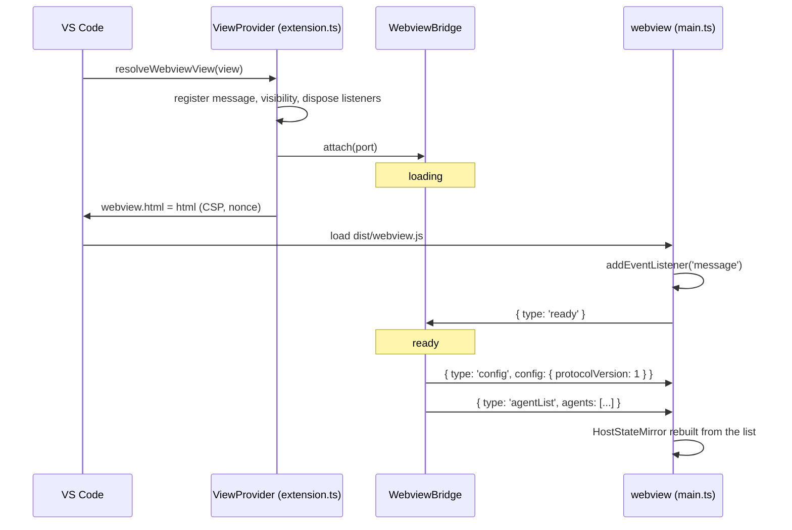
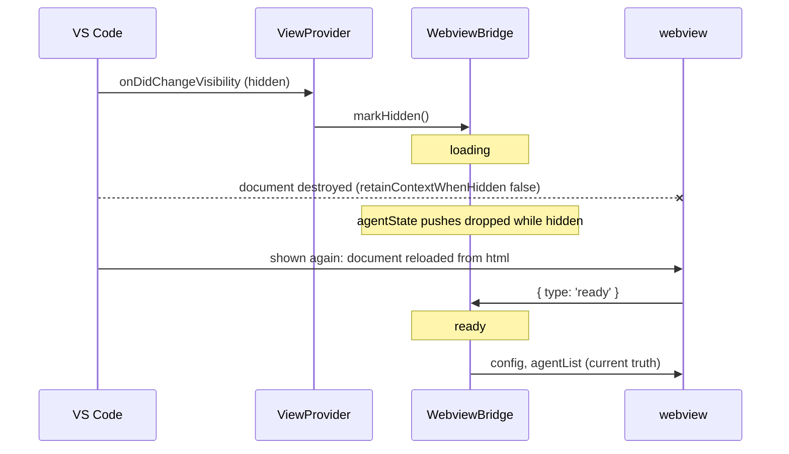
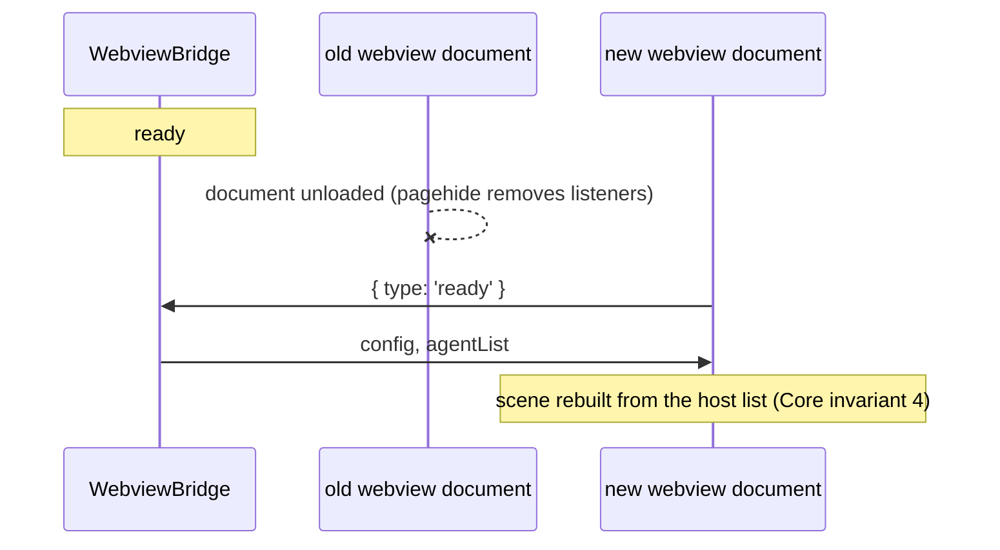
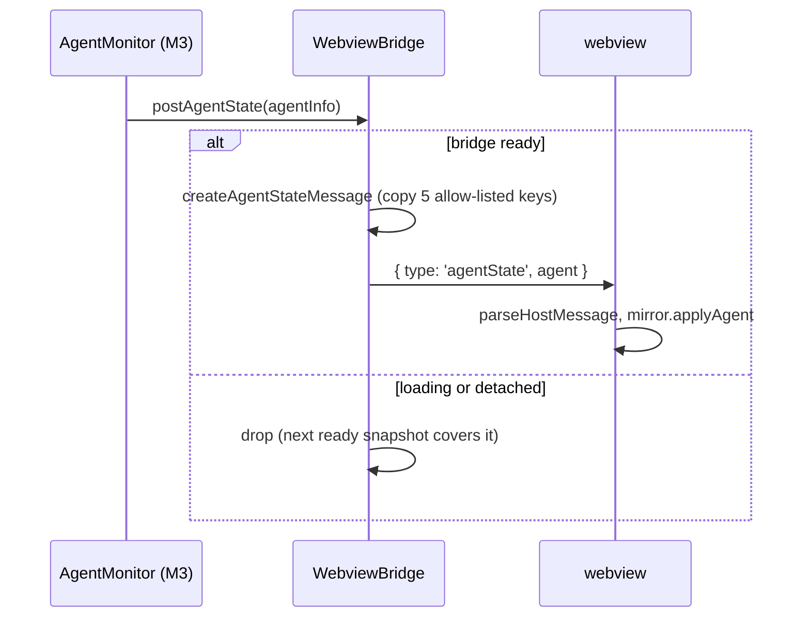
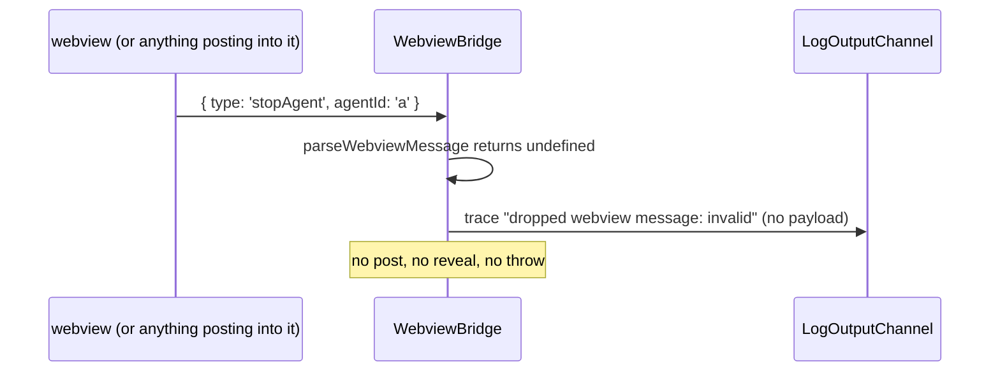

# Host-webview protocol

Purpose: the contract between the extension host and the webview: every message type, field rules, validation, the `ready` handshake, bridge states, ordering guarantees, and how to add a message safely. `src/shared/protocol.ts` implements this document; if they disagree, fix one of them in the same change.
Related: [architecture overview](overview.md), [security and safety](security-and-safety.md), [ADR 0007 allow-list protocol and pull handshake](adr/0007-allow-list-protocol-pull-handshake.md), [ADR 0001 bottom-panel webview](adr/0001-bottom-panel-webview.md), [ADR 0002 no hero health](adr/0002-no-hero-health.md), [ADR 0004 esbuild two bundles](adr/0004-esbuild-two-bundles.md), [M2 plan](plans/m2-protocol.md), [agent detection](agent-detection.md) (planned, M3), [CLAUDE.md](../../CLAUDE.md).

## 1. Principles

- **One-way state.** Agent state flows host to webview only. The webview never reports game state to the host (Core invariant 2).
- **Observe, never control.** The webview can send exactly two messages: `ready` and `focusAgent`. `focusAgent` only reveals a terminal (Core invariant 3).
- **Allow-listed agent data.** `AgentInfo` has exactly `id`, `name`, `state`, `toolName`, `timestamp` (Core invariant 7).
- **Pull, then push.** The webview asks with `ready`; the host answers with full snapshots; only then does it push single events. Every webview load is a cold start ([ADR 0001](adr/0001-bottom-panel-webview.md)).
- **Validate at every receiver.** Both sides parse incoming data with total functions that never throw and drop anything that is not exactly a known message.

## 2. Shared types

Defined in `src/shared/protocol.ts`, imported by both bundles ([ADR 0004](adr/0004-esbuild-two-bundles.md)).

| Type | Definition |
|---|---|
| `AgentState` | `'spawned' \| 'working' \| 'idle' \| 'despawned'` |
| `AgentInfo` | `{ id: string; name: string; state: AgentState; toolName: string \| null; timestamp: number }`, all `readonly` |
| `ConfigSnapshot` | `{ protocolVersion: 1 }` (M2). Later milestones add webview-relevant settings (M7 reduce motion and colorblind options, M8 sound). |
| `PROTOCOL_VERSION` | `1`. Bumped on any breaking change to a message shape. |

No message or type has an optional property. "Absent" is `null`.

## 3. Message catalog

### Host to webview (`HostToWebviewMessage`)

| `type` | Fields | When | Since |
|---|---|---|---|
| `config` | `config: ConfigSnapshot` | answer to every `ready` (first); from M7 also on a relevant setting change | M2 |
| `agentList` | `agents: readonly AgentInfo[]` (at most 64, unique ids) | answer to every `ready` (second). Replaces the webview's whole agent set. Empty until M3. | M2 |
| `agentState` | `agent: AgentInfo` | one agent changed state (`spawned`, `working`, `idle`, `despawned`), only while the bridge is `ready` | M2 (type), M3 (sent) |

### Webview to host (`WebviewToHostMessage`)

| `type` | Fields | Host action | Since |
|---|---|---|---|
| `ready` | none | mark the bridge `ready`; post `config`, then `agentList` | M2 |
| `focusAgent` | `agentId: string` | reveal the terminal of a live agent that the host itself lists; nothing else. Dropped in M2 (no reveal capability until M3). | M2 (type), M3 (reveal), M7 (sent by roster click) |

There is no message that stops, kills, restarts, writes to, or sends input to a session, and none may be added (Core invariant 3). E1 adds progress load and save messages; they touch only `globalState`, never a session.

## 4. Field and validation rules

Both `parseWebviewMessage` and `parseHostMessage` apply these rules. They return a newly built object or `undefined`; they never throw and never return the input object.

| Rule | Detail |
|---|---|
| Container | plain object: not `null`, not an array, prototype `Object.prototype` or `null` |
| Keys | exactly the expected own string keys; no extra keys, no symbol keys, no inherited fields. Checked with `Object.getOwnPropertyNames` (not `Object.keys`), so a non-enumerable extra key is rejected too; `type` is read only as an own property |
| `type` | one of the known strings for that direction, compared exactly (case-sensitive, no trimming) |
| `id`, `agentId` | string, 1..128 chars, `/^[A-Za-z0-9][A-Za-z0-9._:-]{0,127}$/` |
| `name` | string, 1..64 UTF-16 units, not blank after trim, no C0/C1 control characters, no bidi override or isolate characters (`U+202A..U+202E`, `U+2066..U+2069`). Enforced by a `charCodeAt` loop over the UTF-16 units, not a regex, after the length check |
| `state` | one of `AGENT_STATES` |
| `toolName` | `null`, or string 1..128 chars matching `/^[A-Za-z0-9_][A-Za-z0-9_.:-]{0,127}$/` (fits `Bash`, `Read`, `mcp__server__tool`; no spaces, so free text cannot ride in it) |
| `timestamp` | epoch milliseconds, `Number.isSafeInteger` and `>= 0` |
| `agents` | array, length <= 64, every entry a valid `AgentInfo`, ids unique |
| `config` | exactly `{ protocolVersion }` with value `=== PROTOCOL_VERSION` |
| Order of checks | `typeof` and length before any regex, so oversized strings are rejected in constant time |

Host-side creators (`toAgentInfo`, `createConfigMessage`, `createAgentListMessage`, `createAgentStateMessage`) are the only way the host builds outgoing messages. They copy only the allow-listed keys, so an object carrying extra fields (for example a monitor record that briefly held a transcript line) cannot leak them onto the wire. Their output always passes `parseHostMessage`.

## 5. Bridge states (host)

`WebviewBridge` (`src/host/webviewBridge.ts`) owns the host side. It imports nothing from `vscode` or Node built-ins (only `src/shared/**`, enforced by ESLint, [coding standards section 3](../engineering/coding-standards.md)); `extension.ts` adapts the real webview to it.



| State | `agentState` pushes | Incoming messages |
|---|---|---|
| `detached` | dropped | ignored |
| `loading` | dropped (the next snapshot covers them) | parsed and handled |
| `ready` | posted | parsed and handled |

## 6. Flows

### 6.1 First open (handshake)



Listeners are registered before `html` is set (host) and before `ready` is sent (webview), so neither the `ready` nor its answer can be missed.

**Partial answer when a dependency throws.** The bridge sets `ready`, then builds and posts `config`, then calls `getAgents()` and posts `agentList`, all inside one try/catch. If `getAgents()` throws, `config` has already been posted, `agentList` is not, and exactly one `logger.error` line is written (`webview bridge error: <name>: <message>`); nothing is rethrown. The bridge stays `ready`, so later `agentState` pushes are still posted. The webview keeps its pre-`agentList` state (config applied, agent set as it was, empty on a fresh load) until the next `ready` answer or `agentState` push updates it. If `getConfig()` throws, nothing is posted and one error is logged. No retry is attempted; the next `ready` (show, reload) is the recovery point.

`ready` is sent exactly once per webview document load and never skipped. Because it travels on the public `onDidReceiveMessage` event, it is also the host-observable proof that the webview script ran: the extension-host integration suite subscribes to the same event through its provider spy and counts one `ready` per load, with no production test hook ([M2 plan section 1.2](plans/m2-protocol.md#12-ready-is-the-observable-script-ran-signal)).

### 6.2 Hide and show



VS Code does not call `resolveWebviewView` again on re-show; it reloads the document from the same `html`. Each show therefore produces exactly one new `ready` on the same view.

### 6.3 Webview reload ("Developer: Reload Webviews" or a crash restart)



The bridge may still be `ready` from the old document; pushes in that window can be lost, and the snapshot that answers the new `ready` covers them.

### 6.4 Agent state push (from M3)



### 6.5 `focusAgent` (reveal only)

```mermaid
sequenceDiagram
  participant W as webview (M7 roster click)
  participant B as WebviewBridge
  participant R as revealAgentTerminal (M3, extension.ts)
  participant T as terminal
  W->>B: { type: 'focusAgent', agentId }
  B->>B: parseWebviewMessage
  alt reveal capability null (M2)
    B->>B: drop, trace "reveal unavailable"
  else agentId not a live agent in host list
    B->>B: drop, trace "unknown agent"
  else live agent
    B->>R: revealAgentTerminal(agentId)
    R->>T: terminal.show() only
  end
  Note over B,T: nothing is posted back; no input, signal, or dispose
```

### 6.6 Invalid or unknown message



The webview side mirrors this: `handleHostMessage` returns `false` for an invalid host message and the mirror is unchanged.

## 7. Ordering and delivery guarantees

- `config` is always posted before `agentList` in a `ready` answer, so settings (M7) apply before the scene is built.
- `agentList` replaces the webview's agent set completely; it is the recovery point for any lost push.
- `agentState` messages are posted in the order the monitor emits them. Delivery is best effort: a push may be dropped while hidden, while loading, or if `postMessage` fails. Correctness relies on the next snapshot, never on every push arriving.
- The webview tolerates an `agentState` for an unknown id (a missed `spawned`): it inserts the agent. `despawned` removes it. Only these messages change the webview's agent set.
- `HostStateMirror` keeps agents in insertion order: `agentList` order first, then new ids in arrival order. An `agentState` for an existing id updates it in place (`Map.set` keeps the original position), so a state change never reorders the roster. `agents()` returns a new array each call, so readers (the M4 `Game`) cannot mutate the mirror.

## 8. Error handling

- Host: `WebviewBridge.handleMessage` and `postAgentState` never throw. Errors from its dependencies are logged once per occurrence as `webview bridge error: <error.name>: <error.message>` (or `non-error thrown`) to the "Pixel Agents" output channel; payloads are never logged. The error logger and the `postMessage` rejection handler (`trace 'post failed: view gone'`) each wrap the logger call in their own try/catch and swallow a throwing logger, so nothing escapes as an exception or an unhandled rejection. See section 6.1 for the partial `ready` answer when `getAgents()` throws.
- Webview: the `message` listener body is wrapped in try/catch and reports through the single crash reporter `reportError` in `main.ts`, which prints `Pixel Agents webview error: <message>` with `console.error`, at most once per distinct message per page load. `<message>` is `error.message` for any genuine Error, including one from another realm (another frame, or a `node:vm` test context): an `isError` check accepts `instanceof Error`, or an object whose built-in tag is `[object Error]` and whose `message` is a string. Any other thrown value prints the fixed string `non-error thrown`, never the value itself. `event.data` is never logged.
- `assertNever` throws a `TypeError` that never includes the offending value.

## 9. Versioning

Both bundles ship in the same `.vsix`, so a version mismatch can only happen during development (`npm run watch` rebuilt one bundle while an old webview is open). The `config` validator requires `protocolVersion === PROTOCOL_VERSION`; on mismatch the webview drops it, and reloading the webview fixes it. Bump `PROTOCOL_VERSION` on any breaking shape change.

## 10. Adding or changing a message

1. Get an architect plan. A new webview-to-host message is checked against Core invariant 3 and must not reach a session or a terminal beyond `show()`.
2. Add the interface, add it to the union, add its `type` to `HOST_TO_WEBVIEW_TYPES` or `WEBVIEW_TO_HOST_TYPES` (the compile-time proofs fail otherwise), add parser rules and, for host messages, a creator.
3. Handle it in the receiving `switch` (the `assertNever` default fails typecheck otherwise).
4. Update this document (catalog, rules, a flow diagram) and [security and safety](security-and-safety.md) if it crosses a trust boundary differently.
5. The tester extends the validator cases, fuzz mutations, and the "no controlling message types" check.
