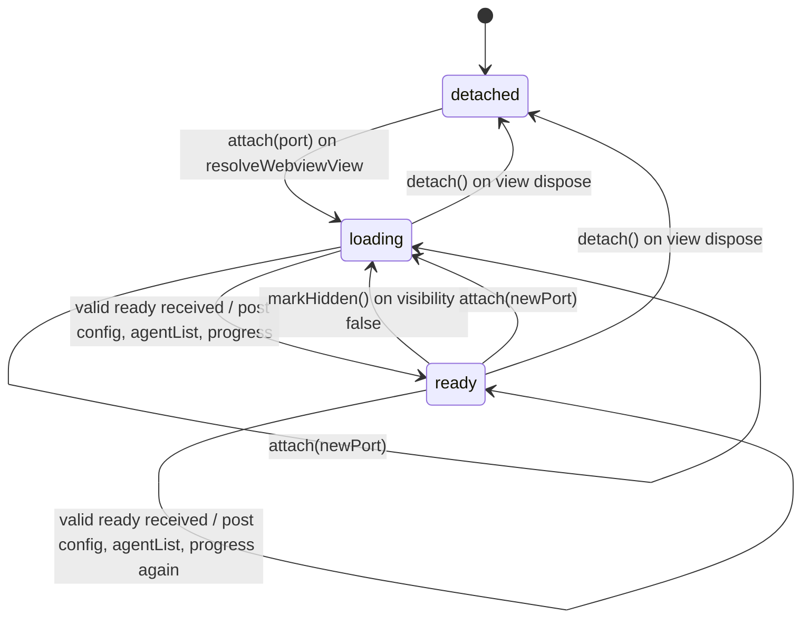
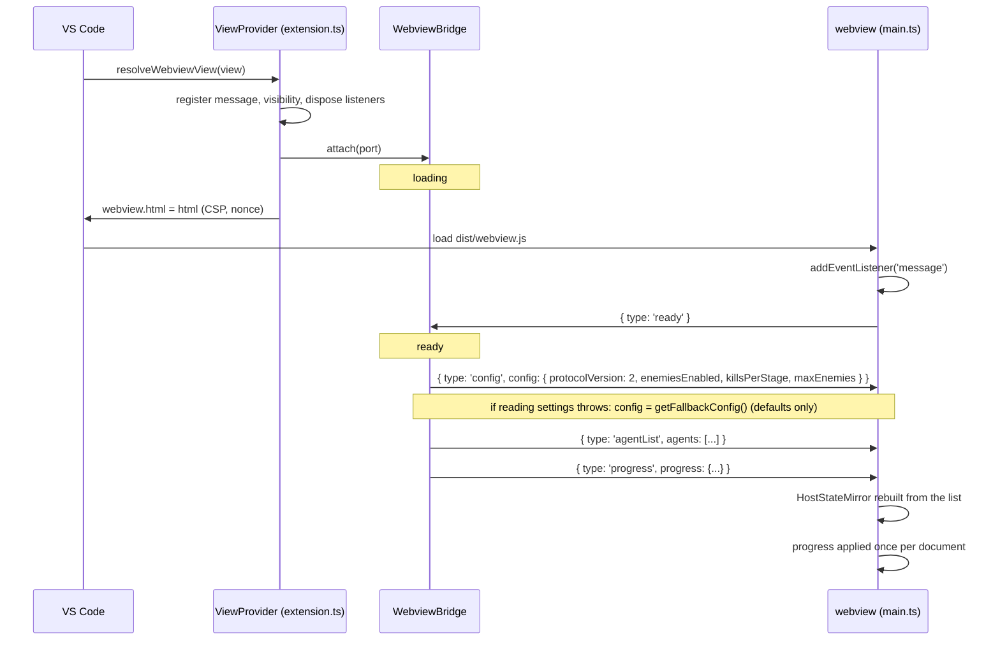
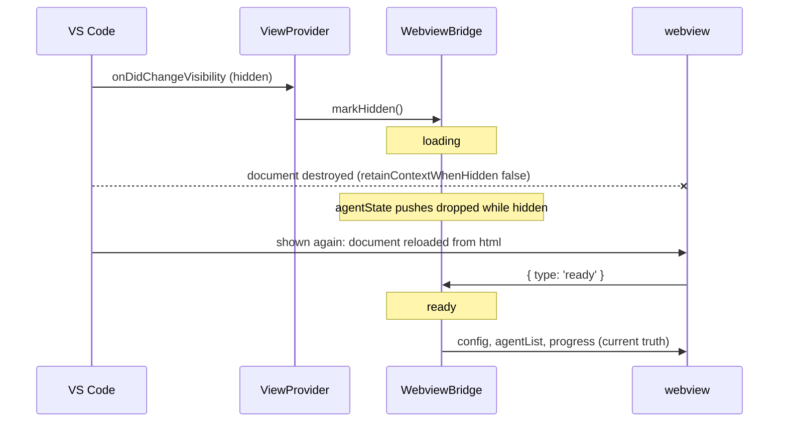
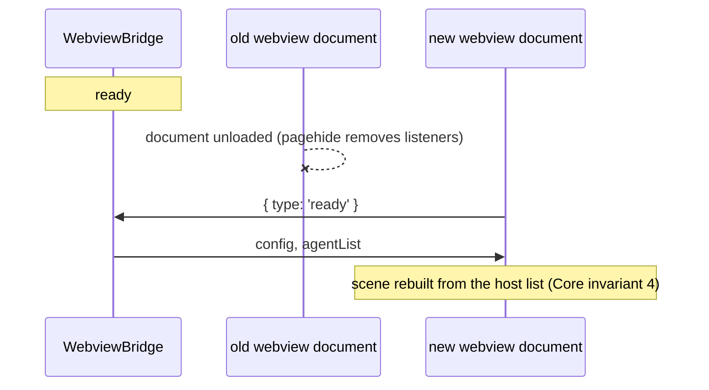
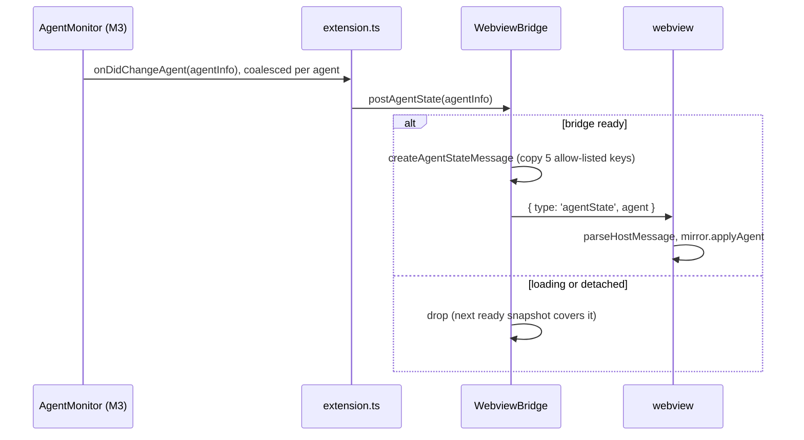
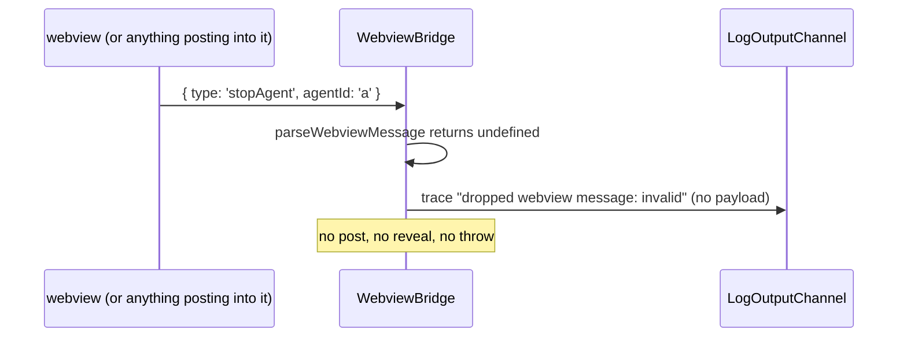

# Host-webview protocol

Purpose: the contract between the extension host and the webview: every message type, field rules, validation, the `ready` handshake, bridge states, ordering guarantees, and how to add a message safely. `src/shared/protocol.ts` implements this document; if they disagree, fix one of them in the same change.
Related: [architecture overview](overview.md), [security and safety](security-and-safety.md), [ADR 0007 allow-list protocol and pull handshake](adr/0007-allow-list-protocol-pull-handshake.md), [ADR 0001 bottom-panel webview](adr/0001-bottom-panel-webview.md), [ADR 0002 no hero health](adr/0002-no-hero-health.md), [ADR 0004 esbuild two bundles](adr/0004-esbuild-two-bundles.md), [M2 plan](plans/m2-protocol.md), [M3 plan](plans/m3-monitor.md), [E1 plan](plans/e1-enemies.md) and [ADR 0012](adr/0012-host-owned-versioned-progress.md) (the progress messages, built in E1; drift in [E1 plan section 13.5](plans/e1-enemies.md#13-as-built-drift-checked-against-the-e1-working-tree)), [agent detection](agent-detection.md), [CLAUDE.md](../../CLAUDE.md).

## 1. Principles

- **One-way state.** Agent state flows host to webview only. The webview never reports agent or hero state to the host (Core invariant 2). From E1 it reports one more thing, its own stage-progress counters (`saveProgress`), which hold no agent data.
- **Observe, never control.** The webview can send exactly three messages (since E1; two before it): `ready`, `focusAgent`, and `saveProgress`. `focusAgent` only reveals a terminal; `saveProgress` only reaches the extension's own `globalState` (Core invariant 3, [ADR 0012](adr/0012-host-owned-versioned-progress.md)).
- **Allow-listed agent data.** `AgentInfo` has exactly `id`, `name`, `state`, `toolName`, `timestamp` (Core invariant 7).
- **Pull, then push.** The webview asks with `ready`; the host answers with full snapshots; only then does it push single events. Every webview load is a cold start ([ADR 0001](adr/0001-bottom-panel-webview.md)).
- **Validate at every receiver.** Both sides parse incoming data with total functions that never throw and drop anything that is not exactly a known message.

## 2. Shared types

Defined in `src/shared/protocol.ts`, imported by both bundles ([ADR 0004](adr/0004-esbuild-two-bundles.md)).

| Type | Definition |
|---|---|
| `AgentState` | `'spawned' \| 'working' \| 'idle' \| 'despawned'` |
| `AgentInfo` | `{ id: string; name: string; state: AgentState; toolName: string \| null; timestamp: number }`, all `readonly` |
| `ConfigSnapshot` | `{ protocolVersion: 2, enemiesEnabled: boolean, killsPerStage: number, maxEnemies: number }` (E1; M2 had `{ protocolVersion: 1 }`). The ranges are the exported constants `MIN_KILLS_PER_STAGE` 5, `MAX_KILLS_PER_STAGE` 500, `MIN_MAX_ENEMIES` 1, and `MAX_MAX_ENEMIES` 12. Later milestones add webview-relevant settings (M7 reduce motion and colorblind options, M8 sound). |
| `Progress` | `{ schemaVersion: 1, stageIndex, killsInStage, totalKills, bossesDefeated, cycle }`, all `readonly` integers, defined in `src/shared/progress.ts` (E1). No string field. See [data model section 7](data-model.md#7-persisted-progress-e1). |
| `PROTOCOL_VERSION` | `2` (E1: the catalog and `ConfigSnapshot` changed; M2 to H3 used `1`). Bumped on any breaking change to a message shape. |

No message or type has an optional property. "Absent" is `null`.

**Id convention (M3, not a shape rule).** Real agent ids are Claude Code session UUIDs (lower case). Ids starting with `sim-` are simulated agents from the monitor's simulator, whose names start with `Sim` and a space ([agent detection section 3.3](agent-detection.md#33-simulator-source)); UI may label them, and `focusAgent` for them reveals nothing.

## 3. Message catalog

### Host to webview (`HostToWebviewMessage`)

| `type` | Fields | When | Since |
|---|---|---|---|
| `config` | `config: ConfigSnapshot` | answer to every `ready` (first); E1: also re-posted by `WebviewBridge.postConfig()` when a `pixelAgents.*` setting changes (ready state only) | M2 |
| `agentList` | `agents: readonly AgentInfo[]` (at most 64, unique ids) | answer to every `ready` (second). Replaces the webview's whole agent set. Empty in M2; from M3 the monitor's live agents (`AgentMonitor.getAgents()`, never `despawned` ones). | M2 |
| `agentState` | `agent: AgentInfo` | one agent changed state (`spawned`, `working`, `idle`, `despawned`), only while the bridge is `ready` | M2 (type), M3 (sent) |
| `progress` | `progress: Progress` | answer to every `ready` (third, after `config` and `agentList`): the host's stored progress after migration validation, or the default. Applied once per webview document (also when it arrives after the engine's 1.5 s boot gate; see section 7). | E1 |

### Webview to host (`WebviewToHostMessage`)

| `type` | Fields | Host action | Since |
|---|---|---|---|
| `ready` | none | mark the bridge `ready`; post `config`, then `agentList` (from E1 then `progress`) | M2 |
| `focusAgent` | `agentId: string` | reveal the terminal of a live agent that the host itself lists; nothing else. Dropped in M2 (no reveal capability until M3). | M2 (type), M3 (reveal), M7 (sent by roster click) |
| `saveProgress` | `progress: Progress` | validate with `isProgress`; hand to `ProgressStore.save`, which ignores it in read-only mode or when `totalKills` is lower than the stored value, and otherwise coalesces a `globalState` write. Nothing is posted back. The webview sends it only after it has applied a `progress` message in the same document, and builds it with `createSaveProgressMessage`. | E1 |

There is no message that stops, kills, restarts, writes to, or sends input to a session, and none may be added (Core invariant 3). E1's `progress` and `saveProgress` touch only `globalState`, never a session, a terminal, or a command, and carry no agent data.

## 4. Field and validation rules

Both `parseWebviewMessage` and `parseHostMessage` apply these rules. They return a newly built object or `undefined`; they never throw and never return the input object.

| Rule | Detail |
|---|---|
| Container | plain object: not `null`, not an array, prototype `Object.prototype` or `null` |
| Keys | exactly the expected own string keys; no extra keys, no symbol keys, no inherited fields. Checked with `Object.getOwnPropertyNames` (not `Object.keys`), so a non-enumerable extra key is rejected too; `type` is read only as an own property |
| `type` | one of the known strings for that direction, compared exactly (case-sensitive, no trimming) |
| `id`, `agentId` | string, 1..128 chars, `/^[A-Za-z0-9][A-Za-z0-9._:-]{0,127}$/` |
| `name` | string, 1..64 UTF-16 units, not blank after trim, no C0/C1 control characters, no bidi override or isolate characters (`U+202A..U+202E`, `U+2066..U+2069`). Enforced by a `charCodeAt` loop over the UTF-16 units, not a regex, after the length check |
| `state` | one of `AGENT_STATES` |
| `toolName` | `null`, or string 1..128 chars matching `/^[A-Za-z0-9_][A-Za-z0-9_.:-]{0,127}$/` (fits `Bash`, `Read`, `mcp__server__tool`; no spaces, so free text cannot ride in it) |
| `timestamp` | epoch milliseconds, `Number.isSafeInteger` and `>= 0` |
| `agents` | array, length <= 64, every entry a valid `AgentInfo`, ids unique |
| `config` | exactly `{ protocolVersion, enemiesEnabled, killsPerStage, maxEnemies }`: `protocolVersion === PROTOCOL_VERSION`, `enemiesEnabled` boolean, `killsPerStage` integer `MIN_KILLS_PER_STAGE`..`MAX_KILLS_PER_STAGE` (5..500), `maxEnemies` integer `MIN_MAX_ENEMIES`..`MAX_MAX_ENEMIES` (1..12) |
| `progress`, and `progress` inside `saveProgress` (E1) | exactly `{ schemaVersion, stageIndex, killsInStage, totalKills, bossesDefeated, cycle }`: `schemaVersion === 1`, `stageIndex` integer 1..10, the other four safe integers 0..1,000,000,000; nothing else, no inherited or symbol keys |
| Order of checks | `typeof` and length before any regex, so oversized strings are rejected in constant time |

Host-side creators (`toAgentInfo`, `createConfigMessage`, `createAgentListMessage`, `createAgentStateMessage`, and from E1 `createProgressMessage`) are the only way the host builds outgoing messages. The webview-side creator `createSaveProgressMessage` (E1) is the only way the webview builds a `saveProgress`: both progress creators copy the six `Progress` keys through `toProgress` and return `undefined` for an invalid value. They copy only the allow-listed keys, so an object carrying extra fields (for example a monitor record that briefly held a transcript line) cannot leak them onto the wire. Their output always passes `parseHostMessage`.

## 5. Bridge states (host)

`WebviewBridge` (`src/host/webviewBridge.ts`) owns the host side. It imports nothing from `vscode` or Node built-ins (only `src/shared/**`, enforced by ESLint, [coding standards section 3](../engineering/coding-standards.md)); `extension.ts` adapts the real webview to it.



| State | `agentState` pushes | Incoming messages |
|---|---|---|
| `detached` | dropped | ignored |
| `loading` | dropped (the next snapshot covers them) | parsed and handled |
| `ready` | posted | parsed and handled |

## 6. Flows

### 6.1 First open (handshake)



**Ready answer order (as built, E1).** The bridge answers `ready` with `config`, then `agentList`, then `progress`. If reading settings fails (`getConfig()` throws), the host posts a defaults-only `config` built by `getFallbackConfig` and still posts `agentList` and `progress`, so a settings fault never blanks the scene (Core invariant 4). If no fallback is wired, the error is logged and the ready answer stops after that point.

Listeners are registered before `html` is set (host) and before `ready` is sent (webview), so neither the `ready` nor its answer can be missed.

**Partial answer when a dependency throws.** The bridge sets `ready`, then runs the three answers in order. `config` has its own try/catch (`getFallbackConfig`, above), and the fallback post is itself guarded, so a failing fallback is logged (name only) and never suppresses `agentList` or `progress`. `progress` has its own try/catch, so a failing store logs one error and leaves `config` and `agentList` posted (the webview plays on defaults and never saves). `agentList` is covered only by the outer `handleMessage` try/catch: if `getAgents()` throws, `config` has already been posted, `agentList` and `progress` are not, and exactly one `logger.error` line is written (`webview bridge error: <error.name>`); nothing is rethrown. The bridge stays `ready`, so later `agentState` pushes are still posted. The webview keeps its pre-`agentList` state (config applied, agent set as it was, empty on a fresh load) until the next `ready` answer or `agentState` push updates it. No retry is attempted; the next `ready` (show, reload) is the recovery point.

`ready` is sent exactly once per webview document load and never skipped. Because it travels on the public `onDidReceiveMessage` event, it is also the host-observable proof that the webview script ran: the extension-host integration suite subscribes to the same event through its provider spy and counts one `ready` per load, with no production test hook ([M2 plan section 1.2](plans/m2-protocol.md#12-ready-is-the-observable-script-ran-signal)).

### 6.2 Hide and show



VS Code does not call `resolveWebviewView` again on re-show; it reloads the document from the same `html`. Each show therefore produces exactly one new `ready` on the same view.

### 6.3 Webview reload ("Developer: Reload Webviews" or a crash restart)



The bridge may still be `ready` from the old document; pushes in that window can be lost, and the snapshot that answers the new `ready` covers them.

### 6.4 Agent state push (from M3)



### 6.5 `focusAgent` (reveal only)

```mermaid
sequenceDiagram
  participant W as webview (M7 roster click)
  participant B as WebviewBridge
  participant R as AgentMonitor.revealAgentTerminal (M3)
  participant T as terminal
  W->>B: { type: 'focusAgent', agentId }
  B->>B: parseWebviewMessage
  alt reveal capability null (M2, or monitor failed to start)
    B->>B: drop, trace "reveal unavailable"
  else agentId not a live agent in host list
    B->>B: drop, trace "unknown agent"
  else live agent
    B->>R: revealAgentTerminal(agentId)
    alt agent linked to an open terminal
      R->>T: terminal.show() only
    else simulated, startup, or closed terminal
      R->>R: trace "reveal skipped (no terminal)"
    end
  end
  Note over B,T: nothing is posted back; no input, signal, or dispose
```

### 6.6 Invalid or unknown message



The webview side mirrors this: `handleHostMessage` returns `false` for an invalid host message and the mirror is unchanged.

### 6.7 Progress load (E1)

```mermaid
sequenceDiagram
  participant W as webview (main.ts)
  participant B as WebviewBridge
  participant S as ProgressStore (host)
  participant G as globalState
  W->>B: { type: 'ready' }
  B->>W: config, agentList
  B->>S: load() (first call reads globalState; later calls return the latest accepted value)
  S->>G: get('pixelAgents.progress')
  alt absent
    S-->>B: default progress (nothing written)
  else valid v1 or migratable older version
    S-->>B: migrated progress (not rewritten until the next save)
  else invalid
    S-->>B: default progress (one fixed log line)
  else newer schemaVersion (downgrade)
    S-->>B: default progress, store goes read-only (one fixed log line, stored value untouched)
  end
  B->>W: { type: 'progress', progress }
  W->>W: Game.applyProgress (once), ProgressSaver.markLoaded()
```

If `getAgents()` throws (section 6.1), `config` is posted and neither `agentList` nor `progress` follows, because `progress` is the last step of the same `ready` handler. If `getProgress()` throws, `config` and `agentList` are already posted, no `progress` is sent, and one error line is logged. The webview then runs on defaults after its 1.5 s gate and **never saves** in that document (fail closed). A `progress` message that arrives *after* the gate timed out is still applied, once: the engine restores the stored stage (clearing the current wave) and the saver opens; kills earned on defaults in the meantime are discarded, never saved.

### 6.8 Progress save (E1)

```mermaid
sequenceDiagram
  participant G as Game (webview)
  participant P as ProgressSaver
  participant B as WebviewBridge
  participant S as ProgressStore
  participant X as globalState
  G->>P: onProgress(progress, urgent) on a kill or a boss defeat
  alt not loaded yet
    P->>P: drop
  else urgent (boss defeated)
    P->>B: { type: 'saveProgress', progress }
  else kill
    P->>P: keep latest; send at most once per 15 s (trailing)
  end
  B->>B: parseWebviewMessage (exact keys, ranges)
  alt invalid
    B->>B: drop, trace "dropped webview message: invalid" (no payload)
  else valid
    B->>S: save(progress)
    alt read-only (newer stored version) or totalKills below stored
      S->>S: drop (trace only)
    else
      S->>S: keep latest; write at most once per 2 s
      S->>X: update('pixelAgents.progress', progress)
    end
  end
  Note over B,X: nothing is posted back; no session, terminal, or command is reachable
```

## 7. Ordering and delivery guarantees

- `config` is always posted before `agentList` in a `ready` answer, so settings (M7) apply before the scene is built. From E1 `progress` follows `agentList`; the engine hides the scene (boot clear color) until it arrives or 1.5 s of game time pass, so a stage never flashes in the wrong order. From E1 a `config` is also re-posted when a `pixelAgents.*` setting changes (ready state only). The `progress` answer has its own try/catch (`#postProgress`), so a failing store still leaves `config` and `agentList` posted.
- `agentList` replaces the webview's agent set completely; it is the recovery point for any lost push.
- `agentState` messages are posted in the order the monitor emits them. Delivery is best effort: a push may be dropped while hidden, while loading, or if `postMessage` fails. Correctness relies on the next snapshot, never on every push arriving.
- The webview tolerates an `agentState` for an unknown id (a missed `spawned`): it inserts the agent. `despawned` removes it. Only these messages change the webview's agent set.
- `HostStateMirror` keeps agents in insertion order: `agentList` order first, then new ids in arrival order. An `agentState` for an existing id updates it in place (`Map.set` keeps the original position), so a state change never reorders the roster. `agents()` returns a new array each call, so readers (the M4 `Game`) cannot mutate the mirror.

## 8. Error handling

- Host: `WebviewBridge.handleMessage` and `postAgentState` never throw. Errors from its dependencies are logged once per occurrence as `webview bridge error: <error.name>` (or `non-error thrown`); the error message is never logged, since dependency messages can carry file paths to the "Pixel Agents" output channel; payloads are never logged. The error logger and the `postMessage` rejection handler (`trace 'post failed: view gone'`) each wrap the logger call in their own try/catch and swallow a throwing logger, so nothing escapes as an exception or an unhandled rejection. See section 6.1 for the partial `ready` answer when `getAgents()` throws.
- Webview: the `message` listener body is wrapped in try/catch and reports through the single crash reporter `reportError` in `main.ts`, which prints `Pixel Agents webview error: <message>` with `console.error`, at most once per distinct message per page load. `<message>` is `error.message` for any genuine Error, including one from another realm (another frame, or a `node:vm` test context): an `isError` check accepts `instanceof Error`, or an object whose built-in tag is `[object Error]` and whose `message` is a string. Any other thrown value prints the fixed string `non-error thrown`, never the value itself. `event.data` is never logged.
- `assertNever` throws a `TypeError` that never includes the offending value.

## 9. Versioning

E1 bumped `PROTOCOL_VERSION` to 2 (new messages and `ConfigSnapshot` fields). The version in `config` is the wire version; the **stored** data has its own `schemaVersion` ([ADR 0012](adr/0012-host-owned-versioned-progress.md)) and is migrated by the host, never by the webview.

Both bundles ship in the same `.vsix`, so a version mismatch can only happen during development (`npm run watch` rebuilt one bundle while an old webview is open). The `config` validator requires `protocolVersion === PROTOCOL_VERSION`; on mismatch the webview drops it, and reloading the webview fixes it. Bump `PROTOCOL_VERSION` on any breaking shape change.

## 10. Adding or changing a message

1. Get an architect plan. A new webview-to-host message is checked against Core invariant 3 and must not reach a session or a terminal beyond `show()`.
2. Add the interface, add it to the union, add its `type` to `HOST_TO_WEBVIEW_TYPES` or `WEBVIEW_TO_HOST_TYPES` (the compile-time proofs fail otherwise), add parser rules and, for host messages, a creator.
3. Handle it in the receiving `switch` (the `assertNever` default fails typecheck otherwise).
4. Update this document (catalog, rules, a flow diagram) and [security and safety](security-and-safety.md) if it crosses a trust boundary differently.
5. The tester extends the validator cases, fuzz mutations, and the "no controlling message types" check.
