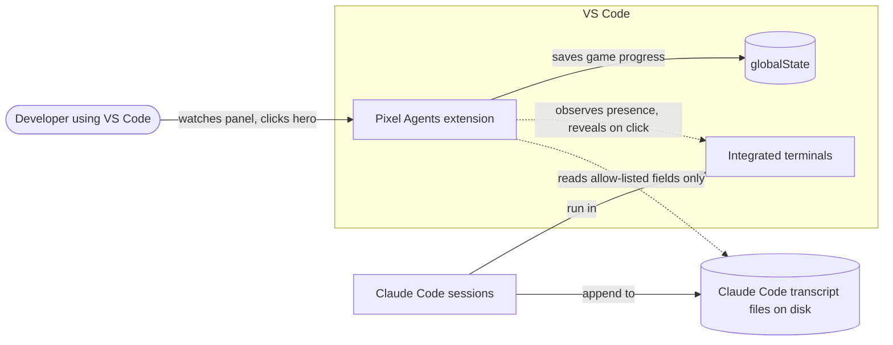
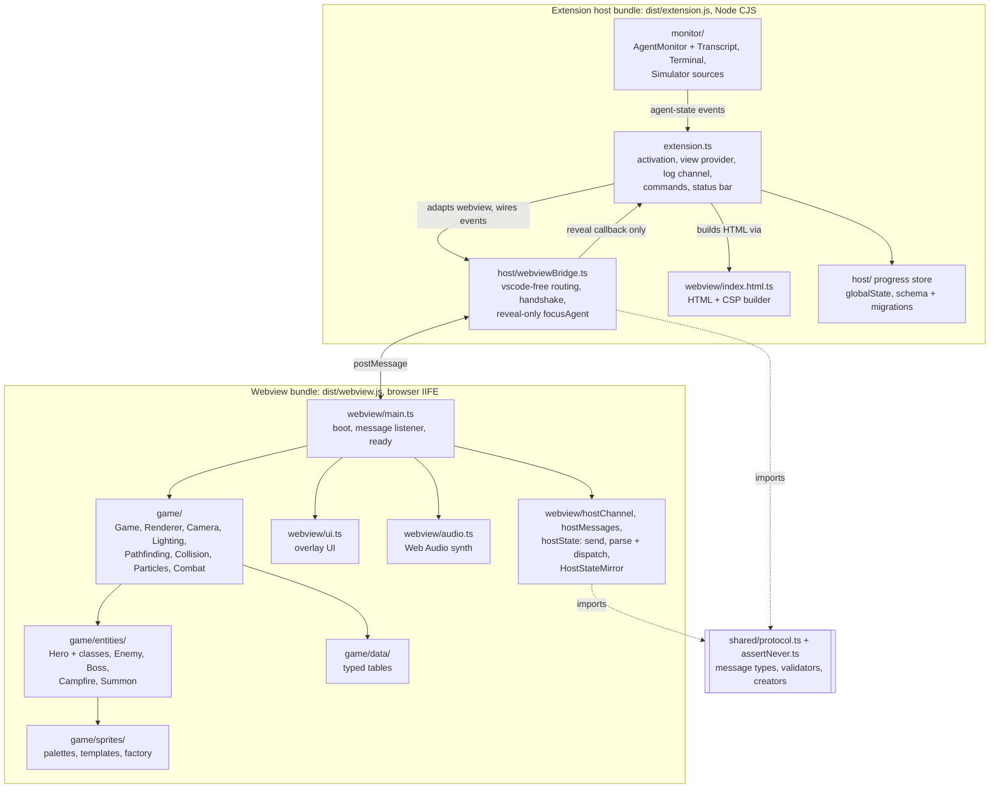

# Architecture overview

Purpose: the big picture of Pixel Agents: what it talks to, what runs where, how data flows, and which boundaries keep agents safe from the game. Start here before reading any other architecture doc.
Related: [CLAUDE.md](../../CLAUDE.md), [docs index](../index.md), [glossary](../glossary.md), [roadmap](../engineering/roadmap.md), [coding standards](../engineering/coding-standards.md), ADRs [0001](adr/0001-bottom-panel-webview.md), [0002](adr/0002-no-hero-health.md), [0003](adr/0003-procedural-sprites.md), [0004](adr/0004-esbuild-two-bundles.md), [0006](adr/0006-node-test-runner.md), [0007](adr/0007-allow-list-protocol-pull-handshake.md); plans: [M1 scaffold](plans/m1-scaffold.md), [M2 protocol](plans/m2-protocol.md); [host-webview protocol](host-webview-protocol.md), [security and safety](security-and-safety.md); planned: [agent detection](agent-detection.md) (M3), [game engine](game-engine.md) (M4), [data model](data-model.md) (M4).

## 1. What it is

A VS Code extension that adds a bottom-panel webview view, "Pixel Agents". Every active Claude Code session appears as a pixel-art hero. While the agent works, the hero fights through dungeon stages; while it is idle, the hero rests at a campfire; when the session ends, the hero warps out. The extension only **observes** agents. It never controls them.

## 2. System context

Dotted arrows are read-only observation. The extension never writes to transcripts, never sends input to a terminal, and never signals a process (Core invariant 3). The only terminal action is `focusAgent`, which reveals (shows) a terminal.

## 3. Containers

| Container | Runs in | Responsibility | Arrives in |
|---|---|---|---|
| `src/extension.ts` | host | activate, register the view provider, own disposables; create the "Pixel Agents" log channel, adapt the webview to the bridge and register view listeners (M2); wire the monitor and reveal (M3), status bar, commands (M7) | M1, grows in M2, M3, M7 |
| `src/host/` | host | vscode-free host logic: `WebviewBridge` (bridge states, `ready` handshake, validated dispatch, reveal-only `focusAgent`); progress store (E1). Imports only `src/shared/` | M2, E1 |
| `src/webview/index.html.ts` | host | pure function: build the webview HTML and CSP from a nonce and the script URI | M1 |
| `src/shared/protocol.ts`, `assertNever.ts` | both | message unions, `AgentState`, `AgentInfo`, limits, exact-key validators, allow-list creators, exhaustiveness guard; no imports from outside `src/shared/` | M2 |
| `src/monitor/` | host | read-only agent detection; emits `spawned`, `working`, `idle`, `despawned` | M3 |
| `src/webview/main.ts` | webview | boot the canvas; register the `message` listener, then send `ready`; hand host messages to the mirror (M2) and the game (M4) | M1 (blank canvas), M2, M4 |
| `src/webview/hostChannel.ts`, `hostMessages.ts`, `hostState.ts` | webview | DOM-free: typed `send` over `acquireVsCodeApi`, parse and dispatch host messages, `HostStateMirror` (the agent list the M4 `Game` reads) | M2 |
| `src/game/**` | webview | the dungeon simulation and renderer | M4 onward |
| `src/webview/ui.ts`, `audio.ts` | webview | overlay UI; synthesized sound | M7, M8 |

## 4. Data flow

1. A source in the monitor observes a session change (transcript append, terminal open or close, or a simulator tick).
2. `AgentMonitor` debounces and normalizes it into an agent-state event holding only id, name, state, tool name, and timestamp (Core invariant 7).
3. `extension.ts` hands the event to `WebviewBridge.postAgentState`, which posts it (rebuilt by the allow-list creator) only if the bridge is `ready`. If the view is hidden or still loading, nothing is sent; the snapshot on the next `ready` covers it ([host-webview protocol](host-webview-protocol.md#5-bridge-states-host)).
4. `main.ts` passes the message to `handleHostMessage`, which validates it and updates `HostStateMirror`; from M4 `Game` updates the matching hero from the mirror. Only these events change hero state (Core invariant 2, [ADR 0002](adr/0002-no-hero-health.md)).
5. The webview may send `ready` (on every document load, requesting a snapshot) and `focusAgent` (reveal a terminal). The bridge validates both and drops anything else ([ADR 0007](adr/0007-allow-list-protocol-pull-handshake.md)).

## 5. Boundaries that protect agents

- **Read-only monitor.** No code path writes to, signals, kills, or sends input to a process or terminal. Enforced by review and grep tests: over `src/host/**` and `extension.ts` from M2, extended to `src/monitor/**` in M3.
- **One-way state.** Hero state flows host to webview only. Nothing the game does can reach the monitor or a session; the webview can send only `ready` and `focusAgent`, and the bridge's only outward capability is a reveal callback.
- **Crash isolation.** The host bridge never throws across `onDidReceiveMessage`, and the webview `message` listener is wrapped in try/catch (M2); the webview update loop is wrapped in try/catch (from M4). A webview crash or reload cannot affect the host; on reload the scene is rebuilt from the host's agent list (Core invariant 4).
- **Bundle boundary.** Host and webview never import each other's runtime code; they share only `src/shared/` ([ADR 0004](adr/0004-esbuild-two-bundles.md)). `src/host/` is host-only and vscode-free ([coding standards section 3](../engineering/coding-standards.md#3-bundle-boundaries)).

## 6. Security boundary

- Webview CSP (built in `index.html.ts`, from M1):
  `default-src 'none'; script-src 'nonce-<N>'; style-src 'nonce-<N>'; base-uri 'none'; form-action 'none';`
  No `unsafe-inline`, no `unsafe-eval`, no `img-src`, `font-src`, `media-src`, or `connect-src`. `base-uri` and `form-action` are explicit because they do not fall back to `default-src`. The nonce alone authorizes the single bundle script loaded from `asWebviewUri`, so the webview's `cspSource` is not needed. The nonce is 16 or more random bytes from the host, base64-encoded, regenerated per HTML load. Styles set through the CSSOM from script (for example `canvas.style.width`) are not blocked by this policy; inline `style="..."` attributes in the HTML are not used.
- `localResourceRoots` is only the extension's `dist/` folder. All resources load through `asWebviewUri`. Webview options also disable command URIs and forms.
- No external images, fonts, or audio exist ([ADR 0003](adr/0003-procedural-sprites.md)), so the CSP needs no extra sources.
- Full threat model in [security and safety](security-and-safety.md).

## 7. Current state

### 7.1 M1 (committed)

After M1 the host bundle registers the view and serves the HTML; the webview bundle draws a blank, integer-scaled canvas. There is no protocol, monitor, or game yet, and no message channel in either direction: the webview does not call `acquireVsCodeApi` and the host registers no message handler. Tests run on Node's built-in `node:test` ([ADR 0006](adr/0006-node-test-runner.md)); integration tests run the extension in a downloaded VS Code via the dev-only `@vscode/test-electron` launcher with `--disable-extensions` ([ADR 0006 amendment](adr/0006-node-test-runner.md#amendment-m1-review-extension-host-integration-tests)). In development builds the webview bundle carries an inline sourcemap so DevTools never fetches a `.map` under the CSP ([ADR 0004 implementation notes](adr/0004-esbuild-two-bundles.md#implementation-notes-m1)). The task-level plan is [M1 scaffold](plans/m1-scaffold.md).

### 7.2 M2 (in progress)

M2 opens the message channel; nothing new is drawn. The host gains the "Pixel Agents" log channel and `src/host/webviewBridge.ts`, which `extension.ts` attaches to each resolved view before setting `html`. On every document load (first open, every re-show, every webview reload) `main.ts` registers its `message` listener and sends `ready`; the bridge answers with `config` (`protocolVersion: 1`) and an empty `agentList`, which the webview stores in `HostStateMirror`. `focusAgent` is accepted by the protocol but dropped by the bridge, because no reveal capability exists until M3. Because `ready` is a protocol message on the public `onDidReceiveMessage` event, the integration suite can confirm that the webview script really ran after each show without any production test hook. CSP, bundles, and sourcemaps are unchanged. The task-level plan is [M2 protocol](plans/m2-protocol.md); the contract is [host-webview protocol](host-webview-protocol.md).

Rows in the container table above show when each container arrives.
