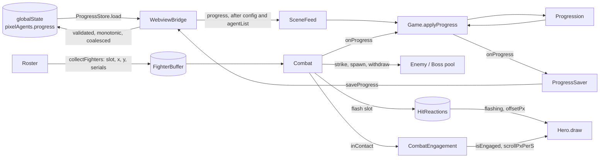
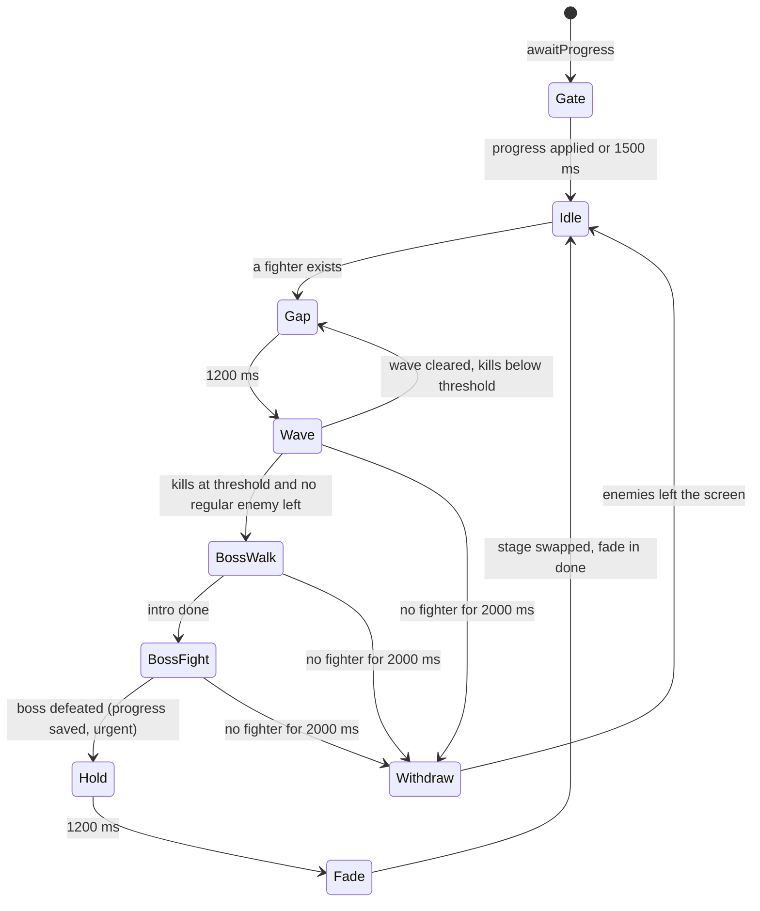
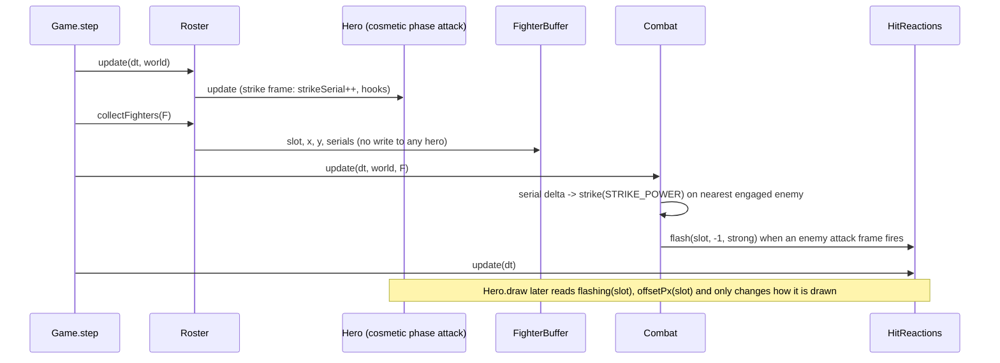

# E1 plan: Stage 1 The Forgotten Cellar, Stage 2 Goblin Mine Shafts (enemies, bosses, combat, drops, persisted progress)

Purpose: the detailed, task-by-task plan for batch E1: the first enemies (ten, five per stage), the first bosses, `Combat`, enemy health bars, drops, stage progression by cumulative work with a second playable stage, the compact enemy table with scaling formulas and its startup validator, and the first persisted data (`globalState` schema version 1, a migration runner, and two protocol messages). Written by the architect; the pixel-artist, developer, and tester work from it. Follows the layout of the [H3 plan](h3-classes.md), the [H2 plan](h2-classes.md), and the [M4 plan](m4-engine.md).
Related: [roadmap E1](../../engineering/roadmap.md#e1-stage-1-the-forgotten-cellar-stage-2-goblin-mine-shafts), [H3 plan](h3-classes.md), [game engine](../game-engine.md), [data model](../data-model.md), [host-webview protocol](../host-webview-protocol.md), [security and safety](../security-and-safety.md), [ADR 0002 no hero health](../adr/0002-no-hero-health.md), [ADR 0009 hero lifecycle isolation](../adr/0009-hero-lifecycle-isolation.md), [ADR 0011 summons](../adr/0011-summons-are-leased-cosmetic-entities.md), [ADR 0012 host-owned versioned progress](../adr/0012-host-owned-versioned-progress.md), [ADR 0013 enemy health and the hero reaction board](../adr/0013-enemy-health-and-hero-reaction-board.md), [art style guide](../../design/art-style-guide.md), [sprite spec](../../design/sprite-spec.md), [game design](../../design/game-design.md), [coding standards](../../engineering/coding-standards.md), [testing strategy](../../engineering/testing-strategy.md), [glossary](../../glossary.md), [CLAUDE.md](../../../CLAUDE.md).

Status: built on `feat/e1-enemies` (uncommitted at the as-built sync). Sections 1 to 12 are the design as planned; [section 13](#13-as-built-drift-checked-against-the-e1-working-tree) lists where the code differs and wins. Where this plan and the code disagree, fix one of them in the same change.

## 1. Goal

After E1 the party fights. While an agent is `working`, its hero marches down the corridor with the rest of the party and fights enemies that walk in from the right; while it is `idle`, the hero rests at the campfire and is never attacked. Enemies have health and a bar; heroes have neither. Regular kills fill a per-stage counter; at the threshold a stage boss walks in; defeating the boss fades to the next stage (Stage 2, then back to Stage 1 until E5). Progress survives reloads and upgrades in the host's `globalState`.

- **Enemies** (`Enemy`, pooled, capacity 12): walk in from the right edge, stand in front of the party, and attack on a timer. Their attack is cosmetic: it makes one nearby fighting hero flash white for 100 ms and slide 1 to 2 px, nothing else. A strike from any fighting hero hits the nearest engaged enemy; at zero health the enemy dissolves (engine-generated), drops decoration, and counts as one kill.
- **Bosses** (`Boss extends Enemy`, one pooled instance): intro pose, a 2-frame telegraph before each attack, two phases (palette shift and faster attacks at half health), a bigger health bar. Defeat triggers a drop burst, a 1.2 s hold, and a stage change.
- **`Combat`**: the wave director and the only code that damages enemies. It reads a `FighterBuffer` of numbers and writes enemy state, drops, and a `HitReactions` board. It has no hero reference ([ADR 0013](../adr/0013-enemy-health-and-hero-reaction-board.md)).
- **Stages**: `STAGES` gains Stage 2 (`goblin-mine-shafts`) and a `dust` ambient. A `StageDirector` swaps the stage runtime behind a 400 ms dark fade. Per-stage palette overrides keep the master palette from growing (decision E1-2).
- **Persistence**: `Progress` v1 (five counters), a host `ProgressStore` with a migration runner, `progress` (host to webview) and `saveProgress` (webview to host) messages, `PROTOCOL_VERSION` 2, and three `pixelAgents.*` settings carried in `ConfigSnapshot` ([ADR 0012](../adr/0012-host-owned-versioned-progress.md)).

Layers touched: shared protocol and a new shared progress module, host (progress store, game config reader, bridge, `extension.ts`), manifest settings, webview glue (`sceneFeed`, `hostMessages`, `hostState`, `main.ts`, a new `progressSaver`), game engine (`Combat`, `Enemy`, `Boss`, `Drops`, `HitReactions`, `Fighters`, `Progression`, `StageDirector`, `Engagement`, `Game`, `Renderer`, `Hero`, `Roster`, `Ambience`, `Particles`, sprite cache), data tables (`enemies`, `drops`, `stages`, `tuning`), sprites (enemy, drop, bar, Stage 2 art), repo tooling (`docs:tables` enemy table). Not touched: the monitor, the terminal reveal path, the CSP, `esbuild.mjs`, any dependency, `World`, `ClassHero`, `Summon*`, `Effects`, the class and summon tables, `Collision.ts`.

### 1.1 H3 as built, the facts E1 relies on (checked against HEAD 359c1c1 on `feat/e1-enemies`)

- **`Game`** builds exactly one stage runtime from `deps.stages[0]` in its constructor and keeps `world.stage` as a plain `readonly` field of a literal; `World` has exactly eight fields (`stage campfire particles effects summons engagement rng cache`), and `classStructure.test.ts` pins that list. `Game.step` order: drain events, `engagement.update(countFighting)`, `camera.advance`, `roster.update`, campfire, ambience, particles, effects, summons, renderer clock.
- **`Engagement`** is an interface (`update(dtMs, workingHeroes)`, `scrollPxPerS`, `isEngaged`) with one class, `TimedEngagement` (advance 5 s, engage 2.4 s, scroll 24 px/s with a 300 ms ease). `Hero.#updateFighting` enters `attack` only while `world.engagement.isEngaged` and returns to `advance` when it clears. This is the seam the roadmap named for E1.
- **Hero hooks** `onAttackStrike`, `shouldCastAbility`, `onAbilityRelease` receive only `World` and are called only from `Hero.ts`. `ClassHero` has no `draw`, no `Roster`/`Engagement` import, and a structural test already bans `Combat|Enemy|Boss` in it and in the class data, `Effects.ts`, `Summons.ts`, and `Summon.ts` (case-sensitive; E1 widens it, section 7 note 10).
- **`Hero.draw`** takes a `DrawContext` `{ surface, camera, world }` built by `Renderer`; positions use `Math.floor(this.#x)`. `Hero.ts` may not call `fillRect` (structural test) but may call `drawBitmap`.
- **`Renderer.render(surface, world, heroes, camera)`** sorts heroes, summons, the campfire, and alcove solids by foot y, draws shadows first (`entity.shadowWidth`), then entities, the effect pass, the foreground, and particles. `Renderer` caches one `Lighting` per stage id, so several stages already work.
- **Structural scan scope.** `engineStructure.test.ts` bans `hp health mana dead downed retreat damage gauge hurt dying` in **every** file under `src/game/**` except the validator, and bans `healthbar hpbar manabar meter progressbar` in every file under `entities/` plus `Roster`, `Engagement`, `Game`, `heroTemplates`, `spriteFactory`. Enemy code needs those words, so the test must change in a controlled way (section 2.1, decision E1-17). Note that SNAKE_CASE names such as `TIER_HEALTH` slip past `\bhealth\b` (underscore is a word character), so this plan keeps enemy numbers out of `tuning.ts` regardless.
- **Protocol.** `PROTOCOL_VERSION` is 1; `ConfigSnapshot` is `{ protocolVersion }`; webview-to-host is exactly `ready` and `focusAgent`; the bridge answers `ready` with `config` then `agentList`; `SceneFeed.applyConfig` forwards to the mirror only; `main.ts` has exactly one `channel.send` (`ready`), which `engineStructure.test.ts` pins. `extension.ts` builds `getConfig` as `{ protocolVersion }`.
- **Sprites.** `STAGE_TILE_CHARS['forgotten-cellar']` is `12345678`; `SpriteCache.sheet(template)` always uses the master palette; `buildStage`, `TilePicker`, and `Lighting` read the master palette. `MASTER_PALETTE` is 37 colors with a cap of 48. `ParticleKind` is `ember spark drip splash`; `Ambience` switches on `AmbientEffect.kind` with `assertNever`.
- **No `Collision` hit tests exist** (`Aabb`, `overlaps`, `containsPoint` only). E1 does not add a spatial hash (decision E1-18).

## 2. Invariant check

| Invariant | How E1 respects it |
|---|---|
| 1 Heroes invulnerable | No hero field, class-row key, `World` field, or hook argument is added. Enemy attacks write only to `HitReactions`: a 100 ms flash and a 1 to 2 px offset, drawn by `Hero.draw` as a white silhouette and a shifted x. `Hero.draw` reads two getters; it never writes. Nothing is drawn on a hero except the existing shadow and sprite. Health bars, bar frames, and the damage vocabulary exist only on the enemy side. No damage numbers are drawn in E1 (no pixel font until U1). Boss telegraph and slam flash heroes exactly like any enemy attack; there is no stun, slow, or knock-down state. The flash is a short silhouette swap, not a tint and not red; the art style guide's allowed list (flash, 1-2 px knockback, spark) is the whole palette of reactions. |
| 2 Lifecycle from host events only | `Combat`, `Enemy`, `Boss`, `Progression`, `StageDirector`, and `Drops` import no hero code and receive no `AgentInfo`, `AgentState`, or lifecycle value. The only hero data they see is the `FighterBuffer`: slot, x, y, and two cosmetic counters, for heroes whose cosmetic **phase** is already `advance`, `attack`, or `ability` (themselves derived from host events). Wave, boss, defeat, and stage events change the enemy side, the stage runtime, and the corridor scroll; they never call `applyAgentState` and never touch the roster. `applyAgentState(` is still defined only in `Hero.ts` and called only in `Roster.ts`. |
| 3 Read-only monitor, reveal-only `focusAgent` | The monitor and the reveal path are untouched. `saveProgress` reaches only the extension's own `globalState` through `ProgressStore`; it carries five numbers and cannot name a session, terminal, or command. The docs say "three webview messages" instead of "two"; the tester replaces (does not loosen) the type-list assertions. |
| 4 Crash isolation | `Combat.update` runs in its own try/catch in `Game.step` with a fault counter (three faults disable combat for the page load, `Engagement` falls back to the timer, enemies clear); each `Enemy` runs under `guarded`; the drop pool, the reaction board, the fade, and the progress callback each have their own catch. A throwing `onProgress` callback is caught in the engine. Webview reload rebuilds heroes from the host list; progress is reloaded from `globalState`. An invalid enemy table disables combat and reports once; it does not stop the game. |
| 5 No external assets | Enemies, bosses, drops, bars, and Stage 2 are palette-character templates; the hit flash and dissolve are generated from them at runtime. |
| 6 No runtime dependencies | None. |
| 7 Transcript privacy | `Progress` has no string field. Nothing about an agent (id, name, tool, class, state) is persisted, logged, or sent by E1 code. The fighter buffer holds slot numbers, never ids. The monitor is unchanged. |

### 2.1 The seam: enemy side and hero side

The structural rule (ADR 0013), stated as lists the tester can assert:

| Side | Files | Vocabulary | Imports |
|---|---|---|---|
| Hero side | `entities/Hero.ts`, `ClassHero.ts`, `Summon.ts`, `Entity.ts`, `Roster.ts`, `Summons.ts`, `Effects.ts`, `HitReactions.ts`, `Fighters.ts`, `Engagement.ts` (the hero-facing class), `data/classes.ts`, `classMap.ts`, `effects.ts`, `summons.ts`, `data/tuning.ts`, and every other `src/game/**` file not listed below | the existing ban list stays exactly as is | none of the enemy-side files (`Combat`, `Enemy`, `Boss`, `Drops`, `Progression`, `StageDirector`, `data/enemies`, `data/drops`). Exceptions: `Game.ts` and `Renderer.ts` (they wire both sides), and `Engagement.ts`, which imports only the type `Pick<Combat, 'inContact' \| 'disabled'>` (one `import type`) |
| Enemy side | `Combat.ts`, `entities/Enemy.ts`, `entities/Boss.ts`, `Drops.ts`, `Progression.ts`, `StageDirector.ts`, `data/enemies.ts`, `data/drops.ts` | `hp health damage` and similar are allowed here (and only here); `mana dead downed retreat hurt dying gauge` stay banned (an enemy is "defeated" and "dissolves", never "dead" or "hurt"); no `heal regen restore revive resurrect` (enemies do not heal or revive in E1) | no `Hero`, `ClassHero`, `Roster`, `Summon`, `SummonPool`, `Effects`, `EffectPool`, `AgentInfo`, `AgentState`, `applyAgentState`, or `lifecycle`; may import `Fighters`, `HitReactions`, `Particles`, `Entity` types, `rng`, `layout`, `tuning`, `animations`, `data/stages`, and `src/shared/progress` |

New files are hero side by default, so a forgotten file keeps the strict ban. The enemy-side list is a literal array in the test.

The two buffers, the only places the sides meet:

```text
hero side                                   enemy side
Roster.collectFighters(out) ----numbers---> Combat.update(dt, world, fighters)     (in)
    slot, x, y, strikeSerial, abilitySerial        reads, never writes back
HitReactions.flashing(slot), offsetPx(slot) <---- Combat calls reactions.flash(slot, push, strong)   (out)
    read by Hero.draw only                     the only enemy-side call that names a hero slot
```

### 2.2 Summons are never targets

- `Combat` and the enemy side contain no `Summon` identifier and import neither `Summons.ts` nor `Summon.ts`; the fighter buffer lists heroes only; `HitReactions` is indexed by hero slot and has no kind. Enemy attacks cannot reach a summon, and a summon cannot reach an enemy.
- `Summons.ts`/`Summon.ts` import nothing from the enemy side (already tested; E1 widens the pattern). The H3 option "the pool may read enemies to aim" ([H3 plan section 3.5](h3-classes.md#35-seam-for-e1-recorded-not-built)) is **withdrawn for E1**: `World` carries no enemies, so the pool cannot see any. Beasts "snap" and turrets "aim" at nothing as before.
- Structural test (section 7 note 10): `/\bSummon/` does not match any enemy-side file; `/\b(Combat|Enemy|Boss|Fighters|HitReactions|combat|enemies)\b/` does not match `Summons.ts`/`Summon.ts`.

### 2.3 `ClassHero` seam: how class code stays out of combat

The H3 test says `ClassHero.ts` must import neither `Combat` nor `Enemy`. The plan finds the seam so that **`ClassHero.ts` is not edited at all**:

- Damage is resolved by `Combat` from `strikeSerial` and `abilitySerial`, two monotonic counters that `Hero.ts` (the base class) increments where it already calls the hooks (`#updateAttack` on the strike frame, `#updateAbility` on release). `ClassHero` neither sets nor reads them.
- Reactions are drawn by `Hero.draw` from `DrawContext.reactions`. `DrawContext` is passed only to `draw`; `ClassHero` has no `draw`, and the hooks it overrides receive `World`, which carries no reaction board and no combat.
- Class shots stay data-driven and fly into the corridor as in H1 to H3. They do not home on enemies; each strike is paired with an engine impact spark on the targeted enemy (section 3.4). This amends the H1 plan's "targets read from `Combat` through the same two hooks": that seam is closed, not used.
- The Berserker rule ([H3 plan section 2.1](h3-classes.md#21-the-berserker-must-not-read-as-hurt-or-as-a-rage-meter), rule 6) holds structurally: no class code can see an enemy hit. The structural assertion widens to a case-insensitive scan: `ClassHero.ts` and the class tables match none of `combat enemy enemies boss reaction fighter progress`.

## 3. Interfaces (signatures only)

All of `src/game/**` imports only `src/shared/**` and sibling game files. The engine still has no host channel; the only new engine output is a numeric callback (section 3.4.8).

### 3.1 Shared: progress and protocol

```ts
// src/shared/progress.ts (new; imports nothing)
export const PROGRESS_SCHEMA_VERSION = 1;
export const MAX_STAGE_INDEX = 10;                 // full game; stages beyond the delivered count wrap in the engine
export const MAX_PROGRESS_COUNT = 1_000_000_000;
export interface Progress {
  readonly schemaVersion: typeof PROGRESS_SCHEMA_VERSION;
  readonly stageIndex: number;       // 1..MAX_STAGE_INDEX: the stage being played
  readonly killsInStage: number;     // regular kills toward this stage's boss
  readonly totalKills: number;       // all regular kills ever; also the host's monotonic key
  readonly bossesDefeated: number;
  readonly cycle: number;            // completed passes through the delivered stages (E5: New Game+)
}
export const PROGRESS_KEYS: readonly ['schemaVersion','stageIndex','killsInStage','totalKills','bossesDefeated','cycle'];
export const DEFAULT_PROGRESS: Progress;           // stage 1, zeros
export function isProgress(value: unknown): value is Progress;      // exact keys, safe integers, ranges; never throws
export function toProgress(source: Progress): Progress | undefined; // creator: copies the six keys into a new object

// src/shared/protocol.ts (changed)
export const PROTOCOL_VERSION = 2;
export interface ConfigSnapshot {
  readonly protocolVersion: typeof PROTOCOL_VERSION;
  readonly enemiesEnabled: boolean;
  readonly killsPerStage: number;      // 5..500
  readonly maxEnemies: number;         // 1..12
}
export interface ProgressMessage { readonly type: 'progress'; readonly progress: Progress }          // host -> webview
export interface SaveProgressMessage { readonly type: 'saveProgress'; readonly progress: Progress }  // webview -> host
// HOST_TO_WEBVIEW_TYPES gains 'progress'; WEBVIEW_TO_HOST_TYPES gains 'saveProgress'; the Exact<> proofs follow.
export function createProgressMessage(progress: Progress): ProgressMessage | undefined;
// parseHostMessage / parseWebviewMessage: exact keys; nested progress via isProgress; createConfigMessage copies the four keys.
```

`protocol.ts` imports `isProgress` and the `Progress` type from `./progress` (the header comment "Imports nothing" becomes "imports only `./progress`"). `parseConfigMessage` validates the three new fields (boolean; integers in range) and still requires `protocolVersion === PROTOCOL_VERSION`.

### 3.2 Host: store, config reader, bridge, extension glue

```ts
// src/host/progressMigrations.ts (new, vscode-free)
export type MigrationStep = (raw: Readonly<Record<string, unknown>>) => Record<string, unknown>;
export const MIGRATIONS: readonly MigrationStep[];   // [] in E1; MIGRATIONS[i] upgrades version i+1 to i+2
export type LoadSource = 'fresh' | 'stored' | 'migrated' | 'invalid' | 'future';
export interface LoadOutcome { readonly progress: Progress; readonly source: LoadSource }
export function migrateProgress(raw: unknown, steps?: readonly MigrationStep[], current?: number): LoadOutcome; // never throws

// src/host/progressStore.ts (new, vscode-free, imports src/shared and ./progressMigrations)
export const PROGRESS_KEY = 'pixelAgents.progress';
export const PROGRESS_WRITE_COALESCE_MS = 2000;
export interface KeyValueStore { get(key: string): unknown; update(key: string, value: unknown): PromiseLike<void> }
export interface StoreTimers { set(run: () => void, ms: number): unknown; clear(handle: unknown): void }
export class ProgressStore {
  constructor(deps: { store: KeyValueStore; timers: StoreTimers; logger: BridgeLogger });
  load(): Progress;                // runs migrateProgress once, remembers the source; 'future' => read-only mode; never throws
  save(next: Progress): void;      // validate (isProgress), drop if read-only or next.totalKills < stored.totalKills, else coalesce a write; never throws
  flush(): void;                   // write the pending value now
  dispose(): void;                 // flush, clear the timer
}

// src/host/gameConfig.ts (new)
export interface GameSettings { readonly enemiesEnabled: boolean; readonly killsPerStage: number; readonly maxEnemies: number }
export const GAME_SETTINGS_SECTION = 'pixelAgents';
export function readGameSettings(get: (key: string) => unknown): GameSettings;   // clamps to range, defaults on anything else

// src/host/webviewBridge.ts (changed)
// WebviewBridgeDeps gains: getProgress: () => Progress; saveProgress: (progress: Progress) => void.
// ready answer: config, agentList, progress (each posted independently, as today).
// New: postConfig(): void (ready state only) for setting changes. handleMessage gains case 'saveProgress' -> deps.saveProgress(message.progress) in the existing try/catch.
```

`extension.ts` builds `ProgressStore` over `context.globalState` (`get`: `globalState.get`, `update`: `globalState.update`) and `setTimeout`/`clearTimeout`, pushes `store` into `context.subscriptions` (dispose flushes), passes `getProgress: () => store.load()` (the store caches the first outcome so repeated `ready` answers are stable and cheap) and `saveProgress: (p) => store.save(p)`, builds `getConfig` from `{ protocolVersion } + readGameSettings`, and calls `bridge.postConfig()` from the existing configuration listener when `affectsConfiguration('pixelAgents')`. No `setKeysForSync`. No new `vscode` API beyond `globalState` and `getConfiguration`.

`package.json` `contributes.configuration` gains three settings (all `window` scope):

| Setting | Type | Default | Range | Meaning |
|---|---|---|---|---|
| `pixelAgents.enemies` | boolean | `true` | | show enemies and stage progress; off = the party marches in an empty corridor (the M4 rhythm) |
| `pixelAgents.killsPerStage` | integer | `30` | 5 to 500 | regular kills before the stage boss appears |
| `pixelAgents.maxEnemies` | integer | `6` | 1 to 12 | most enemies on screen at once (waves are also sized by the number of fighting heroes) |

Reduce-motion and volume settings stay M7 and M8 (decision E1-6).

### 3.3 Data tables

```ts
// src/game/data/enemies.ts (enemy side; the only home of enemy numbers)
export type EnemyTier = 'minion' | 'elite' | 'boss';
export type EnemyGait = 'walk' | 'hop' | 'float';           // cosmetic draw motion only
export interface EnemyRow {
  readonly id: string;           // kebab-case, globally unique
  readonly name: string;         // from the table below, mirrored by the artist
  readonly stage: number;        // 1-based, must exist in STAGES
  readonly tier: EnemyTier;
  readonly gait: EnemyGait;
  readonly vigor: number;        // health multiplier on the tier base, 0.5 to 2
  readonly pace: number;         // walking speed multiplier on the tier base, 0.5 to 1.6
  readonly drop: DropKind;       // main drop (data/drops.ts)
}
export const ENEMIES: readonly EnemyRow[];                    // 10 rows in E1, written `as const satisfies`
export const ENEMY_IDS: readonly string[];
export function enemiesForStage(stage: number): readonly EnemyRow[];     // the four regular rows
export function bossFor(stage: number): EnemyRow | undefined;

// scaling formulas (pure; every constant here)
export const TIER_HEALTH: Readonly<Record<EnemyTier, number>>;          // minion 10, elite 24, boss 120
export const HEALTH_GROWTH = 1.35;        // per stage index
export const CYCLE_HEALTH_GROWTH = 0.25;  // per completed cycle, capped at CYCLE_CAP 8
export const PARTY_BOSS_GROWTH = 0.35;    // per fighting hero beyond the first, party capped at 8
export function healthOf(row: EnemyRow, stageIndex: number, cycle: number, party: number): number;
//   max(1, round(TIER_HEALTH[tier] * vigor * HEALTH_GROWTH^(stageIndex-1) * (1 + CYCLE_HEALTH_GROWTH * min(cycle, CYCLE_CAP))
//                * (tier === 'boss' ? 1 + PARTY_BOSS_GROWTH * (min(party, 8) - 1) : 1)))
export const TIER_SPEED_PX_PER_S: Readonly<Record<EnemyTier, number>>;  // minion 26, elite 20, boss 14 (times pace)
export const TIER_ATTACK_MS: Readonly<Record<EnemyTier, number>>;       // minion 1800, elite 2200, boss 2600 (+-20 percent, seeded)
export const STRIKE_POWER = 1;            // one hero strike
export const ABILITY_POWER = 2;           // one ability hit, up to ABILITY_TARGETS = 3 enemies

export function validateEnemies(rows: readonly EnemyRow[], stages: readonly StageDef[]): readonly string[];
```

`validateEnemies` returns fixed-text errors (empty means valid) and implements the incremental mode of roadmap A3: for every stage in `stages`, exactly five rows and exactly one boss (so exactly four regular); all ids kebab-case and globally unique; every row's `stage` exists in `stages`; `ENEMIES.length === 5 * stages.length`; `vigor`, `pace` in range; `drop` is a `DROP_KINDS` member; a boss row has `tier: 'boss'` only; at least one `minion`; at most one `elite` per stage is not required (default has one). The "50 ids, 10 stages" contract is **not** enforced in E1 (E5 pins it and deletes the incremental mode). `Game` runs it once at construction: on errors it reports once through the sink (scope `boot`, fixed text), builds `Combat` in the disabled state, and keeps the stage and heroes running.

Default rows the developer enters (ids and names are mirrored by the pixel-artist; the numbers are tuning, decision E1-11):

| Stage | id | name | tier | gait | vigor | pace | drop |
|---|---|---|---|---|---|---|---|
| 1 | `cellar-rat` | Cellar Rat | minion | walk | 1.0 | 1.1 | coin |
| 1 | `cave-bat` | Cave Bat | minion | float | 0.8 | 1.3 | coin |
| 1 | `web-spider` | Web Spider | minion | walk | 1.1 | 1.0 | coin |
| 1 | `crate-mimic` | Crate Mimic | elite | hop | 1.0 | 0.8 | gem |
| 1 | `rat-king` | Rat King | boss | walk | 1.0 | 0.6 | chest |
| 2 | `goblin-miner` | Goblin Miner | minion | walk | 1.0 | 1.0 | ore |
| 2 | `goblin-scout` | Goblin Scout | minion | walk | 0.8 | 1.3 | ore |
| 2 | `ore-beetle` | Ore Beetle | minion | walk | 1.3 | 0.8 | ore |
| 2 | `rock-golem` | Rock Golem | elite | walk | 1.2 | 0.6 | gem |
| 2 | `goblin-foreman` | Goblin Foreman | boss | walk | 1.0 | 0.6 | chest |

Resulting health at cycle 0: minion 10 (stage 1) and 14 (stage 2, 13.5 rounded); elite 24 and 39; boss 120 solo and 414 with eight fighters in stage 1. One hero strikes about 2.56 times per second (the 390 ms attack cycle) plus an ability every 4 to 8 s, so a minion takes a solo hero about 3.5 s, and the stage-1 boss about 40 s solo and about 17 s with eight heroes. These are first guesses tuned by eye in the manual benchmark.

```ts
// src/game/data/drops.ts (enemy side)
export const DROP_KINDS = ['coin', 'gem', 'ore', 'chest'] as const;
export type DropKind = (typeof DROP_KINDS)[number];
export const DROP_CHANCE: Readonly<Record<EnemyTier, number>>;     // minion 0.6, elite 1, boss 1 (a chest plus BOSS_COIN_BURST = 5 coins)
```

Drops are decoration (decision E1-12): a drop pops out of a defeated enemy on a short arc, rests 900 ms, and fades over 300 ms. Nothing collects it, it has no value, no inventory exists, and no hero field, count, or health depends on it. The names avoid `heal`, `potion`, `restore`, and `armor` on purpose.

```ts
// src/game/data/stages.ts (changed)
export type AmbientEffect =
  | { readonly kind: 'drip'; readonly perSecond: number }
  | { readonly kind: 'dust'; readonly perSecond: number };   // E1: drifting motes (Stage 2)
// STAGES gains the row { id: 'goblin-mine-shafts', index: 2, name: 'Goblin Mine Shafts', props: [...], ambient: { kind: 'dust', perSecond: 6 } }.
```

Stage 2 props (developer enters positions; the validator and the nav connectivity check apply unchanged): the door frame, at least six distinct props from the artist's set (wall: `support`, `pickaxe`, `oreVein`, `lantern` (animated, light source); floor: `minecart` (alcove, solid, foot y 134 like barrels and crates), `rubble`), torches replaced by lanterns (`TORCH_LIGHT`-like `LightDef`, color char `T`), at most 8 lights. `Ambience` gains the `dust` case (emits `mote` particles anywhere in the corridor view, slow drift; `assertNever` keeps the switch honest). `Particles` gains the kind `mote`.

### 3.4 Engine

#### 3.4.1 `Fighters` and `Roster` (numbers in)

```ts
// src/game/Fighters.ts (new, imports nothing)
export class FighterBuffer {
  constructor(capacity: number);                 // MAX_AGENTS (64)
  readonly slot: Int32Array; readonly x: Float32Array; readonly y: Float32Array;
  readonly strikeSerial: Int32Array; readonly abilitySerial: Int32Array;
  count: number;
  clear(): void;
  push(slot: number, x: number, y: number, strikeSerial: number, abilitySerial: number): void;   // silently drops past capacity
}
// Roster.ts (changed): collectFighters(out: FighterBuffer): void
//   for each hero with phase advance | attack | ability: out.push(hero.slot, hero.x, hero.y, hero.strikeSerial, hero.abilitySerial). Writes nothing to any hero.
// Hero.ts (changed, no lifecycle code): get strikeSerial(): number; get abilitySerial(): number
//   incremented in #updateAttack (on the strike frame, just before onAttackStrike) and in #updateAbility (on release, just before onAbilityRelease).
```

#### 3.4.2 `HitReactions` (cosmetic reaction board) and `Hero.draw`

```ts
// src/game/HitReactions.ts (new)
export class HitReactions {
  constructor(slots: number);                    // MAX_AGENTS; slot % slots indexes the board
  flash(slot: number, pushSign: 1 | -1, strong: boolean): void;   // called only by Combat; ignores a slot flashed within HERO_FLASH_GAP_MS
  update(dtMs: number): void;                    // called only by Game
  flashing(slot: number): boolean;               // read by Hero.draw only
  offsetPx(slot: number): number;                // signed whole pixels (0, +-1, or +-2 for strong), decays to 0 over HERO_KNOCK_MS
  clear(): void;
}
// Entity.ts (changed): DrawContext gains `readonly reactions: HitReactions`. World is NOT changed.
// Hero.draw (changed): outside warpIn/warpOut, if ctx.reactions.flashing(this.slot) draw the white silhouette frame
//   (world.cache.heroFlash(look, layers), built lazily per look) instead of the normal frame, and add offsetPx to the draw x only.
//   this.#x, this.#y, phase, and lifecycle are never written by a reaction.
```

Tuning (`tuning.ts`, neutral names): `HERO_FLASH_MS` 100, `HERO_FLASH_GAP_MS` 500 per slot (photosensitivity: a hero flashes at most twice a second, the flash is a 16x20 silhouette), `HERO_KNOCK_PX` 1 (2 when `strong`, the art style guide's 1 to 2 px), `HERO_KNOCK_MS` 160.

#### 3.4.3 `Enemy`, `Boss`

```ts
// src/game/entities/Enemy.ts (enemy side)
export type EnemyPhase = 'approach' | 'engaged' | 'withdraw' | 'dissolve';
export class Enemy extends GuardedEntity {
  get x(): number; get sortY(): number; get shadowWidth(): number;       // per tier: 10, 14, 30
  get row(): EnemyRow | null; get phase(): EnemyPhase; get inUse(): boolean; get finished(): boolean;
  get healthFraction(): number;                 // 0..1, drives the bar only
  get isEngaged(): boolean;                     // standing at its stand position and not dissolving
  get isTargetable(): boolean;                  // engaged and health > 0
  begin(row: EnemyRow, health: number, startX: number, lane: number): void;   // pool only; resets all fields
  setStand(standX: number): void;               // Combat: where to stop (front of the party plus a gap)
  strike(power: number): boolean;               // the ONLY health mutator; true exactly once, when this call defeats it
  beginWithdraw(): void;                        // walk off to the right and be released; no kill credit
  takeAttackFrame(): boolean;                   // true once per attack animation on its strike frame; Combat polls it
  beginAttack(): void;                          // Combat decides when (interval, seeded); the entity plays attack
  release(): void;
  update(dtMs: number, world: World): void;     // movement (own pace plus the corridor scroll while approaching), animation clock, dissolve timer; arithmetic on its own fields only
  draw(ctx: DrawContext): void;                 // sprite (or the white flash silhouette for `ENEMY_FLASH_MS` 100 after a strike), dissolve frame, gait offset, bar
}
// src/game/entities/Boss.ts (enemy side)
export type BossStage = 1 | 2;
export class Boss extends Enemy {
  get bossStage(): BossStage;                   // 2 below 50 percent health (palette shift, attack interval x 0.7)
  get telegraphing(): boolean;                  // the 2-frame telegraph before an attack (ENEMY_TELEGRAPH_MS 500)
  get introduced(): boolean;                    // the intro pose finished (ENEMY_INTRO_MS 1200)
}
```

Behavior: `approach` moves left at `(TIER_SPEED_PX_PER_S[tier] * pace) + world.engagement.scrollPxPerS` until `x <= standX`, then becomes `engaged` (speed 0, `idle`). `withdraw` moves right at twice its own pace plus the scroll and is released past `x > 340`. `dissolve` plays four engine-generated frames at `ENEMY_DISSOLVE_FRAME_MS` 100 and is then `finished`. The enemy health bar is drawn by `Enemy.draw` (frame bitmap plus one `fillRect` for the fill) only while `healthFraction < 1` and for `ENEMY_BAR_SHOW_MS` 2500 after the last strike, always for the boss while it is engaged; the bar frame is art ([section 10](#10-art-needs-batch-e1)), the fill is `fillRect` in a palette color from the `ArtSet`. A bar is never drawn for anything else.

#### 3.4.4 `Combat`

```ts
// src/game/Combat.ts (enemy side)
export interface CombatConfig { readonly enabled: boolean; readonly killsPerStage: number; readonly maxEnemies: number }
export interface CombatEvents {                // plain callbacks into Game; numbers and ids only
  onStageClear(): void;                        // the boss was defeated and the hold elapsed
  onProgress(urgent: boolean): void;           // a kill (false) or a boss defeat (true)
}
export class Combat {
  constructor(rows: readonly EnemyRow[], rng: Rng, reactions: HitReactions, progression: Progression, events: CombatEvents, enabled: boolean);
  configure(config: CombatConfig): void;
  setStage(def: StageDef): void;                // picks the stage's rows; clears live enemies and drops
  update(dtMs: number, world: World, fighters: FighterBuffer): void;
  get inContact(): boolean;                     // at least one engaged, targetable enemy
  get disabled(): boolean;                      // enabled=false, an invalid table, or three faults
  entities(): readonly Entity[];                // live enemies for the renderer's y-sort (a reused array)
  drawDrops(surface: Surface, cache: SpriteCache): void;
  clear(): void;
}
```

Per-step algorithm (`Combat.update`; arithmetic and pool calls only, no allocation):

1. **Strikes.** For each fighter, compare `strikeSerial` and `abilitySerial` with the per-slot value seen last step (`delta = serial >= seen ? serial - seen : serial`, capped at 2, then `seen = serial`; a slot absent this step resets its seen values to 0, which handles slot reuse). Each strike calls `strike(STRIKE_POWER)` on the **nearest engaged** enemy (smallest x); each ability hit calls `strike(ABILITY_POWER)` on up to `ABILITY_TARGETS` nearest engaged enemies. Every hit emits two `spark` particles at the enemy and starts its flash. A strike with no engaged enemy is a no-op. A `true` return from `strike` counts one kill (regular) or starts the boss defeat flow.
2. **Enemy attacks.** Each engaged enemy has a seeded countdown from `TIER_ATTACK_MS` (+-20 percent); at zero it `beginAttack()`s, and when `takeAttackFrame()` fires Combat picks a fighter among the three with the largest x (seeded) and calls `reactions.flash(slot, -1, boss)`. A boss slam picks up to three fighters. With no fighters nothing is attacked. This is the **only** call in the code base that names a hero slot on the enemy side.
3. **Waves.** If at least one fighter exists, combat is enabled, no boss is pending or alive, the stage is not in transition, and the live regular count is below the cap, then after `WAVE_GAP_MS` 1200 spawn a wave of `min(maxEnemies, 1 + floor(fighters / 2))` regular enemies off-screen at `ENEMY_SPAWN_X` 340, row chosen by weight (minion 3, elite 1), health from `healthOf(row, stageIndex, cycle, fighters)`, lane `i % ENEMY_LANE_COUNT` (foot y `156 - 5 * lane`), stand x `min(frontX + ENEMY_GAP_PX, ENEMY_STAND_MAX_X) + (lane % 2) * 8`, where `frontX` is the largest fighter x. The party count read for sizing is a number only.
4. **Boss.** When `progression.killsInStage >= killsPerStage`, regular spawning stops; once the last regular enemy is gone, the boss row for the stage spawns (health `healthOf(..., fighters)` frozen at spawn), walks in at its pace with a larger stand gap (`BOSS_STAND_MAX_X` 288), plays its intro, then fights. On defeat: a chest and a coin burst, `progression.onBossDefeated(stageCount)`, `events.onProgress(true)`, a `STAGE_CLEAR_HOLD_MS` 1200 hold, then `events.onStageClear()`.
5. **Withdrawal.** If there have been no fighters for `WITHDRAW_AFTER_MS` 2000, every live enemy `beginWithdraw()`s. A boss that withdraws is not credited and **restarts at full health** later (nothing about a fight is persisted); a pending boss stays pending.
6. **Faults.** `Game` wraps `update` in try/catch; the third fault sets `disabled`.

#### 3.4.5 `Progression`

```ts
// src/game/Progression.ts (enemy side, pure)
export class Progression {
  constructor(stageCount: number);
  load(progress: Progress): void;                 // clamps stageIndex into 1..stageCount (wrap), keeps the other counters
  get stageIndex(): number; get killsInStage(): number; get cycle(): number;
  onKill(): void;                                  // killsInStage++, totalKills++
  onBossDefeated(): void;                          // bossesDefeated++, killsInStage = 0, stageIndex++, wrap to 1 and cycle++ after the last delivered stage
  snapshot(): Progress;                            // a new frozen object (called on events only)
}
```

Progression is by cumulative work: kills happen only while heroes are working and fighting, and the party size scales the wave size. There is no wall-clock time, so a stopped or idle agent adds nothing. After the last delivered stage progression wraps to Stage 1 and increments `cycle` (E5 turns this into New Game+).

#### 3.4.6 `StageDirector` and the stage swap

```ts
// src/game/StageDirector.ts (new)
export class StageDirector {
  constructor(build: (def: StageDef) => StageRuntime, stages: readonly StageDef[]);
  get runtime(): StageRuntime;                    // what world.stage returns
  get fadeAlpha(): number;                        // 0..1, drawn by Renderer as a dark full-screen rect
  get transitioning(): boolean;
  show(index: number): void;                      // instant swap (progress load, tests)
  begin(index: number): void;                     // STAGE_FADE_MS out, swap, STAGE_FADE_MS in
  update(dtMs: number): void;
}
```

`Game` replaces `world.stage` (a plain field) with a getter on the world object that returns `director.runtime`; the `World` interface is unchanged (`readonly stage`). Runtimes are built lazily and cached by stage id (strips, nav grid, lights: a few milliseconds, built behind the black fade). `Renderer` already caches `Lighting` per stage id. Heroes keep their formation, seats, and paths: the room geometry is shared by every stage and `validateStages` already checks connectivity per stage. `Combat` is told `setStage` at the fade midpoint and pauses spawning while `transitioning`. The fade is `fillRect(clearColor)` with alpha at most 1 over the whole buffer, drawn last; it is dark, slow (400 ms each way), and never white. Reduce-motion (M7) can shorten it.

Boot gate: `GameDeps.awaitProgress` (true in `main.ts`) makes `Game.render` draw only the boot clear color, and keeps `Combat` idle, until `applyProgress` arrives or `PROGRESS_WAIT_MS` 1500 of game time elapses (then it runs on defaults). This stops a one-frame Stage 1 flash on every re-show for a player who lives in Stage 2. Heroes still build from the snapshot and animate meanwhile.

#### 3.4.7 `Engagement`

```ts
// Engagement.ts (changed): the interface is unchanged. New class:
export class CombatEngagement implements Engagement {
  constructor(combat: Pick<Combat, 'inContact' | 'disabled'>, fallback: Engagement);   // fallback = TimedEngagement
  update(dtMs: number, workingHeroes: number): void;   // disabled: delegate to the fallback; else scroll target 24 px/s unless in contact, 0 otherwise, same 300 ms ease; no fighters: ease to 0, not engaged
  readonly scrollPxPerS: number;
  readonly isEngaged: boolean;                          // combat.inContact and at least one fighter
}
```

`Game` constructs `CombatEngagement(combat, new TimedEngagement())`. This replaces the timer as the roadmap says and keeps the M4 rhythm as the failure mode (enemies off, invalid table, three faults).

#### 3.4.8 `Game` changes

```ts
export interface GameConfig { readonly enemiesEnabled: boolean; readonly killsPerStage: number; readonly maxEnemies: number }
export interface GameDeps {
  /* existing fields */
  readonly onProgress?: (progress: Progress, urgent: boolean) => void;   // numbers only; wrapped in try/catch by the engine
  readonly awaitProgress?: boolean;                                      // default false (tests); main.ts passes true
  readonly enemies?: readonly EnemyRow[];                                // default ENEMIES; tests inject tables
}
export interface GameSink extends AgentEventSink {
  applyProgress(progress: Progress): void;      // applied once per Game; later calls are ignored
  applyConfig(config: GameConfig): void;
}
// Game.step order (changed): drain, engagement.update, camera, roster.update, fighters.clear + roster.collectFighters,
// combat.update (own try/catch), reactions.update, campfire, ambience, particles, effects, summons, director.update, renderer clock.
// Game.render passes combat.entities(), combat (for drops), reactions, and director.fadeAlpha to Renderer.
// heroSnapshot() is unchanged.
```

`applyProgress` loads `Progression`, `director.show(progress.stageIndex)`, calls `combat.setStage`, and lifts the boot gate. `applyConfig` calls `combat.configure`. Neither touches the roster.

#### 3.4.9 `Renderer` changes

`Renderer.render(surface, world, heroes, camera, extras)` where `extras` carries `{ foes: readonly Entity[]; reactions: HitReactions; drops: (surface, cache) => void; fadeAlpha: number }` (a reused object). `#sortEntities` also pushes `foes`. `DrawContext` gains `reactions`. After the effect pass and before the foreground, the renderer calls the drop draw (own try/catch and fault counter like effects, scope `render`, disabled after three faults). The fade rect is drawn after particles. Shadows come from `entity.shadowWidth` as today (enemies 10/14/30).

### 3.5 Sprite cache and art set

```ts
// spriteFactory.ts (changed; developer-owned)
export interface ArtSet {
  /* existing */
  readonly stagePalettes: Readonly<Record<string, Palette>>;   // stage id -> partial overrides, E1-2; the cellar may be {}
  readonly enemies: Readonly<Record<string, SpriteTemplate>>;  // enemy id -> single template 'enemies/<id>'
  readonly enemyPhasePalettes: Readonly<Record<string, readonly Palette[]>>;   // boss id -> palettes for phases 2..n
  readonly drops: Readonly<Record<DropKind, SpriteTemplate>>;  // 'drops/<kind>'
  readonly enemyBar: { readonly frame: SpriteTemplate; readonly bossFrame: SpriteTemplate; readonly fillChar: string; readonly backChar: string };
}
// SpriteCache additions (each built lazily, null when art is missing so the draw is skipped):
//   sheet(template, palette?)                    // palette defaults to the master palette; stages pass master + stagePalettes[id]
//   enemy(id: string, phase: number): HeroSprites | null     // every animation, phase palette applied over master
//   enemyFlash(id: string): FrameSet | null      // white silhouette of idle frame 0 and attack frames, from the same rows
//   enemyDissolve(id: string): FrameSet | null   // ENEMY_DISSOLVE_FRAMES = 4 frames of idle frame 0, pixels removed in a seeded hash order
//   heroFlash(look, layers): HeroSprites         // white silhouettes of the composited hero rows
//   drop(kind: string): FrameSet | null
//   css(char: string): string                    // palette char to CSS color (bar fill)
```

`validateEnemyArt(art, rows)` and `validateDropArt(art)` (tests only, like the other art validators): see section 7 note 3. Enemy animation contract: minion and elite `idle 2, walk 2, attack 3`; boss adds `telegraph 2` and `intro 2`; no animation named `hit`, `death`, `dead`, `die`, `dying`, `hurt`, or `downed` (the hit flash and the dissolve are the engine's). Size by tier: minion at most 20x20 (16x16 default), elite at most 28x28 (24x24 default), boss at most 64x48 (48x48 default); anchor on the foot pixel; at most 12 colors; master palette plus the stage palette characters; `.` transparent.

`ParticleKind` gains `mote` and `PARTICLE_PALETTE` gains a `mote` ramp (art).

### 3.6 Webview glue

```ts
// src/webview/hostMessages.ts: HostMessageTarget gains applyProgress(progress: Progress): void; handleHostMessage dispatches 'progress'.
// src/webview/hostState.ts: the mirror stores the last Progress (read-only copy) alongside config and agents.
// src/webview/sceneFeed.ts: constructor(mirror, sink: GameSink | null, onProgressLoaded: () => void);
//   applyProgress -> mirror, then sink.applyProgress, then onProgressLoaded(); applyConfig -> mirror, then sink.applyConfig(game config fields).
// src/webview/progressSaver.ts (new, DOM-free):
export interface SaverTimers { set(run: () => void, ms: number): unknown; clear(handle: unknown): void }
export const PROGRESS_SAVE_INTERVAL_MS = 15000;
export class ProgressSaver {
  constructor(send: (progress: Progress) => void, timers: SaverTimers);
  markLoaded(): void;                              // until this is called, submit() and flush() send nothing
  submit(progress: Progress, urgent: boolean): void;   // urgent sends now; otherwise at most one send per interval, trailing, latest wins
  flush(): void;                                   // best effort on pagehide
  dispose(): void;
}
// src/webview/main.ts: new Game({ ..., awaitProgress: true, onProgress: (p, urgent) => saver.submit(p, urgent) });
//   saver = new ProgressSaver((p) => channel.send({ type: 'saveProgress', progress: p }), window timers); feed's onProgressLoaded = () => saver.markLoaded().
```

`channel.send` now appears in `main.ts` for `ready` and for `saveProgress` (inside one closure). `sceneFeed.ts` and `gameHost.ts` still never reference the channel. If the webview never receives `progress`, it never saves: fail closed.

## 4. Data flow (E1)



The combat and stage cycle (cosmetic; it never touches hero state and is not a lifecycle machine):



One step, end to end (the strike path):



## 5. Developer task list

Do the tasks in order; each is independently verifiable. No new packages. Branch: `feat/e1-enemies` (already created from the H3 commit). Tasks 1 to 14 need no E1 art (use the tester's tiny test art set); task 15 needs the artist's steps A-E1-1 to A-E1-6. Do not commit before reviewer Approve.

0. **Start.** Set roadmap E1 `Status: in progress` (batch line and summary row 8). Check: only those two lines changed.
1. **Shared progress and protocol.** `src/shared/progress.ts`; `protocol.ts`: `PROTOCOL_VERSION` 2, `ConfigSnapshot` fields, `ProgressMessage`, `SaveProgressMessage`, type lists, parsers, creators. Check: typecheck; `parseHostMessage`/`parseWebviewMessage` round-trip valid messages and drop crafted ones (extra key, string counters, `stageIndex` 0 or 11, negative, float, `NaN`); the `Exact<>` proofs compile only with the new type strings.
2. **Host store, config, bridge, glue.** `progressMigrations.ts`, `progressStore.ts`, `gameConfig.ts`, `webviewBridge.ts` (deps, `saveProgress` case, `postConfig`, the third snapshot message), `extension.ts`, `package.json` settings, `eslint.config.mjs` only if the host boundary block needs the new files (they import only `src/shared`). Check: `ready` posts `config`, `agentList`, `progress` in that order; an invalid `saveProgress` is dropped with a fixed trace line; a future-version stored value is not overwritten; a throwing store does not escape the bridge.
3. **Enemy data.** `data/enemies.ts` (types, the ten default rows, `healthOf` and the other formulas, `validateEnemies`), `data/drops.ts`. Check: `validateEnemies(ENEMIES, STAGES)` is empty once task 4 adds Stage 2; crafted tables with six enemies in a stage, two bosses, a duplicate id, an unknown stage, a non-boss with `tier: 'boss'`, or a missing boss each produce an error.
4. **Stages and ambience.** `data/stages.ts` Stage 2 row and the `dust` ambient (positions use the artist's prop sizes; until A-E1-4 lands, tests use the test art set), `Ambience` `dust` case, `Particles` `mote`, `tuning.ts` additions (capacities, fade, gate, reactions, wave geometry; no enemy numbers). Check: `validateStages(STAGES, TEST_ART)` is empty for two stages; `assertNever` switches compile.
5. **Progression.** `Progression.ts`. Check: kills and boss defeat arithmetic, wrap after the last delivered stage with `cycle` increment, `load` clamping a too-high `stageIndex`.
6. **Fighters and Roster.** `Fighters.ts`, `Hero.ts` serials (two getters and two increments), `Roster.collectFighters`. Check: only `advance`, `attack`, `ability` heroes are listed; resting, travelling, and exiting heroes are not; no hero field changes.
7. **Reactions and hero draw.** `HitReactions.ts`, `Entity.ts` (`DrawContext.reactions`), `Hero.draw` flash and offset, `SpriteCache.heroFlash`. Check: with the board flashing a slot the hero draws the silhouette; the hero's `x`, `y`, `phase`, and `lifecycle` are unchanged; warp phases ignore it; a second flash within `HERO_FLASH_GAP_MS` is ignored.
8. **Enemy, Boss, Drops.** `entities/Enemy.ts`, `entities/Boss.ts`, `Drops.ts` (pooled, capacity `DROP_CAPACITY` 16), `SpriteCache` enemy, flash, dissolve, drop, css, and the bar. Check: pool reuse without allocation, dissolve ends in `finished`, `strike` returns true exactly once, the bar is drawn only after damage.
9. **Combat.** `Combat.ts` per section 3.4.4. Check: the strike delta rule across slot reuse, nearest-engaged targeting, wave size by fighters, the boss gate and restart rule, withdrawal, kill credit only for regular enemies, summons and heroes absent from every list, a thrown `Enemy.update` quarantines only that enemy.
10. **Engagement.** `CombatEngagement` and the fallback. Check: engaged only with contact and a fighter; scroll eases; disabled combat gives the exact M4 timed behavior.
11. **Stage director and sprite palettes.** `StageDirector.ts`, per-stage palette passthrough (`SpriteCache.sheet(template, palette)`, `TilePicker`, `Lighting` ambient color), `Game` world getter for `stage`. Check: a swap mid-run leaves heroes' positions and phases unchanged; the fade alpha is 0 to 1 to 0 over `2 * STAGE_FADE_MS`; runtimes are cached.
12. **Game and Renderer wiring.** `Game` (deps, `applyProgress`, `applyConfig`, boot gate, combat guard, progress callback guard), `Renderer` (extras, foes in the sort, drop pass, fade). Check: `heroSnapshot()` is unchanged by every combat stimulus; the draw-call ceilings of section 9 hold; a throwing `onProgress` is caught.
13. **Webview glue.** `hostMessages`, `hostState`, `sceneFeed`, `progressSaver`, `main.ts`. Check: no save before `progress` is applied; urgent saves are immediate and others are throttled with a trailing flush; `sceneFeed.ts` and `gameHost.ts` still have no channel.
14. **`docs:tables`.** `scripts/generate-doc-tables.ts` gains `renderEnemyTable(ENEMIES, STAGES)` writing a generated region in `docs/design/enemies-and-stages.md` (columns: stage, id, name, tier, gait, health at cycle 0 and party 1, pace in px/s, drop; header `Delivered enemies: 10 of 50.`). Check: running twice leaves no diff; `--check` passes.
15. **Art glue** (needs A-E1-1 to A-E1-6). `sprites/artSet.ts` gathers `enemies`, `enemyPhasePalettes`, `drops`, `enemyBar`, `stagePalettes`, `stageSprites`, particle `mote`. Check: `validateArtSet`, `validateStageArt`, `validateEnemyArt`, and `validateDropArt` over `SHIPPED_ART` are clean; F5 shows both stages.
16. **Docs.** `docs/design/enemies-and-stages.md` (prose around the generated region: stage list, tiers, the cosmetic reaction rule, drops are decoration, progression and persistence in plain words), `docs/design/game-design.md` (enemies, bosses, stages, persistence; remove "In H1 there are no enemies"), `README.md` (three settings in the config table, one privacy sentence: only stage counters are stored), `CHANGELOG.md` ("Enemies, bosses, and Stage 2; the party now fights; progress is saved across reloads and upgrades; cosmetic only, heroes take no damage").
17. **Local checks (human-owned).** F5 with `--disable-extensions`, simulator on with `simulatorAgentCount` 8: 60 s DevTools recording at the reference panel size ([M4 decision H4-3](m4-engine.md#11-decisions-for-the-human)), 60 fps with 8 heroes and the highest wave; let the boss fall and watch the fade and Stage 2; hide and show and "Developer: Reload Webviews" restore the stage and counters; set `pixelAgents.enemies` off and on; temporarily make `Combat.update`, `Enemy.draw`, and `onProgress` throw (not committed) and confirm one console error line each, heroes keep their poses and lifecycle, and the scene keeps running. Also check, with a hand-edited `globalState` value of `schemaVersion: 99`, that the extension logs one line, plays on defaults, and leaves the stored value untouched.
18. **Docs drift.** Flag in the handoff anything in [game engine](../game-engine.md), [data model](../data-model.md), [protocol](../host-webview-protocol.md), [security and safety](../security-and-safety.md), ADRs 0012 and 0013, or this plan that the code changed. The architect syncs them in a doc pass before the tester finishes.
19. **Hand off to the tester** with section 7.
20. **Commit after reviewer Approve.** Set roadmap E1 `Status: done` and summary row 8; stage all agents' E1 work including art and docs; one commit, for example `feat: add Stage 1 and 2 enemies, bosses, combat, and persisted progress`; merge to `main` fast-forward. No push without the human.

## 6. Ownership split

| File or area | Owner |
|---|---|
| `src/game/sprites/enemyTemplates*.ts` (per-stage files, for example `enemyTemplatesStage1.ts`, `enemyTemplatesStage2.ts`), `dropTemplates.ts`, `stage2Templates.ts`, `palettes.ts`/`palettesE1.ts` (stage palettes, `mote` ramp, phase palettes), `spriteTemplates.ts` (barrel exports), `docs/design/art-style-guide.md`, `docs/design/sprite-spec.md` | pixel-artist |
| `src/shared/progress.ts`, `src/shared/protocol.ts`, `src/host/progressStore.ts`, `progressMigrations.ts`, `gameConfig.ts`, `webviewBridge.ts`, `src/extension.ts`, `package.json`, `eslint.config.mjs` (only if needed), `src/webview/**` changes, `src/game/**` (all engine files listed in section 3), `sprites/artSet.ts`, `spriteFactory.ts`, `spriteValidator.ts`, `spriteTypes.ts` union merges (with the artist's agreement), `scripts/generate-doc-tables.ts`, `docs/design/enemies-and-stages.md`, `docs/design/game-design.md`, `README.md`, `CHANGELOG.md` | developer |
| `test/**`, `docs/engineering/testing-strategy.md` | tester |
| this plan, ADRs 0012 and 0013, `game-engine.md`, `data-model.md`, `host-webview-protocol.md`, `security-and-safety.md`, `roadmap.md` (except status), `docs/index.md`, `docs/glossary.md`, `CLAUDE.md` (except Core invariants) | architect |
| git operations, roadmap E1 status lines | developer |

## 7. Test notes for the tester

Unit suites use the existing fakes plus a test `ArtSet` that already carries tiny hero, class, effect, and summon templates; extend it with tiny enemy templates (the animation contract of section 3.5), two drop templates, a bar frame, a second stage with the same prop keys, and a stage palette, so engine tests do not depend on E1 art. Suggested files: `test/shared/progress.test.ts` and `protocol*.test.ts` extensions, `test/host/progressMigrations.test.ts`, `progressStore.test.ts`, `gameConfig.test.ts`, `webviewBridge.test.ts` extensions, `test/webview/progressSaver.test.ts` and `hostMessages.test.ts` extensions, `test/game/enemyData.test.ts`, `combat.test.ts`, `enemy.test.ts`, `boss.test.ts`, `progression.test.ts`, `hitReactions.test.ts`, `stageDirector.test.ts`, `combatEngagement.test.ts`, `heroInvariantCombat.test.ts`, `renderer` extensions, `test/repo/engineStructure.test.ts`, `classStructure.test.ts`, `combatStructure.test.ts` (new), `protocolStructure.test.ts`, `docsTables.test.ts`, `test/build/*Bundle.test.ts`, and an integration extension (`progress.itest.ts`).

1. **Enemy table and validator.** `validateEnemies(ENEMIES, STAGES)` is empty for the shipped tables (10 rows, 2 stages, 4 regular + 1 boss each, 10 unique kebab-case ids, every stage exists). Crafted tables each produce a fixed-text error: six rows in a stage, two bosses, zero bosses, a duplicate id (also across stages), a row for a missing stage, a boss row with `tier: 'minion'`, `vigor` or `pace` out of range, an unknown `drop`, a non-contiguous total (9 or 11 rows). The validator never throws on junk. `healthOf` is pure, monotone in `stageIndex`, `cycle`, and (for bosses only) `party`, never below 1, and ignores `party` for non-bosses; spot values: stage 1 minion 10, stage 2 minion 14, stage 1 boss 120 solo and 414 with eight fighters. `Game` with an injected invalid table starts, reports once with scope `boot`, runs with combat disabled, and `heroSnapshot()` is unaffected. (The "exactly 50 ids" check is not an E1 requirement; add it in E5.)
2. **Persistence: shape and migration.** `isProgress` accepts the default and rejects: extra key, missing key, string or float or negative or `NaN` or `Infinity` counters, counters above `MAX_PROGRESS_COUNT`, `stageIndex` 0 or above `MAX_STAGE_INDEX`, `schemaVersion` 0 or 2, arrays, class instances, inherited keys. `migrateProgress` gives `fresh` for `undefined`, `stored` for a valid v1, `invalid` for junk (never throws, including for hostile getters), `future` for `schemaVersion: 99` (the outcome carries the default). With an injected two-step chain (`current` 3, steps v1 to v2 to v3) a stored v1 reaches v3 step by step and reports `migrated`; a step that throws or returns an invalid shape gives `invalid`. `ProgressStore`: `load` caches the first outcome; a `future` store never calls `update` for any save; a lower `totalKills` than stored is dropped; a valid save is written once per `PROGRESS_WRITE_COALESCE_MS` with the latest value winning (fake timers); `flush` and `dispose` write the pending value; a rejecting or throwing `update` and a throwing `get` never escape and log only fixed strings (no payload, no `error.message`).
3. **Protocol and bridge.** The webview-to-host type list is exactly `ready`, `focusAgent`, `saveProgress` (the M2 "exactly two" assertions are replaced, not loosened); the host-to-webview list adds `progress`; the compile-time proofs hold; `ConfigSnapshot` has exactly four keys and validates ranges; the fuzz suite mutates `saveProgress`, `progress`, and the new config fields. Bridge: a `ready` answer is `config`, `agentList`, `progress` in order, and a throwing `getProgress` still leaves the first two posted with one error line; `saveProgress` is parsed, passed to `deps.saveProgress` once, and dropped (trace, no payload) when invalid; `postConfig` posts only while `ready`; no new message can name an agent, terminal, or command (extend the banned-word and "no controlling message types" scans to `saveProgress`/`progress`).
4. **Combat model.** Strike delta rule (including slot reuse and a serial that goes backwards); a strike hits the nearest engaged enemy and never an approaching one; an ability hits up to three; a defeat counts one kill exactly once; a boss defeat does not count as a regular kill; wave size is `min(maxEnemies, 1 + floor(fighters / 2))`; no spawns with zero fighters, with combat disabled, during a transition, or while a boss is pending; the boss spawns only after the threshold and an empty field; a withdrawn boss restarts at full health and the pending flag survives; withdrawal after 2 s without fighters credits nothing; capacity never exceeds `ENEMY_CAPACITY`; `Combat.entities()` and the fighter buffer never contain a summon (feed a `SummonPool` with live summons and assert the lists).
5. **Heroes fight only while working.** Drive a `Game` with the fake host: a `working` hero strikes and is the only target of reactions; an `idle` hero (rest phase) is never in the buffer and never flashes; a `working` to `idle` event mid-wave makes the hero leave the buffer on the next step and, if it was the last fighter, the enemies withdraw after 2 s; `idle` to `working` brings it back; `despawned` removes it from the buffer at once; spawned and standby heroes are not fighters.
6. **Cosmetic only (invariant 1).** Every enemy attack, boss telegraph, boss slam, and flash leaves each hero's `x`, `y`, `phase`, `lifecycle`, `classId` identical to a run with the board cleared (two runs, same seed); the only differences are draw calls (the silhouette frame instead of the frame, and a draw x offset of at most 2 px that returns to 0 within `HERO_KNOCK_MS`). A hero flashes at most twice per second. `Hero.draw` calls only `drawBitmap`/`drawBitmapRegion` (no `fillRect`). No hero draw call or fill ever includes a bar, number, or tint; no health vocabulary appears on the hero side. Enemies: `strike` is the only health mutator; the bar draws only after damage (and always for an engaged boss); no bar is drawn for a hero, a summon, or the campfire.
7. **Hero lifecycle isolation (invariant 2).** Extend the hero-invariant test: with a boss and a wave live, apply each of the four host events and assert the exact effects as before; then apply every combat stimulus (enemy attacks on every slot, boss telegraph and slam, phase change, boss defeat, hold, stage transition and fade, `applyProgress`, `applyConfig` with enemies off and on, a stage swap mid-travel) and assert `heroSnapshot()` is unchanged; throw from `Combat.update`, `Enemy.update`, `Enemy.draw`, `Boss.update`, the drop pass, the fade, and `onProgress` (one at a time and together) and assert the snapshot and every hero's pose are unchanged, the scene keeps running, and the next frame renders. Three `Combat` faults disable it, `CombatEngagement` falls back to the timed rhythm (assert the M4 numbers), and no hero is removed. A thrown error text contains no agent id, name, or tool.
8. **Engagement and stage flow.** `CombatEngagement` is engaged only with contact and at least one fighter; the scroll eases to 0 on contact and back to 24 px/s; with no fighters it eases to 0; disabled combat reproduces `TimedEngagement` exactly. Progression: `killsInStage` and `totalKills` rise per regular kill; `onBossDefeated` advances the stage, resets `killsInStage`, increments `bossesDefeated`, wraps to Stage 1 after the last delivered stage with `cycle` + 1; loading a stored `stageIndex` above the delivered count wraps instead of failing. `StageDirector`: `fadeAlpha` ramps 0 to 1 to 0 over `2 * STAGE_FADE_MS`, the swap happens at the peak, runtimes are built once and cached, `show` swaps instantly; heroes' positions and phases are unchanged across a swap; the boot gate renders only the clear color until `applyProgress` or `PROGRESS_WAIT_MS`, then runs on defaults.
9. **Progress callback and saver.** `onProgress` fires with `urgent` false on a kill and true on a boss defeat; the engine catches a throwing callback. `ProgressSaver` sends nothing before `markLoaded`; urgent sends immediately; non-urgent sends at most once per `PROGRESS_SAVE_INTERVAL_MS` with a trailing send of the latest value (fake timers); `flush` sends the pending value; `dispose` cancels the timer. Webview-level: a document that never receives `progress` sends no `saveProgress`; a document that does sends only valid `Progress` objects.
10. **Structural (new `combatStructure.test.ts` and widened existing tests).** Literal arrays `ENEMY_SIDE` and `HERO_SIDE` as in section 2.1. (a) The M4/H3 vocabulary ban in `engineStructure.test.ts` and `classStructure.test.ts` runs over every `src/game/**` file **not** in `ENEMY_SIDE` (the validator exception stays); `healthbar|hpbar|manabar|meter|progressbar` runs over the entity files not in `ENEMY_SIDE`; the enemy side is scanned for `mana dead downed retreat hurt dying gauge heal regen restore revive resurrect` (still banned). (b) No hero-side file imports an enemy-side file, except `Game.ts` and `Renderer.ts` and the single `import type` in `Engagement.ts`; no enemy-side file imports a hero-side file other than `Fighters`, `HitReactions`, `Particles`, `Entity` (types), `rng`, `layout`, `tuning`, `animations`, `data/stages`, and `src/shared/progress`. (c) Enemy-side files match none of `Hero|ClassHero|Roster|Summon|Effects|AgentInfo|AgentState|applyAgentState|lifecycle|exiting`. (d) `ClassHero.ts`, `classes.ts`, `classMap.ts`, `effects.ts`, `summons.ts`, `Summons.ts`, `Summon.ts`, `Effects.ts`, `Roster.ts` match none of `/\b(combat|enemy|enemies|boss|reaction|reactions|fighter|fighters|progress)\b/i` (case-insensitive; `Roster.ts` is allowed exactly the word `FighterBuffer` through `collectFighters`: assert the allowed tokens explicitly). (e) `World` still has exactly the eight H3 fields (no `combat`, `enemies`, `reactions`). (f) `HitReactions.flash(` is called only in `Combat.ts` (and its own file); `Hero.ts` calls only `flashing(` and `offsetPx(`; `ClassHero.ts` has no `draw`. (g) `applyAgentState(` is still defined only in `Hero.ts` and called only in `Roster.ts`; `lifecycle` is assigned only in `Hero.ts`; `Hero.ts` still has two `#lifecycle =` assignments. (h) Hero.ts assigns `#strikeSerial`/`#abilitySerial` only by increment and never reads lifecycle for them. (i) `channel.send` appears only in `main.ts`, with exactly the `ready` and `saveProgress` literals; `src/game/**` still has no `.send(`, `postMessage`, `globalState`, or `localStorage`. (j) `Combat.ts` has no `Math.random`, `Date`, or DOM global (already covered by the engine scans). (k) Drop kinds are exactly `coin gem ore chest`; no identifier in `data/drops.ts` or `Drops.ts` matches `heal|potion|restore|armor|buff`. (l) `src/host/**` still imports no `vscode`, `node:`, `src/monitor`, or `src/game`; `progressStore.ts` writes only through the `KeyValueStore` port.
11. **Art.** Shipped art passes `validateArtSet`, `validateStageArt` (both stages, per-stage palettes: every stage template uses only its stage characters under the merged palette, no `.` in tiles except the designated window and foreground variants), `validateEnemyArt` (ten templates, animation counts per tier, sizes per tier, anchor inside, at most 12 colors, master plus stage characters only, no forbidden animation name, one phase palette per boss for phase 2, `enemyPhasePalettes` keys exactly the boss ids), `validateDropArt` (four kinds, `idle`, at most 12x12, at most 8 colors), the bar frames (sizes, a transparent interior), and the `mote` ramp. No hex and no `data:` URI in any new template file (extend the scanned list). Master palette at most 48 colors. The engine-generated flash and dissolve frames: same size as the source frame, flash has one color, dissolve frames have monotonically fewer opaque pixels.
12. **Generated docs.** `enemies-and-stages.md` region equals `renderEnemyTable(ENEMIES, STAGES)`; ten rows; header `Delivered enemies: 10 of 50.`; health values equal `healthOf(row, stage, 0, 1)`; `--check` fails on a crafted change; no diff after a second run; the class table is unchanged.
13. **Bundles and manifest.** `dist/webview.js` contains the enemy table and `Combat`; `dist/extension.js` contains `ProgressStore` and not the enemy table or any `src/game` code; no eval or `new Function`; no new file types; `dependencies` empty; the three settings exist with the stated defaults, ranges, and `window` scope; record the production webview bundle size (assumption: under 300 KB through E5).
14. **Integration (`test:integration`).** In the downloaded VS Code with a clean `globalState`: first open posts `config`, `agentList`, `progress` (default) in order; a `saveProgress` posted through the provider spy's webview channel is persisted and a second `ready` returns it (a synthetic webview message through the public event, no production hook); a hand-written `schemaVersion: 99` value is returned as the default and left untouched after a valid save; an invalid message is dropped with no write. The existing M2 to M4 integration suites stay green.
15. **Performance** (node, soft): 8 mixed heroes plus a live wave of 6, a boss fight, and 10 simulated minutes of `frame(16.67)` average under 1 ms per frame (report; fail above 4 ms); draw-call ceilings with 8 heroes, 12 enemies, 16 drops, 24 effects, 8 summons, and 384 particles: at most **200** bitmap draws and **520** fills (section 9). Real frame time is the manual benchmark (task 17).
16. **Existing suites stay green**, including M2 to M4 integration; update only the assertions this plan names (exact message lists, `World` pin unchanged, vocabulary scope, `channel.send` count, `PROTOCOL_VERSION`, draw ceilings, pinned `classFor` answers are untouched). The webview log has no error line.
17. **Manual QA** ([testing strategy section 7.3](../../engineering/testing-strategy.md)): enemies and bosses read by silhouette at three panel sizes and two zoom levels; hero flashes are brief and calm, never red, never a health impression; nothing is drawn on a hero except its shadow and the brief flash; no number or bar near any hero or summon; bars appear only on damaged enemies and engaged bosses; the dissolve and the stage fade are slow and dark; Stage 2 reads as a different place with the same hero line-up; resting heroes are never attacked; 8 heroes with a wave of 6 do not hide each other's faces for long (R5).

Not automated: rendered pixels, silhouettes, real-canvas compositing, DevTools frame time.

## 8. Gates for E1

| Gate | E1 meaning |
|---|---|
| G1 | `npm run build`, `lint`, `typecheck` (all three projects), `test`, and `test:integration` pass |
| G2 | `npm run docs:tables` leaves no diff (class and enemy tables); the CI stale-docs step passes |
| G3 | invariants intact (section 2); the hero-invariant test is extended and passes; notes 4 to 8 and 10 pass |
| G4 | no new packages; no image, audio, or font files |
| G5 | `CHANGELOG.md` entry; README updated (settings, privacy sentence); `enemies-and-stages.md`, `game-design.md`, `game-engine.md`, `data-model.md`, protocol doc, security doc, ADRs 0012 and 0013 match the code; art docs match the art |
| G6 | `CLAUDE.md` directory map lists the new files (architect syncs on the developer's drift flag) |
| G7 | reviewer Approve; one commit; roadmap E1 ticked |

**Done when** ([roadmap E1](../../engineering/roadmap.md#e1-stage-1-the-forgotten-cellar-stage-2-goblin-mine-shafts), made concrete): G1 to G7 hold; note 6 and 7 prove enemy hits, boss phases, boss defeat, and stage progression never change hero state or despawn a hero, and that `Combat` has no code path to a hero other than the cosmetic reaction board (note 10); note 1 proves the validator passes for stages 1 and 2 and fails for six enemies in a stage, two bosses, or a duplicate id; notes 2, 3, 9, and 14 prove fresh install, the v1 schema, the migration runner, future-version safety, and the message contract; note 12 proves the generated enemy table matches; the reviewer confirms by eye that the flash reads as theater and not as damage; the manual benchmark holds 60 fps with 8 heroes and the largest wave.

## 9. Risks, assumptions, defaults

- **R1: A reaction reads as hurt.** Mitigation: 100 ms solid white silhouette, at most twice a second per hero, 1 to 2 px slide, no red, no sound, no number, no bar, no pose change, nothing persists; the flash is the style guide's allowed list verbatim. Fallback: shorten to 67 ms or drop the slide (constants).
- **R2: The vocabulary scan.** E1 is the first batch that must change a structural invariant test (the ban list scope). Done as an explicit allow-list with the default on the strict side (new files are hero side), a second still-banned list for the enemy side, and import-direction tests, so the change adds checks instead of removing them. The reviewer should read the test diff first.
- **R3: Persistence safety.** Mitigated by ADR 0012: numeric-only shape, host-owned, validated both ways, monotonic and coalesced writes, fail-closed load, read-only on a newer version, a tested migration runner from day one. Residual: two windows at once interleave (accepted).
- **R4: Performance (60 fps, 8+ heroes now, 30+ enemies in E3).** E1 adds at most 12 enemy bitmaps, 12 bar frames, 16 drops, up to 8 hero silhouettes (a flashing hero draws one bitmap, replacing its frame, so +0), and a fade rect: the ceilings rise from **152 to 200 bitmap draws** and from **450 to 520 `fillRect` calls** (shadows 12, bar fills 12, fade 1, particles at capacity). Enemy `update` and `draw` allocate nothing; `Combat` uses preallocated arrays and a pool; linear scans over at most 12 enemies and 64 fighters per step are cheaper than a spatial hash (decision E1-18). The fighter buffer is refilled each step (64 pushes at most). Sprite memory: each enemy template has at most 7 to 11 frames; flash and dissolve variants are built lazily per enemy on first need (about 8 extra small bitmaps each); hero flash silhouettes are built lazily per look on the first flash (about 26 small bitmaps), so the worst case of 288 looks adds under 9 MB only if every look is flashed in one document (typical use: 8 looks). The first stage swap builds three strips and two foregrounds in a few milliseconds behind the black fade.
- **R5: Overlap.** With eight heroes in one row up to x 294, enemies stand at most at x 300 and the boss at 288 (48 px wide, so it overlaps the two front heroes visually; y-sort decides who is in front). Enemies use lanes (foot y 156 down to 141) so waves of six do not stack on one pixel row. If the F5 look is crowded the options are, in order: smaller `maxEnemies` default, a larger stand gap, boss `BOSS_STAND_MAX_X` 280. All are constants.
- **R6: Class shots do not home.** A projectile may pass an enemy that is flashing and sparking from the strike. Accepted for E1 (cosmetic; ADR 0013 consequences). A later polish may shorten an effect's life to the target distance using numbers passed by `Game` to `EffectPool`, never through `World`.
- **R7: Boss fights restart on withdrawal.** If every agent goes idle mid-boss, the boss walks off and returns at full health later. Chosen over persisting a fight (which would store transient game state and complicate the schema).
- **R8: Stage 2 art volume.** One batch carries a full environment plus ten enemy templates; it is split into six artist steps ([section 10](#10-art-needs-batch-e1)) so the developer is never blocked long and each step is validated on its own.
- **R9: Palette budget.** Stage 1 uses characters `1` to `8`; ten stages cannot each add eight master characters under the cap of 48. Per-stage palette overrides of `1` to `8` (E1-2) make every later stage cost zero master characters. This needs three small developer changes (palette passthrough in `SpriteCache.sheet`, `TilePicker`, and `Lighting`) and one validator rule.
- **R10: Photosensitivity.** Hero flashes are small, solid, at most twice a second per hero; enemy hit flashes are tiny and per-enemy; the stage fade is dark, 400 ms each way, once per boss; no strobing, no white full-screen flash. Reduce-motion (M7) gates flashes, shortens the fade, and thins the dust.
- **R11: Webview reload loses an in-progress wave.** By design: the scene rebuilds from the host's agent list and the stored progress; kills in the current wave and the boss fight are not stored. At most about the last 15 s of non-urgent kill counts can be lost (the saver interval), never a boss defeat (urgent).
- **R12: Reduced draw guard coverage.** The new passes (enemy draw through `guarded`, drops, fade) each need their own fault limit like the effect pass; missing one would let a draw bug blank the frame. Covered by note 7.
- **R13: Docs lead the code.** The protocol and data-model docs describe the messages and schema as "planned (E1)" until the developer lands them; the developer flags drift and the architect syncs, as in H1 to H3.
- **Defaults chosen:** the party fights as one and all classes hit alike; strike power 1 and ability power 2 on up to three targets; health scaling 1.35 per stage and 0.25 per cycle; boss health grows 0.35 per extra fighter; 30 kills per stage; 6 enemies on screen by default; waves sized by fighters; withdrawal after 2 s without fighters; 2 boss phases; hit flash and dissolve generated by the engine; drops are decoration; no camera shake and no damage numbers; progress v1 of five counters; three settings; `PROTOCOL_VERSION` 2; per-stage palettes; no spatial hash; the ten default enemy rows above.

## 10. Art needs (batch E1)

Everything is characters only, no hex; `.` is transparent; enemies face **left** (they walk toward the heroes; the engine mirrors an enemy only while it withdraws, so left-facing is the one authored direction; decision E1-19); at most 12 colors per sprite, outline included; master palette plus the stage's characters. Validate with the validators before handing over. Delivery in six steps (decision E1-16), so the developer is never blocked long. Tasks 1 to 14 use test art; only task 15 needs this list.

### 10.1 Step A-E1-1: shared additions

| Item | Where | Spec |
|---|---|---|
| Stage palette support | `palettes.ts` or `palettesE1.ts` | `STAGE_PALETTES: Record<stageId, Palette>` with partial overrides of the characters `1` to `8` (and `n`, `g`, `T` if the stage needs its own clear, ambient, and torch light); `{}` for the cellar. Stage 2 values: timber brown, ore glints, lantern yellow (art style guide stage 2 row). Also `STAGE_TILE_CHARS`, `STAGE_CLEAR_CHAR`, `STAGE_AMBIENT_CHAR` entries for `goblin-mine-shafts` (the same eight characters). |
| `mote` particle ramp | `palettes.ts` | `PARTICLE_PALETTE.mote`: three characters, bright to dim, warm dust. |
| Enemy health bar frames | `enemyTemplates.ts` (or `uiTemplates.ts`) | `enemyBar` about 18x4: a 1 px dark outline with a transparent 16x2 interior; `bossBar` about 34x5 likewise. Anchor top-left. Export the fill and back characters (`enemyBar.fillChar`, `backChar`; a warm color for the fill is fine because bars belong to enemies; never on a hero). Master characters only. |
| Drop sprites | `dropTemplates.ts` | `drops/coin`, `drops/gem`, `drops/ore` about 6x6, `drops/chest` about 12x10; `idle` with 1 to 2 frames (a glint), foot-anchored, at most 8 colors. Calm decoration: nothing that looks like a potion, heart, or bar. |
| Barrel exports | `spriteTemplates.ts` | export `ENEMY_SPRITES`, `ENEMY_PHASE_PALETTES`, `DROP_SPRITES`, `ENEMY_BAR`, `STAGE_PALETTES`, merged with the existing exports, so `artSet.ts` changes by at most one line per map. |

### 10.2 Step A-E1-2: Stage 1 enemies (four templates)

Each template `enemies/<id>`, left-facing, foot anchor, animations `idle 2, walk 2, attack 3` (7 frames), cute-spooky (big eyes, chunky shapes, no gore). Silhouettes must differ when filled solid black.

| id | Tier and size | Look | Cue |
|---|---|---|---|
| `cellar-rat` | minion 16x16 | low long body, pink tail, big ears | horizontal, tail curl |
| `cave-bat` | minion 16x16 | wide wings, round body, small fangs; drawn mid-air (the engine adds a gait offset) | wings spread |
| `web-spider` | minion 16x16 | round body, eight legs, a thread pixel above | wide legs |
| `crate-mimic` | elite 24x24 | a wooden crate with eyes and a toothy lid; `attack` snaps the lid | boxy, jagged lid |

Palette: Stage 1 characters (`1` to `8`) plus one accent per enemy from the master set.

### 10.3 Step A-E1-3: Rat King (boss)

`enemies/rat-king`, boss 48x48, left-facing. Animations `idle 2, walk 2, attack 3, telegraph 2, intro 2` (11 frames). A huge rat in a bent crown on a heap of small rats' tails (decorative), cape of tattered cloth. `intro`: stands tall and spreads its arms. `telegraph`: rears up (frame 1) and winds back (frame 2), clearly different from `attack` so the player can read it. One phase palette in `ENEMY_PHASE_PALETTES['rat-king']` (phase 2: a hotter crown and cape, same silhouette) overriding at most four characters.

### 10.4 Step A-E1-4: Stage 2 environment (`goblin-mine-shafts`)

`STAGE_SPRITES['goblin-mine-shafts']`: tiles `wallTop` 2, `wallMid` 5 (4 rock-and-timber plus 1 shaft opening with transparent pixels so the backdrop shows), `wallBase` 2, `floorBack` 3, `floorFront` 3, `foreground` 2; tiles obey the join rules (columns 0 and 15 identical, rows 0 and 15 identical). Props (6 or more, ids `goblin-mine-shafts/<name>`): `support` (timber beam, wall), `pickaxe` (wall), `oreVein` (wall, glints), `lantern` (wall, 4-frame loop, light source), `minecart` (floor, 16x16, solid, base-center anchor), `rubble` (floor, decoration), plus `doorFrame` 16x128 (door column). Backdrop 128x128 tiling horizontally, period 64: mine shaft arches with distant timber. Uses the eight stage characters only. Mood: timber brown, ore glints, lantern yellow.

### 10.5 Step A-E1-5: Stage 2 enemies (four templates)

Same contract as 10.2. `goblin-miner` minion 16x16 (helmet lamp, pickaxe over the shoulder), `goblin-scout` minion 16x16 (lean, long ears, leaning forward to run), `ore-beetle` minion 16x16 (round shell with ore glints, low and wide), `rock-golem` elite 24x24 (stacked rocks, glowing eyes, no fists raised above the head so the silhouette stays compact).

### 10.6 Step A-E1-6: Goblin Foreman (boss)

`enemies/goblin-foreman`, boss 48x48 (same animation set as the Rat King): a big goblin in a hard hat with a lantern, swinging a huge pickaxe. `telegraph`: pickaxe raised over the head (frame 1), pulled back (frame 2). One phase palette for phase 2 (hotter lantern glow, same silhouette).

### 10.7 What the engine draws itself (no art)

Hit flashes (white silhouettes) for enemies and heroes, the death dissolve, health bar fill, shadows, the stage fade, impact sparks, drop arcs and fades, the telegraph timing. The artist does not draw a hurt, downed, death, or flash frame for any enemy, and never any frame, icon, or bar for a hero.

### 10.8 Docs the pixel-artist updates

[Art style guide](../../design/art-style-guide.md): the delivered enemy table (ids, tiers, sizes, silhouette cues, palettes), the stage 2 characters and props section, the per-stage palette rule, the enemy animation set (replacing "enemy-only extras `hit`, `death` arrive with E1": the flash and dissolve are the engine's), the drop and bar specs, the left-facing rule for enemies, the master palette count. [Sprite spec](../../design/sprite-spec.md): enemy, drop, and bar templates, the new exports, the stage palette mechanism.

## 11. Decisions for the human

Each has a default so work can proceed.

| # | Question | Default chosen | Alternative |
|---|---|---|---|
| E1-1 | Combat model | The party fights as one: any striking hero hits the nearest engaged enemy; all classes hit alike (strike 1, ability 2 on up to 3 enemies); classes keep no stats | Class roles change damage or targets (rejected: stats on classes, and the game-design rule "no stats") |
| E1-2 | Stage palettes (master cap 48) | Per-stage partial overrides of characters `1` to `8` (`STAGE_PALETTES`), zero new master characters per stage | New master characters per stage and raise the cap (grows with every batch) |
| E1-3 | Hit flash and dissolve | Generated by the engine from the existing frames (white silhouette; four-step seeded pixel dissolve) | The artist hand-draws `hit` and `dissolve` frames per enemy (the roadmap's original wording; more art, more validator rules, 20 more frames per stage) |
| E1-4 | Persistence shape | Host `globalState`, key `pixelAgents.progress`, v1 = five counters, not synced; `progress` and `saveProgress` messages; `PROTOCOL_VERSION` 2 ([ADR 0012](../adr/0012-host-owned-versioned-progress.md)) | Webview-owned storage (rejected) |
| E1-5 | Newer stored version (downgrade) | Read-only: play on defaults, never overwrite, log one fixed line | Reset to defaults and overwrite |
| E1-6 | Settings | Three: `pixelAgents.enemies`, `killsPerStage` (30), `maxEnemies` (6), carried in `ConfigSnapshot` and re-posted on change | Constants only (breaks the "every threshold is configurable" convention) |
| E1-7 | Pacing | 30 kills to a boss; waves sized `1 + fighters/2`; boss health grows with party size; stage health x1.35; tuned by eye in the manual benchmark | A time-based pace (rejected by roadmap: progression is by work) |
| E1-8 | Shake and numbers | No camera shake (the `Surface` port has no transform) and no damage numbers (no pixel font until U1); hits are shown by flash, spark, and bar | Add a shake offset to `Surface` in M7 with reduce-motion |
| E1-9 | Boss phases | Two (palette shift and attack interval x 0.7 at half health) | Three phases (an added feature, more art) |
| E1-10 | Everyone goes idle mid-fight | Enemies withdraw after 2 s; a boss restarts at full health when work resumes; nothing about a fight is persisted | Freeze the fight in place or persist boss health |
| E1-11 | Enemy names and numbers | The ten defaults in section 3.3; the developer may rename, the artist mirrors | Human-chosen names |
| E1-12 | Drops | Four cosmetic kinds, popped and faded, collected by nothing, no value | Drops that feed a counter (needs a v2 migration and a plan for achievements) |
| E1-13 | Stage 2 ambient | `dust` motes (`mote` particle kind) | Reuse `drip` |
| E1-14 | Stage transition | 400 ms dark fade out, swap, 400 ms in, after a 1.2 s hold on the boss defeat | A cut with no fade |
| E1-15 | Who is attacked | Only fighting heroes (`advance`, `attack`, `ability`); never resting, travelling, or exiting heroes; never summons | Attack the whole party (would flash resting heroes) |
| E1-16 | Art delivery | Six steps A-E1-1 to A-E1-6 (shared, Stage 1 minions and elite, Rat King, Stage 2 environment, Stage 2 enemies, Goblin Foreman) | Two big deliveries (longer wait) |
| E1-17 | Structural vocabulary test | Hero-side ban list unchanged; explicit enemy-side allow-list of eight files; enemy side keeps `mana dead downed retreat hurt dying gauge` banned; import-direction tests | One global ban list with neutral enemy names (rejected in ADR 0013) |
| E1-18 | Spatial hash | None in E1 (at most 12 enemies and 64 fighters, linear scans); revisit in E3 at 30+ enemies | Add the hash now |
| E1-19 | Enemy facing | Authored left-facing, never mirrored | Authored right-facing and mirrored like heroes (one more convention to explain) |

## 12. Architect doc pass (applied with this plan)

- New: this plan; [ADR 0012](../adr/0012-host-owned-versioned-progress.md); [ADR 0013](../adr/0013-enemy-health-and-hero-reaction-board.md).
- [Roadmap](../../engineering/roadmap.md): E1 entry rewritten (plan link, scope, files, art batches A-E1-1 to A-E1-6, done-when wording). Status lines untouched.
- [Docs index](../../index.md): the plan row and the two ADR rows. [Glossary](../../glossary.md): enemy-side terms.
- [Host-webview protocol](../host-webview-protocol.md): the three-message wording, `progress` and `saveProgress` rows, `ConfigSnapshot` fields, version 2, and two new flows (load, save), marked "planned (E1)".
- [Data model](../data-model.md): section 7 replaced with the designed schema and store rules; enemies and drops rows in the ownership table. [Security and safety](../security-and-safety.md): B3 wording, T1, T14, a new T22, the data inventory row, section 5 storage sentence. [Game engine](../game-engine.md): the seam table row for E1 and a pointer section.
- Not changed now, but the developer or architect updates them at as-built time: [game engine](../game-engine.md) sections 2, 4, 6, 8, 15 (components table, step order, the enemy and combat sections, render order with enemies and the fade, the raised ceilings), [data model](../data-model.md) sections 4 and 5 (stage 2, tuning groups), [CLAUDE.md](../../../CLAUDE.md) directory map (new `src/shared/progress.ts`, host files, `Combat`, `Enemy`, `Boss`, `Drops`, `HitReactions`, `Fighters`, `Progression`, `StageDirector`, the enemy and drop template files, `progressSaver.ts`) and ownership table (new artist template files).
- For the tester: [testing strategy](../../engineering/testing-strategy.md) sections 4, 5 (stimuli), and 7 plus the changed assertions listed in section 7 note 16. For the pixel-artist: section 10 and the sprite spec.

## 13. As-built drift (checked against the E1 working tree)

Verified by reading `src/` on `feat/e1-enemies` before the commit. None of these changes weakens an invariant; most add a guard. The code wins; [game engine](../game-engine.md) section 14.2, [data model](../data-model.md) sections 5 to 8, the [protocol](../host-webview-protocol.md), [security and safety](../security-and-safety.md), and ADRs [0012](../adr/0012-host-owned-versioned-progress.md) and [0013](../adr/0013-enemy-health-and-hero-reaction-board.md) carry the same facts.

### 13.1 Combat

- **Constructor.** `new Combat(rows, rng, reactions, progression, events, enabled, onError = () => undefined)`: a seventh optional `ErrorSink`. `Game` passes its deduplicating sink, which `Combat` hands to `guarded(enemy, 'update', ...)`, so a throwing `Enemy.update` is reported once and only that enemy is quarantined (released with no credit; the wave director replaces it).
- **Extra members.** `setTransitioning(on: boolean)`: `Game` calls it every step with `StageDirector.transitioning`; while true `#direct` spawns neither a wave nor the boss (strikes, attacks, and drops keep running). `recordFault()`: `Game` calls it from its own catch around `Combat.update`; the third fault (`COMBAT_FAULT_LIMIT`) clears everything and makes `disabled` true for the page load. `disabled` is `!constructEnabled || !userEnabled || faults >= 3`. `configure` clears the field when the result is disabled. `update` returns at once (clearing any live enemies) while disabled, and is a no-op for `dtMs <= 0`.
- **Step order inside `update`.** resolve strikes, `#attackAndAnimate` (each pooled enemy then the boss), `drops.update`, `#direct` (hold, withdrawal, waves, boss), `#refreshLive`.
- **`inContact` uses `isEngaged`, not `isTargetable`.** It is true when any enemy (or the boss) is `engaged` (standing at its stand position, not dissolving). The plan said "engaged, targetable". The difference shows only for the boss: during its intro pose (`ENEMY_INTRO_MS` 1200) the boss is engaged but not targetable and cannot attack (`canAttack` needs `isTargetable`), so the corridor stops and the heroes enter `attack`, but their strikes find no target (a no-op) until the intro ends. A regular enemy has no intro (`introTotalMs` 0), so for it the two are the same. A dissolving enemy is neither, so the scroll resumes the moment the last enemy is struck down.
- **First-sight baseline for strike counting.** The plan's rule "a slot absent this step resets its seen values to 0" would count up to `MAX_SERIAL_DELTA` strikes the first time a long-running hero's large serial appeared. As built, `#tracked[slot]` is 0 until a slot is first seen in the buffer; on first sight (and on slot reuse after an absence) `Combat` stores the current serials as the baseline and counts nothing. After that `delta = serial >= seen ? serial - seen : serial`, capped at `MAX_SERIAL_DELTA` 2 (a backwards serial counts as a restart). A slot missing from a step is untracked and its seen values are zeroed. Slots at or above `SLOT_TRACK` 256 are ignored (slots stay below 64).
- **Targeting.** `#hit` picks the `count` nearest (smallest x) enemies that are `isTargetable` (the boss included, `picked.includes` guards duplicates), emits `HIT_SPARKS` 2 spark particles per picked enemy, then calls `strike`. A `true` return calls `#onDefeated` once: a regular kill rolls `DROP_CHANCE[tier]` with the seeded generator, then `Progression.onKill()` and `onProgress(false)`; a boss spawns a chest and `BOSS_COIN_BURST` coins, then `Progression.onBossDefeated()` (no argument; the stage count went to the `Progression` constructor), `onProgress(true)`, and the `STAGE_CLEAR_HOLD_MS` hold that ends in `onStageClear()`.
- **Attacks.** Each enemy is armed at spawn with `armAttack(TIER_ATTACK_MS[tier] * attackIntervalFactor * (1 +- ATTACK_JITTER))` (seeded). `tickAttack(dt)` counts down only while `canAttack`; at zero `Combat` calls `beginAttack()` and re-arms. When `takeAttackFrame()` fires, `#landAttack` flashes the party member with the largest x among at most `BOSS_SLAM_TARGETS` 3 (a regular attack picks one of them with the seeded generator, `strong` false; a boss slam flashes all of them, `strong` true). It is the only enemy-side call that names a hero slot, and `push` is always `-1`.
- **Sizing.** `Enemy.begin(row, health, startX, footY)`: the fourth argument is the foot y (not a lane index); `Combat` computes `ENEMY_LANE_FOOT_Y - ENEMY_LANE_STEP_PX * (spawned % ENEMY_LANE_COUNT)`. Health is frozen at spawn for the boss.

### 13.2 StageDirector

`new StageDirector(build, stages, onSwap = null)`: a third optional argument `onSwap(def)` fires once at the fade midpoint, after the runtime swap and before the fade-in. `Game` passes `(def) => combat.setStage(def)`, so the wave rows change exactly when the room does. `show(index)` is an instant swap and does **not** fire `onSwap`, so `Game` calls `combat.setStage(director.runtime.def)` itself in `applyProgress` and in the director-fault recovery. `begin(index)` is ignored while a fade runs. `StageRuntime` carries its `def`. An index past the delivered stages wraps (`defFor`).

### 13.3 Enemy and Boss

- **Extra members on `Enemy`.** `canAttack` (engaged, targetable, no attack in progress), `armAttack(ms)`, `tickAttack(dtMs): boolean`, `introLeftMs`, `isWindingUp` (the boss wind-up is playing), `attackIntervalFactor` (1; the boss returns 0.7 in phase 2), `spritePhase` (1; the boss returns its `bossStage`, which selects the phase palette), and two protected getters `introTotalMs` and `telegraphTotalMs` (0 for a regular enemy; the boss supplies `ENEMY_INTRO_MS` 1200 and `ENEMY_TELEGRAPH_MS` 500). `isTargetable` is `engaged && health > 0 && introLeftMs <= 0`. `strike` returns false when not targetable or `!(power > 0)`.
- **Attack animation.** `beginAttack` enters a telegraph stage first when `telegraphTotalMs > 0` (animation `telegraph`), then the swing (`attack`); `takeAttackFrame()` becomes true once when `enemyFrameIndex('attack', ...)` reaches `ENEMY_ATTACK_STRIKE_FRAME` 1; the swing ends at `ENEMY_ATTACK_TOTAL_MS` (from `animations.ts`). `beginWithdraw` and a defeating `strike` cancel an attack in progress. A withdrawing enemy is drawn mirrored; the authored art faces left.
- **`Boss`** adds `bossStage` (2 below `BOSS_PHASE2_FRACTION` 0.5), `telegraphing` (alias of `isWindingUp`), and `introduced` (engaged and the intro finished), and overrides the three members above.
- **Health bar cost.** A bar is 2 `fillRect` calls (the back rect, then the fill rect) plus 1 `drawBitmap` (the outline frame). The fill width is `ceil(healthFraction * innerW)` (so any health above zero shows at least 1 px; zero draws no fill). The plan counted one `fillRect` per bar. Ceiling arithmetic: bitmaps 152 + 12 enemies + 12 bar frames + 16 drops = 192, inside the 200 ceiling; fills 450 + 12 enemy shadows + 24 bar rects + 1 fade rect = 487, inside the 520 ceiling (33 spare). A dissolving enemy draws no shadow and no bar, and the boss is never alive together with a regular enemy (the director waits for an empty field), so 12 is the true maximum.

### 13.4 Renderer, Game, and the boot gate

- **`Renderer.render(surface, world, heroes, camera, extras?: RenderExtras)`.** The fifth parameter is optional so the M4 to H3 call sites and tests still render. `RenderExtras` is an exported interface `{ foes: readonly Entity[]; reactions: HitReactions; drops: (surface, cache) => void; fadeAlpha: number }`. Without it the renderer sorts heroes only, gives `DrawContext` an internal empty `HitReactions`, and runs no drop pass and no fade. `Game` owns one reused `RenderExtras` and assigns `fadeAlpha` before each render. Pass order: heroes and foes y-sorted with shadows, the effect pass, the drop pass, the foreground, particles, the fade rect last. The drop pass and the fade each have their own fault counter (`PASS_FAULT_LIMIT` 3, in `tuning.ts`) and report once.
- **`Game`.** It imports the value `MAX_AGENTS` from `../shared/protocol` (sizing `HitReactions` and `FighterBuffer`); `src/game/**` therefore imports `shared/protocol.ts` by value, not only types, which is allowed (shared is both bundles' common ground). It builds `Combat`, `Progression`, and `StageDirector` itself; `Combat`'s `onStageClear` calls `director.begin(progression.stageIndex)`; `onProgress` calls `deps.onProgress(progression.snapshot(), urgent)` inside its own try/catch. `validateEnemies` failure reports once (scope `boot`, `Enemy data is invalid`) and constructs `Combat` with `enabled = false`.
- **Late-progress rule.** `Game.applyProgress` is applied exactly once per `Game`, **even after the boot gate timed out**. The plan said the gate ends with "defaults" and later calls are ignored; as built only a second call is ignored. If the `progress` message arrives after `PROGRESS_WAIT_MS` 1500, it still loads `Progression`, `director.show(stageIndex)`, and `combat.setStage` (which clears the live wave), so restoring the stored stage beats playing on defaults. Kills made on defaults in the meantime are discarded, never saved: `ProgressSaver` stays closed until `SceneFeed.applyProgress` calls `markLoaded()`, which happens only when a `progress` message arrives. The roster is untouched. A document that never receives `progress` still never saves (fail closed, ADR 0012). A progress object that fails `isProgress` is ignored.
- **Boot gate while waiting.** `Game.render` draws only the stage clear color, `Combat` does not update, and heroes still step and rebuild from the snapshot.

### 13.5 Shared, host, and webview

- **`protocol.ts`.** Exports `MIN_KILLS_PER_STAGE` 5, `MAX_KILLS_PER_STAGE` 500, `MIN_MAX_ENEMIES` 1, and `MAX_MAX_ENEMIES` 12 (the `ConfigSnapshot` ranges, which `package.json` mirrors), and a webview-side creator `createSaveProgressMessage(progress): SaveProgressMessage | undefined` next to `createProgressMessage`. Both copy through `toProgress` (the six allow-listed keys) and return `undefined` for an invalid value. `main.ts` builds every outgoing save with `createSaveProgressMessage` inside the `ProgressSaver` send closure, so the webview, like the host, can only send an allow-listed copy. The plan listed host creators only.
- **Host.** `ProgressStoreDeps` is exported; `gameConfig.ts` also exports `DEFAULT_ENEMIES_ENABLED`, `DEFAULT_KILLS_PER_STAGE`, and `DEFAULT_MAX_ENEMIES`. `ProgressStore.save` also drops a value that would fall below the highest pending `totalKills`, not only the stored one. Everything else matches section 3.2.
- **Webview.** `SceneFeed.applyProgress` calls `onProgressLoaded` even when the engine ignores a repeated message (harmless; the saver is already open). `main.ts` flushes and disposes the saver on `pagehide`.

### 13.6 Sprite cache, art set, and validators

- **`SpriteCache`.** `enemy(id, phase): HeroSprites | null`; `enemyFlash(id): HeroSprites | null` (the plan said `FrameSet | null`: it holds a white silhouette of **every** animation so the flash matches whatever the enemy is doing, built lazily and cached per id); `enemyDissolve(id): FrameSet | null` (`ENEMY_DISSOLVE_FRAMES` 4 nested frames of `idle[0]`, seeded per id by `hashId`, so each frame strictly loses pixels); `drop(kind)`; `barFrame(boss): FrameSet`; `barChars`; `css(char)`; `heroFlash(look, layers)`; `stagePalette(stageId)` (master plus the stage's overrides, cached); `sheet(template, palette = master)`. `Stage.ts` passes `stagePalette(def.id)` for tiles, props, backdrop, and `Renderer` for the `Lighting` ambient color. Drops are drawn with the **master** palette. Enemies (`enemy`, `enemyFlash`, `enemyDissolve`) are drawn with `stagePalette(<the stage of the enemy's ENEMIES row>)`, with a boss phase palette laid over that.
  **Fixed (was an open gap found at the sync).** The Stage 2 enemy templates use the stage characters `1` to `8` and are recolored by `STAGE_PALETTES['goblin-mine-shafts']`. `SpriteCache.#enemyPalette` now starts from the enemy's stage palette (cache keys stay `id|phase`, since an enemy belongs to one stage) and `validateEnemyArt` validates each template against that stage's merged palette. A scratch check confirmed Stage 2 frames resolve to mine colors, not the cellar grays, and `validateArtSet(SHIPPED_ART)` is `[]`.
- **`ArtSet` and glue.** As planned, with `drops` keyed by `DropSpriteId` and `FLASH_CHAR` `'w'` (a master character) as the silhouette color.
- **Validators (tests only).** `validateEnemyArt(art)` and `validateDropArt(art)` take only the `ArtSet` and read `ENEMIES` and `DROP_KINDS` themselves; both run inside `validateArtSet`. There is no separate `validateStageArt`: `validateArtSet` merges `stagePalettes[stageId]` over the master palette per stage and checks tile characters, the clear and ambient characters, and `validateStageSprites` against that merged palette. The required props are the module-private `REQUIRED_PROPS` record keyed by stage id (cellar: `barrel crate bonePile puddle cobweb chains torch doorFrame`; mine: `support pickaxe oreVein lantern minecart rubble doorFrame`), and `FLAME_PROPS` requires a flame loop (`torch` 2 frames, `lantern` 4). Enemy size limits are `ENEMY_MAX_SIZE` 16, 24, and 48 per tier (square bounds; the plan's 64x48 boss bound was tightened to 48), animation sets are `idle 2, walk 2, attack 3` plus `telegraph 2, intro 2` for a boss, names matching `hit|death|dead|die|dying|hurt|downed` are forbidden, at most 12 colors per enemy and 8 per drop, and a phase palette may override at most 4 characters, each a master character with a `#rrggbb` value. The bar frames and the fill and back characters are checked inside `validateEnemyArt`.

### 13.7 Where constants live

| Constant | File |
|---|---|
| `ENEMY_DISSOLVE_FRAMES` 4, `ENEMY_DISSOLVE_FRAME_MS` 100, `ENEMY_FLASH_MS`, `ENEMY_BAR_SHOW_MS`, `ENEMY_CAPACITY`, wave and lane geometry, `STAGE_FADE_MS`, `STAGE_CLEAR_HOLD_MS`, `PROGRESS_WAIT_MS`, `COMBAT_FAULT_LIMIT`, `PASS_FAULT_LIMIT`, `MAX_SERIAL_DELTA`, `HIT_SPARKS`, hero reaction times, `MOTE_*` | `src/game/data/tuning.ts` |
| `DROP_CAPACITY` 16, `DROP_REST_MS` 900, `DROP_FADE_MS` 300, `DROP_ARC_MS` 360, `DROP_ARC_HEIGHT_PX` 14, `BOSS_COIN_BURST` 5, `DROP_CHANCE` | `src/game/data/drops.ts` (enemy side, so the drop words stay out of the hero-side scan) |
| `TIER_HEALTH`, `HEALTH_GROWTH`, `CYCLE_HEALTH_GROWTH`, `CYCLE_CAP`, `PARTY_BOSS_GROWTH`, `PARTY_CAP`, `TIER_SPEED_PX_PER_S`, `TIER_ATTACK_MS`, `ATTACK_JITTER`, `STRIKE_POWER`, `ABILITY_POWER`, `ABILITY_TARGETS`, `TIER_SHADOW_PX`, `VIGOR_*`, `PACE_*` | `src/game/data/enemies.ts` |
| `ENEMY_ATTACK_TOTAL_MS`, `enemyFrameIndex`, `enemyOnceFrameIndex` | `src/game/data/animations.ts` |
| `MIN_KILLS_PER_STAGE`, `MAX_KILLS_PER_STAGE`, `MIN_MAX_ENEMIES`, `MAX_MAX_ENEMIES`, `MAX_AGENTS` | `src/shared/protocol.ts` |
| `PROGRESS_SCHEMA_VERSION`, `MAX_STAGE_INDEX`, `MAX_PROGRESS_COUNT` | `src/shared/progress.ts` |

### 13.8 Items for the tester and the docs

- The M4 to H3 budget test (`classBudget.test.ts`) still pins 152 bitmaps and 450 fills; the E1 ceilings are 200 and 520 with the arithmetic in 13.3.
- Add an assertion that a Stage 2 enemy's rasterized colors use the stage palette (the gap in 13.6 is fixed).
- Add assertions for: the first-sight baseline (a slot that appears with a large serial counts nothing), `inContact` during the boss intro with no strike landing, `setTransitioning` pausing spawns only, a late `progress` applied once after the gate, and `Renderer.render` without `extras`.
