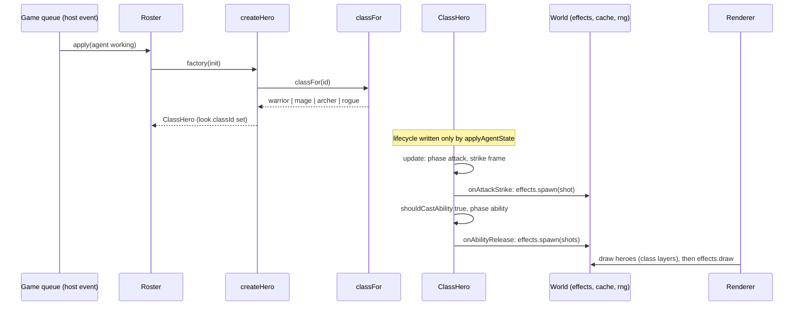

# H1 plan: Warrior, Mage, Archer, Rogue

Purpose: the detailed, task-by-task plan for batch H1 (the first hero batch, "M5" in conversation): four cosmetic hero classes, sticky class assignment from the session id, the `ability` animation, a pooled cosmetic effect layer, the class data tables, and the `docs:tables` generator. Written by the architect; the pixel-artist, developer, and tester work from it. Follows the layout of the [M4 plan](m4-engine.md).
Related: [roadmap H1](../../engineering/roadmap.md#h1-warrior-mage-archer-rogue), [game engine](../game-engine.md), [data model](../data-model.md), [M4 plan](m4-engine.md), [M3 plan](m3-monitor.md), [ADR 0002 no hero health](../adr/0002-no-hero-health.md), [ADR 0003 procedural sprites](../adr/0003-procedural-sprites.md), [ADR 0008 DOM-free engine](../adr/0008-dom-free-engine-behind-ports.md), [ADR 0009 hero lifecycle isolation](../adr/0009-hero-lifecycle-isolation.md), [security and safety](../security-and-safety.md), [art style guide](../../design/art-style-guide.md), [sprite spec](../../design/sprite-spec.md), [coding standards](../../engineering/coding-standards.md), [testing strategy](../../engineering/testing-strategy.md), [glossary](../../glossary.md), [CLAUDE.md](../../../CLAUDE.md).

## 1. Goal

After H1 every hero in the panel is one of four classes, chosen from its session id and stable for as long as the webview document lives (and across reloads, because it is a pure function of the id). Each class has its own palette, silhouette, and weapon. While a hero is `working` and the party is engaged it still plays the `attack` cycle, now with a class look and, for the Mage and Archer, a small projectile flying into the empty corridor. Every few seconds of attacking it plays a 3-frame `ability` animation with a class effect (whirl, arcane burst, volley, dagger flurry). Resting, warp-in, warp-out, and victory are unchanged except that they wear the class look. Nothing is hurt, nothing is damaged, nothing is counted: the effects are pictures that fly and fade.

**Does H1 need enemies or `Combat` (E1)? No.** Classes in H1 are purely cosmetic behavior: art, a data row, and a pooled effect layer. There are no targets, so projectiles and bursts play into empty space and end in a spark, exactly as the base hero's attack cycle already swings at nothing. E1 adds `Combat` and gives the same hooks a target; see section 3.6 for the seam. No enemy, damage, or hit code is written in H1.

**How class assignment works.** `classFor(id)` in `src/game/data/classMap.ts` is a pure function: `DELIVERED_CLASSES[(hashId(id) >>> 16) % DELIVERED_CLASSES.length]`. No state, no persistence, no use of tool names or transcript content (decision H1-1). The hero factory calls it when the roster creates a hero, so a replaced exiting hero, a snapshot rebuild, and a webview reload all give the same class for the same id. It uses the upper 16 bits of the FNV-1a hash so the class is not tied to the skin tone (`h % 4`) or hair color (`(h >>> 8) % 6`).

Layers touched: data tables (classes, classMap, effects, tuning, animations), game engine (`Effects`, `Hero` hooks, `ClassHero`, `Renderer`, `Game`, `Roster`), sprites (art set, validator, class and effect templates), repo tooling (`docs:tables`, CI). Not touched: the host, the monitor, `src/shared/protocol.ts`, CSP, `esbuild.mjs`, any setting, any dependency, persistence. The protocol does not change.

### 1.1 M4 as built (checked against commit c8d3815 on `feat/m4-engine`)

- `Hero` stores `lifecycle`; `phase` is derived. `Hero.applyAgentState` is the only lifecycle writer and `Roster` its only caller. `Hero` already has a protected `heroLayers(world)` hook returning `world.cache.baseHero`, and `HeroInit` carries `look: HeroLook` (`skin`, `hair`, `accent`).
- `HeroFactory = (init: HeroInit) => Hero`; `Game` uses `deps.heroFactory ?? ((init) => new Hero(init))`; `Roster` calls it in `#create` with `lookFor(id)` (accent `null`). The seam was built for this batch.
- `SpriteCache.hero(look, layers)` caches by skin, hair, accent, and the four layer ids; `a` is overridden by `look.accent`. `heroBounds`/`compositeHeroFrame` align layers on anchors over union bounds, so a 24-wide weapon over a 16-wide body already works.
- `REQUIRED_HERO_ANIMATIONS` lists ten animations; `ability` is not required. `HERO_FRAME_MS` has no `ability`. The validator rejects names matching `hurt|downed|death|dead|die|dying`.
- `Hero.update` has two exhaustive `switch (this.#phase)` blocks, `#animationName` a third, and `Roster.countFighting` counts `advance` and `attack`. All of these change when the `ability` phase is added (task 4).
- `World` is `{ stage, campfire, particles, engagement, rng, cache }`; `Renderer.render(surface, world, heroes, camera)` draws entities after the light pass, then foreground, then particles. `Particles` draws 1 px rectangles only, so a projectile sprite needs its own pool.
- `HeroSnapshot` is `{ id, lifecycle, exiting }`. `lookFor(id)` lives in `Roster.ts`.
- No `scripts/` directory, no `docs:tables` script, no CI stale-docs step, and no `docs/design/classes.md` exist yet.
- `testing-strategy.md` section 4.2 describes class mapping as "each tool and activity maps to the class in `classMap.ts`". Decision H1-1 (accepted 2026-10-09) changes that to id-based; the tester updates the row.

## 2. Invariant check

| Invariant | How H1 respects it |
|---|---|
| 1 Heroes invulnerable | `ClassDef` has exactly the fields of section 3.1: no number that could be health, mana, power, or cooldown display. The ability interval is a hidden timer in `ClassHero` (`#abilityClockMs`), never drawn, never named like a resource. Effects are sprites that fly and expire; none is drawn on a hero as a bar or icon, none targets a hero. No `ability` input from any enemy exists (there are none). The validator still rejects hurt/downed/death animation names for every class layer set. The structural scan (note 10) covers `ClassHero.ts`, `Effects.ts`, `data/classes.ts`, `data/classMap.ts`. |
| 2 Lifecycle from host events only | `ClassHero extends Hero` and only overrides hooks that receive a `World`. `World` has no roster, so a subclass cannot reach `applyAgentState`; the structural check that `applyAgentState(` is defined only in `Hero.ts` and called only in `Roster.ts` stays. The new `ability` phase is cosmetic: it is entered only from `attack`, left after its animation, and interrupted by the same lifecycle checks as `attack` (`working` to `idle` goes to `travel`; `despawned` goes to `victory`). Class choice is a pure function of the id, so nothing in the game loop can change it. |
| 3 Read-only monitor, reveal-only `focusAgent` | No host, monitor, or protocol change. The engine still has no channel. |
| 4 Crash isolation | Hooks run inside `Hero.update`/`draw`, which are already under `guarded`. Effects update in their own try/catch in `Game.step` and draw in a guarded pass in `Renderer` (like the light pass). Missing class art falls back to the base hero look rather than throwing. Pool exhaustion drops the spawn silently. |
| 5 No external assets | Class layers and effects are palette-character templates; the class color is a partial palette swap. No file types added (G4). |
| 6 No runtime dependencies | None. The `docs:tables` runner uses `esbuild`, already a devDependency, plus Node. |
| 7 Transcript privacy | The class is computed from the session id only, in memory, and never stored or sent. Persisting a class per session id is rejected in H1-1 because it would store session ids ([security and safety](../security-and-safety.md)). Tool names are not read. Error text in `src/game/**` stays fixed strings. |

## 3. Interfaces (signatures only)

All of `src/game/**` imports only `src/shared/**` and sibling game files.

### 3.1 Data tables

```ts
// data/effects.ts
export const EFFECT_IDS = ['whirl', 'orbBolt', 'arcaneBurst', 'arrow', 'dagger', 'smokePuff'] as const;
export type EffectId = (typeof EFFECT_IDS)[number];

// data/classes.ts
export const CLASS_IDS = ['warrior', 'mage', 'archer', 'rogue'] as const;   // grows to 12 in H2 and H3
export type ClassId = (typeof CLASS_IDS)[number];
export type ClassRole = 'melee' | 'ranged' | 'caster';
/** One cosmetic effect to spawn, in hero-relative pixels (dx is multiplied by +1 when the hero faces right, -1 when left). */
export interface EffectShot {
  readonly effect: EffectId;
  readonly dx: number; readonly dy: number;       // from the hero's foot pixel (dy negative is up)
  readonly vx: number; readonly vy: number;       // px/s (vx also mirrored by facing)
  readonly lifeMs: number;
}
export interface ClassAbility { readonly id: string; readonly name: string; readonly shots: readonly EffectShot[]; }
export interface ClassDef {
  readonly id: ClassId;
  readonly name: string;                 // from the art style guide
  readonly role: ClassRole;
  readonly colors: string;               // docs text, for example 'red + steel'
  readonly silhouette: string;           // docs text, the readable cue
  readonly strike: readonly EffectShot[]; // spawned on the attack strike frame; empty for a pure melee swing
  readonly ability: ClassAbility;
}
export const CLASSES: readonly ClassDef[];                 // as const satisfies readonly ClassDef[]
export function classDef(id: ClassId): ClassDef;           // throws RangeError('Unknown class') only on a programming error
export function validateClasses(defs: readonly ClassDef[]): readonly string[];   // tests only, not run at boot; takes the table only, the art cross-check is validateClassArt (3.5)

// data/classMap.ts
export const DELIVERED_CLASSES: readonly ClassId[];        // H1: all four, in CLASS_IDS order
export function classFor(id: string): ClassId;             // pure, total, never throws
```

Default rows (the developer enters these; the artist matches the effects). `dx` and `dy` are relative to the foot pixel and a negative `dy` is up; the hero is 20 px tall, so chest height is about -10.

| Class | role | strike | ability |
|---|---|---|---|
| warrior | melee | none (the sword swing is in the weapon layer) | `whirlwind`, "Whirlwind": `whirl` at dx 0, dy -6, no velocity, life 460 ms |
| mage | caster | `orbBolt` at dx 12, dy -12, vx 150, life 500 | `arcaneBurst`, "Arcane Burst": `arcaneBurst` at dx 28, dy -10, no velocity, life 420 |
| archer | ranged | `arrow` at dx 12, dy -10, vx 180, life 500 | `volley`, "Volley": three `arrow` at dx 12, dy -14/-10/-6, vx 180, vy -10/0/+10, life 500 |
| rogue | melee | none | `daggerFlurry`, "Dagger Flurry": `smokePuff` at dx 0, dy -4, life 360; `dagger` at dx 10, dy -12, vx 200, life 400; `dagger` at dx 4, dy -8, vx 200, life 400 |

`ClassDef` deliberately has no combat numbers. E1 extends it in its own plan (section 3.6). The structural test (note 10) pins the key set of every row, so a field such as `hp` or `mana` cannot be added unnoticed.

### 3.2 Effects (new, cosmetic)

```ts
// Effects.ts
export class EffectPool {
  constructor(capacity: number);                 // EFFECT_CAPACITY
  spawn(effect: EffectId, x: number, y: number, vx: number, vy: number, lifeMs: number, flipX: boolean): boolean;  // false when full
  update(dtMs: number, particles: Particles): void;   // moves, ages, expires; projectiles end in two 'spark' particles
  draw(surface: Surface, cache: SpriteCache): void;   // drawBitmap only; frames from cache.effect(id)
  get count(): number;
  clear(): void;
}
// entities/Entity.ts: World gains
//   readonly effects: EffectPool;
// sprites/spriteFactory.ts: SpriteCache gains
//   effect(id: EffectId): FrameSet | null;          // null if the art set lacks it (the draw is skipped)
//   classLayers(id: string): HeroLayerSet | null;    // null falls back to baseHero
```

Struct-of-arrays pool with a free list, like `Particles`; no allocation in `update`/`draw`. Positions are floats and drawn floored. A particle whose frame cannot be resolved is skipped, never thrown. An effect fully outside `-32..352` x is expired early so off-screen projectiles cost nothing.

### 3.3 Hero hooks and the `ability` phase

```ts
// entities/Hero.ts
export type HeroPhase =
  'warpIn' | 'standby' | 'travel' | 'advance' | 'attack' | 'ability' | 'rest' | 'victory' | 'warpOut';
export class Hero {
  get classId(): string | null;                                      // look.classId
  protected onAttackStrike(world: World): void;                      // no-op; fires once per attack cycle on frame ATTACK_STRIKE_FRAME
  protected shouldCastAbility(dtMs: number, world: World): boolean;  // false; called each update while phase is 'attack'
  protected onAbilityRelease(world: World): void;                    // no-op; fires once per ability on frame ABILITY_RELEASE_FRAME
}
```

Phase rules (added to [game engine section 6](../game-engine.md#6-hero-behavior)):

- `attack` to `ability` when `shouldCastAbility` returns true; the hero plays the `ability` animation (3 frames, `HERO_FRAME_MS.ability` 120/140/200 ms) in place, then returns to `attack` if the engagement is still engaged, otherwise to `advance`.
- `ability` is not a non-interruptible phase. The existing checks apply unchanged: `despawned` goes to `victory` at once; a lifecycle that is no longer `working` goes to `travel` through `#startTravel`. The base `Hero` never casts (`shouldCastAbility` is false), so the base hero's behavior is unchanged.
- The hook arguments are `World` only. `World` has no roster, so a hook has no path to `applyAgentState`.
- `Roster.countFighting` counts `advance`, `attack`, and `ability`. `Hero.#animationName` returns `ability` for the `ability` phase. Both phase `switch` blocks in `update` list it and still end in `assertNever`.
- `HeroSnapshot` gains `classId: string | null` so tests can prove the class never changes.

### 3.4 `ClassHero` and the factory

```ts
// entities/ClassHero.ts
export class ClassHero extends Hero {
  constructor(init: HeroInit, def: ClassDef);
  protected override heroLayers(world: World): HeroLayerSet;     // world.cache.classLayers(def.id) ?? world.cache.baseHero
  protected override onAttackStrike(world: World): void;         // spawns def.strike shots
  protected override shouldCastAbility(dtMs: number, world: World): boolean;   // hidden seeded timer, ABILITY_INTERVAL_MIN_MS..MAX_MS
  protected override onAbilityRelease(world: World): void;       // spawns def.ability.shots
}
/** The default HeroFactory from H1: classFor(init.info.id), look.classId set, a ClassHero. */
export function createHero(init: HeroInit): Hero;
```

Shot spawn: x = floored hero x plus `dx` (mirrored by facing), y = floored hero y plus `dy`, velocities likewise, `flipX` when the hero faces left. In the corridor heroes always face right. The ability timer accumulates only while the phase is `attack`, picks its next interval from `world.rng` (seeded, deterministic) on first use and after each cast, and is reset by nothing else. It is a hidden timer: never drawn, never exposed through a getter.

`Game` default factory changes from `new Hero(init)` to `createHero`. Tests inject their own factory exactly as before. `lookFor(id)` is unchanged (classId `null`); `createHero` sets the class.

### 3.5 Sprites and art set

```ts
// sprites/spriteFactory.ts
export interface HeroLook { readonly skin: number; readonly hair: number; readonly accent: string | null; readonly classId: string | null; }
export interface ArtSet {
  /* existing fields */
  readonly classLayers: Readonly<Record<string, HeroLayerSet>>;   // class id -> layers
  readonly classPalettes: Readonly<Record<string, Palette>>;      // class id -> partial palette (see 10.1)
  readonly effects: Readonly<Record<string, SpriteTemplate>>;     // effect id -> template, animation 'idle'
}
// SpriteCache.hero: palette order is master, classPalettes[classId], skinTones[skin], hairColors[hair], accent.
// The cache key gains the class id.
// spriteValidator.ts
export const REQUIRED_HERO_ANIMATIONS: Readonly<Record<string, number>>;   // gains ability: 3 (eleven animations, 26 frames per layer)
export function validateClassArt(art: ArtSet, classIds: readonly string[], effectIds: readonly string[]): readonly string[];
```

`validateArtSet` now also runs `validateHeroLayers` over every `classLayers` entry, checks the composited look of each class under its palette (at most 12 colors, outline included), checks class palettes, and checks the effect templates. `validateClassArt` is the cross-check between the code tables and the art (every class id has layers and a palette; every effect id used by a class exists). Neither runs at boot (the M4 policy: bad art fails the test, not the user's panel; runtime fallbacks cover a missing entry).

Rules `validateClassArt` enforces (fixed-text errors with ids only):

- a class palette overrides only characters that exist in the master palette and only from `a c d b k m` (never `o s h e w`, so outline, skin, hair, eyes, and highlight stay shared);
- the class palette is applied before skin and hair, so a class can never recolor skin or hair;
- layer ids are unique per class (`warrior/head`), except a class may reuse the base `body` template object (id `hero/body`);
- every layer set has the same eleven animation names and equal frame counts; no animation name matches the forbidden pattern;
- effect templates: animation `idle` only, at most 32x32, at most 8 colors, master characters only, anchor inside the sprite.

### 3.6 Seam for E1 (not built in H1)

E1 adds `Combat` and enemies. The hooks above get targets by reading `world.combat` (nearest enemy to the right of the hero) instead of using fixed velocities: `onAttackStrike` and `onAbilityRelease` stay the only entry points, `ClassDef` gains combat numbers in its own E1 plan (named for what they do to enemies, kept out of `src/game/entities/**` words banned by the structural check, and read by `Combat`, never written by it onto a hero), and enemy attacks still never feed into any hero field except the cosmetic flash/knockback/spark fields. A hero never reads an enemy hit as a trigger for `ability` (the interval is a timer). Recording this here keeps H1 from inventing combat state.

## 4. Data flow (H1)



The only new inputs to the engine are the class table and the seeded generator; nothing flows from a hook back to `Roster`, `Engagement` (except `countFighting`, which reads phase), or the host.

## 5. Developer task list

Do the tasks in order; each is independently verifiable. No new packages. Work on a short-lived branch, for example `feat/h1-classes`, created from `main` once M4 is merged. Tasks 1 to 6 need no class art (use the tester's tiny test art set); task 7 needs the artist's first delivery; task 8 needs the class art. `npm run lint`, `typecheck` (all three projects), `build`, and `test` must stay green throughout except for the tests that pin M4-only behavior listed in task 14.

0. **Start.** Set roadmap H1 `Status: in progress` (batch line and summary row 5). Check: only those two lines changed.
1. **Constants and animation.** In `tuning.ts`: `EFFECT_CAPACITY` 24, `ABILITY_INTERVAL_MIN_MS` 4000, `ABILITY_INTERVAL_MAX_MS` 8000, `ATTACK_STRIKE_FRAME` 1, `ABILITY_RELEASE_FRAME` 1, `EFFECT_FRAME_MS` 90, `EFFECT_CULL_MARGIN_PX` 32 (each with a unit and an `Assumption:` comment). In `animations.ts`: `HERO_FRAME_MS.ability = [120, 140, 200]`, and an exported `ABILITY_TOTAL_MS` computed from it. Check: typecheck; `heroFrameIndex('ability', 130, 3)` is 1.
2. **Class tables.** `data/effects.ts`, `data/classes.ts` (the four rows of section 3.1, `validateClasses`), `data/classMap.ts` (`classFor`). Check: `classFor` is total for `''`, a UUID, `sim-0-0`, and a 10 KB string; 1,000 UUID-like ids cover all four classes; `sim-0-0` to `sim-7-0` cover at least three classes (if not, change only the bit selection or add a fixed mix constant in `classFor`, and record it in the comment); no row has an unknown key.
3. **Effect pool.** `Effects.ts` (section 3.2); add `effects` to `World`; `Game` constructs the pool (capacity `EFFECT_CAPACITY`), updates it in `step` inside its own try/catch (scope `'update'`), and clears it in `dispose`. Check: spawning 100 into a pool of 24 leaves `count` 24 and does not throw; expired slots are reused; `update` and `draw` allocate nothing (array identities unchanged).
4. **Hero hooks and the `ability` phase.** Section 3.3: the `HeroPhase` member, the three protected hooks, the strike detection (once each time the `attack` animation enters frame `ATTACK_STRIKE_FRAME`), the `ability` branch of `#updateFighting`, `#animationName`, both `update` switches, `Hero.classId`, `Roster.countFighting`, `HeroSnapshot.classId`. Check: the base `Hero` behaves exactly as in M4 (all M4 tests pass unchanged except those listed in task 14); a test subclass whose `shouldCastAbility` returns true plays `ability` and returns to `attack`; a `despawned` or `idle` event during `ability` takes effect on the next update.
5. **Sprite factory and validator.** Section 3.5: `HeroLook.classId`, the new `ArtSet` fields (empty records are valid), palette order, cache key, `SpriteCache.effect` and `classLayers`, `REQUIRED_HERO_ANIMATIONS.ability`, `validateClassArt`, the extended `validateArtSet`. The A0 base hero fails `validateArtSet` until the artist adds `ability` to it (artist delivery A1-1, section 10), so land the validator change together with that art. Check: with the artist's A1-1 delivery, `validateArtSet(SHIPPED_ART)` is clean; a crafted class palette overriding `s`, or an effect with an unknown character, produces exactly one error naming the id.
6. **`ClassHero` and `createHero`.** Section 3.4; switch `Game`'s default factory to `createHero`. Check: with test art and a test `CLASSES`, a hero created for a known id has the expected `classId` forever (10 simulated minutes of working/idle cycles, a replace-after-despawn, a snapshot rebuild); `onAttackStrike` spawns the strike shots once per attack cycle; the ability fires only while attacking, never while resting, and never in the first `ABILITY_INTERVAL_MIN_MS` of attacking; missing class art draws the base hero.
7. **Renderer.** Draw effects after the entities and before the foreground (game engine section 8, new step 6b) in a guarded pass: own try/catch, scope `'render'`, disabled after `EFFECT_FAULT_LIMIT` (3) faults, composite and alpha reset on a fault. Check: with a recording surface, effect draws come after the last entity draw and before the first foreground draw; a throwing `Surface.drawBitmap` during effects does not stop foreground and particles from drawing.
8. **Art glue** (needs the class art). `sprites/artSet.ts`: add `classLayers: CLASS_LAYERS`, `classPalettes: CLASS_PALETTES`, `effects: EFFECT_SPRITES`. Check: `validateArtSet(SHIPPED_ART)` and `validateClassArt(SHIPPED_ART, CLASS_IDS, EFFECT_IDS)` are clean; F5 shows four distinct silhouettes in the simulator.
9. **`docs:tables`.** `scripts/generate-doc-tables.ts` imports `data/classes.ts` and `data/classMap.ts` (pure data, no art) and rewrites the region between `<!-- BEGIN GENERATED: classes -->` and `<!-- END GENERATED: classes -->` in `docs/design/classes.md` with a compact table (class, role, colors, silhouette, strike, ability) and the delivered count; a `--check` argument prints nothing and exits 1 if the file would change. Runner: a small `scripts/docs-tables.mjs` that bundles the script with the esbuild API (already a devDependency) into `out/scripts/` and runs it, the same pattern as `test/run.mjs`; no `--experimental-strip-types`, no new package. `package.json`: `"docs:tables": "node scripts/docs-tables.mjs"`. Output uses the compact `|---|` delimiter row so `markdownlint-cli2` stays clean (MD060 is off) and Prettier ignores Markdown. Check: running it twice leaves no diff; changing a class name in `classes.ts` changes the table; `--check` fails until the script is re-run.
10. **CI.** In `.github/workflows/ci.yml` add, after Test, a step "Check generated docs" running `npm run docs:tables` then `git diff --exit-code -- docs`. Check: the workflow YAML parses and the step order keeps `npm ci` first.
11. **Docs.** Create `docs/design/classes.md` (purpose line, links, the generated region, a short prose section per class: what it looks like and which cosmetic effect it plays, and a paragraph stating there is no health or damage) and `docs/design/game-design.md` (short: heroes follow agents, classes are cosmetic, how class is assigned, what the effects are). Update the art-style guide link status only if the artist has not (artist-owned).
12. **Local checks (human-owned, open; see section 13.3).** F5 with `--disable-extensions`, `pixelAgents.simulator: on`, `simulatorAgentCount` 8: record 60 s in DevTools Performance at the reference panel size (decision H4-3); confirm 60 fps, a mix of classes, abilities firing during engage, effects never overlapping a bar or label (there are none), classes unchanged after hiding and re-showing the tab and after "Developer: Reload Webviews". Temporarily make `ClassHero.onAttackStrike` throw (do not commit) and confirm one console error line, the hero stays drawn and keeps its lifecycle, other heroes keep fighting.
13. **`CHANGELOG.md` and `README.md`.** Added: "Four hero classes (Warrior, Mage, Archer, Rogue) with their own look, attack, and signature effect; cosmetic only; class is derived from the session id; `npm run docs:tables`." README: one sentence under what the panel shows.
14. **Existing tests that pin M4-only behavior** (change by design, the tester does it, listed so the developer does not chase them): the hero-animation-count assertions (ten to eleven required animations), the draw-call ceiling (120 to 144 bitmap draws, note 7), the `Phase` exhaustiveness checks, `HeroSnapshot` equality helpers (new field), `engineStructure.test.ts` file lists (new files), and `testing-strategy.md` section 4.2 "Class mapping".
15. **Docs drift.** Flag in the handoff anything in [game engine](../game-engine.md), [data model](../data-model.md), or this plan that the code changed.
16. **Hand off to the tester** with section 7.
17. **Commit after reviewer Approve.** Set roadmap H1 `Status: done` and summary row 5; stage all agents' H1 work including art and docs; one commit, for example `feat: add Warrior, Mage, Archer, and Rogue hero classes`; merge to `main` fast-forward. No push without the human.

## 6. Ownership split

| File or area | Owner |
|---|---|
| `src/game/sprites/palettes.ts`, `spriteTemplates.ts`, `classTemplates.ts`, `effectTemplates.ts` (new template files), `docs/design/art-style-guide.md`, `docs/design/sprite-spec.md` | pixel-artist |
| `src/game/**` (everything else: `Effects.ts`, `data/classes.ts`, `data/classMap.ts`, `data/effects.ts`, `entities/ClassHero.ts`, `Hero.ts`, `Roster.ts`, `Renderer.ts`, `Game.ts`, `sprites/artSet.ts`, `spriteFactory.ts`, `spriteValidator.ts`), `scripts/`, `package.json` script, `.github/workflows/ci.yml`, `docs/design/classes.md`, `docs/design/game-design.md`, `CHANGELOG.md`, `README.md` | developer |
| `test/**` (`test/game/`, `test/repo/`, `test/support/`), `testing-strategy.md` | tester |
| this plan, `game-engine.md`, `data-model.md`, `roadmap.md` (except status), `docs/index.md`, `docs/glossary.md`, `CLAUDE.md` (except Core invariants) | architect |
| git operations, roadmap H1 status lines | developer |

## 7. Test notes for the tester

Unit suites use the M4 fakes plus a test `ArtSet` extended with two tiny class layer sets, class palettes, and two effect templates, so engine tests do not depend on H1 art. Separate art tests run the validators over the shipped art. Suggested files: `test/game/classMap.test.ts`, `test/game/classHero.test.ts`, `test/game/effects.test.ts`, extensions to `heroInvariant.test.ts`, `engineStructure.test.ts`, `spriteValidator.test.ts`, `renderer` order tests, and `test/repo/docsTables.test.ts`.

1. **Class mapping** (replaces the tool-based wording in [testing strategy](../../engineering/testing-strategy.md) section 4.2 if decision H1-1 is accepted). `classFor` is pure and total (empty, long, non-ASCII ids); the same id gives the same class on every call and in a fresh process; 1,000 UUID-like ids use all four classes, none under 15 percent; `sim-0-0` to `sim-7-0` use at least three classes; the class is independent of skin and hair (all 16 skin and class pairs occur over 1,000 ids); `DELIVERED_CLASSES` equals `CLASS_IDS` in H1. Through `Game`: a hero's `classId` (from `heroSnapshot`) is the same before and after 10 simulated minutes of working/idle cycles, after `despawned` then `spawned` for the same id (replacement), after a snapshot rebuild, and in a fresh `Game` fed the same list (reload). Extended in H2 and H3 with the new ids; at H3 exactly 12 unique ids.
2. **Class data.** `CLASSES` has one row per `CLASS_IDS` entry, unique ids, names equal the art style guide names, every row's key set equals exactly `id, name, role, colors, silhouette, strike, ability`, every `EffectShot` effect id is in `EFFECT_IDS`, lifetimes between 100 and 1500 ms, `|dx| <= 40`, `|dy| <= 24`, speeds at most 240 px/s, at most 4 shots per list. `validateClasses` fails crafted rows (unknown effect, duplicate id, extra key).
3. **Art.** The shipped art passes `validateArtSet` and `validateClassArt`: every class has layers and a palette, eleven animations, 26 frames per layer, equal frame counts, anchors inside bounds, at most 12 colors in each composited look (checked with each of the 4 skin tones and 6 hair colors, since swaps replace characters), class palettes override only `a c d b k m`, effect templates meet the rules of section 3.5; crafted faults (a class palette overriding `s`, an `ability` with 2 frames, an animation named `hurt`, `death`, `downed`, or `dying`, a 13th color, an effect with a second animation) each give exactly one error naming the id. The base hero also has `ability`. No hex color and no `data:` URI in any template file.
4. **Phase machine.** The `ability` phase is entered only from `attack`; never while resting, traveling, or in a warp; leaves after `ABILITY_TOTAL_MS` to `attack` (engaged) or `advance` (not engaged); `working` to `idle` or `despawned` during `ability` takes effect on the next update (travel; victory then removal after about 1.8 s); `Roster.countFighting` counts it (engagement keeps its rhythm with all heroes casting). The base `Hero` with no hooks never enters `ability`. Strike detection fires exactly once per attack cycle (390 ms) for a long run and not at all while `advance`.
5. **ClassHero effects.** Shots spawn at the right positions (floored hero position plus offsets), with the right velocities, flipped when facing left; mage and archer spawn one strike shot per cycle; warrior and rogue spawn none; an ability spawns exactly its shots once; the first ability is not before `ABILITY_INTERVAL_MIN_MS` of attack time; intervals stay within 4 to 8 s; the schedule is deterministic for a fixed seed; the timer does not advance while resting or advancing.
6. **Effect pool.** Capacity honored (`spawn` false when full, no throw); expired slots reused; deterministic; `update` ends projectiles with spark particles into the particle pool (dropped silently when full); culling beyond the margin; `draw` uses `drawBitmap` only (a recording surface sees no `fillRect` from the pool); frame choice follows `EFFECT_FRAME_MS`; missing effect art is skipped without throwing; `clear` empties it.
7. **Renderer.** Effects draw after the last entity and before the first foreground draw; composite is `source-over` and alpha 1 after every frame; a throwing effect draw is isolated (foreground and particles still draw; reported once; disabled after three faults); draw-call budget with 8 heroes of mixed classes and 24 live effects: at most 144 bitmap draws and 450 fills (the M4 ceiling of 120 rises by the 24-effect cap, [game engine section 15](../game-engine.md#15-performance-budget)).
8. **Crash isolation.** A `ClassHero` subclass injected through `heroFactory` whose `onAttackStrike`, `shouldCastAbility`, or `onAbilityRelease` throws: `frame` never throws, the next frame renders, only a throwing `shouldCastAbility` (it runs on every attack-phase update) reaches `FAULT_LIMIT` (3 consecutive faults) and freezes the hero (still listed and drawn); a lifecycle event unfreezes it. `onAttackStrike` and `onAbilityRelease` fire once per cycle, so a clean update between two throws resets the count and the hero keeps fighting, which is still safe. The lifecycle is unchanged throughout. A throwing `EffectPool.update` or `draw` leaves heroes, the loop, and the lifecycle untouched.
9. **Hero-invariant test** (extend [testing strategy section 5](../../engineering/testing-strategy.md#5-hero-invariant-test-from-m4)). New stimuli, each for 10 simulated minutes with 1, 8, 32, and 64 heroes covering all four classes in `spawned`, `working`, and `idle`: continuous attack and ability casting; effect-pool exhaustion; a missing class art entry (fallback look); throwing hooks; throwing effect update and draw. After each: `heroSnapshot()` (now including `classId`) equals the pre-stimulus snapshot and nothing was sent. Then each of the four events behaves as in M4 for class heroes, including events applied during `ability`.
10. **Structural** (extend `engineStructure.test.ts`). In `src/game/entities/**`, `Roster.ts`, `Effects.ts`, `data/classes.ts`, `data/classMap.ts`, `data/effects.ts`: no word-boundary match for `hp`, `health`, `mana`, `dead`, `downed`, `retreat`, `damage`, `gauge` (comments stripped); `ClassHero.ts` and `Effects.ts` call no `fillRect` or `strokeRect`; `ClassHero.ts` does not import `Roster`; `applyAgentState(` is still defined only in `Hero.ts` and called only in `Roster.ts`; `lifecycle` assigned only in `Hero.ts`; `classFor` reads no argument other than the id and imports nothing but `hashId` and the class list; no hook returns or accepts an `AgentInfo`; every `switch` over `.phase` includes `ability` and ends in `assertNever`.
11. **Generated docs** (`docsTables.test.ts`, gate G2). `docs/design/classes.md` contains the begin and end markers once each; the region equals what the generator produces now (call the generator's exported pure `renderClassTable(CLASSES)`); the generator's `--check` mode: a crafted change to a class name makes the check fail; the generator performs no network or non-docs write (writes only `docs/design/classes.md`); the script imports no vscode, DOM, or art files.
12. **Bundles and no assets.** `dist/webview.js` contains `ClassHero` and `EffectPool` and no class table text is in `dist/extension.js`; no eval or `new Function`; no new file types; `package.json` `dependencies` empty; record the production webview bundle size in the handoff (assumption: under 300 KB).
13. **Performance** (node, soft): 8 mixed-class heroes plus 10 simulated minutes of `frame(16.67)` average under 1 ms per frame on the reference machine (report; fail only above 4 ms). Real frame time is the manual benchmark: 8 simulated heroes, 60 s, steady 60 fps, no frame over 33 ms.
14. **Existing suites stay green**, including the M2 to M4 integration suites; the webview log has no error line.
15. **Manual QA** (testing strategy section 7.3): the four classes read by silhouette at three panel sizes and two zoom levels (plume and shield, pointy hat and orb staff, hood with bow and quiver, hood and mask with daggers); effects are small and calm, never fill the screen, and never appear to hit or mark a hero; no text, bar, or gauge appears on or near any hero; classes are unchanged after hide/show and Reload Webviews; the campfire still grows with three resting heroes; a temporary forced exception (developer task 12) shows one console error and the scene keeps running.

Not automated: rendered pixels, silhouettes (manual), real-canvas compositing, and DevTools frame time.

## 8. Gates for H1

| Gate | H1 meaning |
|---|---|
| G1 | `npm run build`, `lint`, `typecheck` (all three projects), `test`, and `test:integration` pass |
| G2 | `npm run docs:tables` leaves no diff; the CI stale-docs step exists and passes (first batch where G2 applies) |
| G3 | invariants intact (section 2); the hero-invariant test is extended and passes; notes 8, 9, 10 pass |
| G4 | no new packages; no image, audio, or font files |
| G5 | `CHANGELOG.md` entry; README updated; `classes.md`, `game-design.md`, `game-engine.md`, `data-model.md` match the code; art docs match the art |
| G6 | `CLAUDE.md` directory map lists the new files and `scripts/` |
| G7 | reviewer Approve; one commit; roadmap H1 ticked |

**Done when** ([roadmap H1](../../engineering/roadmap.md#h1-warrior-mage-archer-rogue), made concrete): G1 to G7 hold; note 1 proves class assignment is deterministic, sticky, and stable across reload; note 9 and note 10 prove the hero-invariant and structural checks extend to class heroes, effects, and the `ability` phase; note 3 proves each class has a complete template set and passes the validator; note 4 and 5 prove class attacks and abilities with no enemies present never change hero state; the reviewer confirms by eye in F5 or the dev preview that each class reads by silhouette; the manual benchmark holds 60 fps with 8 simulated heroes.

## 9. Risks, assumptions, defaults

- **Performance (60 fps, 8+ heroes now, 30+ enemies later).** New per-frame cost: at most 24 effect `drawBitmap` calls and an `EffectPool.update` over 24 slots, and hero bitmap sets that are now cached per (class, skin, hair) look. Sets are built lazily on first draw, so 8 heroes build at most 8 sets; each is 26 frames per look (the M4 base hero was 24 with ten animations of 2 to 4 frames); keep each build under a few ms. Mitigations: pooled effects, cached bitmaps, no allocation per frame, a hard cap of 24 live effects. Ranged heroes strike about 6 times per 2.4 s engage; at 500 ms life the live count stays near 12 for 8 heroes.
- **Class reshuffle on later batches.** Because the class is `hash % delivered-count`, adding classes in H2 and H3 changes the class of a given id after the extension updates (which restarts the webview anyway). Within one running extension the class never changes. Accepted by the human on 2026-10-09 with the plan sign-off (H1-1); the alternative of fixing the class by full 12-class table order would show a missing-art hero until all batches land.
- **Reload stability.** Pure function of id, so a webview reload (every tab hide/show with `retainContextWhenHidden: false`) rebuilds the same classes. This is the main reason tool names are not used (H1-1).
- **Photosensitivity.** Effects are at most 24x24 px, three frames, no full-screen flash, no strobing (frame time 90 ms, interval between abilities at least 4 s per hero). Reduce-motion and effect-density options arrive in M7 through `EffectPool` spawn gating.
- **Art/engine contract drift.** The validator is the single source of truth. The artist runs it (or the tester's suite does) before the developer lands task 5. A change to animation counts goes through the sprite spec.
- **Persistence and migrations.** None. Class is derived, never stored; a persisted class per session id is rejected because it would store session ids (invariant 7).
- **Bundle boundaries.** Unchanged. `src/game/**` imports only `src/shared/**` and itself; the `scripts/` generator imports only pure data files and runs in Node, outside both bundles and outside the `.vsix` (the CI package check already forbids `scripts/`).
- **CSP.** No change.
- **Defaults chosen:** id-hash class assignment; data-driven `ClassHero` (no per-class file in H1); attack stays 3 frames; `ability` 3 frames, required for every hero layer set including the base hero; ability only while attacking, 4 to 8 s, seeded; effects pooled at 24 and drawn after entities, before the foreground, unlit; class color as a partial palette swap over `a c d b k m`; classes reuse the base `body` template unless a pose demands more; master palette cap 48 colors.

## 10. Art needs (batch H1)

The pixel-artist delivers in three steps so the developer is never blocked for long. Everything is characters only, no hex; `.` is transparent; heroes face right; at most 12 colors per composited hero look (outline included) and 8 per effect. Validate with `validateArtSet` before handing over.

### 10.1 Step A1-1: shared additions (before development task 5)

| Item | Where | Spec |
|---|---|---|
| `ability` animation on the base hero | `BASE_HERO` (all four layers; `gear` stays `null`) | 3 frames. A generic "raise the weapon arm, thrust forward, recover" pose in the same 16x20 / 24-wide weapon canvases and the same foot anchor `(8, 19)`. Never played by the base hero; it exists so every layer set has the same eleven animations (idle 2, walk 4, attack 3, ability 3, sit 2, eat 2, sleep 2, polish 2, read 2, warmHands 2, victory 2 = 26 frames per layer). Frame timing is 120/140/200 ms, release on frame 1. |
| `CLASS_PALETTES` | `palettes.ts` | `Readonly<Record<'warrior' \| 'mage' \| 'archer' \| 'rogue', Palette>>`: a partial palette per class that overrides only characters from `a c d b k m` (accent, cloth, cloth shade, pants, boots, metal). Never `o s h e w`. If a class needs a color that cannot be expressed by recoloring those six (for example gold trim on the Mage), add new master characters (extend, never repurpose; master total at most 48). Index the colors by class as in the style guide: Warrior red + steel, Mage blue + gold, Archer forest green + brown, Rogue slate + purple. Keep red off the whole body: red belongs to the plume, cloth accents, and shield, so it never reads as a hurt tint (style guide section 5). Pair color with a shape cue for colorblind readers. |
| `EFFECT_SPRITES` | `effectTemplates.ts`, re-exported from `spriteTemplates.ts` | `Readonly<Record<EffectId, SpriteTemplate>>`, ids `effects/<name>`, animation `idle` only, anchor at the sprite center. Table below. |

| Effect id | Size | Frames | Used by | Look |
|---|---|---|---|---|
| `whirl` | 24x12 | 3 (expanding steel arc ring seen edge-on) | Warrior ability | steel and white, around the hero's feet and torso height |
| `orbBolt` | 6x6 | 2 (pulse) | Mage strike | blue core, gold spark pixel; flies right |
| `arcaneBurst` | 24x24 | 3 (small star, ring, fading ring) | Mage ability | blue and gold; appears in front of the hero |
| `arrow` | 10x3 | 1 | Archer strike and ability | brown shaft, steel tip, a feather pixel; points right |
| `dagger` | 7x5 | 2 (spin) | Rogue ability | steel and purple; flies right |
| `smokePuff` | 12x10 | 3 (grow and thin) | Rogue ability | slate and purple wisp at the feet |

No effect may look like damage taken: no red flashes on or near a hero, no white full-body flash, no cracks, no stars over a head, no health ticks. Effects are small (at most 24x24 here), calm, and read as things the hero does.

### 10.2 Step A1-2: Warrior and Mage layers

For each class, `CLASS_LAYERS[id]` is a `HeroLayerSet` with all eleven animations on every layer and equal frame counts. A class may reuse the base `body` template object (id `hero/body`, recolored by the class palette) and override only `head`, `gear`, and `weapon`; supply a class `body` only where a pose needs it. Layer ids are `warrior/head`, `warrior/gear`, `warrior/weapon` and so on. The head layer is 16x20 and shares the body's anchor; weapon is up to 24 wide with its anchor on the same foot pixel; gear is 16x20 (capes, shoulders, quiver, shield). Layers may hold all-transparent frames (the weapon is empty while resting except in `polish`). Derive class pieces from the base frames with the existing `spriteBuilder` helpers (overlay the hat on the base head frames at each frame's bob offset), so poses stay aligned.

| Class | Design note | Silhouette cue at 16x20 | Required frames of note |
|---|---|---|---|
| Warrior | red + steel; plumed steel helm, broad pauldrons (gear layer), round shield on the off arm (gear), sword in the weapon layer | wide shoulders, vertical red plume above the head | `attack`: horizontal sword swing with a crescent on the strike frame; `ability`: hero spins a quarter turn pose with the sword out (the `whirl` effect is the ring) |
| Mage | blue + gold; tall pointy hat with a gold band, robe hem (gear), orb staff in the weapon layer | tallest silhouette, hat tip near the top edge | `attack`: staff thrust forward with the orb glowing on the strike frame; `ability`: staff raised overhead, orb bright |

### 10.3 Step A1-3: Archer and Rogue layers

| Class | Design note | Silhouette cue | Required frames of note |
|---|---|---|---|
| Archer | forest green + brown; hood, quiver on the back (gear layer), bow in the weapon layer | hood point and a quiver bulge behind the shoulder | `attack`: draw and release with the bow arm extended, string pull on the strike frame; `ability`: bow raised high, three-quarter draw |
| Rogue | slate + purple; hood and face mask, low crouch (a 1-2 px lower head and a forward lean in the head and gear layers), twin daggers in the weapon layer | low, forward-leaning, hood and mask | `attack`: quick stab with the front dagger, back dagger visible; `ability`: both daggers drawn and thrown forward |

All four classes: `sit`, `eat`, `sleep`, `read`, `warmHands` keep the class head and gear so the class reads at the campfire; the weapon layer is empty except in `polish` and visible in `idle`, `walk`, `attack`, `ability`, and `victory`. `sleep` stays a closed-eye line and a small "z" (never a hurt pose).

### 10.4 What the engine draws itself (no art)

Shadows, warp beams, the end-of-flight sparks, and everything in the M4 list. The artist does not draw a cooldown indicator, an aura, or any icon above a hero.

### 10.5 Docs the pixel-artist updates

[Art style guide](../../design/art-style-guide.md): the class table status (delivered classes, final palette characters and the class palette rules), the `ability` animation (now part of the hero set, 3 frames), the effect list, and the master palette size. [Sprite spec](../../design/sprite-spec.md): the eleven required animations and the 26-frame count per layer, class palette swaps (partial palettes over `a c d b k m`, applied before skin and hair), effect templates (`idle` only, center anchor), and the new exports (`CLASS_PALETTES`, `CLASS_LAYERS`, `EFFECT_SPRITES`).

## 11. Decisions for the human

Each has a default so work can proceed. H1-1 is the one that changes wording in the roadmap and testing strategy.

**Sign-off (2026-10-09).** The human approved this plan ("proceed with the M5 plan"), which accepts the defaults below. That includes H1-1 (class is a pure hash of the agent id; tool names are not used) and the consequence recorded in section 9: when delivered classes grow in H2 and H3, `hash % n` changes and each hero's class is reshuffled once, an accepted one-time change.

| # | Question | Default chosen | Alternative |
|---|---|---|---|
| H1-1 | How is a hero's class chosen? | `classFor(id)`: a pure hash of the session id over the delivered classes. Tool names are not used. Stable across reloads and replaced heroes, needs no storage. Roadmap and testing-strategy wording about "tools map to classes" is replaced by "id maps to class" | Map the tool on the creating event (`Edit` to Warrior, `Read` to Mage, ...) with the id hash as fallback: `toolName` is `null` on a normal `spawned`, so most heroes would still use the hash, and a webview reload would re-create working heroes with their *current* tool, changing class on every tab re-show. Persisting the class per session id would fix that but stores session ids (invariant 7), so it is not offered |
| H1-2 | One data-driven `ClassHero` or four subclass files? | One `ClassHero` plus rows in `classes.ts`; H1 behaviors are data (effect shots), so no per-class file. H2 and H3 add a subclass only where code is needed (Necromancer, Druid, Artificer summons) | Four files `Warrior.ts`, `Mage.ts`, `Archer.ts`, `Rogue.ts` as the roadmap lists (more files, each a few lines, same behavior) |
| H1-3 | Class art scope | Classes reuse the base `body` and supply `head`, `gear`, `weapon`; a class `body` only where a pose needs it (Rogue crouch via head and gear lean first) | Full per-class bodies (4 layers x 26 frames x 4 classes; slower and more drift risk) |
| H1-4 | Attack frames: roadmap says 3 to 4 | Exactly 3 for every class (validator and `HERO_FRAME_MS.attack` unchanged) | Allow 3 or 4 (validator and timings need a per-class table) |
| H1-5 | `ability` required for every hero layer set, including the base hero | Yes: the artist adds a generic 3-frame `ability` to the base hero; eleven animations everywhere | Require it only for class sets (the base hero then has a different animation set from classes) |
| H1-6 | Ability trigger | Hidden seeded timer, 4 to 8 s of attack time, only while `attack`; no cooldown display, no resource | Trigger once per engage cycle (more regular, less alive) |
| H1-7 | Effect pool size and draw ceiling | 24 live effects; bitmap-draw ceiling for 8 heroes rises from 120 to 144 | 16 effects and ceiling 136; or fold projectiles into `Particles` as colored dots (no art, much less readable) |
| H1-8 | `docs:tables` runner and CI check | esbuild-bundled script behind `node scripts/docs-tables.mjs`; CI runs it then `git diff --exit-code -- docs` | `node --experimental-strip-types` (needs extension-less imports fixed and a Node 22.18+ pin) |
| H1-9 | Class color mechanism | Partial palette swap over `a c d b k m`, applied before skin and hair; new master characters only when a swap cannot express a color; master cap 48 | Dedicated per-class characters for everything (palette grows by about 20 colors) |
| H1-10 | Art delivery in three steps (A1-1 shared, A1-2 Warrior and Mage, A1-3 Archer and Rogue) | Yes, each validated before handoff | One delivery of everything (developer waits longer; one validation) |

## 12. Architect doc pass (applied before development)

- New: this plan.
- [Roadmap](../../engineering/roadmap.md): H1 plan link, scope, files, and art lines; "tools" wording replaced by the id-hash default (H1-1, accepted 2026-10-09).
- [Game engine](../game-engine.md): components (Effects, ClassHero), the `ability` phase and diagram, identity and class paragraph, render step 6b, seams, performance ceiling.
- [Data model](../data-model.md): classes, class map, effects ownership and section 6, art contract additions, tuning constants.
- [Glossary](../../glossary.md): class, ability, effect, `classFor`, delivered classes.
- [Docs index](../../index.md) and [CLAUDE.md](../../../CLAUDE.md) directory map (`Effects.ts`, `ClassHero.ts`, `classes.ts`, `classMap.ts`, `effects.ts`, `scripts/`).
- No new ADR: class-from-id and a cosmetic effect pool are cheap to reverse and covered by [ADR 0002](../adr/0002-no-hero-health.md) and [ADR 0009](../adr/0009-hero-lifecycle-isolation.md). If the human picks the tool-based alternative of H1-1, add an ADR then.
- For the tester: [testing strategy](../../engineering/testing-strategy.md) sections 4.2 (Class mapping row), 5, and 7.3; plus the changes listed in task 14.

## 13. As-built drift (checked against HEAD ec76b05 on `feat/h1-classes`)

Purpose: where the code differs from sections 3 to 10. The code is correct unless a row says otherwise; [game engine](../game-engine.md) and [data model](../data-model.md) were updated to match. Every row was verified in the source. Pattern as in [M4 plan section 13](m4-engine.md#13-as-built-drift-checked-against-commits-081732d-to-b320b00).

### 13.1 Changed contracts

| Plan (section) | As built |
|---|---|
| `validateClasses(defs, art)` (3.1) | `validateClasses(defs: readonly ClassDef[])` in `data/classes.ts`; it takes no art parameter (the table module stays art-free). The art cross-check is `validateClassArt(art, classIds, effectIds)` in `sprites/spriteValidator.ts`, as in 3.5. |
| Fault guard (task 7) | `EFFECT_FAULT_LIMIT` = 3 lives in `data/tuning.ts`; the renderer's effects pass counts faults against it and stops drawing effects after the third. |
| `createHero` location (3.4) | `src/game/entities/ClassHero.ts` exports `createHero(init)`. `Game` only imports it, as the default `heroFactory` (`deps.heroFactory ?? createHero`). |
| Effect playback (3.2) | Moving effects (nonzero velocity) loop at `EFFECT_FRAME_MS` 90 ms per frame; static effects play once at 90 ms per frame and hold their last frame until they expire. |
| Fallback look (2, 3.5) | A class with no entry in `ArtSet.classLayers` draws the base hero layers, still recoloured by that class's palette when `ArtSet.classPalettes` has one (the cache applies the class palette whenever `look.classId` is set). |
| `validateArtSet` (3.5) | Classes may share the base `body` template, so a fault in it would repeat once per class look; `validateArtSet` de-duplicates identical messages and reports the shared hero/body fault once. |
| `Game` and `World` (task 3) | `World.effects: EffectPool` exists. `Game` builds the pool (capacity `EFFECT_CAPACITY`) and updates it in `#updateEffects`, its own try/catch with scope `'update'`; on a fault it clears the pool. `dispose` clears it too. |
| Effect colours (3.5, 10.1) | Effect sheets are built from the master palette. The class palette is not applied to effects; an effect that needs a class colour uses master characters. |
| Effect id type (3.1) | `EffectSpriteId` is a local string union in `sprites/spriteTypes.ts` (`whirl`, `orbBolt`, `arcaneBurst`, `arrow`, `dagger`, `smokePuff`) so art files do not import `data/`. `EFFECT_SPRITES` is keyed by it. Keying by `EffectId` from `data/effects.ts` is deferred until the unions can share one source. |
| Art-only exports (10) | `HERO_POSES`, `HERO_HEAD`, and `HeroPose` are exported from `heroTemplates.ts` so `classTemplates.ts` can derive class layers from the same poses. They are for artist-owned files only; the engine must not import them. |
| Simulator ids (task 2) | `sim-0-0` to `sim-7-0` map to rogue, warrior, warrior, mage, rogue, mage, archer, mage: all four classes occur in 8 simulated heroes. |
| Generated table (task 9) | The first line of the region reads `Delivered classes: N of 12.` The 12 is `PLANNED_CLASS_COUNT`, hardcoded in `scripts/generate-doc-tables.ts`; N is `DELIVERED_CLASSES.length`. |

### 13.2 New files and tooling

| File | Role |
|---|---|
| `scripts/docs-tables.mjs` | the `npm run docs:tables` runner: bundles `generate-doc-tables.ts` with the esbuild API into `out/scripts/generate-doc-tables.cjs` and calls its `main`. Accepts `--check`. |
| `scripts/generate-doc-tables.ts` | pure generator (`renderClassTable`, `applyClassTable`, `main`); imports only `data/classes.ts` and `data/classMap.ts`. |
| `src/game/sprites/classTemplates.ts`, `effectTemplates.ts` | artist-owned class layers (`CLASS_LAYERS`) and effect sprites (`EFFECT_SPRITES`). |

### 13.3 Open item

Task 12 (the manual F5 benchmark and the forced-throw check) is human-owned and still open. It cannot be run by an agent: it needs a 60 s DevTools Performance recording at the reference panel size with 8 simulated heroes, a hide/show and "Developer: Reload Webviews" class-stability check, and a temporary (uncommitted) throw in `ClassHero.onAttackStrike` that must show one console error line while the scene keeps running. The roadmap tick for H1 should note this as outstanding until the human records the result.
