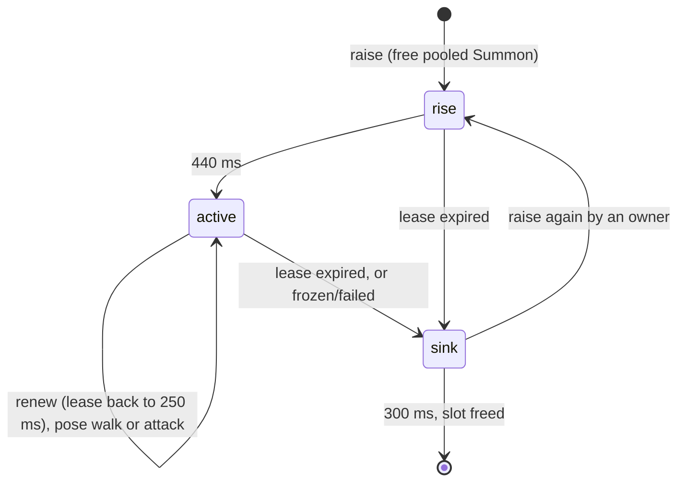

# H2 plan: Cleric, Paladin, Necromancer (with skeleton summon), Bard

Purpose: the detailed, task-by-task plan for batch H2 (the second hero batch): four more cosmetic hero classes, the `Summon` entity convention (a cosmetic, owner-leased, pooled ally), cosmetic aura effects for blessing and music, and the change of `classFor` from four to eight delivered classes. Written by the architect; the pixel-artist, developer, and tester work from it. Follows the layout of the [H1 plan](h1-classes.md).
Related: [roadmap H2](../../engineering/roadmap.md#h2-cleric-paladin-necromancer-bard), [H1 plan](h1-classes.md), [game engine](../game-engine.md), [data model](../data-model.md), [ADR 0002 no hero health](../adr/0002-no-hero-health.md), [ADR 0003 procedural sprites](../adr/0003-procedural-sprites.md), [ADR 0009 hero lifecycle isolation](../adr/0009-hero-lifecycle-isolation.md), [ADR 0011 summons are leased cosmetic entities](../adr/0011-summons-are-leased-cosmetic-entities.md), [security and safety](../security-and-safety.md), [art style guide](../../design/art-style-guide.md), [sprite spec](../../design/sprite-spec.md), [coding standards](../../engineering/coding-standards.md), [testing strategy](../../engineering/testing-strategy.md), [glossary](../../glossary.md), [CLAUDE.md](../../../CLAUDE.md).

## 1. Goal

After H2 every hero is one of eight classes, still chosen from its session id and stable for as long as the webview document lives. The four new classes use the H1 machinery (a `ClassDef` row, class layers and palette, strike and ability effect shots, the `ability` phase) with no new hero code, except one capability: a class row may declare a **summon**. Only the Necromancer does in H2.

- **Cleric** (white + gold, mace): its ability, Blessing, is a calm gold glow at its feet and two sparkles rising from it. It is a picture of a blessing. It restores nothing, because there is nothing to restore (Core invariant 1).
- **Paladin** (gold + white, winged helm, kite shield): the sword glows in every frame it is visible (art only, no engine feature). Its ability, Radiant Smite, is a gold-white burst in front of it plus one sparkle.
- **Necromancer** (dark purple + sickly green, skull staff): the strike is a green wisp flying into the empty corridor. The ability, Bone Call, releases two rising wisps and raises a **skeleton** beside the hero. The skeleton walks in place while the hero advances, swings at nothing while the hero attacks, and sinks into the floor shortly after the hero stops fighting (goes to the campfire, or exits). It has no health, no target, and no effect on any hero.
- **Bard** (teal + magenta, feathered hat, lute): the strike is a musical note drifting up and forward; the ability, Chorus, is three notes fanning out.

Layers touched: data tables (classes, classMap, effects, summons, tuning, animations), game engine (`Summon`, `SummonPool`, `ClassHero`, `Game`, `Renderer`, `Entity.World`), sprites (art set, cache, validator, class, effect, and summon templates), repo tooling (`docs:tables` summon cell). Not touched: the host, the monitor, `src/shared/protocol.ts`, CSP, `esbuild.mjs`, any setting, any dependency, persistence, `Roster`, `Hero`. The protocol does not change. **H2 needs no enemies and no `Combat`** (as in H1, section 1 there): shots and summons play into the empty corridor.

### 1.1 H1 as built, the facts H2 relies on (checked against HEAD ec76b05 and the working tree on `feat/h1-classes`)

- `ClassHero extends Hero` is data-driven by a `ClassDef` row (H1-2). Hooks (`onAttackStrike`, `shouldCastAbility`, `onAbilityRelease`) receive only a `World`. `createHero` is the default `HeroFactory`; it calls `classFor(id)`.
- `World` is `{ stage, campfire, particles, effects, engagement, rng, cache }`. `Game` builds and updates `EffectPool` in its own try/catch (`#updateEffects`) and clears it on a fault and on `dispose`. The renderer draws effects after the entities in a guarded pass (`EFFECT_FAULT_LIMIT` 3).
- `Hero.update` is public and overridable; `Hero.slot` is a public readonly int (lowest free, freed on removal). Heroes in `advance`, `attack`, and `ability` stand still in their formation slot.
- `EffectPool`: capacity 24, struct-of-arrays, spawn drops silently when full; a moving effect (nonzero `vx` or `vy`) loops its frames and ends in two spark particles; a static one plays once and holds its last frame.
- `Renderer.#sortEntities` y-sorts heroes, the campfire, and solid props in one buffer and draws shadows from `entity.shadowWidth`; each entity draws under `guarded(entity, 'draw', ...)`.
- `SpriteCache.sheet(template)` builds only the `idle` animation; `ArtSet` has `classLayers`, `classPalettes`, `effects`; `validateClassArt(art, classIds, effectIds)` cross-checks code tables and art.
- The structural scan bans the words `hp health mana dead downed retreat damage gauge` in `src/game/entities/**`, `Roster.ts`, `Effects.ts`, `data/classes.ts`, `data/classMap.ts`, `data/effects.ts`. **`dead` matters here**: the Necromancer ability must not be called "Raise Dead" (it is "Bone Call").
- The pixel-artist's working `spriteTypes.ts` already declares `ClassPaletteIdH2` (`cleric paladin necromancer bard`), `EffectSpriteIdH2` (`buffSparkle note healGlow holyBurst soulWisp`), and `SummonSpriteId` (`skeleton`, ids `summons/<name>`, single non-layered template). [Sprite spec](../../design/sprite-spec.md) has no summon section yet (checked: no "summon" in `docs/design/`). This plan therefore ratifies the proposal and fixes the rest in section 3.5; the artist transcribes section 3.5 into the sprite spec.

## 2. Invariant check

| Invariant | How H2 respects it |
|---|---|
| 1 Heroes invulnerable | `ClassDef` gains only `summon: SummonDef \| null` (a summon kind and a draw offset, no number that could be a resource). Auras are one-shot effect bursts from the existing pool: never a persistent icon, bar, ring that fills, or counter on a hero. The Cleric blessing restores nothing and targets nothing; it is centered on the Cleric. A summon has no hp, shows no gauge, is never a target, and is not drawn with a hit flash. The structural word ban grows by `heal regen restore revive resurrect` (section 7 note 10) and the effect id `healGlow` is renamed `blessGlow` (decision H2-7). |
| 2 Lifecycle from host events only | `Hero`, `Roster`, and `applyAgentState` are untouched. The summon system has no reference to a hero, a roster, or a lifecycle: `ClassHero` pushes plain numbers into `SummonPool` (`raise`, `renew`), the pool never calls back into a hero, and `Summon` extends `GuardedEntity`, not `Hero`. A summon's whole life follows the owner's cosmetic phase (derived from host events), never the reverse. [ADR 0011](../adr/0011-summons-are-leased-cosmetic-entities.md). |
| 3 Read-only monitor, reveal-only `focusAgent` | No host, monitor, or protocol change. |
| 4 Crash isolation | Each summon runs `update` and `draw` under `guarded`. The pool updates in its own try/catch in `Game.step` (scope `update`) and clears itself on a fault. A summon that is quarantined is simply freed (it has no state worth keeping). A throwing hook inside `ClassHero` is already guarded by the roster. Missing summon art is skipped, never thrown. Pool exhaustion drops the raise silently. |
| 5 No external assets | Summon, effect, and class sprites are palette-character templates. No new file types. |
| 6 No runtime dependencies | None. |
| 7 Transcript privacy | Nothing new is read, stored, or sent. The class stays a pure function of the session id. The pool is keyed by the hero's `slot` integer, not by an id, and holds no strings from agents. |

## 3. Interfaces (signatures only)

All of `src/game/**` imports only `src/shared/**` and sibling game files.

### 3.1 Data tables

```ts
// data/effects.ts: EFFECT_IDS gains five (appended; the six H1 ids and their order do not change)
//   'buffSparkle' | 'note' | 'blessGlow' | 'holyBurst' | 'soulWisp'
// data/summons.ts (new, pure data)
export const SUMMON_IDS = ['skeleton'] as const;          // grows to beast, turret in H3
export type SummonId = (typeof SUMMON_IDS)[number];
// data/classes.ts
export const CLASS_IDS = ['warrior','mage','archer','rogue','cleric','paladin','necromancer','bard'] as const;  // H1 order kept; H3 appends four
export interface SummonDef {
  readonly kind: SummonId;
  readonly dx: number;   // from the owner's foot pixel, mirrored when the owner faces left
  readonly dy: number;   // down is positive; a small positive dy sorts the summon in front of its owner
}
export interface ClassDef { /* H1 fields, plus */ readonly summon: SummonDef | null; }   // required key; null for 7 of 8 rows
// classMap.ts: DELIVERED_CLASSES equals CLASS_IDS (all eight). classFor is unchanged in form.
```

Default rows (the developer enters these; `dx`/`dy` are relative to the foot pixel, negative `dy` is up, the hero is 20 px tall). Roles are documentation text and stay within the existing `ClassRole` union.

| Class | role | colors | strike | ability | summon |
|---|---|---|---|---|---|
| cleric | melee | white + gold | none (mace swing is in the weapon layer) | `blessing`, "Blessing": `blessGlow` dx 0, dy -3, no velocity, life 600; `buffSparkle` dx -5, dy -12, vy -16, life 640; `buffSparkle` dx 5, dy -10, vy -12, life 640 | null |
| paladin | melee | gold + white | none (the sword glow is in the weapon layer) | `radiantSmite`, "Radiant Smite": `holyBurst` dx 16, dy -10, no velocity, life 440; `buffSparkle` dx 4, dy -14, vy -14, life 560 | null |
| necromancer | caster | dark purple + sickly green | `soulWisp` dx 12, dy -12, vx 130, life 520 | `boneCall`, "Bone Call": `soulWisp` dx 16, dy -4, vy -22, life 560; `soulWisp` dx 20, dy -4, vy -14, life 560 | `{ kind: 'skeleton', dx: 18, dy: 1 }` |
| bard | caster | teal + magenta | `note` dx 8, dy -14, vx 28, vy -18, life 700 | `chorus`, "Chorus": `note` dx 6, dy -16, vx 24, vy -26, life 760; `note` dx 8, dy -14, vx 36, vy -18, life 760; `note` dx 10, dy -12, vx 48, vy -10, life 760 | null |

Silhouette text for the generated table: Cleric "rounded hood or mitre, soft glow pixel, mace"; Paladin "winged helm, tall kite shield, glowing sword"; Necromancer "hood, hunched, skull staff, skeleton beside it"; Bard "big feathered hat, lute". Names equal the art style guide.

Why a data field and not a `Necromancer.ts` subclass: H1-2 says a subclass only where code is needed. The only code a summoning class needs is generic (tend the pool each update, raise on ability), and H3 reuses it for the Druid beast and the Artificer turret by adding a row and a summon id. See decision H2-8.

`validateClasses` gains: `summon` is `null` or has exactly the keys `dx dy kind`, `kind` in `SUMMON_IDS`, `|dx| <= 40`, `|dy| <= 24`. `ROW_KEYS` gains `summon`. A new `validateSummons` is not needed (the ids list is a `const`).

### 3.2 The `Summon` entity and the pool

```ts
// entities/Summon.ts (new). Extends GuardedEntity. Imports no Hero, ClassHero, or Roster.
export type SummonPhase = 'rise' | 'active' | 'sink';
export type SummonPose = 'walk' | 'attack';
export class Summon extends GuardedEntity {
  readonly shadowWidth: number;               // SUMMON_SHADOW_WIDTH_PX
  get x(): number; get sortY(): number;
  get phase(): SummonPhase; get kind(): SummonId | null;
  update(dtMs: number, world: World): void;  // advances the animation clock only
  draw(ctx: DrawContext): void;              // drawBitmap only; art missing => skip
  // pool-only mutators (plain numbers in, nothing returned): place(), begin(kind, ...), setPhase(...)
}

// Summons.ts (new, like Effects.ts)
export class SummonPool {
  constructor(capacity: number);                                             // SUMMON_CAPACITY; Summon objects preallocated
  /** Owner pushes. Both are no-ops on a bad number, an unknown kind, or a full pool. They return nothing. */
  raise(slot: number, kind: SummonId, x: number, y: number, faceRight: boolean): void;
  renew(slot: number, x: number, y: number, faceRight: boolean, pose: SummonPose): void;
  update(dtMs: number, world: World): void;                                  // lease, phase timers, per-summon guard
  entities(): readonly Summon[];                                             // the live list, reused array (renderer y-sorts it)
  get count(): number;
  clear(): void;
}
// entities/Entity.ts: World gains   readonly summons: SummonPool;
// sprites/spriteFactory.ts: SpriteCache gains
//   summon(id: SummonId): HeroSprites | null;   // every animation of the template, master palette, cached by template id; null if the art set lacks it
//   ArtSet gains: readonly summons: Readonly<Record<string, SpriteTemplate>>;
// data/animations.ts: SUMMON_FRAME_MS and onceFrameIndex(name, elapsedMs, frameCount)   // clamps at the last frame, for rise and sink
```

Behavior (the whole contract):

1. **Key.** A summon belongs to a hero **slot** (`Hero.slot`). At most one summon per slot. The pool holds no hero, roster, or id.
2. **Raise.** `raise` finds the slot's summon: none, so take a free pooled `Summon` and start `rise`; one that is `rise` or `active`, so do nothing (the owner's Bone Call still plays its wisps); one that is `sink`, so restart it at `rise`. A full pool drops the raise silently.
3. **Lease.** Every summon carries `leaseMs`, set to `SUMMON_LEASE_MS` (250) by `raise` and by every `renew`. `renew` on a missing or `sink` summon does nothing. `update` subtracts the step; at zero a `rise` or `active` summon enters `sink`. The owner renews from its own `update` only while its phase is `advance`, `attack`, or `ability`.
4. **Phases.** `rise` (4 frames, once) then `active` (idle/walk/attack loop by `pose`) then `sink` (3 frames, once) then freed. All timers are plain arithmetic in the pool, so a quarantined entity cannot strand a phase.
5. **Cleanup rules** (every path ends with the summon freed within `SUMMON_LEASE_MS` plus the sink time, about 0.55 s):

| Event | What happens |
|---|---|
| owner leaves the fight (lifecycle `idle` takes it to `travel`) | no more renewals; lease expires; sink |
| owner `despawned` (to `victory`) | same; the summon is gone before `warpOut` |
| owner replaced (exiting hero swapped for a fresh one) | the old hero is in `victory`/`warpOut` and renews nothing; a fresh owner on the reused slot adopts only a `rise`/`active` summon (it renews it); a `sink`ing one is not adopted |
| owner quarantined (3 faults) or removed | it stops updating, so no renewals; lease expires |
| snapshot rebuild or webview reload | the new `Game` has an empty pool; nothing carries over |
| a summon itself faults 3 times | the pool frees it at once (no quarantine for a cosmetic) |
| pool-level fault | `Game` reports once and `clear()`s the pool; heroes are untouched |
| `Game.dispose` | `clear()` |

**6. Placement.** `x`, `y` are set by `raise` and `renew` from the owner's floored foot pixel plus the row's `dx` (mirrored by facing) and `dy`. A summon never moves on its own, has no path, no collision, and is not in `Collision` or the nav grid. Owners stand still while fighting, so no easing is needed.

**7. Cap.** `SUMMON_CAPACITY` = 8 live summons in total. With one per slot the cap rarely binds (a Necromancer is about 1 hero in 8); extra raises drop silently.

**8. Never a target.** `SummonPool` is not reachable from any future target query. E1's plan must not register summons in the spatial hash or in `Combat`'s target list (section 3.6).

**9. Never touches a hero.** Pool and `Summon` methods take numbers and a `World`; `World` has no roster. There is nothing in the API that returns, stores, or mutates a hero.

### 3.3 `ClassHero` additions

```ts
// entities/ClassHero.ts
override update(dtMs: number, world: World): void;     // super.update, then #tendSummon when def.summon is not null
protected override onAbilityRelease(world: World): void;   // existing shots, then raise the summon when def.summon is not null
```

`#tendSummon` reads only `this.phase`, `this.slot`, position, and facing. `advance` renews with pose `walk`; `attack` and `ability` renew with `attack`; every other phase renews nothing. It never reads or writes `lifecycle`. Class rows with `summon: null` pay one null check. `createHero` is unchanged.

### 3.4 Aura and buff effects (no new engine feature)

There is no aura system. A "buff" is one more entry in `ClassDef.strike` or `ability.shots`, played by `EffectPool` like any H1 effect, positioned relative to the casting hero only. Rules that keep it from reading as a status or a resource:

- one-shot bursts of at most 600 to 760 ms; nothing persists on a hero past the ability, no icon above a head, no ring that fills or shrinks with a quantity;
- centered on the caster: the pool has no way to target another hero and the hooks have no way to find one;
- drawn after the entities, over the caster: use transparent-edged shapes (an outline ring and sparkle pixels), not filled blobs that hide the sprite;
- small and calm: gold, white, green, teal, magenta; no red, no full-body white flash, no cracks (art style guide, hit-reaction rules).

Moving effects (a rising sparkle, a drifting note) end in two spark particles when their life runs out; that is the existing `EffectPool` rule and is accepted as a small "pop".

**Paladin glow** is art only: the weapon layer's frames carry a lighter halo around the blade in `idle`, `walk`, `attack`, `ability`, and `victory`, with a 2-frame shimmer in `idle`. A hero light-map source was rejected: it would compete with torches and the campfire for `MAX_LIGHTS` (16) and add per-hero light work.

### 3.5 Sprites: classes, effects, and the summon convention

`SpriteTemplate` is unchanged. Additions:

- `ArtSet.summons` (above), `SHIPPED_ART.summons` from `SUMMON_SPRITES`.
- `SpriteCache.summon(id)`: for each animation of the template, rasterize its frames with the **master palette** (no class palette, no skin or hair swap), return `Record<string, FrameSet>` with `w`, `h`, and `anchor` from the template; cached by template id; returns `null` when `ArtSet.summons[id]` is missing.
- `spriteValidator.ts`: `REQUIRED_SUMMON_ANIMATIONS = { idle: 2, walk: 4, attack: 3, rise: 4, sink: 3 }` and `validateSummonArt(art, summonIds)`, included in `validateArtSet` for every template in `ArtSet.summons` (the cross-check against `SUMMON_IDS` mirrors `validateClassArt`; the developer may fold it into that function's signature, keeping the fixed-text errors with ids only).
- `spriteTypes.ts`: merge `ClassPaletteIdH2` into `ClassPaletteId` and `EffectSpriteIdH2` into `EffectSpriteId` (the artist's own note says merge when wiring), with `healGlow` renamed `blessGlow` (H2-7). Done in the same change that adds the art, so `Record<...>` types stay satisfied.

**Summon sprite convention (normative; the pixel-artist transcribes it into [sprite spec](../../design/sprite-spec.md) as the summon section, replacing the "UNREVIEWED" proposal):**

| Rule | Value |
|---|---|
| shape | one template (no layers, no gear, no skin or hair swap), id `summons/<name>`, faces right, anchor = foot pixel inside the sprite |
| size | at most 24x24; the skeleton about 14 to 16 wide and 16 to 20 tall (a little smaller than or equal to a hero) |
| colors | master palette characters only, at most 8 colors including the outline `o`; new master characters may be appended (never repurposed; master total stays at most 48) |
| animations | exactly `idle` 2, `walk` 4, `attack` 3, `rise` 4, `sink` 3 frames (`rise` and `sink` play once) |
| forbidden names | no animation name matching `hurt\|downed\|death\|dead\|die\|dying` (the same rule as hero layers); the exit is called `sink` on purpose |
| look | `rise`: climbs out of the floor in a small green puff. `sink`: descends into the floor and thins into a green puff, upright, calm. It never collapses, falls apart, flashes, or shows red. `attack`: a short sword or claw swing in step with the hero's 390 ms cycle. Cute-spooky, never gory |
| shadow | drawn by the engine (flat bar, `SUMMON_SHADOW_WIDTH_PX`); not in the sprite |

Animation timings (developer, `animations.ts`, `SUMMON_FRAME_MS`): `idle` 400, `walk` 130, `attack` 140/90/160, `rise` 110 per frame, `sink` 100 per frame (once; `onceFrameIndex`). The `ability` animation, class layer rules, class palette rules (partial over `a c d b k m`, applied before skin and hair), and the 26 frames per layer count are unchanged from H1.

### 3.6 `classFor` with eight classes

`classFor` is unchanged in form: `DELIVERED_CLASSES[(hashId(id) >>> 16) % DELIVERED_CLASSES.length]`, now over eight. `DELIVERED_CLASSES` stays in `CLASS_IDS` order, with the H1 four first.

- **Stable within a running extension.** The table is a build-time constant and the function is pure, so a given id gives the same class on every call, after replacement, snapshot rebuild, and webview reload, exactly as in H1.
- **One-time reshuffle on update (accepted, roadmap A5).** Because 8 is a power of two and the H1 classes keep indexes 0 to 3, a hero whose `(hash >>> 16) % 8` is 0 to 3 keeps its H1 class (about half of all ids) and the other half become Cleric, Paladin, Necromancer, or Bard. The change happens only when the extension updates (which restarts the webview anyway). H3 moves to `% 12`, which reshuffles more; also accepted.
- **Simulator.** `sim-0-0` to `sim-7-0` must show at least five distinct classes and at least one of the four H2 classes. If the current slice of the hash does not give that, the developer changes only the bit selection (a different shift or a fixed mix constant), records the reason in the `classFor` comment, and re-checks independence from skin and hair. Simulator ids cannot change (monitor-owned). Seeing a Necromancer in the simulator is the F5 check for summons; if no sim id maps to it, use a test hero (task 10).

### 3.7 Seam for E1 (recorded, not built)

- `Combat` target queries read enemies only. A summon is never a target, has no hit box, and no enemy attack changes it. If E1 wants the skeleton to "hit" an enemy, the pool may read `world.enemies` to aim its swing and the **enemy** takes the cosmetic hit; no summon field and no hero field changes.
- The hooks' shots and the summon offsets stay data. Enemy hits never cause an ability, a raise, or a sink; those stay timer and owner-phase driven.

## 4. Data flow (H2)

```mermaid
sequenceDiagram
  participant Q as Game queue (host event)
  participant R as Roster
  participant H as ClassHero (Necromancer)
  participant W as World
  participant P as SummonPool
  participant S as Summon
  participant Rn as Renderer
  Q->>R: apply(agent working)
  R->>H: applyAgentState (only lifecycle writer)
  H->>H: update: phase attack, hidden timer fires, phase ability
  H->>W: onAbilityRelease: effects.spawn(soulWisp x2)
  H->>P: raise(slot, skeleton, x, y, face)
  loop every step while advance, attack, ability
    H->>P: renew(slot, x, y, face, pose)
  end
  Note over P,S: pool: lease -= dt; rise then active then sink then free
  Q->>R: apply(agent idle)
  R->>H: applyAgentState
  H->>H: phase travel: no renewals
  P->>S: lease expires: sink, then freed
  Rn->>P: entities() into the y-sort, draw under guarded
```



The only inputs to the summon system are numbers pushed by the owner and the step length. Nothing flows from the pool, a `Summon`, or an effect back to `Roster`, `Engagement`, or the host.

## 5. Developer task list

Do the tasks in order; each is independently verifiable. No new packages. Work on a short-lived branch created after H1 is reviewed and committed (H1 is built but not yet final-committed at the time of writing; do not start H2 commits on top of unreviewed H1). Tasks 1 to 5 need no H2 art (use the tester's tiny test art set); task 6 needs the artist's step A2-1; task 7 needs A2-2 and A2-3.

0. **Start.** Set roadmap H2 `Status: in progress` (batch line and summary row 6). Check: only those two lines changed.
1. **Constants, animations, ids.** `tuning.ts`: `SUMMON_CAPACITY` 8, `SUMMON_LEASE_MS` 250, `SUMMON_SHADOW_WIDTH_PX` 8 (each with a unit and an `Assumption:` comment). `animations.ts`: `SUMMON_FRAME_MS` (section 3.5), `SUMMON_RISE_TOTAL_MS`, `SUMMON_SINK_TOTAL_MS` computed from it, and `onceFrameIndex`. `data/summons.ts` (new). `data/effects.ts`: append the five ids. Check: typecheck; `onceFrameIndex('sink', 10_000, 3)` is 2 and `(…, 0, 3)` is 0.
2. **Class rows and map.** `data/classes.ts`: append the four ids, add `summon` to `ClassDef`, add `summon: null` to the four H1 rows, add the four H2 rows (section 3.1), extend `validateClasses` and `ROW_KEYS`. `classMap.ts`: no code change beyond the comment (all eight delivered). Check: `classFor` total for `''`, a UUID, `sim-0-0`, and a 10 KB string; 1,000 UUID-like ids cover all eight classes with none under 8 percent; the simulator criterion of section 3.6; independence from skin (4) and hair (6): all 32 skin-and-class pairs occur over 1,000 ids.
3. **`Summon` and `SummonPool`.** `entities/Summon.ts`, `Summons.ts` (section 3.2); add `summons` to `World`; `Game` constructs the pool, updates it in `#updateSummons` (own try/catch, scope `update`, `clear()` on a fault) after `#updateEffects`, and clears it in `dispose`. Check: raise, renew, lease expiry, sink, and free by plain arithmetic with a fake world; a raise into a full pool is a no-op; two raises for one slot give one summon; `sink` plus `raise` restarts it; `update` allocates nothing (array identities unchanged); a throwing `Summon.update` three times frees it.
4. **Renderer.** In `#sortEntities` push `world.summons.entities()` after the heroes (the shadow pass and the guarded draw pass already iterate the sort buffer). Check: with a recording surface, a live summon draws one bitmap in y order with a shadow `fillRect`; a throwing summon draw does not stop other entities; no beam is drawn for a summon.
5. **Sprites and validator.** Section 3.5: `ArtSet.summons`, `SpriteCache.summon`, `REQUIRED_SUMMON_ANIMATIONS`, `validateSummonArt`, merge the H2 unions (with the `blessGlow` rename), `SUMMON_SPRITES` import. Check: with a crafted template, a missing `rise`, a name matching `die`, a 9th color, or a 25x25 size each produces exactly one error naming the id; `SpriteCache.summon` returns `null` for a missing id and the same object for a repeat call.
6. **`ClassHero` summon support.** Section 3.3. Check: with a test row `summon: { kind: 'skeleton', dx: 18, dy: 1 }` and test art, a hero's ability raises exactly one summon at the expected position, mirrored when facing left; `advance` gives pose `walk`, `attack` and `ability` give `attack`; a `working` to `idle` event removes the summon within 0.7 s; `despawned` likewise; a row with `summon: null` never touches the pool; the hero's `heroSnapshot` entry is identical with and without a summon.
7. **Art glue** (needs A2-1 to A2-3). `sprites/artSet.ts`: `summons: SUMMON_SPRITES`; if the artist's barrel does not already merge the H1 and H2 maps, spread them here. Check: `validateArtSet(SHIPPED_ART)` and `validateClassArt(SHIPPED_ART, CLASS_IDS, EFFECT_IDS)` are clean; F5 shows eight classes.
8. **`docs:tables`.** `renderClassTable` appends "; summons a skeleton" to the ability cell when `summon !== null`; the header line reads `Delivered classes: 8 of 12.` (computed). Regenerate `docs/design/classes.md`. Check: running twice leaves no diff; `--check` passes.
9. **Docs.** `docs/design/classes.md` (four prose sections: what each looks like and plays; the Necromancer paragraph says the skeleton is decoration with no health and no effect; the Cleric paragraph says Blessing restores nothing), `docs/design/game-design.md` (one paragraph on summons and aura effects), `CHANGELOG.md` ("Four more hero classes (Cleric, Paladin, Necromancer with a cosmetic skeleton, Bard); cosmetic only"), README one sentence.
10. **Local checks (human-owned).** F5 with `--disable-extensions`, `pixelAgents.simulator: on`, `simulatorAgentCount` 8: 60 s DevTools recording at the reference panel size ([M4 decision H4-3](m4-engine.md#11-decisions-for-the-human)), 60 fps; classes and the skeleton unchanged after hide/show and "Developer: Reload Webviews" (the skeleton is rebuilt only when the next Bone Call fires); if no simulator hero is a Necromancer, temporarily force one with a throwaway local edit (not committed). Temporarily make `SummonPool.update` and `Summon.draw` throw (not committed) and confirm one console error line each, heroes keep their poses and lifecycle, and other heroes keep fighting.
11. **Existing tests that pin H1-only behavior** (change by design; the tester does it, listed so the developer does not chase them): class counts 4 to 8, the pinned `ClassDef` key set (adds `summon`), the 12-color and 26-frame loops over `CLASS_IDS`, `World` fakes (new `summons`), the draw-call ceiling (144 to 152), the simulator class expectations in `classMap.test.ts`, `engineStructure.test.ts` file lists and banned words, and `classStructure`/`docsTables` expectations.
12. **Docs drift.** Flag in the handoff anything in [game engine](../game-engine.md), [data model](../data-model.md), [ADR 0011](../adr/0011-summons-are-leased-cosmetic-entities.md), or this plan that the code changed.
13. **Hand off to the tester** with section 7.
14. **Commit after reviewer Approve.** Set roadmap H2 `Status: done` and summary row 6; stage all agents' H2 work including art and docs; one commit, for example `feat: add Cleric, Paladin, Necromancer, and Bard hero classes`; merge to `main` fast-forward. No push without the human.

## 6. Ownership split

| File or area | Owner |
|---|---|
| `src/game/sprites/classTemplatesH2.ts`, `effectTemplatesH2.ts`, a summon template file (suggested `summonTemplates.ts`), `palettes.ts` (`CLASS_PALETTES` entries), `spriteTemplates.ts` (barrel exports), `spriteTypes.ts` unions, `docs/design/art-style-guide.md`, `docs/design/sprite-spec.md` | pixel-artist |
| `src/game/**` otherwise: `entities/Summon.ts`, `Summons.ts`, `entities/ClassHero.ts`, `entities/Entity.ts`, `data/summons.ts`, `data/classes.ts`, `data/classMap.ts`, `data/effects.ts`, `data/tuning.ts`, `data/animations.ts`, `Game.ts`, `Renderer.ts`, `sprites/artSet.ts`, `spriteFactory.ts`, `spriteValidator.ts`; `scripts/generate-doc-tables.ts`, `docs/design/classes.md`, `docs/design/game-design.md`, `CHANGELOG.md`, `README.md` | developer |
| `test/**`, `testing-strategy.md` | tester |
| this plan, ADR 0011, `game-engine.md`, `data-model.md`, `roadmap.md` (except status), `docs/index.md`, `docs/glossary.md`, `CLAUDE.md` (except Core invariants) | architect |
| git operations, roadmap H2 status lines | developer |

`spriteTypes.ts` holds the artist's id unions today (an H1 precedent); the union merge in task 5 is a mechanical edit the developer makes in the same change that wires the art, with the artist's agreement, so the two never edit it concurrently.

## 7. Test notes for the tester

Unit suites use the H1 fakes plus a test `ArtSet` extended with one tiny summon template (five animations) and the new effect ids, so engine tests do not depend on H2 art. Suggested files: `test/game/summons.test.ts`, `test/game/summonHero.test.ts`, extensions to `classMap.test.ts`, `classData.test.ts`, `heroInvariantClasses.test.ts`, `crashIsolation`, `renderer` draw-call and order tests, `classArt.test.ts`, `spriteValidator.test.ts`, `test/repo/engineStructure.test.ts`, `classStructure.test.ts`, `docsTables.test.ts`, `test/build/classBundle.test.ts`.

1. **Class mapping.** `classFor` pure and total; the same id gives the same class on every call and in a fresh process; 1,000 UUID-like ids use all eight classes, none under 8 percent; all 32 skin-and-class pairs occur over 1,000 ids; `sim-0-0` to `sim-7-0` give at least five classes including at least one H2 class (section 3.6); `DELIVERED_CLASSES` equals `CLASS_IDS` (eight). Through `Game`: a hero's `classId` is unchanged across 10 simulated minutes of working/idle cycles, replacement, snapshot rebuild, and a fresh `Game` fed the same list (reload). Explicitly assert the documented reshuffle property for known ids: an id whose `(hash >>> 16) % 8 < 4` has the same class under 4 and 8 (documents the accepted behavior, not a requirement the code must keep).
2. **Class data.** Eight rows, unique ids, names equal the art style guide, key set equals exactly `id name role colors silhouette strike ability summon`; `summon` is `null` for seven rows and `{ kind: 'skeleton', dx, dy }` for `necromancer`; every shot effect id is in `EFFECT_IDS`; lifetimes 100 to 1500 ms; `|dx| <= 40`, `|dy| <= 24`; speeds at most 240 px/s; at most 4 shots per list; `validateClasses` fails crafted rows (extra key, unknown summon kind, `dx` 60).
3. **Art.** Shipped art passes `validateArtSet` and `validateClassArt` for eight classes (eleven animations, 26 frames per layer, at most 12 colors per composited look under 4 skins by 6 hair colors, class palettes override only `a c d b k m`). Effects: the five new ids exist, `idle` only, at most 32x32, at most 8 colors. Summon: `summons/skeleton` has exactly `idle 2, walk 4, attack 3, rise 4, sink 3`, at most 24x24, at most 8 colors, anchor inside, master characters only, no forbidden animation name. Crafted faults each give exactly one error naming the id. No hex and no `data:` URI in any new template file. Master palette at most 48 colors.
4. **Summon pool.** Raise, renew, and lease behave per section 3.2: one summon per slot; `raise` on `rise`/`active` is a no-op; on `sink` it restarts; a full pool (`SUMMON_CAPACITY`) drops silently; after the last renewal the summon is freed within `SUMMON_LEASE_MS` plus the sink total (assert at most 700 ms, with margin); `renew` on a missing or sinking summon does nothing; NaN and out-of-range inputs are ignored; deterministic; `update` and `entities()` allocate nothing; `clear` empties it; a summon whose `update` throws three times is freed and the pool keeps working.
5. **Summon never touches heroes.** For 10 simulated minutes with 1, 8, 32, and 64 heroes covering all eight classes: raising, renewing, exhausting the pool, throwing `Summon.update`, throwing `Summon.draw`, a throwing `SummonPool.update`, and missing summon art leave `heroSnapshot()` equal to the pre-stimulus snapshot and send nothing. `Game.step` after a pool fault: heroes still advance, `classId`s unchanged.
6. **Owner binding.** Necromancer hero: no summon before the first ability (at least 4 s of attack time); after it, one summon; `advance` gives pose `walk` and `attack`/`ability` give `attack`; `working` to `idle` removes it (travel plus lease plus sink); `despawned` removes it before the hero's `warpOut`; replacing an exiting Necromancer for the same id leaves at most one summon; a frozen (quarantined) Necromancer's summon is gone within 0.7 s; a non-summoner hero on a reused slot never renews it. The hero's `phase`, `lifecycle`, and `classId` are identical with the summon system disabled (compare two runs with the same seed, summons on and off).
7. **Effects and auras.** Each H2 ability and strike spawns exactly its shots at the right positions (floored hero position plus offsets, mirrored when facing left); Cleric and Paladin strike nothing; Necromancer and Bard strike one shot per 390 ms attack cycle; the first ability is not before `ABILITY_INTERVAL_MIN_MS`; pool exhaustion drops silently. Effect-pool occupancy: 8 Bards attacking for 60 simulated seconds never exceed 24 live (and never throw); typical mixed party stays near 12.
8. **Renderer.** Summons draw in y order with heroes and props; shadow `fillRect` per summon; effects still after the last entity and before the foreground; composite `source-over` and alpha 1 after every frame. Draw-call budget with 8 heroes (4 summoning, so 8 summons by forcing), 24 live effects, and 384 particles: at most **152** bitmap draws and **450** fills (H1 ceiling 144 plus `SUMMON_CAPACITY` 8; shadows and beams stay inside the fill ceiling: 8 + 8 + 1 shadows, 16 beam rects during warps, particles at capacity).
9. **Hero-invariant test** (extend [testing strategy section 5](../../engineering/testing-strategy.md#5-hero-invariant-test-from-m4)). New stimuli are in notes 5 and 6; add each of the four events applied while a summon is rising, active, and sinking: the hero's lifecycle follows the event exactly as before.
10. **Structural** (extend `engineStructure.test.ts`). The scanned set grows by `entities/Summon.ts`, `Summons.ts`, `data/summons.ts`. Banned words (word-boundary, comments stripped) grow by `heal regen restore revive resurrect`; the full list is then `hp health mana dead downed retreat damage gauge heal regen restore revive resurrect`. `Summon.ts` and `Summons.ts` import none of `Hero`, `ClassHero`, `Roster`, `Engagement`; contain no `applyAgentState`, `lifecycle`, `fillRect`, or `strokeRect`; no exported `SummonPool` method has a parameter typed as `Hero`, `AgentInfo`, or an id string. `Summon extends GuardedEntity`, not `Hero`. `applyAgentState(` is still defined only in `Hero.ts` and called only in `Roster.ts`; `lifecycle` is still assigned only in `Hero.ts`. `ClassHero.ts` still does not import `Roster`; it may import `SummonPose` only as a type. Every `switch` over a summon phase ends in `assertNever`. `Combat.ts` (from E1) must not import `Summons.ts` (add the assertion when E1 lands).
11. **Generated docs** (`docsTables.test.ts`, G2). `classes.md` region equals `renderClassTable(CLASSES)`; eight rows; the header reads `Delivered classes: 8 of 12.`; the Necromancer ability cell mentions the skeleton; `--check` fails on a crafted change.
12. **Bundles and no assets.** `dist/webview.js` contains `SummonPool` and no class table text is in `dist/extension.js`; no eval or `new Function`; no new file types; `dependencies` empty; record the production webview bundle size in the handoff (assumption: under 300 KB).
13. **Performance** (node, soft): 8 mixed heroes with summons plus 10 simulated minutes of `frame(16.67)` averages under 1 ms per frame (report; fail above 4 ms). Real frame time is the manual benchmark (task 10).
14. **Existing suites stay green**, including the M2 to M4 integration suites; the webview log has no error line.
15. **Manual QA** ([testing strategy section 7.3](../../engineering/testing-strategy.md)): the four new classes read by silhouette at three panel sizes and two zoom levels (rounded hood and glowing mace; winged helm, tall kite shield, glowing sword; hunched hood with skull staff and skeleton; big feathered hat with lute); effects are small and calm; nothing looks like damage, a heal bar, or a status icon; the skeleton sinks calmly and never looks defeated; no text, bar, or gauge appears on or near any hero or summon; classes unchanged after hide/show and Reload Webviews.

Not automated: rendered pixels, silhouettes, real-canvas compositing, DevTools frame time.

## 8. Gates for H2

| Gate | H2 meaning |
|---|---|
| G1 | `npm run build`, `lint`, `typecheck` (all three projects), `test`, and `test:integration` pass |
| G2 | `npm run docs:tables` leaves no diff; the CI stale-docs step passes |
| G3 | invariants intact (section 2); the hero-invariant test is extended and passes; notes 5, 6, 9, 10 pass |
| G4 | no new packages; no image, audio, or font files |
| G5 | `CHANGELOG.md` entry; README updated; `classes.md`, `game-design.md`, `game-engine.md`, `data-model.md`, ADR 0011 match the code; art docs (including the sprite spec summon section) match the art |
| G6 | `CLAUDE.md` directory map lists the new files |
| G7 | reviewer Approve; one commit; roadmap H2 ticked |

**Done when** ([roadmap H2](../../engineering/roadmap.md#h2-cleric-paladin-necromancer-bard), made concrete): G1 to G7 hold; note 1 proves eight-class assignment is deterministic, sticky, and stable across reload; notes 5, 6, and 9 prove summons never change or despawn a hero and are removed only because the owner stopped fighting (a phase derived from host events); note 10 proves the structural checks cover `Summon`, the pool, and the buff effects and that no gauge, heal, or hit semantics exist; note 3 proves each class and the skeleton have complete templates; the reviewer confirms by eye that the four new classes and the skeleton read cleanly; the manual benchmark holds 60 fps with 8 simulated heroes.

## 9. Risks, assumptions, defaults

- **Performance (60 fps, 8+ heroes now, 30+ enemies later).** New per-frame cost: at most 8 summon `drawBitmap` calls, 8 shadow rects, and an `update` over at most 8 summons (plain arithmetic). Worst-case bitmap draws 120 + 24 effects + 8 summons = 152. Effect pool stays at 24: an attacking Mage, Necromancer, or Bard has about 1.3 to 1.8 live strike effects (one per 390 ms, 500 to 700 ms life), so 8 such heroes hold about 10 to 15, plus a few in-flight abilities (2 to 3 shots each, staggered 4 to 8 s apart per hero), about 21 at the extreme; beyond 24 the spawn drops silently. Hero sprite sets: 8 classes by 4 skins by 6 hair colors is at most 192 looks, each 26 small bitmaps built lazily on first draw, kept for the document's life (the cache never evicts); about 6 MB worst case, reached only if 192 distinct sessions with all combinations appear in one document; typical use builds 8 sets. Skeleton sheet: 16 bitmaps, built once.
- **Photosensitivity.** Effects at most 24x24, three frames, no full-screen flash, no strobing; abilities at least 4 s apart per hero; the skeleton's rise and sink are slow (440 and 300 ms) and small. Reduce-motion (M7) gates `EffectPool` spawns and `SummonPool.raise` with the same switch.
- **Summon versus quarantine.** Heroes are never removed for a fault ([ADR 0009](../adr/0009-hero-lifecycle-isolation.md)). Summons are the opposite on purpose: they carry no state worth preserving, so a faulting summon is freed. Do not copy that rule to heroes.
- **Slot reuse.** The pool key is the hero slot, which a replacement may reuse. The fresh owner can adopt a live (`rise`/`active`) summon; this is cosmetic and invisible in practice (same class, same id). A `sink`ing summon is never adopted.
- **CSP, bundles, persistence.** No change. Nothing is persisted: class and summon are derived or transient. `src/game/**` stays DOM-free and imports only `src/shared/**` and itself.
- **Art/engine contract drift.** The validator is the single source of truth. The artist runs it (or the tester's suite does) before the developer lands task 7. Animation counts are fixed in section 3.5; a change goes through the sprite spec and this plan.
- **Defaults chosen:** data-driven summon field, no `Necromancer.ts`; one skeleton per Necromancer, raised by the ability, sinking when the owner leaves the fight; blessing is self-centered; buffs are one-shot bursts, not persistent icons; Paladin glow is art; effect pool 24, summon pool 8, bitmap ceiling 152; five effect ids as the artist proposed with `healGlow` renamed `blessGlow`; ability name "Bone Call" because the structural ban covers the word `dead`.

## 10. Art needs (batch H2)

Everything is characters only, no hex; `.` is transparent; heroes and summons face right; at most 12 colors per composited hero look (outline included), 8 per effect, 8 per summon. Validate with `validateArtSet` before handing over. Delivery in three steps so the developer is never blocked for long (decision H2-10).

### 10.1 Step A2-1: shared additions (before development task 7; tasks 1 to 6 use test art)

| Item | Where | Spec |
|---|---|---|
| `CLASS_PALETTES` entries for `cleric paladin necromancer bard` | `palettes.ts` | partial palettes over `a c d b k m` only (never `o s h e w`). Cleric white + gold; Paladin gold + white; Necromancer dark purple + sickly green; Bard teal + magenta. White cloth is `c`; the shared highlight `w` stays untouched. Red stays off bodies. Pair color with a shape cue. New master characters only where a swap cannot express a color (master total at most 48). |
| Five effects, ids `effects/<name>`, `idle` only, anchor at the center | `effectTemplates.ts` or `effectTemplatesH2.ts`, re-exported from `spriteTemplates.ts` | `buffSparkle` about 7x7, 2 frames (twinkle), gold-white, used by Cleric, Paladin. `note` about 6x8, 2 frames (two note shapes), teal and magenta, Bard. `blessGlow` about 22x12, 3 frames (outline ring and soft gold glow that expands and fades; transparent center so the hero stays visible), Cleric ability. `holyBurst` about 24x24, 3 frames (small star, ring, fading ring), gold-white, Paladin ability. `soulWisp` about 6x8, 2 frames (flickering green flame), Necromancer strike and ability. Sizes are defaults; stay within the validator (at most 32x32, 8 colors). |
| `SUMMON_SPRITES` with `summons/skeleton` | a new artist file (suggested `summonTemplates.ts`), re-exported from `spriteTemplates.ts` | follows section 3.5: `idle` 2, `walk` 4, `attack` 3, `rise` 4, `sink` 3, at most 24x24, at most 8 colors, anchor on the foot pixel, master characters (append new ones for the bone and green glow if needed). Plain bone, small green eye or glow, a short rusty sword in the attack. Cute-spooky. |
| Barrel exports | `spriteTemplates.ts` | export `CLASS_LAYERS` and `EFFECT_SPRITES` as the **merged** H1 plus H2 maps, plus `SUMMON_SPRITES`, so `artSet.ts` changes by one line. Merge the H2 id unions in `spriteTypes.ts` with the developer (section 6). |

Rename: ask for `healGlow` to become `blessGlow` now (decision H2-7); if it has already shipped under the old name, keep it and the structural ban drops `heal` for effect ids only.

No effect may look like damage taken or a gauge: no red flashes on or near a hero, no white full-body flash, no cracks, no stars over a head, no filling bar, no persistent icon. Effects are small, calm, and read as things the hero does.

### 10.2 Step A2-2: Cleric and Paladin layers

Each class: `CLASS_LAYERS[id]` with all eleven animations on every layer and equal frame counts (26 per layer), layer ids `cleric/head`, `cleric/gear`, `cleric/weapon` and so on, reusing the base `body` template unless a pose needs its own. Head 16x20, gear 16x20, weapon up to 24 wide, all on the foot anchor.

| Class | Design note | Silhouette cue | Frames of note |
|---|---|---|---|
| Cleric | white + gold; rounded hood or mitre with a soft glow pixel, light robe hem and a small holy symbol on the chest (gear), mace in the weapon layer | rounded top, pale robe, mace | `attack`: overhead mace swing, strike on frame 1. `ability`: mace raised, glow pixel brighter (the `blessGlow` ring is the engine effect). |
| Paladin | gold + white; winged helm (gear or head), tall kite shield on the off arm (gear), sword in the weapon layer **with a glow**: a lighter halo around the blade in `idle`, `walk`, `attack`, `ability`, and `victory`, a 2-frame shimmer in `idle` | wings at the helm, tall shield, glowing blade | `attack`: sword cut with the glow trailing. `ability`: sword raised overhead, glow at its strongest. |

### 10.3 Step A2-3: Necromancer and Bard layers

| Class | Design note | Silhouette cue | Frames of note |
|---|---|---|---|
| Necromancer | dark purple + sickly green; hood, a 1-2 px hunch (lower head, forward lean in head and gear), skull staff in the weapon layer with a green glow in the eye sockets | hunched hooded figure, tall staff with a skull | `attack`: staff thrust, glow bright on the strike frame. `ability`: staff planted and raised, glow strongest (the wisps and the skeleton are engine effects). |
| Bard | teal + magenta; big feathered hat (feather in magenta), lute in the weapon layer | big hat with a plume, lute across the body | `attack`: strum with the lute swung forward, strike on frame 1. `ability`: lute raised, mouth open mid-song (never a hurt face). |

All four: `sit`, `eat`, `sleep`, `read`, `warmHands` keep the class head and gear so the class reads at the campfire; the weapon layer is empty except in `polish` and visible in `idle`, `walk`, `attack`, `ability`, and `victory`. `sleep` stays a closed-eye line and a small "z".

### 10.4 What the engine draws itself (no art)

Shadows (including the skeleton's), warp beams, end-of-flight sparks. The artist does not draw a cooldown indicator, an aura that persists, or any icon above a hero or summon.

### 10.5 Docs the pixel-artist updates

[Art style guide](../../design/art-style-guide.md): the class table status (eight delivered, final palette characters), the five effects, the skeleton summon (look, animation list), the master palette size, and the rule that auras are one-shot bursts. [Sprite spec](../../design/sprite-spec.md): replace the "UNREVIEWED" summon proposal with section 3.5's convention (single template, `summons/<name>`, the five animations and frame counts, forbidden names, master palette only, at most 8 colors and 24x24, engine-drawn shadow), and the new exports (`SUMMON_SPRITES`, merged `CLASS_LAYERS`, `EFFECT_SPRITES`).

## 11. Decisions for the human

Each has a default so work can proceed. H2-3 and H2-4 amend roadmap wording.

| # | Question | Default chosen | Alternative |
|---|---|---|---|
| H2-1 | Where do summons live? | A pooled `Summon` entity in `World.summons`, outside the `Roster`, owned by a lease the hero renews (ADR 0011) | A roster member created through `HeroInit` (puts a non-agent in the list that the hero-invariant test counts, and invites a path to lifecycle) |
| H2-2 | Summon lifetime | One skeleton per Necromancer, raised by Bone Call, sinks about 0.55 s after the owner stops fighting (idle or despawned); not carried to the campfire | Skeleton follows to the fire and rests (needs rest animations and seats; more art and a seat rule) |
| H2-3 | Cleric "heal" | A self-centered Blessing flourish: restores nothing, targets nothing | A glow landing on the nearest ally (needs a roster view in `World`, a path toward hero state; rejected by invariants 1 and 2) |
| H2-4 | Buff visuals | One-shot effect bursts from the existing pool; replaces the roadmap's "decorative icons" | A small persistent icon above the hero for a few seconds (reads as a status or resource; rejected) |
| H2-5 | Paladin glow | Baked into the weapon layer art | A light-map source per Paladin (competes for `MAX_LIGHTS`, per-hero light cost) |
| H2-6 | `classFor` over 8 classes | Unchanged form over the delivered set; about half of all ids keep their H1 class, half reshuffle once on update; stable within a running extension | A fixed 12-slot table with fallback art (shows missing-art heroes until H3) |
| H2-7 | Rename `healGlow` to `blessGlow` | Yes, now, while the art is in progress, so the structural ban on `heal` is clean | Keep the name and exempt effect ids from the `heal` ban |
| H2-8 | Summoner as data or as subclass | `ClassDef.summon` plus generic `ClassHero` support; H3 adds rows | `Necromancer.ts` subclass (the roadmap's original file list; a second copy of the tending code for the Druid and Artificer later) |
| H2-9 | Pool sizes and ceilings | Effects 24 (unchanged), summons 8, bitmap ceiling 144 to 152 | Effects 32 and ceiling 160 if the manual benchmark shows drops |
| H2-10 | Art delivery | Three steps: A2-1 shared (palettes, five effects, skeleton, barrel), A2-2 Cleric and Paladin, A2-3 Necromancer and Bard | One delivery (the developer waits longer; one validation) |
| H2-11 | Ability name for the Necromancer | "Bone Call" (avoids the banned word `dead`) | "Raise Dead" with `dead` exempted from the scan in `classes.ts` (weakens a check that guards invariant 1; rejected) |

## 12. Architect doc pass (applied before development)

- New: this plan and [ADR 0011](../adr/0011-summons-are-leased-cosmetic-entities.md).
- [Roadmap](../../engineering/roadmap.md): H2 plan link, scope (data-driven summon field, buffs as bursts), files, art batches, done-when wording about summons; A6 clarified.
- [Game engine](../game-engine.md): components table (Summon, SummonPool), the summon lifecycle paragraph in section 6, render step 6, sprites section 13.2, seams, performance ceiling 152.
- [Data model](../data-model.md): section 6 (eight classes, `summon` field, summons data), section 3 art contract additions, tuning constants.
- [Glossary](../../glossary.md): summon (updated), lease, aura, `SummonPool`; the stale "picked from tool activity" wording in `class` corrected.
- [Docs index](../../index.md) and [CLAUDE.md](../../../CLAUDE.md) directory map.
- For the tester: [testing strategy](../../engineering/testing-strategy.md) section 5 stimuli and the structural row (banned words, scanned files), plus the changes in task 11. For the pixel-artist: section 10 and the sprite spec summon section.
