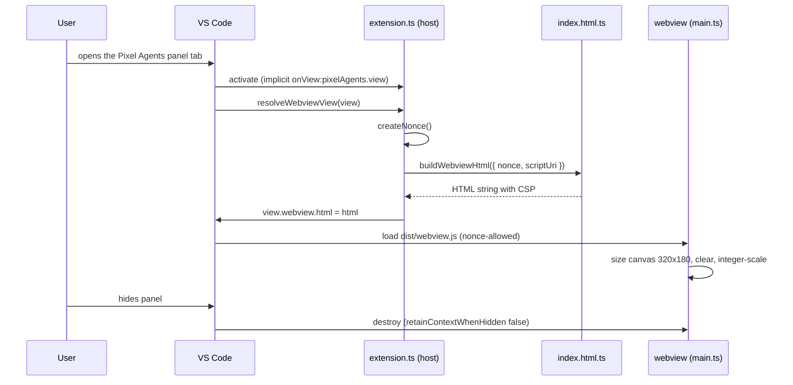

# M1 plan: Scaffold

Purpose: the detailed, task-by-task plan for milestone M1 (Scaffold): the repo skeleton that builds, lints, typechecks, tests, packages, and opens an empty "Pixel Agents" bottom-panel webview. Written by the architect; the developer and tester work from it.
Related: [roadmap M1](../../engineering/roadmap.md#m1-scaffold), [architecture overview](../overview.md), [ADR 0001 bottom-panel webview](../adr/0001-bottom-panel-webview.md), [ADR 0003 procedural sprites](../adr/0003-procedural-sprites.md), [ADR 0004 esbuild two bundles](../adr/0004-esbuild-two-bundles.md), [ADR 0006 test runner](../adr/0006-node-test-runner.md), [coding standards](../../engineering/coding-standards.md), [team workflow](../../engineering/team-workflow.md), [CLAUDE.md](../../../CLAUDE.md).

## 1. Goal

After M1, `npm install && npm run build` produces `dist/extension.js` (Node CJS) and `dist/webview.js` (browser IIFE); `lint`, `typecheck`, `test`, and `package` pass; F5 opens an Extension Development Host where the bottom panel has a "Pixel Agents" tab showing a blank, integer-scaled, dark canvas. There is no protocol, monitor, game, or persisted state yet. CI runs every gate.

Layers touched: extension host (activation and view provider only), webview UI (HTML/CSP builder and a blank canvas boot). Not touched: monitor, shared protocol, game engine, data tables, sprites.

## 2. Invariant check

| Invariant | How M1 respects it |
|---|---|
| 1 Heroes invulnerable | No hero code exists. Nothing to check beyond review. |
| 2 Lifecycle from host events only | No hero code exists. |
| 3 Read-only monitor | No monitor. The webview has no message channel at all in M1 (no `acquireVsCodeApi`, no `onDidReceiveMessage`). |
| 4 Crash isolation | `main.ts` wraps its boot and resize handler in try/catch. `retainContextWhenHidden: false`; nothing in the webview is a source of truth. |
| 5 No image or audio files | View container icon is a codicon reference (`$(flame)`), no marketplace `icon` field, a test scans the repo for asset extensions. |
| 6 No runtime dependencies | `dependencies` absent; devDependencies limited to the allow-list in section 5; the test runner is Node's built-in `node:test` ([ADR 0006](../adr/0006-node-test-runner.md)), so it adds no package. |
| 7 Transcript privacy | No transcript access. The bug-report template tells users not to paste transcript content. |

## 3. Interfaces (signatures only)

### 3.1 `src/extension.ts` (host bundle)

```ts
import * as vscode from 'vscode';

export const VIEW_TYPE = 'pixelAgents.view';

export function activate(context: vscode.ExtensionContext): void;
export function deactivate(): void;

export class PixelAgentsViewProvider implements vscode.WebviewViewProvider {
  constructor(extensionUri: vscode.Uri);
  resolveWebviewView(
    webviewView: vscode.WebviewView,
    context: vscode.WebviewViewResolveContext,
    token: vscode.CancellationToken,
  ): void;
}

/** 16 random bytes from node:crypto randomBytes, base64. New value per HTML load. */
function createNonce(): string;
```

Behaviour:

- `activate` constructs one `PixelAgentsViewProvider(context.extensionUri)` and pushes `vscode.window.registerWebviewViewProvider(VIEW_TYPE, provider, { webviewOptions: { retainContextWhenHidden: false } })` onto `context.subscriptions`. Nothing else: no status bar, commands, output channel, timers, or listeners in M1.
- `resolveWebviewView` sets `webview.options = { enableScripts: true, enableCommandUris: false, enableForms: false, localResourceRoots: [Uri.joinPath(extensionUri, 'dist')] }`, computes `scriptUri = webview.asWebviewUri(Uri.joinPath(extensionUri, 'dist', 'webview.js')).toString()`, and assigns `webview.html = buildWebviewHtml({ nonce: createNonce(), scriptUri })`. It registers no message handler.
- `deactivate` has an empty body with a comment: all disposables are owned by `context.subscriptions`.
- No `console.*` (lint enforces `no-console` in host code).

### 3.2 `src/webview/index.html.ts` (host bundle, pure)

```ts
export interface WebviewHtmlInput {
  /** base64 of at least 16 random bytes; must match /^[A-Za-z0-9+/]{22,}={0,2}$/ */
  readonly nonce: string;
  /** result of webview.asWebviewUri(...).toString(); non-empty */
  readonly scriptUri: string;
}

/** Returns the Content-Security-Policy value for one HTML load. Pure. */
export function buildCsp(nonce: string): string;

/** Returns the full HTML document. Pure; throws RangeError on an invalid nonce or empty scriptUri. */
export function buildWebviewHtml(input: WebviewHtmlInput): string;
```

Contract:

- Imports nothing (no `vscode`, no `node:*`, no DOM; it sits in the host tsconfig, which has no DOM lib).
- `buildCsp(n)` returns exactly:
  `default-src 'none'; script-src 'nonce-<n>'; style-src 'nonce-<n>'; base-uri 'none'; form-action 'none';`
  No `unsafe-inline`, `unsafe-eval`, `unsafe-hashes`, `*`, `http:`, `https:`, `data:`, `blob:`, and no `img-src`, `media-src`, `font-src`, `connect-src`, `worker-src`, `frame-src`. `base-uri` and `form-action` are listed because they do not fall back to `default-src`.
- `buildWebviewHtml` output, in order: `<!DOCTYPE html>`, `<html lang="en">`, `<meta charset="UTF-8">`, `<meta http-equiv="Content-Security-Policy" content="<buildCsp(nonce)>">`, viewport meta, `<title>Pixel Agents</title>`, one `<style nonce="<n>">` block (html/body margin 0, full size, overflow hidden, flex-centered, background `var(--vscode-panel-background)`; `canvas { display: block; image-rendering: pixelated; }`), then in `<body>` exactly one `<canvas aria-label="Pixel Agents scene" role="img"></canvas>` and exactly one `<script nonce="<n>" src="<escaped scriptUri>"></script>`.
- No inline event handler attributes (`on*=`), no `style="..."` attributes, no inline script body, no other external reference.
- `scriptUri` is HTML-attribute-escaped (`&`, `<`, `>`, `"`, `'`).

### 3.3 `src/webview/main.ts` (webview bundle)

No exports. Behaviour:

- Module constants `INTERNAL_WIDTH = 320`, `INTERNAL_HEIGHT = 180`, `CLEAR_COLOR` (Assumption: a fixed near-black such as `#14101c`; replaced by the master palette in M4). These move to `Renderer` in M4.
- Boot (runs immediately; the script tag is the last element in `<body>`), inside try/catch:
  1. `document.querySelector('canvas')`; if null, return.
  2. Set `canvas.width = 320`, `canvas.height = 180`; `getContext('2d', { alpha: false })`; if it returns null, skip drawing (layout and listeners still run); otherwise `imageSmoothingEnabled = false` and fill with `CLEAR_COLOR`.
  3. `layout()`: `dpr = window.devicePixelRatio || 1`; `scale = max(1, floor(min(innerWidth * dpr / 320, innerHeight * dpr / 180)))`; set `canvas.style.width = (320 * scale / dpr) + 'px'` and the same for height. Integer scale in device pixels keeps pixels crisp.
  4. `window.addEventListener('resize', onResize)` (fires on panel resize and zoom); `window.addEventListener('pagehide', onPageHide)` removes both listeners.
- The catch block calls `console.error` once with the error message (the only allowed webview console use). No rethrow.
- No `acquireVsCodeApi`, no `postMessage`, no `requestAnimationFrame` loop (nothing animates, so zero CPU while shown). M2 adds messaging; M4 adds the loop.

## 4. Data flow (M1)



## 5. Developer task list

Each task lists files, key contents, and an acceptance check. Do them in order; each is independently verifiable. Use exact versions (`npm install -D --save-exact`).

1. **Repo hygiene files.**
   Files: `.gitignore`, `.gitattributes`, `.editorconfig`, `.nvmrc`.
   - `.gitignore`: `node_modules/`, `dist/`, `out/`, `*.vsix`, `.DS_Store`, `*.log`.
   - `.gitattributes`: `* text=auto eol=lf`, `*.vsix binary`.
   - `.editorconfig`: root, utf-8, lf, 2-space indent, final newline, trim trailing whitespace.
   - `.nvmrc`: `22` (Assumption: Node 22 LTS for development and CI; the extension itself runs on VS Code's bundled Node).
   - Delete the stray `.DS_Store` files in the repo root and `docs/` (they are untracked junk, and `.gitignore` keeps them out).
   Check: files exist; `git check-ignore .DS_Store` succeeds after task 13's `git init`.

2. **`package.json` (developer fields).**
   - `name: "pixel-agents"`, `displayName: "Pixel Agents"`, `description`, `version: "0.0.1"`, `publisher` (Assumption: `"pixel-agents"` until the human names a publisher), `license: "MIT"`, `categories: ["Visualization", "Other"]`, `main: "./dist/extension.js"`.
   - `engines: { "vscode": "^1.90.0" }` (Assumption: 1.90 is a recent baseline whose extension host runs Node 20, matching the esbuild `node20` target; it is above the 1.74 floor for implicit view activation).
   - `activationEvents: []` (implicit `onView:pixelAgents.view`; no `*`, no `onStartupFinished`).
   - `capabilities: { untrustedWorkspaces: { supported: true } }` (we never execute workspace content).
   - `contributes.viewsContainers.panel: [{ "id": "pixelAgents", "title": "Pixel Agents", "icon": "$(flame)" }]`.
   - `contributes.views.pixelAgents: [{ "type": "webview", "id": "pixelAgents.view", "name": "Pixel Agents" }]`.
   - No top-level `icon`, no `dependencies` key, no `contributes.configuration` yet (no thresholds exist).
   - `scripts`: `build: node esbuild.mjs`, `watch: node esbuild.mjs --watch`, `vscode:prepublish: node esbuild.mjs --production`, `package: vsce package --no-dependencies --allow-missing-repository --no-rewrite-relative-links` (as built: without a `repository` field `vsce` rejects the README's relative links, so `--no-rewrite-relative-links` is needed too; remove both flags once a repository URL exists), `typecheck: tsc -p tsconfig.json && tsc -p tsconfig.webview.json && tsc -p tsconfig.tools.json`, `lint: eslint . --max-warnings 0 && prettier --check . && markdownlint-cli2`, `format: prettier --write .`. Leave `test` to the tester. No `docs:tables` until H1.
   - devDependencies (exact versions, this list only): `esbuild`, `typescript`, `@types/vscode` (exactly `1.90.0`, matching the engines minimum), `@types/node` (20.x, matching the extension host's Node), `eslint`, `@eslint/js`, `typescript-eslint`, `prettier`, `markdownlint-cli2`, `@vscode/vsce`. Anything else needs human approval. (Update: the human later approved `@vscode/test-electron`, exact-pinned, for integration tests; the current list is in [coding standards section 11](../../engineering/coding-standards.md#11-dependencies).)
   - Commit `package-lock.json`.
   Check: `npm install` succeeds; `node -e "const p=require('./package.json'); if (p.dependencies && Object.keys(p.dependencies).length) process.exit(1)"` exits 0.

3. **TypeScript configs.**
   Files: `tsconfig.base.json`, `tsconfig.json`, `tsconfig.webview.json`, `tsconfig.tools.json`.
   - `tsconfig.base.json`: every option in [coding standards section 2](../../engineering/coding-standards.md#2-typescript) (`strict`, `noUncheckedIndexedAccess`, `noImplicitOverride`, `noImplicitReturns`, `noFallthroughCasesInSwitch`, `noUnusedLocals`, `noUnusedParameters`, `exactOptionalPropertyTypes`, `isolatedModules`, `verbatimModuleSyntax`, `forceConsistentCasingInFileNames`, `skipLibCheck: false`, `noEmit: true`, `target: ES2022`, `module: ESNext`, `moduleResolution: Bundler`).
   - `tsconfig.json` (host): extends base; `lib: ["ES2022"]`, `types: ["node", "vscode"]`; `include: ["src/extension.ts", "src/monitor/**/*.ts", "src/shared/**/*.ts", "src/webview/index.html.ts"]`.
   - `tsconfig.webview.json`: extends base; `lib: ["ES2022", "DOM", "DOM.Iterable"]`, `types: []`; `include: ["src/webview/**/*.ts", "src/game/**/*.ts", "src/shared/**/*.ts"]`, `exclude: ["src/webview/index.html.ts"]`.
   - `tsconfig.tools.json`: extends base; `lib: ["ES2022"]`, `types: ["node"]`, `allowJs: true`, `checkJs: true`; `include: ["test/**/*", "scripts/**/*", "*.mjs"]`.
   Check: `npm run typecheck` passes once tasks 6-7 exist.

4. **`esbuild.mjs`.**
   - Two build option objects sharing `bundle: true`, `sourcemap: !production`, `minify: production`, `logLevel: 'info'`, `legalComments: 'none'`.
   - Host: `entryPoints: ['src/extension.ts']`, `platform: 'node'`, `format: 'cjs'`, `target: 'node20'`, `external: ['vscode']`, `outfile: 'dist/extension.js'`.
   - Webview: `entryPoints: ['src/webview/main.ts']`, `platform: 'browser'`, `format: 'iife'`, `target: 'es2022'`, `outfile: 'dist/webview.js'`, no externals (a stray `vscode` or `node:*` import fails to resolve, which is the bundle-boundary backstop).
   - Sourcemaps (as built): in development the host bundle emits an external `.map`, the webview bundle `sourcemap: 'inline'`. An external `dist/webview.js.map` made DevTools trigger a CSP connect violation (the CSP has no `connect-src`); the inline map needs no fetch, so the CSP in section 3.2 is unchanged. See [ADR 0004 implementation notes](../adr/0004-esbuild-two-bundles.md#implementation-notes-m1).
   - Flags: `--watch` uses `esbuild.context()` and `ctx.watch()` for both; `--production` minifies and disables sourcemaps. A non-watch build first removes `dist/` (`fs.rm(..., { recursive: true, force: true })`) so stale `.map` files never reach the package.
   - Exit code 1 on any build error.
   Check: `npm run build` creates exactly `dist/extension.js`, `dist/extension.js.map`, and `dist/webview.js` (with its inline sourcemap); `node esbuild.mjs --production` leaves no `.map` and no inline sourcemap.

5. **Lint and format config.**
   Files: `eslint.config.mjs`, `.prettierrc.json`, `.prettierignore`, `.markdownlint-cli2.jsonc`.
   - ESLint flat config: `@eslint/js` recommended, `typescript-eslint` `recommendedTypeChecked` for `**/*.ts` with `parserOptions.project: ['./tsconfig.json', './tsconfig.webview.json', './tsconfig.tools.json']` (not `projectService`: it would resolve every file to the root host `tsconfig.json`), `tseslint.configs.disableTypeChecked` for `**/*.{js,mjs,cjs}`. Rules from [coding standards section 10](../../engineering/coding-standards.md#10-formatting-and-linting), including `@typescript-eslint/no-unused-vars` ignoring `_`-prefixed names. `no-console: error` everywhere except `src/webview/**` (allow `error`) and `test/**`, `scripts/**`, `*.mjs`. Boundary rules from [coding standards section 3](../../engineering/coding-standards.md#3-bundle-boundaries) via `no-restricted-imports` per glob, with `src/webview/index.html.ts` named as the host-side exception that may import nothing. Ignores: `dist/`, `out/`, `node_modules/`.
   - `.prettierrc.json`: `printWidth: 100`, `singleQuote: true`, `trailingComma: "all"`, `semi: true`. `.prettierignore`: `dist/`, `out/`, `node_modules/`, `package-lock.json`, `*.md`, `.claude/`.
   - `.markdownlint-cli2.jsonc`: globs `**/*.md`; ignores `node_modules/**`, `dist/**`, `out/**`, `.claude/**` (agent definitions are human-owned, so no agent can fix findings there). Disable `MD013` (prose is not hard-wrapped) and, if the installed version has it, `MD060` (tables use `|---|` delimiter rows); set `MD024: { siblings_only: true }`. Each disabled rule carries a comment saying why.
   Check: `npm run lint` passes. If markdownlint flags architect- or artist-owned docs, do not edit them; list each finding (file, line, rule) in the handoff for the owner.

6. **`src/webview/index.html.ts`.** Implement section 3.2 exactly.
   Check: typecheck passes; the tester's CSP tests pass.

7. **`src/extension.ts` and `src/webview/main.ts`.** Implement sections 3.1 and 3.3.
   Check: `npm run build` and `typecheck` pass; F5 check in task 8.

8. **`.vscode/` for F5.**
   Files: `.vscode/launch.json`, `.vscode/tasks.json`, `.vscode/extensions.json`, `.vscode/settings.json`.
   - `launch.json`: one configuration "Run Pixel Agents", `type: extensionHost`, `request: launch`, `args: ["--extensionDevelopmentPath=${workspaceFolder}"]`, `outFiles: ["${workspaceFolder}/dist/**/*.js"]`, `preLaunchTask: "npm: build"`.
   - `tasks.json`: npm `build` task (default build group, `problemMatcher: []`) and npm `watch` task (`isBackground: true`, `problemMatcher: []`) for manual use. Assumption: F5 uses the one-shot build, because a background watch task needs a problem-matcher extension that we do not require.
   - `extensions.json`: recommend `dbaeumer.vscode-eslint`, `esbenp.prettier-vscode`, `DavidAnson.vscode-markdownlint`.
   - `settings.json`: Prettier as default formatter, format on save, `typescript.tsdk: node_modules/typescript/lib`, `search.exclude` for `dist` and `out`.
   Check (manual): F5 opens the Extension Development Host; the panel shows a "Pixel Agents" tab; opening it shows a dark canvas that stays crisp and integer-scaled while the panel is resized; "Developer: Open Webview Developer Tools" shows no CSP violation for our script or style; hiding and re-showing the tab rebuilds it; "Developer: Show Running Extensions" lists Pixel Agents only after the tab was opened.

9. **`.vscodeignore`.**
   Exclude: `src/**`, `test/**`, `docs/**`, `tools/**`, `scripts/**`, `out/**`, `.github/**`, `.vscode/**`, `.claude/**`, `node_modules/**`, `**/*.map`, `**/*.ts`, `tsconfig*.json`, `esbuild.mjs`, `eslint.config.mjs`, `.prettierrc.json`, `.prettierignore`, `.markdownlint-cli2.jsonc`, `.editorconfig`, `.gitattributes`, `.gitignore`, `.nvmrc`, `CLAUDE.md`, `SPEC.md`, `CONTRIBUTING.md`, `CODE_OF_CONDUCT.md`, `**/.DS_Store`.
   Check: `npx vsce ls --no-dependencies` (as built: `vsce ls` in vsce 4.0.0 does not accept `--allow-missing-repository` and does not prompt for a repository) lists only `package.json`, `README.md`, `CHANGELOG.md`, `LICENSE`, `dist/extension.js`, `dist/webview.js` (after a production build). `npm run package` produces `pixel-agents-0.0.1.vsix`.

10. **Project docs.**
    Files: `README.md`, `CONTRIBUTING.md`, `CHANGELOG.md`, `LICENSE`, `CODE_OF_CONDUCT.md`.
    - `README.md`: purpose line, what the extension does, the "observe only" promise (monitor never controls agents, heroes never die), dev setup (`npm install`, F5), the commands table, link to `docs/index.md`. No config table yet (no settings).
    - `CONTRIBUTING.md`: purpose line, links to [team workflow](../../engineering/team-workflow.md), [coding standards](../../engineering/coding-standards.md), and the testing strategy; branch and Conventional Commit rules; the Core invariants by reference to `CLAUDE.md` (do not copy them).
    - `CHANGELOG.md`: Keep a Changelog format, `## [Unreleased]` with `### Added` describing the scaffold.
    - `LICENSE`: MIT, year 2026. Assumption: copyright holder "Pixel Agents contributors" unless the human names one.
    - `CODE_OF_CONDUCT.md`: Contributor Covenant 2.1. Assumption: the enforcement contact says "the project maintainers, via the repository's private contact channel"; do not put a personal email in the repo unless the human supplies one for this purpose.
    Check: markdownlint passes on these files.

11. **`.github/`.**
    Files: `.github/workflows/ci.yml`, `.github/workflows/release.yml`, `.github/ISSUE_TEMPLATE/bug_report.md`, `.github/ISSUE_TEMPLATE/feature_request.md`, `.github/pull_request_template.md`, `.github/CODEOWNERS`.
    - `ci.yml`: on `push` to `main` and `pull_request`; `permissions: contents: read`; `ubuntu-latest`; `actions/checkout@v4`, `actions/setup-node@v4` with `node-version-file: .nvmrc` and npm cache; steps `npm ci`, `npm run lint`, `npm run typecheck`, `npm run build`, `npm run test`, then a package-contents step: `node esbuild.mjs --production`, `npx vsce ls --no-dependencies` (no `--allow-missing-repository`; see task 9) and fail if any listed path starts with `src/`, `test/`, `docs/`, `tools/`, `scripts/`, or ends in `.map`, `.ts`, or an image/audio/font extension. A `docs:tables` stale check is added in H1, not now.
    - `release.yml`: on tags `v*`; same setup and gates, then `npm run package` and `actions/upload-artifact@v4` with the `.vsix`. No marketplace publish and no secrets (publishing needs human approval).
    - Issue templates: bug report asks for VS Code version, OS, steps, and explicitly says "do not paste Claude Code transcript content"; feature request asks which invariant, if any, it touches.
    - PR template: checklist for the seven invariants, gates G1-G7, docs updated, `CHANGELOG.md` entry, roadmap status. As built, it opens with a `<!-- markdownlint-disable-next-line MD041 -->` comment because a PR body starts at section level (GitHub supplies the title).
    - `CODEOWNERS`: Assumption: comment-only until the human gives a GitHub handle and a remote exists; the comments list the invariant-critical paths (`CLAUDE.md`, `.claude/agents/`, `src/monitor/`, `src/shared/protocol.ts`, `src/webview/index.html.ts`, `docs/architecture/adr/`).
    Check: YAML passes `prettier --check`; workflows reference only `npm` scripts that exist.

12. **Hand off to the tester** with the list of tests in section 7 and the developer handoff (gates you could run; `test` is not yet defined until the tester adds it). Flag any drift in `CLAUDE.md` or architecture docs.

13. **Commit (only after reviewer Approve and the human's explicit go-ahead for this first commit).**

    ```sh
    git init -b main
    git switch -c feat/m1-scaffold
    # set roadmap M1 "Status: done" and the summary row 1 to done
    git add -A
    git status            # verify: no dist/, out/, node_modules/, .DS_Store, *.vsix
    git commit -m "feat: scaffold Pixel Agents extension with bottom-panel webview"
    git branch main       # main is unborn until now; create it at the scaffold commit
    git switch main
    ```

    No remote, no push. The tester's and architect's files ride in the same commit.

## 6. Ownership split

| File or area | Owner |
|---|---|
| `package.json` (all fields except `test` script), `package-lock.json` | developer |
| `test` script in `package.json`, `test/**` (including `test/run.mjs`), `docs/engineering/testing-strategy.md` | tester |
| `tsconfig*.json`, `esbuild.mjs`, `eslint.config.mjs`, Prettier and markdownlint config, `.vscode/`, `.github/`, `.gitignore`, `.gitattributes`, `.editorconfig`, `.nvmrc`, `.vscodeignore` | developer |
| `src/extension.ts`, `src/webview/index.html.ts`, `src/webview/main.ts` | developer |
| `README.md`, `CONTRIBUTING.md`, `CHANGELOG.md`, `LICENSE`, `CODE_OF_CONDUCT.md` | developer |
| this plan, `docs/architecture/**`, `docs/index.md`, `docs/engineering/{coding-standards,team-workflow,roadmap}.md`, `CLAUDE.md` (not Core invariants) | architect |
| roadmap `Status:` lines and summary rows | developer (at commit) |
| git operations | developer |
| `.claude/agents/**`, CLAUDE.md Core invariants | human |

## 7. Test notes for the tester

Runner: Node's built-in `node:test` and `node:assert/strict`, with TypeScript test files compiled by the already-present esbuild. Rationale and rejected options are in [ADR 0006](../adr/0006-node-test-runner.md). It adds zero devDependencies, so invariant 6 holds trivially.

Suggested setup (tester decides details):

- `test/run.mjs`: find `test/**/*.test.ts`, bundle each with esbuild (`platform: 'node'`, `format: 'cjs'`, `target: 'node22'`, inline sourcemaps) into `out/test/`, then call `run({ files })` from `node:test`, pipe through the `spec` reporter, and set `process.exitCode = 1` on any failure.
- `package.json`: `"test": "node test/run.mjs"`.
- Tests read repo files relative to the repo root (`process.cwd()`), never absolute paths.

Tests to write at M1:

1. `test/webview/indexHtml.test.ts` (unit, pure function):
   - CSP equals the exact string in section 3.2 for a given nonce; contains no `unsafe-inline`, `unsafe-eval`, `unsafe-hashes`, `*`, `http:`, `https:`, `data:`, `blob:`, and none of `img-src`, `media-src`, `font-src`, `connect-src`.
   - The HTML has one CSP meta tag, exactly one `<script>` with `nonce` equal to the input and `src` equal to the escaped `scriptUri`, one `<style nonce>`, exactly one `<canvas>`, no `on*=` attributes, no `style="` attributes, no inline script body.
   - Two different nonces give two different documents; the nonce appears only in CSP, script, and style.
   - Invalid nonces (empty, too short, containing `'`, `"`, `;`, space) and an empty `scriptUri` throw `RangeError`.
   - A `scriptUri` containing `"` and `<` is escaped in the output.
2. `test/repo/manifest.test.ts`: `dependencies` absent or empty; every devDependency is in the allow-list (section 5 task 2) and pinned to an exact version (no `^`, `~`, ranges); `@types/vscode` equals the minimum of `engines.vscode`; `main` is `./dist/extension.js`; panel container `pixelAgents` exists with a `$(...)` codicon icon; view `pixelAgents.view` has `type: webview`; `activationEvents` contains neither `*` nor `onStartupFinished`; no top-level `icon`; scripts `build`, `watch`, `package`, `lint`, `format`, `typecheck`, `test` exist.
3. `test/repo/vscodeignore.test.ts`: `.vscodeignore` contains patterns that exclude `src/`, `test/`, `docs/`, `tools/`, and `**/*.map`.
4. `test/repo/noAssets.test.ts`: walk the repo (skip `node_modules`, `.git`, `dist`, `out`) and assert no file has an image, audio, or font extension: `.png .gif .jpg .jpeg .webp .bmp .ico .svg .wav .mp3 .ogg .flac .m4a .aac .ttf .otf .woff .woff2`.
5. `test/build/bundles.test.ts` (requires a prior `npm run build`, which every gate run does first; fail with a clear message if `dist/` is missing): `dist/extension.js` and `dist/webview.js` exist; `dist/webview.js` contains no `require("vscode")` and no `require("node:`.

Not tested automatically at M1 (manual, task 8): the F5 panel, integer scaling, hide/show rebuild, lazy activation. Extension-host integration tests would need `@vscode/test-electron`, which is not on the allow-list; ask the human before M2 or M3 if they are wanted.

Update (M1 review follow-up): the human approved `@vscode/test-electron` as an exact-pinned, dev-only devDependency. Integration tests (`npm run test:integration`) run the extension inside a downloaded VS Code with `--disable-extensions`, cached in `.vscode-test/` (git- and package-ignored); CI runs them under `xvfb-run -a`. They automate most of the task 8 checklist; whatever stays manual is listed in the [testing strategy](../../engineering/testing-strategy.md). See the [ADR 0006 amendment](../adr/0006-node-test-runner.md#amendment-m1-review-extension-host-integration-tests).

`docs/engineering/testing-strategy.md` at M1 should cover: purpose and related links; the runner and how `test/run.mjs` works; folder layout (`test/<area>/` mirroring `src/`, plus `test/repo/` for structural and repo checks and `test/build/` for bundle checks); the pyramid (unit, structural/repo, bundle, later simulation integration from M3, no extension-host tests without approval); a table of the required suites from the tester definition with the milestone each arrives in (validator E1, class mapping H1, protocol M2, hero-invariant M4, structural M4, monitor M3, simulation integration M3, persistence E1, generated docs H1); the M1 manual QA checklist (task 8 checks); and a performance section stating that the 60fps benchmark and how to measure it arrive with M4.

## 8. Gates for M1

| Gate | M1 meaning |
|---|---|
| G1 | `npm run build`, `lint`, `typecheck`, `test` pass |
| G2 | not applicable before H1 ([roadmap A4](../../engineering/roadmap.md#7-assumptions-and-defaults)) |
| G3 | invariants intact (section 2); hero-invariant test arrives in M4 |
| G4 | manifest and no-assets tests pass |
| G5 | `CHANGELOG.md` has the scaffold entry; architecture docs, coding standards, testing strategy match the code |
| G6 | `CLAUDE.md` directory map, commands, ownership match the repo |
| G7 | reviewer Approve; one commit on `feat/m1-scaffold`; roadmap ticked |

Plus: `npm run package` succeeds and CI's package-contents step passes.

## 9. Risks, assumptions, defaults

- **Codicon panel icon.** VS Code accepts `$(codicon)` strings for view container icons; if `vsce` or VS Code rejects `$(flame)`, the developer escalates to the human instead of adding an image file ([ADR 0001](../adr/0001-bottom-panel-webview.md)).
- **VS Code injected default styles.** VS Code may inject its own default `<style>` into the webview document; under `style-src 'nonce-...'` that can log a CSP violation that does not come from our HTML. Our style block sets everything the canvas needs. The developer records in the handoff whether such a message appears; it is accepted as long as no violation names our script or style.
- **`vsce` without a repository.** No remote exists, so `package` passes `--allow-missing-repository` (otherwise `vsce` prompts and CI hangs) and `--no-rewrite-relative-links` (otherwise `vsce` rejects the README's relative links). `vsce ls` in vsce 4.0.0 does not accept `--allow-missing-repository` and never prompts, so CI runs `npx vsce ls --no-dependencies`. Remove both `package` flags when the human adds a `repository` field.
- **Editor IntelliSense for webview files.** The TypeScript server only auto-discovers `tsconfig.json` (the host project), so webview and game files get an inferred project in the editor. CI typecheck is correct; editor hints may show DOM types as allowed or miss strict errors. Accepted; a solution-style config needs `composite`, which conflicts with `noEmit`.
- **markdownlint on existing docs.** Existing docs were written before the linter. Findings in docs owned by other agents go back to their owners, not edited by the developer. `.claude/**` is excluded because only the human edits it.
- **No link check in M1.** Several docs link to planned docs that do not exist yet; a relative-link check test is added in M9 (no new dependency).
- **Node versions.** Development and CI use Node 22 (`.nvmrc`); the host bundle targets `node20` because VS Code 1.90 runs extensions on Node 20; `@types/node` 20.x keeps host code from using newer APIs.
- **Defaults chosen:** `engines.vscode ^1.90.0`; publisher `pixel-agents`; license holder "Pixel Agents contributors"; CI on `ubuntu-latest` only; F5 uses a one-shot build task; `CLEAR_COLOR` near-black until M4; CODEOWNERS comment-only.
- **Performance.** Not exercised in M1 (no loop). The blank canvas does no per-frame work.
- **Name collision in the dev host.** An unrelated marketplace extension, `pablodelucca.pixel-agents` (display name "Pixel Agents"), loaded alongside ours in the human's F5 run because the Extension Development Host inherits installed extensions. For manual checks, launch with `--disable-extensions` or a clean profile so only our extension is present; integration tests always pass `--disable-extensions`. The marketplace name and publisher must be settled before publishing ([roadmap open issues](../../engineering/roadmap.md#8-open-issues)).

## 10. Art needs

None. M1 draws only a solid-color canvas. Confirmed against the [roadmap](../../engineering/roadmap.md#m1-scaffold); the first art batch (A0) is for M4.
