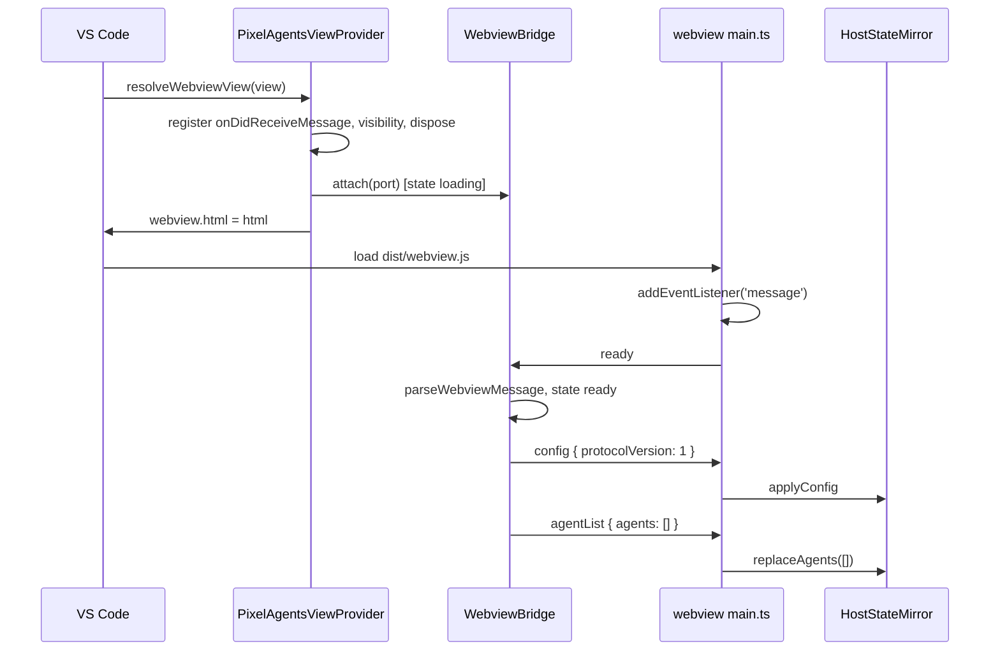

# M2 plan: Protocol

Purpose: the detailed, task-by-task plan for milestone M2 (Protocol): the typed, validated message contract between the extension host and the webview, the `ready` handshake, and reveal-only `focusAgent`. Written by the architect; the developer and tester work from it.
Related: [roadmap M2](../../engineering/roadmap.md#m2-protocol), [M1 plan](m1-scaffold.md), [host-webview protocol](../host-webview-protocol.md), [security and safety](../security-and-safety.md), [ADR 0007 allow-list protocol](../adr/0007-allow-list-protocol-pull-handshake.md), [ADR 0001 bottom-panel webview](../adr/0001-bottom-panel-webview.md), [ADR 0004 esbuild two bundles](../adr/0004-esbuild-two-bundles.md), [ADR 0006 test runner](../adr/0006-node-test-runner.md), [architecture overview](../overview.md), [coding standards](../../engineering/coding-standards.md), [CLAUDE.md](../../../CLAUDE.md).

## 1. Goal

After M2 the host and webview talk over a typed, validated channel. On every webview load the webview sends `ready`; the host answers with a config snapshot and an agent-list snapshot (always empty until M3). The webview mirrors whatever the host sends and drops anything malformed. The host accepts exactly two webview messages, `ready` and `focusAgent`, drops everything else without throwing, and `focusAgent` can only ever reveal a terminal (in M2 it reveals nothing, because no agent exists and no reveal capability is wired; M3 wires `TerminalSource`). Nothing changes on screen: the canvas is still blank.

Layers touched: shared protocol (new), extension host (`extension.ts` routing, new vscode-free `src/host/` module), webview UI (`main.ts` plus three small modules). Not touched: monitor, game engine, data tables, sprites, CSP.

M2 builds on the M1 interfaces in [M1 plan section 3](m1-scaffold.md#3-interfaces-signatures-only). Where M1 code differs from those signatures when M2 starts, the developer flags it in the handoff rather than silently adapting the design.

## 2. Invariant check

| Invariant | How M2 respects it |
|---|---|
| 1 Heroes invulnerable | `AgentInfo` has no health-like field; the exact-key validator rejects any extra field, so none can be added on the wire without a protocol change and review. |
| 2 Lifecycle from host events only | The only producer of agent state in the webview is `handleHostMessage`, fed by host messages. The webview has no message type that reports game state back to the host. `HostStateMirror` is the seam the M4 `Game` reads. |
| 3 Read-only monitor, reveal-only `focusAgent` | Webview-to-host union is exactly `ready` and `focusAgent`. `WebviewBridge` imports nothing from `vscode`; its only side-effect capability is a `revealAgentTerminal` callback, which is `null` in M2. The callback is called only for an id present in the host's own agent list. |
| 4 Crash isolation | Host: `WebviewBridge.handleMessage` never throws (validators never throw; the dispatch is wrapped in try/catch). Webview: the message listener body is wrapped in try/catch. The webview is not a source of truth; every load starts from the host snapshot. |
| 5 No image or audio files | No assets. CSP unchanged. |
| 6 No runtime dependencies | No packages added. Validators are hand-written (no schema library). |
| 7 Transcript privacy | `AgentInfo` is exactly `id`, `name`, `state`, `toolName`, `timestamp`. Message creators copy only those five keys; validators reject any other key; strings are bounded and pattern-checked so free text cannot ride in `id` or `toolName`. Logs never include payloads. |

## 3. Interfaces (signatures only)

### 3.1 `src/shared/assertNever.ts` (both bundles)

```ts
/** Exhaustiveness guard for switches over discriminated unions. Throws TypeError('Unexpected variant'); never includes the value in the message. */
export function assertNever(value: never): never;
```

### 3.2 `src/shared/protocol.ts` (both bundles, imports only `./assertNever` if needed)

```ts
export const PROTOCOL_VERSION = 1;

export const AGENT_STATES = ['spawned', 'working', 'idle', 'despawned'] as const;
export type AgentState = (typeof AGENT_STATES)[number];

/** Privacy allow-list (Core invariant 7). Exactly these keys, in this order. */
export const AGENT_INFO_KEYS = ['id', 'name', 'state', 'toolName', 'timestamp'] as const;

export interface AgentInfo {
  /** Session id. Matches AGENT_ID_PATTERN. */
  readonly id: string;
  /** Display name. 1..MAX_AGENT_NAME_LENGTH UTF-16 units, not blank, no control or bidi-override characters. */
  readonly name: string;
  readonly state: AgentState;
  /** Current or last tool name, or null when none. Matches TOOL_NAME_PATTERN. */
  readonly toolName: string | null;
  /** Epoch milliseconds of the last state change. Safe integer, >= 0. */
  readonly timestamp: number;
}

export const MAX_AGENT_ID_LENGTH = 128;
export const MAX_AGENT_NAME_LENGTH = 64;
export const MAX_TOOL_NAME_LENGTH = 128;
/** Upper bound on agents in one snapshot. Assumption: a protocol safety bound, not a user threshold. */
export const MAX_AGENTS = 64;
export const AGENT_ID_PATTERN: RegExp;   // /^[A-Za-z0-9][A-Za-z0-9._:-]{0,127}$/
export const TOOL_NAME_PATTERN: RegExp;  // /^[A-Za-z0-9_][A-Za-z0-9_.:-]{0,127}$/

/** Webview-relevant configuration. M2 carries only the protocol version; M7 and M8 add fields. */
export interface ConfigSnapshot {
  readonly protocolVersion: typeof PROTOCOL_VERSION;
}

// Host to webview
export interface ConfigMessage { readonly type: 'config'; readonly config: ConfigSnapshot; }
export interface AgentListMessage { readonly type: 'agentList'; readonly agents: readonly AgentInfo[]; }
export interface AgentStateMessage { readonly type: 'agentState'; readonly agent: AgentInfo; }
export type HostToWebviewMessage = ConfigMessage | AgentListMessage | AgentStateMessage;

// Webview to host
export interface ReadyMessage { readonly type: 'ready'; }
/** Reveal-only. Never stops, writes to, or sends input to a session. */
export interface FocusAgentMessage { readonly type: 'focusAgent'; readonly agentId: string; }
export type WebviewToHostMessage = ReadyMessage | FocusAgentMessage;

export const HOST_TO_WEBVIEW_TYPES = ['config', 'agentList', 'agentState'] as const;
export const WEBVIEW_TO_HOST_TYPES = ['ready', 'focusAgent'] as const;

/** Compile-time proofs (exported types so noUnusedLocals does not flag them). */
type Exact<A, B> = [A] extends [B] ? ([B] extends [A] ? true : false) : false;
type AssertTrue<T extends true> = T;
export type HostTypesComplete = AssertTrue<Exact<HostToWebviewMessage['type'], (typeof HOST_TO_WEBVIEW_TYPES)[number]>>;
export type WebviewTypesComplete = AssertTrue<Exact<WebviewToHostMessage['type'], (typeof WEBVIEW_TO_HOST_TYPES)[number]>>;
export type AgentInfoKeysComplete = AssertTrue<Exact<keyof AgentInfo, (typeof AGENT_INFO_KEYS)[number]>>;

// Guards and validators: total functions, never throw, never mutate input.
export function isAgentState(value: unknown): value is AgentState;
export function isAgentId(value: unknown): value is string;
export function isAgentInfo(value: unknown): value is AgentInfo;
export function parseWebviewMessage(raw: unknown): WebviewToHostMessage | undefined;
export function parseHostMessage(raw: unknown): HostToWebviewMessage | undefined;

// Creators: the only way the host builds outgoing messages. Copy allow-listed keys only.
export function toAgentInfo(source: AgentInfo): AgentInfo | undefined;
export function createConfigMessage(config: ConfigSnapshot): ConfigMessage;
export function createAgentListMessage(agents: readonly AgentInfo[]): AgentListMessage;
export function createAgentStateMessage(agent: AgentInfo): AgentStateMessage | undefined;
```

Contract (full rules in [host-webview protocol section 4](../host-webview-protocol.md#4-field-and-validation-rules)):

- `parse*` accept only a plain object (`typeof === 'object'`, not null, not an array, prototype `Object.prototype` or `null`), with **exactly** the expected own string keys and no symbol keys, a known `type`, and valid fields. They return a **new** object built from the validated fields, never the input. Anything else returns `undefined`. The whole body is in try/catch returning `undefined` (defends against Proxies and throwing getters in tests; real `postMessage` data is structured-cloned and has neither).
- String checks test `typeof` and length **before** any regex.
- `name` rule: `1 <= length <= 64`, `name.trim().length > 0`, no `\u0000-\u001F`, `\u007F-\u009F`, `‪-‮`, `⁦-⁩`.
- `timestamp` rule: `Number.isSafeInteger(t) && t >= 0`.
- `agentList.agents`: an array (`Array.isArray`), length `<= MAX_AGENTS`, every element `isAgentInfo`, ids unique. Elements are rebuilt via `toAgentInfo`.
- `config.config`: exact keys `['protocolVersion']`, value `=== PROTOCOL_VERSION`. A version mismatch makes the message invalid.
- `toAgentInfo` returns a new object with exactly the five keys in `AGENT_INFO_KEYS` order, or `undefined` if the copy fails `isAgentInfo`. It does not truncate or repair (normalization is the monitor's job in M3).
- `createAgentListMessage` maps through `toAgentInfo`, skips invalid entries, keeps the first of duplicate ids, and caps at `MAX_AGENTS`. Its output always passes `parseHostMessage`.
- `createAgentStateMessage` returns `undefined` if `toAgentInfo` fails.
- No optional properties anywhere in the protocol (`exactOptionalPropertyTypes` stays simple; absence is `null`).

### 3.3 `src/host/webviewBridge.ts` (host bundle, new folder, imports only `src/shared/**`)

```ts
import type { AgentInfo, ConfigSnapshot, HostToWebviewMessage } from '../shared/protocol';

/** Narrow view of vscode.Webview. vscode's Thenable<boolean> is structurally a PromiseLike<boolean>. */
export interface WebviewPort {
  postMessage(message: HostToWebviewMessage): PromiseLike<boolean>;
}

/** Subset of vscode.LogOutputChannel. Messages never contain payload data. */
export interface BridgeLogger {
  trace(message: string): void;
  error(message: string): void;
}

/** Reveal-only capability: must only show the agent's terminal. */
export type RevealAgentTerminal = (agentId: string) => void;

export interface WebviewBridgeDeps {
  readonly getAgents: () => readonly AgentInfo[];
  readonly getConfig: () => ConfigSnapshot;
  /** null until M3 wires TerminalSource; focusAgent is then dropped. */
  readonly revealAgentTerminal: RevealAgentTerminal | null;
  readonly logger: BridgeLogger;
}

export type BridgeState = 'detached' | 'loading' | 'ready';

export class WebviewBridge {
  constructor(deps: WebviewBridgeDeps);
  get state(): BridgeState;
  /** A view was resolved: store the port, state = 'loading'. Replaces any previous port. */
  attach(port: WebviewPort): void;
  /** The view became hidden (its document is destroyed): state = 'loading' if attached. */
  markHidden(): void;
  /** The view was disposed: drop the port, state = 'detached'. */
  detach(): void;
  /** Entry point for onDidReceiveMessage. Never throws. */
  handleMessage(raw: unknown): void;
  /** Push one agent-state event. Dropped unless state === 'ready'. Used by M3. */
  postAgentState(agent: AgentInfo): void;
}
```

Behaviour of `handleMessage(raw)`, all inside one try/catch:

1. If `state === 'detached'`, return.
2. `msg = parseWebviewMessage(raw)`; if `undefined`, `logger.trace('dropped webview message: invalid')`, return.
3. `switch (msg.type)`:
   - `'ready'`: `state = 'ready'`; post `createConfigMessage(getConfig())`, then `createAgentListMessage(getAgents())`. Every `ready` is answered (idempotent; covers "Developer: Reload Webviews").
   - `'focusAgent'`: if `revealAgentTerminal === null`, trace `'dropped focusAgent: reveal unavailable'`, return. If no agent in `getAgents()` has `id === msg.agentId` and `state !== 'despawned'`, trace `'dropped focusAgent: unknown agent'`, return. Otherwise call `revealAgentTerminal(msg.agentId)` exactly once. Nothing is posted back.
   - `default`: `assertNever(msg)`.
4. `catch (error: unknown)`: `logger.error('webview bridge error: ' + describeError(error))`, where `describeError` returns `error.name + ': ' + error.message` for an `Error` and `'non-error thrown'` otherwise. No rethrow.

Private `post(message)`: if no port, return; `port.postMessage(message).then(undefined, () => logger.trace('post failed: view gone'))`. A failed post is recovered by the next `ready`.

`postAgentState(agent)`: if `state !== 'ready'`, return; `msg = createAgentStateMessage(agent)`; if `undefined`, `logger.error('refused to post agent: invalid fields')` and return; else `post(msg)`. Wrapped in try/catch like `handleMessage`.

### 3.4 `src/extension.ts` changes (host bundle)

```ts
export function activate(context: vscode.ExtensionContext): void;
export function deactivate(): void;

export class PixelAgentsViewProvider implements vscode.WebviewViewProvider, vscode.Disposable {
  constructor(extensionUri: vscode.Uri, bridge: WebviewBridge);
  resolveWebviewView(webviewView: vscode.WebviewView, context: vscode.WebviewViewResolveContext, token: vscode.CancellationToken): void;
  dispose(): void;
}
```

- `activate`: create `const log = vscode.window.createOutputChannel('Pixel Agents', { log: true })` (first host log use, per [coding standards section 6](../../engineering/coding-standards.md#6-logging-and-privacy)); create `WebviewBridge` with `getAgents: () => NO_AGENTS` (`const NO_AGENTS: readonly AgentInfo[] = []`, comment `Assumption: no monitor until M3; the snapshot is empty`), `getConfig: () => ({ protocolVersion: PROTOCOL_VERSION })`, `revealAgentTerminal: null` (comment: `M3 wires TerminalSource reveal; until then focusAgent is dropped`), `logger: log`. Construct the provider with the bridge. Push `log`, the provider, and the `registerWebviewViewProvider` registration onto `context.subscriptions`.
- `resolveWebviewView`, in this order: dispose any previous view listeners; set `webview.options` (unchanged from M1); register `webview.onDidReceiveMessage((raw: unknown) => bridge.handleMessage(raw))`, `webviewView.onDidChangeVisibility(() => { if (!webviewView.visible) bridge.markHidden(); })`, `webviewView.onDidDispose(() => { bridge.detach(); disposeViewListeners(); })`, storing the three disposables in a private array; `bridge.attach({ postMessage: (m) => webviewView.webview.postMessage(m) })`; **then** assign `webview.html` (M1 code). Listeners go first so the first `ready` cannot be missed.
- `dispose()`: `bridge.detach()` and dispose the view listeners.
- `extension.ts` never calls `webview.postMessage` directly; only the bridge posts.

### 3.5 Webview modules (webview bundle, DOM-free except `main.ts`)

```ts
// src/webview/hostChannel.ts
import type { WebviewToHostMessage } from '../shared/protocol';
/** The part of the object returned by acquireVsCodeApi() that we use. getState/setState are deliberately not typed: the webview is never a source of truth. */
export interface VsCodeWebviewApi { postMessage(message: unknown): void; }
export interface HostChannel { send(message: WebviewToHostMessage): void; }
export function createHostChannel(api: VsCodeWebviewApi): HostChannel;

// src/webview/hostMessages.ts
import type { AgentInfo, ConfigSnapshot } from '../shared/protocol';
/** Anything that consumes host state. HostStateMirror now; the M4 Game reads the mirror. */
export interface HostMessageTarget {
  replaceAgents(agents: readonly AgentInfo[]): void;
  applyAgent(agent: AgentInfo): void;
  applyConfig(config: ConfigSnapshot): void;
}
/** Parses and dispatches one host message. Returns false if dropped. Parse never throws; errors thrown by the target propagate to the caller's try/catch. */
export function handleHostMessage(raw: unknown, target: HostMessageTarget): boolean;

// src/webview/hostState.ts
import type { AgentInfo, ConfigSnapshot } from '../shared/protocol';
import type { HostMessageTarget } from './hostMessages';
/** In-memory mirror of host-provided state. Rebuilt from scratch on every webview load. */
export class HostStateMirror implements HostMessageTarget {
  replaceAgents(agents: readonly AgentInfo[]): void; // clear, then insert all
  applyAgent(agent: AgentInfo): void;                // 'despawned' deletes; any other state upserts (a missed 'spawned' is tolerated)
  applyConfig(config: ConfigSnapshot): void;         // stores the latest snapshot
  get config(): ConfigSnapshot | null;
  get agentCount(): number;
  getAgent(id: string): AgentInfo | undefined;
  agents(): readonly AgentInfo[];                    // insertion order
}
```

`handleHostMessage` switches over `msg.type` with `assertNever` in `default`; `applyAgent` switches over `agent.state` with `assertNever` (`'despawned'` deletes; `'spawned' | 'working' | 'idle'` upsert).

### 3.6 `src/webview/main.ts` changes

Boot keeps M1 steps 1-3 and replaces the M1 "no `acquireVsCodeApi`" rule:

1. Module-level `declare function acquireVsCodeApi(): VsCodeWebviewApi;` (the global VS Code injects; may be called only once).
2. After canvas setup: `const mirror = new HostStateMirror()`.
3. `onMessage = (event: MessageEvent<unknown>): void => { try { handleHostMessage(event.data, mirror); } catch (error: unknown) { reportError(error); } }`; `window.addEventListener('message', onMessage)`.
4. `const channel = createHostChannel(acquireVsCodeApi())`; `channel.send({ type: 'ready' })`. Listener before `ready`, so the reply cannot be missed.
5. `onPageHide` removes the `resize`, `message`, and `pagehide` listeners.
6. `reportError(error: unknown)`: the single crash reporter (M1's catch block now calls it too). `console.error('Pixel Agents:', message)` once per distinct message per page load (a `Set<string>` of seen messages). The message is `error.message` for an `Error`, else `'non-error thrown'`; never `event.data`.
No `focusAgent` is sent in M2 (no clickable UI until M7). Nothing is drawn from the mirror until M4.

## 4. Data flow (M2)



All other flows (hide/show, reload, agent-state push, `focusAgent`, invalid message) are in [host-webview protocol section 6](../host-webview-protocol.md#6-flows).

## 5. Developer task list

Do the tasks in order; each is independently verifiable. No new packages.

1. **`src/shared/assertNever.ts`.** Implement section 3.1.
   Check: `npm run typecheck` passes.

2. **`src/shared/protocol.ts`: types and constants.** All type declarations, constants, patterns, and the three compile-time proof types from section 3.2. Header comment: this file is the privacy allow-list (Core invariant 7) and the complete list of webview-to-host messages (Core invariant 3); any change needs an architect plan and a doc update in `host-webview-protocol.md`.
   Check: typecheck passes in both host and webview projects; deliberately adding a third member to `WebviewToHostMessage` without updating `WEBVIEW_TO_HOST_TYPES` fails typecheck (try it locally, then revert).

3. **`src/shared/protocol.ts`: guards, validators, creators.** Implement the functions in section 3.2 with the contract rules. Private helpers (not exported): `isPlainObject(value: unknown): value is Record<string, unknown>`, `hasExactKeys(obj: object, keys: readonly string[]): boolean` (compares `Object.keys` as a set and requires `Object.getOwnPropertySymbols(obj).length === 0`), `isBoundedString(value: unknown, min: number, max: number): value is string`, `isAgentName(value: unknown): value is string`, `isToolName(value: unknown): value is string | null`, `isTimestamp(value: unknown): value is number`. Both `parse*` functions use a `switch` on the validated `type` string with `default` returning `undefined` (the type is still `string` at that point, so no `assertNever` there; exhaustiveness is proven by the `*TypesComplete` types and the dispatch switches in tasks 4 and 6).
   Check: typecheck and lint pass; quick local sanity run of `parseWebviewMessage({ type: 'ready' })` returning a new `{ type: 'ready' }`.

4. **`src/host/webviewBridge.ts`.** New folder `src/host/` for vscode-free host logic. Implement section 3.3. The class holds `#state: BridgeState`, `#port: WebviewPort | null`. Imports: only `../shared/protocol` and `../shared/assertNever`.
   Check: typecheck passes; file contains no `vscode` import.

5. **Repo config for `src/host/`.**
   - `tsconfig.json`: add `"src/host/**/*.ts"` to `include`.
   - `eslint.config.mjs`: add a boundary block for `src/host/**/*.ts`: `no-restricted-imports` bans `vscode`, `../game/*`, `../monitor/*`, `../webview/*`, `../extension` (patterns written the same way as the existing M1 boundary blocks). Add `src/host/**` to the existing webview-code ban list (webview and game code must not import it) and to the `src/shared/**` ban list.
   Check: `npm run lint` passes; temporarily adding `import * as vscode from 'vscode'` to `webviewBridge.ts` fails lint (revert).

6. **`src/webview/hostChannel.ts`, `hostMessages.ts`, `hostState.ts`.** Implement section 3.5. None of these touch `window`, `document`, or `acquireVsCodeApi`, so tests can import them.
   Check: `tsc -p tsconfig.webview.json` passes; lint passes.

7. **`src/extension.ts`.** Implement section 3.4 on top of M1's provider.
   Check: `npm run build` and `typecheck` pass; `dist/extension.js` contains `onDidReceiveMessage`; `dist/webview.js` does not contain `WebviewBridge` (development build, names unminified).

8. **`src/webview/main.ts`.** Implement section 3.6.
   Check: `npm run build` passes; `dist/webview.js` contains `acquireVsCodeApi` and no `require(`.

9. **Manual F5 check.** Launch, open the Pixel Agents tab. In "Developer: Open Webview Developer Tools": no errors, no CSP violation from our script or style (the M1 note about VS Code's injected default style still applies). Set the "Pixel Agents" output channel to Trace ("Developer: Set Log Level" or the channel's gear): opening the tab logs nothing at error level and no "dropped webview message" trace line (the `ready` was accepted). Hide and re-show the tab: still no errors. Run "Developer: Reload Webviews": still no errors. Record results in the handoff.

10. **`CHANGELOG.md` and `README.md`.** CHANGELOG `## [Unreleased]` / `### Added`: "Typed host/webview protocol with validated messages, `ready` handshake, reveal-only `focusAgent`." README: one sentence under the observe-only promise that the panel can only ask VS Code to show a terminal, never to control it. No config table yet.

11. **Hand off to the tester** with section 7. Flag drift: `CLAUDE.md` directory map (new `src/host/`, new webview files), coding standards section 3 (new boundary row), overview containers. The architect applies the deferred edits listed in the M2 planning handoff.

12. **Commit after reviewer Approve.** Branch `feat/m2-protocol` from `main`; set roadmap M2 `Status: done` and summary row 2; one commit `feat: add typed host-webview protocol with ready handshake`; `git switch main && git merge --ff-only feat/m2-protocol`. No push.

## 6. Ownership split

| File or area | Owner |
|---|---|
| `src/shared/assertNever.ts`, `src/shared/protocol.ts`, `src/host/webviewBridge.ts`, `src/extension.ts`, `src/webview/{main,hostChannel,hostMessages,hostState}.ts` | developer |
| `tsconfig.json`, `eslint.config.mjs`, `CHANGELOG.md`, `README.md` | developer |
| `test/**`, `docs/engineering/testing-strategy.md` | tester |
| this plan, `docs/architecture/host-webview-protocol.md`, `security-and-safety.md`, ADR 0007, deferred doc edits | architect |
| git operations, roadmap status line | developer |

## 7. Test notes for the tester

All suites run on `node:test` ([ADR 0006](../adr/0006-node-test-runner.md)). Everything below imports only `src/shared/**`, `src/host/**`, and the three DOM-free webview modules, so no `vscode` stub is needed. Suggested files: `test/shared/protocol.test.ts`, `test/shared/protocolFuzz.test.ts`, `test/host/webviewBridge.test.ts`, `test/webview/hostMessages.test.ts`, `test/repo/protocolStructure.test.ts`.

1. **Exhaustiveness.**
   - Runtime: `HOST_TO_WEBVIEW_TYPES` deep-equals `['config', 'agentList', 'agentState']`; `WEBVIEW_TO_HOST_TYPES` deep-equals `['ready', 'focusAgent']`; `AGENT_STATES` deep-equals `['spawned', 'working', 'idle', 'despawned']`.
   - Type level: a test file declares a `switch` over each union (`HostToWebviewMessage['type']`, `WebviewToHostMessage['type']`, `AgentState`) ending in `assertNever`; it must compile under `tsconfig.tools.json` (typecheck runs it). Also reference `HostTypesComplete`, `WebviewTypesComplete`, `AgentInfoKeysComplete` so a broken proof fails typecheck.
   - Structural: every `switch` in `src/shared/**`, `src/host/**`, and `src/webview/host*.ts` whose discriminant is `.type` or `.state` has a `default` that calls `assertNever` (grep-level check is enough; `parse*` switch on raw strings is the documented exception).
   - `assertNever` throws `TypeError` whose message does not contain the passed value (call it with a cast string like `'secret-text'`).
2. **Validator cases (`parseWebviewMessage`; never throws, returns `undefined`).** `undefined`, `null`, `0`, `NaN`, `''`, `'ready'`, `true`, `[]`, `[{ type: 'ready' }]`, `{}`, `{ type: 'Ready' }`, `{ type: ' ready' }`, `{ type: 'ready', extra: 1 }`, `{ type: 'ready', [Symbol('x')]: 1 }`, `JSON.parse('{"type":"ready","__proto__":{"x":1}}')`, `{ type: 'ready', constructor: 1 }`, a class instance with `type = 'ready'`, `Object.create({ type: 'ready' })` (inherited key), an object with a throwing getter for `type`, a `Proxy` whose `ownKeys` throws, `{ type: 'focusAgent' }`, `{ type: 'focusAgent', agentId: 1 }`, `agentId: ''`, `agentId` of 129 chars (128 accepted), `agentId: '-abc'`, `agentId: 'a b'`, `agentId: 'a\u0000'`, `agentId` of 1,000,000 chars (also assert it returns in under 50 ms), `{ type: 'focusAgent', agentId: 'a', command: 'kill' }`, `{ type: 'stopAgent', agentId: 'a' }`, `{ type: 'sendText', text: 'x' }`. Accepted: `{ type: 'ready' }`, `Object.assign(Object.create(null), { type: 'ready' })`, `{ type: 'focusAgent', agentId: 'sim-1' }`. Accepted results are new objects (`!==` input) with exactly the expected keys.
3. **Validator cases (`parseHostMessage`).** Same shape attacks, plus: agent with each of the five keys missing; agent with an extra key (`text`, `content`, `message`, `cwd`, `hp`); `state: 'dead'`; `toolName: ''`, `toolName: 'Bash tool'`, `toolName: undefined`, `toolName: null` (accepted); `name` blank, 65 chars, containing `\n`, `‮`; `timestamp` `-1`, `1.5`, `NaN`, `Infinity`, `'1'`, `2 ** 53`; `agents` not an array, 65 entries, duplicate ids; `config` with `protocolVersion: 2` or an extra key.
4. **Fuzz.** Deterministic PRNG implemented inline in the test (for example mulberry32, fixed seed; no package). 10,000 iterations per parser: random JSON-like values to depth 3, plus mutations of valid messages (drop a key, add a key, change a field's type, swap the `type` string, oversize a string). Assert no throw; any accepted value deep-equals what the creators would produce for the same fields and has exactly the expected keys. Print the seed on failure.
5. **Privacy allow-list.** `AGENT_INFO_KEYS` deep-equals `['id', 'name', 'state', 'toolName', 'timestamp']`. `toAgentInfo` on an object carrying extra fields (`text`, `content`, `prompt`, `cwd`, `transcriptPath`) returns an object whose `Object.keys` equals `AGENT_INFO_KEYS`. `JSON.stringify(createAgentListMessage([thatObject]))` contains none of the extra values. Round trip: every creator output survives `structuredClone` and passes the matching parser with deep equality. `createAgentListMessage` drops invalid entries, keeps the first duplicate, caps at 64.
6. **No controlling message types.** `WEBVIEW_TO_HOST_TYPES` is exactly the two entries. A structural test reads `src/shared/protocol.ts` and asserts no string literal type in the message unions contains `kill`, `stop`, `terminate`, `signal`, `send`, `write`, `input`, `exec`, `run`, `command`, `dispose`, `close` (case-insensitive). A grep test over `src/host/**` and `src/extension.ts` finds no `sendText`, `sendSequence`, `child_process`, `process.kill`, `executeCommand`, `.dispose()` on a terminal, or `fs.write`/`fs.append`/`fs.unlink`. `src/host/**` imports nothing but `../shared/*`.
7. **Handshake and bridge (fake port, fake logger, spy reveal).**
   - New bridge: `state === 'detached'`; `handleMessage({ type: 'ready' })` posts nothing.
   - After `attach`: state `loading`; `postAgentState(validAgent)` posts nothing.
   - `ready`: state `ready`; posts exactly `[config, agentList]` in that order; `agentList.agents` is `[]` with the M2 deps; `config.protocolVersion === 1`.
   - A second `ready` posts the pair again.
   - `postAgentState` when ready posts one `agentState` with exactly the allow-listed keys; with an invalid agent posts nothing and logs one error not containing the agent's name.
   - `markHidden`: state `loading`; `postAgentState` posts nothing; next `ready` restores.
   - `detach`: state `detached`; `handleMessage` of anything posts nothing and does not throw.
   - `attach` a second port: subsequent posts go only to the new port.
   - Invalid or unknown messages: zero posts, reveal never called, logger `trace` called with a message that contains no payload text.
   - `focusAgent` with `revealAgentTerminal: null`: no call, no post. With a spy and `getAgents` returning `[agent sim-1 working]`: `focusAgent sim-1` calls the spy exactly once with `'sim-1'` and posts nothing; `focusAgent sim-2` (unknown) and `focusAgent` for a `despawned` agent do not call it.
   - `getAgents` or `getConfig` throwing: `handleMessage` does not throw; one `logger.error` call.
   - `port.postMessage` returning a rejected promise: no unhandled rejection (register a `process.on('unhandledRejection')` spy for the test).
8. **Webview receiving.** `handleHostMessage` with `HostStateMirror`: `agentList` replaces (a previously present agent disappears); `agentState working` for an unknown id inserts; `idle` updates; `despawned` deletes; `config` stores; every invalid case from note 3 returns `false` and leaves the mirror unchanged. Rebuild: a fresh mirror fed the same `agentList` equals the old one (the "reload rebuilds from the host list" property the M4 scene relies on). `createHostChannel(fakeApi).send({ type: 'ready' })` calls `fakeApi.postMessage` once with `{ type: 'ready' }`.
9. **Existing M1 suites** stay green: the CSP string is unchanged; bundle checks still pass. Add to the bundle test: `dist/webview.js` contains no `WebviewBridge` and no `onDidReceiveMessage`.
10. **Manual QA additions** for `testing-strategy.md`: task 9's F5 checks (no errors on open, hide/show, Reload Webviews).

Not automated in M2: the `extension.ts` glue (listener order, `onDidChangeVisibility` wiring). It is kept thin so the bridge tests cover the logic; host integration tests still need `@vscode/test-electron`, which needs human approval.

## 8. Gates for M2

| Gate | M2 meaning |
|---|---|
| G1 | `npm run build`, `lint`, `typecheck`, `test` pass |
| G2 | not applicable before H1 |
| G3 | invariants intact (section 2); structural tests in notes 5 and 6 pass |
| G4 | manifest and no-assets tests still pass; no new packages |
| G5 | `CHANGELOG.md` entry; `host-webview-protocol.md` and `security-and-safety.md` match the code; deferred architect edits applied |
| G6 | `CLAUDE.md` directory map lists `src/host/` and the new webview files |
| G7 | reviewer Approve; one commit on `feat/m2-protocol`; roadmap ticked |

## 9. Risks, assumptions, defaults

- **New folder `src/host/`.** Needed so the routing logic is testable without `vscode` ([ADR 0006](../adr/0006-node-test-runner.md) consequence). It is host-bundle only and vscode-free; vscode objects come in as narrow interfaces. E1's progress store is expected to live here too. Cheap to reverse, so no ADR; recorded in [ADR 0007](../adr/0007-allow-list-protocol-pull-handshake.md) consequences.
- **Pull handshake.** The host never pushes before `ready` because messages posted before the webview registers its listener can be lost. Every `ready` is answered; a webview spamming `ready` costs at most one config and one 64-agent snapshot per message, which is acceptable.
- **`resolveWebviewView` may run more than once** (VS Code can re-resolve after the container is moved or closed). `attach` replaces the port and the provider disposes old listeners first.
- **Hidden view.** With `retainContextWhenHidden: false` the document is destroyed on hide; the bridge returns to `loading` and drops pushes until the next `ready`, whose snapshot covers anything missed.
- **`Thenable` vs `PromiseLike`.** `vscode.Webview.postMessage` returns `Thenable<boolean>`, which is assignable to `PromiseLike<boolean>`. If `@types/vscode@1.90.0` disagrees, the adapter in `extension.ts` wraps it with `Promise.resolve(...)`.
- **Config snapshot content.** M2 has no webview-relevant settings, so `ConfigSnapshot` carries only `protocolVersion`. Both bundles ship together, so a mismatch can only happen mid-`watch`; the webview then drops the config message, and a reload fixes it. A `onDidChangeConfiguration` push arrives with the first webview-relevant setting (M7).
- **Protocol limits are not user settings.** `MAX_AGENTS` (64) and the string lengths are safety bounds on the wire, not tunable thresholds, so they are constants, not `pixelAgents.*` settings.
- **Silent drops.** Invalid messages are dropped and logged at trace level with a fixed reason string, never the payload. The output channel is introduced now because the bridge needs somewhere to report its own errors.
- **Names are untrusted display text.** The protocol bounds them and strips nothing; renderers must draw them as canvas text or `textContent`, never `innerHTML` (M7 note in [security and safety](../security-and-safety.md)).
- **Performance.** Validation is O(agents) per message; with at most a few messages per second after M3 debouncing, cost is negligible at 60fps.
- **CSP.** Unchanged; `acquireVsCodeApi` and `postMessage` need no CSP source.
- **Defaults chosen:** id pattern and 128 limit, name limit 64, tool-name pattern and 128 limit, `MAX_AGENTS` 64, `toolName: null` for "no tool", `timestamp` in epoch ms, config sent before agent list, `despawned` agents not revealable.

## 10. Art needs

None. M2 draws nothing new. Confirmed against the [roadmap](../../engineering/roadmap.md#m2-protocol).
