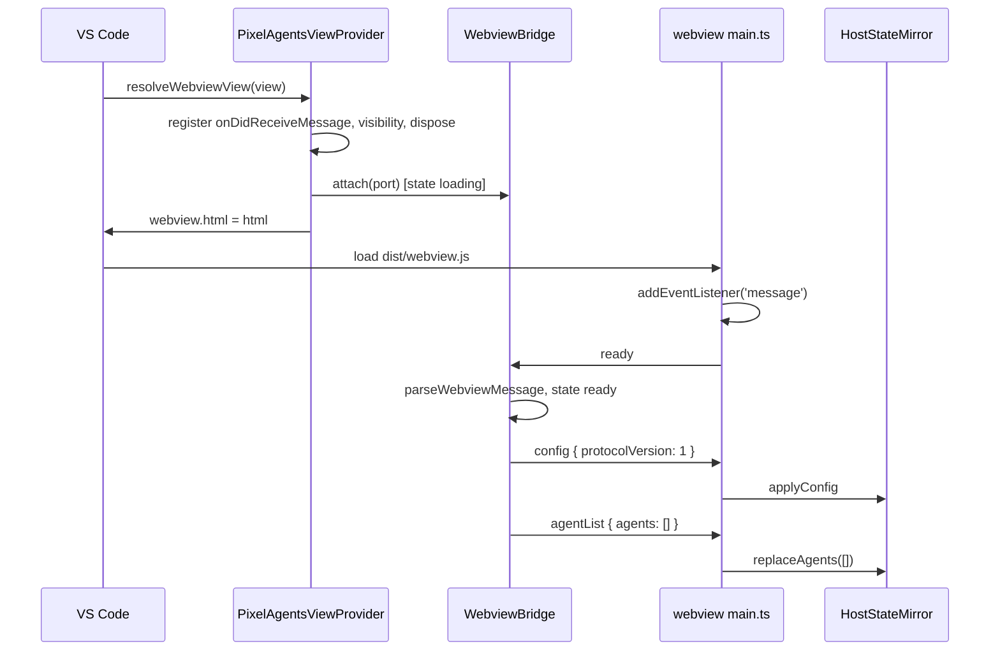

# M2 plan: Protocol

Purpose: the detailed, task-by-task plan for milestone M2 (Protocol): the typed, validated message contract between the extension host and the webview, the `ready` handshake, and reveal-only `focusAgent`. Written by the architect; the developer and tester work from it.
Related: [roadmap M2](../../engineering/roadmap.md#m2-protocol), [M1 plan](m1-scaffold.md), [host-webview protocol](../host-webview-protocol.md), [security and safety](../security-and-safety.md), [ADR 0007 allow-list protocol](../adr/0007-allow-list-protocol-pull-handshake.md), [ADR 0001 bottom-panel webview](../adr/0001-bottom-panel-webview.md), [ADR 0004 esbuild two bundles](../adr/0004-esbuild-two-bundles.md), [ADR 0006 test runner](../adr/0006-node-test-runner.md), [architecture overview](../overview.md), [coding standards](../../engineering/coding-standards.md), [testing strategy](../../engineering/testing-strategy.md), [glossary](../../glossary.md), [CLAUDE.md](../../../CLAUDE.md).

## 1. Goal

After M2 the host and webview talk over a typed, validated channel. On every webview load the webview sends `ready`; the host answers with a config snapshot and an agent-list snapshot (always empty until M3). The webview mirrors whatever the host sends and drops anything malformed. The host accepts exactly two webview messages, `ready` and `focusAgent`, drops everything else without throwing, and `focusAgent` can only ever reveal a terminal (in M2 it reveals nothing, because no agent exists and no reveal capability is wired; M3 wires `TerminalSource`). Nothing changes on screen: the canvas is still blank.

Layers touched: shared protocol (new), extension host (`extension.ts` routing, new vscode-free `src/host/` module), webview UI (`main.ts` plus three small modules). Not touched: monitor, game engine, data tables, sprites, CSP.

M2 builds on the M1 interfaces in [M1 plan section 3](m1-scaffold.md#3-interfaces-signatures-only). Where M1 code differs from those signatures when M2 starts, the developer flags it in the handoff rather than silently adapting the design.

### 1.1 M1 as built (checked against commit d5e0c7f)

This plan was refreshed against the committed M1 code before M2 development started. The facts it relies on:

- `src/extension.ts`: `activate` registers one `PixelAgentsViewProvider` (constructor `(extensionUri)`) with `retainContextWhenHidden: false` and pushes only the registration onto `context.subscriptions`. `resolveWebviewView` sets the locked-down `webview.options`, then `webview.html` with a fresh nonce from `randomBytes(16)`. No message listener, no output channel.
- `src/webview/main.ts`: `boot()` sizes and clears the canvas, lays it out, registers `resize` and `pagehide`; boot and the resize handler are wrapped in try/catch and report through `reportError`, which prints `Pixel Agents webview error: <message>`. No `acquireVsCodeApi`.
- `esbuild.mjs`: host bundle with an external `dist/extension.js.map`; webview bundle with an **inline** sourcemap in development (CSP: no `connect-src`, so DevTools may not fetch a `.map`), none in production ([ADR 0004 implementation notes](../adr/0004-esbuild-two-bundles.md#implementation-notes-m1)). M2 changes nothing here; new webview modules are bundled into `dist/webview.js` and covered by the same inline map.
- `eslint.config.mjs`: boundary blocks for `src/shared/**`, host (`src/extension.ts`, `src/monitor/**`), webview and game, and `index.html.ts`, written as gitignore-style `group` patterns (`'**/monitor'`, `'**/monitor/**'`, ...). No `src/host/` block yet.
- `tsconfig.json` (host) includes `src/extension.ts`, `src/monitor/**`, `src/shared/**`, `src/webview/index.html.ts`; `tsconfig.webview.json` includes `src/webview/**` (minus `index.html.ts`), `src/game/**`, `src/shared/**`. `tsconfig.tools.json` typechecks `test/**`, so a test that no longer compiles fails `npm run typecheck`.
- Tests: `node:test` unit suites via `test/run.mjs`, which aliases `vscode` to `test/support/fakeVscode.ts`; `test/webview/main.test.ts` runs `dist/webview.js` in a `node:vm` fake DOM (`test/support/fakeDom.ts`). Extension-host integration tests: `@vscode/test-electron` (approved, exact-pinned `3.1.0`, [ADR 0006 amendment](../adr/0006-node-test-runner.md#amendment-m1-review-extension-host-integration-tests)) via `npm run test:integration` (`test/integration/run.mjs`), always with `--disable-extensions` and a temp profile; in-host suites are `test/integration/suite/*.itest.ts` run by the minimal harness in `test/integration/support/harness.ts`; `test/integration/support/providerSpy.ts` wraps `window.registerWebviewViewProvider` before activation to observe every `WebviewView` without a production hook.
- On hide and re-show, VS Code reloads the webview document from the same `html` without calling `resolveWebviewView` again (the M1 integration suite sees one resolution across seven hide/show cycles). Each show is therefore a new document, a new `main.ts` run, and a new `ready`.

### 1.2 `ready` is the observable "script ran" signal

The tester asked for a way to confirm, from the host, that `main.ts` really ran in the real webview after each show, without a test-only hook. The protocol provides it: `ready` is sent by `main.ts` once per document load, after its `message` listener is registered, and arrives on the host through the public `webview.onDidReceiveMessage` event. That event accepts any number of subscribers, so the integration suite's `providerSpy` can subscribe on the same `WebviewView` and count `ready` messages (section 7, note 11). Rules this places on the implementation:

- `ready` is sent unconditionally on every boot that reaches step 4 of section 3.6, never deferred, debounced, or skipped on a "second" load.
- No test-only surface: no `pixelAgents.*` test command, no exported test API from `activate`, no environment-variable switch, no extra message type. `activate` keeps returning `void`.
- The host answer (`config`, then `agentList`) goes through `webview.postMessage`, so the spy can also observe it if the tester chooses to wrap that method (note 11).

## 2. Invariant check

| Invariant | How M2 respects it |
|---|---|
| 1 Heroes invulnerable | `AgentInfo` has no health-like field; the exact-key validator rejects any extra field, so none can be added on the wire without a protocol change and review. |
| 2 Lifecycle from host events only | The only producer of agent state in the webview is `handleHostMessage`, fed by host messages. The webview has no message type that reports game state back to the host. `HostStateMirror` is the seam the M4 `Game` reads. |
| 3 Read-only monitor, reveal-only `focusAgent` | Webview-to-host union is exactly `ready` and `focusAgent`. `WebviewBridge` imports nothing from `vscode`; its only side-effect capability is a `revealAgentTerminal` callback, which is `null` in M2. The callback is called only for an id present in the host's own agent list. |
| 4 Crash isolation | Host: `WebviewBridge.handleMessage` never throws (validators never throw; the dispatch is wrapped in try/catch). Webview: the message listener body is wrapped in try/catch. The webview is not a source of truth; every load starts from the host snapshot. |
| 5 No image or audio files | No assets. CSP unchanged. |
| 6 No runtime dependencies | No packages added. Validators are hand-written (no schema library). |
| 7 Transcript privacy | `AgentInfo` is exactly `id`, `name`, `state`, `toolName`, `timestamp`. Message creators copy only those five keys; validators reject any other key; strings are bounded and pattern-checked so free text cannot ride in `id` or `toolName`. Logs never include payloads. |

## 3. Interfaces (signatures only)

### 3.1 `src/shared/assertNever.ts` (both bundles)

```ts
/** Exhaustiveness guard for switches over discriminated unions. Throws TypeError('Unexpected variant'); never includes the value in the message. */
export function assertNever(value: never): never;
```

### 3.2 `src/shared/protocol.ts` (both bundles, imports only `./assertNever` if needed)

```ts
export const PROTOCOL_VERSION = 1;

export const AGENT_STATES = ['spawned', 'working', 'idle', 'despawned'] as const;
export type AgentState = (typeof AGENT_STATES)[number];

/** Privacy allow-list (Core invariant 7). Exactly these keys, in this order. */
export const AGENT_INFO_KEYS = ['id', 'name', 'state', 'toolName', 'timestamp'] as const;

export interface AgentInfo {
  /** Session id. Matches AGENT_ID_PATTERN. */
  readonly id: string;
  /** Display name. 1..MAX_AGENT_NAME_LENGTH UTF-16 units, not blank, no control or bidi-override characters. */
  readonly name: string;
  readonly state: AgentState;
  /** Current or last tool name, or null when none. Matches TOOL_NAME_PATTERN. */
  readonly toolName: string | null;
  /** Epoch milliseconds of the last state change. Safe integer, >= 0. */
  readonly timestamp: number;
}

export const MAX_AGENT_ID_LENGTH = 128;
export const MAX_AGENT_NAME_LENGTH = 64;
export const MAX_TOOL_NAME_LENGTH = 128;
/** Upper bound on agents in one snapshot. Assumption: a protocol safety bound, not a user threshold. */
export const MAX_AGENTS = 64;
export const AGENT_ID_PATTERN: RegExp;   // /^[A-Za-z0-9][A-Za-z0-9._:-]{0,127}$/
export const TOOL_NAME_PATTERN: RegExp;  // /^[A-Za-z0-9_][A-Za-z0-9_.:-]{0,127}$/

/** Webview-relevant configuration. M2 carries only the protocol version; M7 and M8 add fields. */
export interface ConfigSnapshot {
  readonly protocolVersion: typeof PROTOCOL_VERSION;
}

// Host to webview
export interface ConfigMessage { readonly type: 'config'; readonly config: ConfigSnapshot; }
export interface AgentListMessage { readonly type: 'agentList'; readonly agents: readonly AgentInfo[]; }
export interface AgentStateMessage { readonly type: 'agentState'; readonly agent: AgentInfo; }
export type HostToWebviewMessage = ConfigMessage | AgentListMessage | AgentStateMessage;

// Webview to host
export interface ReadyMessage { readonly type: 'ready'; }
/** Reveal-only. Never stops, writes to, or sends input to a session. */
export interface FocusAgentMessage { readonly type: 'focusAgent'; readonly agentId: string; }
export type WebviewToHostMessage = ReadyMessage | FocusAgentMessage;

export const HOST_TO_WEBVIEW_TYPES = ['config', 'agentList', 'agentState'] as const;
export const WEBVIEW_TO_HOST_TYPES = ['ready', 'focusAgent'] as const;

/** Compile-time proofs (exported types so noUnusedLocals does not flag them). */
type Exact<A, B> = [A] extends [B] ? ([B] extends [A] ? true : false) : false;
type AssertTrue<T extends true> = T;
export type HostTypesComplete = AssertTrue<Exact<HostToWebviewMessage['type'], (typeof HOST_TO_WEBVIEW_TYPES)[number]>>;
export type WebviewTypesComplete = AssertTrue<Exact<WebviewToHostMessage['type'], (typeof WEBVIEW_TO_HOST_TYPES)[number]>>;
export type AgentInfoKeysComplete = AssertTrue<Exact<keyof AgentInfo, (typeof AGENT_INFO_KEYS)[number]>>;

// Guards and validators: total functions, never throw, never mutate input.
export function isAgentState(value: unknown): value is AgentState;
export function isAgentId(value: unknown): value is string;
export function isAgentInfo(value: unknown): value is AgentInfo;
export function parseWebviewMessage(raw: unknown): WebviewToHostMessage | undefined;
export function parseHostMessage(raw: unknown): HostToWebviewMessage | undefined;

// Creators: the only way the host builds outgoing messages. Copy allow-listed keys only.
export function toAgentInfo(source: AgentInfo): AgentInfo | undefined;
export function createConfigMessage(config: ConfigSnapshot): ConfigMessage;
export function createAgentListMessage(agents: readonly AgentInfo[]): AgentListMessage;
export function createAgentStateMessage(agent: AgentInfo): AgentStateMessage | undefined;
```

Contract (full rules in [host-webview protocol section 4](../host-webview-protocol.md#4-field-and-validation-rules)):

- `parse*` accept only a plain object (`typeof === 'object'`, not null, not an array, prototype `Object.prototype` or `null`), with **exactly** the expected own string keys and no symbol keys, a known `type`, and valid fields. They return a **new** object built from the validated fields, never the input. Anything else returns `undefined`. The whole body is in try/catch returning `undefined` (defends against Proxies and throwing getters in tests; real `postMessage` data is structured-cloned and has neither).
- String checks test `typeof` and length **before** any regex.
- `name` rule: `1 <= length <= 64`, `name.trim().length > 0`, no `\u0000-\u001F`, `\u007F-\u009F`, `‪-‮`, `⁦-⁩`.
- `timestamp` rule: `Number.isSafeInteger(t) && t >= 0`.
- `agentList.agents`: an array (`Array.isArray`), length `<= MAX_AGENTS`, every element `isAgentInfo`, ids unique. Elements are rebuilt via `toAgentInfo`.
- `config.config`: exact keys `['protocolVersion']`, value `=== PROTOCOL_VERSION`. A version mismatch makes the message invalid.
- `toAgentInfo` returns a new object with exactly the five keys in `AGENT_INFO_KEYS` order, or `undefined` if the copy fails `isAgentInfo`. It does not truncate or repair (normalization is the monitor's job in M3).
- `createAgentListMessage` maps through `toAgentInfo`, skips invalid entries, keeps the first of duplicate ids, and caps at `MAX_AGENTS`. Its output always passes `parseHostMessage`.
- `createAgentStateMessage` returns `undefined` if `toAgentInfo` fails.
- No optional properties anywhere in the protocol (`exactOptionalPropertyTypes` stays simple; absence is `null`).

### 3.3 `src/host/webviewBridge.ts` (host bundle, new folder, imports only `src/shared/**`)

```ts
import type { AgentInfo, ConfigSnapshot, HostToWebviewMessage } from '../shared/protocol';

/** Narrow view of vscode.Webview. vscode's Thenable<boolean> is structurally a PromiseLike<boolean>. */
export interface WebviewPort {
  postMessage(message: HostToWebviewMessage): PromiseLike<boolean>;
}

/** Subset of vscode.LogOutputChannel. Messages never contain payload data. */
export interface BridgeLogger {
  trace(message: string): void;
  error(message: string): void;
}

/** Reveal-only capability: must only show the agent's terminal. */
export type RevealAgentTerminal = (agentId: string) => void;

export interface WebviewBridgeDeps {
  readonly getAgents: () => readonly AgentInfo[];
  readonly getConfig: () => ConfigSnapshot;
  /** null until M3 wires TerminalSource; focusAgent is then dropped. */
  readonly revealAgentTerminal: RevealAgentTerminal | null;
  readonly logger: BridgeLogger;
}

export type BridgeState = 'detached' | 'loading' | 'ready';

export class WebviewBridge {
  constructor(deps: WebviewBridgeDeps);
  get state(): BridgeState;
  /** A view was resolved: store the port, state = 'loading'. Replaces any previous port. */
  attach(port: WebviewPort): void;
  /** The view became hidden (its document is destroyed): state = 'loading' if attached. */
  markHidden(): void;
  /** The view was disposed: drop the port, state = 'detached'. */
  detach(): void;
  /** Entry point for onDidReceiveMessage. Never throws. */
  handleMessage(raw: unknown): void;
  /** Push one agent-state event. Dropped unless state === 'ready'. Used by M3. */
  postAgentState(agent: AgentInfo): void;
}
```

Behaviour of `handleMessage(raw)`, all inside one try/catch:

1. If `state === 'detached'`, return.
2. `msg = parseWebviewMessage(raw)`; if `undefined`, `logger.trace('dropped webview message: invalid')`, return.
3. `switch (msg.type)`:
   - `'ready'`: `state = 'ready'`; post `createConfigMessage(getConfig())`, then `createAgentListMessage(getAgents())`. Every `ready` is answered (idempotent; covers "Developer: Reload Webviews").
   - `'focusAgent'`: if `revealAgentTerminal === null`, trace `'dropped focusAgent: reveal unavailable'`, return. If no agent in `getAgents()` has `id === msg.agentId` and `state !== 'despawned'`, trace `'dropped focusAgent: unknown agent'`, return. Otherwise call `revealAgentTerminal(msg.agentId)` exactly once. Nothing is posted back.
   - `default`: `assertNever(msg)`.
4. `catch (error: unknown)`: `logger.error('webview bridge error: ' + describeError(error))`, where `describeError` returns `error.name + ': ' + error.message` for an `Error` and `'non-error thrown'` otherwise. No rethrow.

Private `post(message)`: if no port, return; `port.postMessage(message).then(undefined, () => logger.trace('post failed: view gone'))`. A failed post is recovered by the next `ready`.

`postAgentState(agent)`: if `state !== 'ready'`, return; `msg = createAgentStateMessage(agent)`; if `undefined`, `logger.error('refused to post agent: invalid fields')` and return; else `post(msg)`. Wrapped in try/catch like `handleMessage`.

### 3.4 `src/extension.ts` changes (host bundle)

```ts
export function activate(context: vscode.ExtensionContext): void;
export function deactivate(): void;

export class PixelAgentsViewProvider implements vscode.WebviewViewProvider, vscode.Disposable {
  constructor(extensionUri: vscode.Uri, bridge: WebviewBridge);
  resolveWebviewView(webviewView: vscode.WebviewView, context: vscode.WebviewViewResolveContext, token: vscode.CancellationToken): void;
  dispose(): void;
}
```

- `activate`: create `const log = vscode.window.createOutputChannel('Pixel Agents', { log: true })` (first host log use, per [coding standards section 6](../../engineering/coding-standards.md#6-logging-and-privacy)); create `WebviewBridge` with `getAgents: () => NO_AGENTS` (`const NO_AGENTS: readonly AgentInfo[] = []`, comment `Assumption: no monitor until M3; the snapshot is empty`), `getConfig: () => ({ protocolVersion: PROTOCOL_VERSION })`, `revealAgentTerminal: null` (comment: `M3 wires TerminalSource reveal; until then focusAgent is dropped`), `logger: log`. Construct the provider with the bridge. Push `log`, the provider, and the `registerWebviewViewProvider` registration onto `context.subscriptions`.
- `resolveWebviewView`, in this order: dispose any previous view listeners; set `webview.options` (unchanged from M1); register `webview.onDidReceiveMessage((raw: unknown) => bridge.handleMessage(raw))`, `webviewView.onDidChangeVisibility(() => { if (!webviewView.visible) bridge.markHidden(); })`, `webviewView.onDidDispose(() => { bridge.detach(); disposeViewListeners(); })`, storing the three disposables in a private array; `bridge.attach({ postMessage: (m) => webviewView.webview.postMessage(m) })`; **then** assign `webview.html` (M1 code). Listeners go first so the first `ready` cannot be missed.
- `dispose()`: `bridge.detach()` and dispose the view listeners.
- `extension.ts` never calls `webview.postMessage` itself; the only `postMessage` occurrence in it is the one-line port adapter passed to `bridge.attach`, so only the bridge decides what is posted. `onDidReceiveMessage` appears only in `extension.ts`.
- `extension.ts` keeps M1's `VIEW_TYPE` export and `createNonce`. The constructor change (`(extensionUri, bridge)`) and the extra subscriptions are deliberate; the M1 host unit tests that construct the provider with one argument or count one subscription are updated by the tester (developer task 12 lists them).

### 3.5 Webview modules (webview bundle, DOM-free except `main.ts`)

```ts
// src/webview/hostChannel.ts
import type { WebviewToHostMessage } from '../shared/protocol';
/** The part of the object returned by acquireVsCodeApi() that we use. getState/setState are deliberately not typed: the webview is never a source of truth. */
export interface VsCodeWebviewApi { postMessage(message: unknown): void; }
export interface HostChannel { send(message: WebviewToHostMessage): void; }
export function createHostChannel(api: VsCodeWebviewApi): HostChannel;

// src/webview/hostMessages.ts
import type { AgentInfo, ConfigSnapshot } from '../shared/protocol';
/** Anything that consumes host state. HostStateMirror now; the M4 Game reads the mirror. */
export interface HostMessageTarget {
  replaceAgents(agents: readonly AgentInfo[]): void;
  applyAgent(agent: AgentInfo): void;
  applyConfig(config: ConfigSnapshot): void;
}
/** Parses and dispatches one host message. Returns false if dropped. Parse never throws; errors thrown by the target propagate to the caller's try/catch. */
export function handleHostMessage(raw: unknown, target: HostMessageTarget): boolean;

// src/webview/hostState.ts
import type { AgentInfo, ConfigSnapshot } from '../shared/protocol';
import type { HostMessageTarget } from './hostMessages';
/** In-memory mirror of host-provided state. Rebuilt from scratch on every webview load. */
export class HostStateMirror implements HostMessageTarget {
  replaceAgents(agents: readonly AgentInfo[]): void; // clear, then insert all
  applyAgent(agent: AgentInfo): void;                // 'despawned' deletes; any other state upserts (a missed 'spawned' is tolerated)
  applyConfig(config: ConfigSnapshot): void;         // stores the latest snapshot
  get config(): ConfigSnapshot | null;
  get agentCount(): number;
  getAgent(id: string): AgentInfo | undefined;
  agents(): readonly AgentInfo[];                    // insertion order
}
```

`handleHostMessage` switches over `msg.type` with `assertNever` in `default`; `applyAgent` switches over `agent.state` with `assertNever` (`'despawned'` deletes; `'spawned' | 'working' | 'idle'` upsert).

### 3.6 `src/webview/main.ts` changes

Boot keeps M1 steps 1-3 and replaces the M1 "no `acquireVsCodeApi`" rule:

1. Module-level `declare function acquireVsCodeApi(): VsCodeWebviewApi;` (the global VS Code injects; may be called only once).
2. After canvas setup: `const mirror = new HostStateMirror()`.
3. `onMessage = (event: MessageEvent<unknown>): void => { try { handleHostMessage(event.data, mirror); } catch (error: unknown) { reportError(error); } }`; `window.addEventListener('message', onMessage)`.
4. `const channel = createHostChannel(acquireVsCodeApi())`; `channel.send({ type: 'ready' })`. Listener before `ready`, so the reply cannot be missed. `ready` is sent on every boot (section 1.2).
5. `onPageHide` removes the `resize`, `message`, and `pagehide` listeners.
6. `reportError(error: unknown)`: the single crash reporter, kept from M1 and used by every catch block. It keeps M1's output format, `` console.error(`Pixel Agents webview error: ${message}`) ``, so existing crash-report tests still match. New in M2: it prints once per distinct message per page load (a `Set<string>` of seen messages), and the message is `error.message` for an `Error`, else the fixed string `'non-error thrown'` (M1's `String(error)` is dropped so a thrown non-Error value is never printed); never `event.data`. As built, "an `Error`" is checked cross-realm by a private `isError`: `instanceof Error`, or an object whose `Object.prototype.toString` tag is `[object Error]` and whose `message` is a string (errors from another frame or a `node:vm` test context are still reported by message).

Steps 2 to 4 run inside M1's existing boot try/catch, after the canvas is cleared and laid out, so a failure in messaging (for example `acquireVsCodeApi` missing) is reported once and the blank canvas still shows. No `focusAgent` is sent in M2 (no clickable UI until M7). Nothing is drawn from the mirror until M4. No `requestAnimationFrame` yet (M4).

## 4. Data flow (M2)



All other flows (hide/show, reload, agent-state push, `focusAgent`, invalid message) are in [host-webview protocol section 6](../host-webview-protocol.md#6-flows).

## 5. Developer task list

Do the tasks in order; each is independently verifiable. No new packages. Work on the existing `feat/m2-protocol` branch.

**Which checks to run during the tasks.** M2 deliberately changes behaviour that some M1 tests pin as "M1 only" (task 12 lists them), and `tsconfig.tools.json` typechecks `test/**`, so the full `npm run typecheck` and `npm run test` are expected to go red in exactly those places until the tester updates them. The developer never edits tests. "Typecheck passes" in the checks below means the two source projects: `npx tsc -p tsconfig.json && npx tsc -p tsconfig.webview.json`. `npm run lint` and `npm run build` must pass throughout. Any red test or tools-typecheck error not listed in task 12 is a real regression: fix the code, not the test.

0. **Start.** Set roadmap M2 `Status: in progress` (milestone line and summary row 2). The M1 status flip did not ride in the M1 commit (orchestrator instruction), so also set M1 `Status: done` and summary row 1 now; both changes ride in the M2 commit.
   Check: `docs/engineering/roadmap.md` shows M1 done and M2 in progress; no other line changed.

1. **`src/shared/assertNever.ts`.** Implement section 3.1.
   Check: typecheck passes.

2. **`src/shared/protocol.ts`: types and constants.** All type declarations, constants, patterns, and the three compile-time proof types from section 3.2. Header comment: this file is the privacy allow-list (Core invariant 7) and the complete list of webview-to-host messages (Core invariant 3); any change needs an architect plan and a doc update in `host-webview-protocol.md`.
   Check: typecheck passes in both host and webview projects; deliberately adding a third member to `WebviewToHostMessage` without updating `WEBVIEW_TO_HOST_TYPES` fails typecheck (try it locally, then revert).

3. **`src/shared/protocol.ts`: guards, validators, creators.** Implement the functions in section 3.2 with the contract rules. Private helpers (not exported): `isPlainObject(value: unknown): value is Record<string, unknown>`, `hasExactKeys(obj: object, keys: readonly string[]): boolean` (compares the own string keys as a set and requires `Object.getOwnPropertySymbols(obj).length === 0`; as built it uses `Object.getOwnPropertyNames` rather than `Object.keys`, so a non-enumerable extra key is also rejected, which is stricter than first planned and accepted, see section 12), `isBoundedString(value: unknown, min: number, max: number): value is string`, `isAgentName(value: unknown): value is string`, `isToolName(value: unknown): value is string | null`, `isTimestamp(value: unknown): value is number`. Both `parse*` functions use a `switch` on the validated `type` string with `default` returning `undefined` (the type is still `string` at that point, so no `assertNever` there; exhaustiveness is proven by the `*TypesComplete` types and the dispatch switches in tasks 4 and 6).
   Check: typecheck and lint pass; quick local sanity run of `parseWebviewMessage({ type: 'ready' })` returning a new `{ type: 'ready' }`.

4. **`src/host/webviewBridge.ts`.** New folder `src/host/` for vscode-free host logic. Implement section 3.3. The class holds `#state: BridgeState`, `#port: WebviewPort | null`. Imports: only `../shared/protocol` and `../shared/assertNever`.
   Check: typecheck passes; file contains no `vscode` import.

5. **Repo config for `src/host/`.**
   - `tsconfig.json`: add `"src/host/**/*.ts"` to `include`. `tsconfig.webview.json` stays as is (it must not include `src/host/`).
   - `eslint.config.mjs`: add a boundary block for `src/host/**/*.ts` with `no-restricted-imports`: `paths: [VSCODE_PATH, ...NODE_BUILTIN_PATHS]`, `patterns: [NODE_SCHEME_PATTERN, { group: ['**/monitor', '**/monitor/**', '**/game', '**/game/**', '**/webview', '**/webview/**', '**/extension'], message: 'src/host/ is vscode-free host logic and imports only src/shared/.' }]`, in the same style as the existing M1 blocks. Assumption: `src/host/` also bans Node built-ins, so it stays pure and testable; Node APIs belong in `src/monitor/` or `extension.ts`. Add `'**/host'` and `'**/host/**'` to the `src/shared/**` block's group and to the webview-and-game block's group (and extend those messages). The host block for `src/extension.ts` and `src/monitor/**` needs no change: it already allows `./host/*`.
   Check: `npm run lint` passes; temporarily adding `import * as vscode from 'vscode'` to `webviewBridge.ts`, or `import '../host/webviewBridge'` to `src/webview/hostState.ts`, fails lint (revert both).

6. **`src/webview/hostChannel.ts`, `hostMessages.ts`, `hostState.ts`.** Implement section 3.5. None of these touch `window`, `document`, or `acquireVsCodeApi`, so tests can import them.
   Check: `npx tsc -p tsconfig.webview.json` passes; lint passes.

7. **`src/extension.ts`.** Implement section 3.4 on top of M1's provider.
   Check: `npm run build` and typecheck pass; `dist/extension.js` contains `onDidReceiveMessage` and `createOutputChannel`; `dist/webview.js` does not contain `WebviewBridge` (development build, names unminified).

8. **`src/webview/main.ts`.** Implement section 3.6.
   Check: `npm run build` passes; `dist/webview.js` contains `acquireVsCodeApi`, no `require(`, and still ends with the inline `sourceMappingURL=data:application/json;base64,` map (no `dist/webview.js.map` file).

9. **Integration smoke run.** `npm run build`, then `npm run test:integration` (on Linux without a display: `xvfb-run -a npm run test:integration`). The M1 suite `view.itest.ts` must still pass unchanged; none of its assertions is M1-only in a way M2 breaks (M2 adds no command and creates no terminal). The `ready` assertions are added by the tester (section 7, note 11).
   Check: the run exits 0; record the VS Code version it used in the handoff.

10. **Manual F5 check.** Launch with `--disable-extensions` (or a clean profile, see [testing strategy section 7](../../engineering/testing-strategy.md#7-manual-qa-checklist)), open the Pixel Agents tab. In "Developer: Open Webview Developer Tools": no errors, no CSP violation from our script or style (the M1 note about VS Code's injected default style still applies), and no sourcemap fetch error (the map is inline). Set the "Pixel Agents" output channel to Trace ("Developer: Set Log Level" or the channel's gear): opening the tab logs nothing at error level and no "dropped webview message" trace line (the `ready` was accepted). Hide and re-show the tab: still no errors. Run "Developer: Reload Webviews": still no errors. Record results in the handoff.

11. **`CHANGELOG.md` and `README.md`.** CHANGELOG `## [Unreleased]` / `### Added`: "Typed host/webview protocol with validated messages, `ready` handshake, reveal-only `focusAgent`." README: one sentence under the observe-only promise that the panel can only ask VS Code to show a terminal, never to control it. No config table yet.

12. **Hand off to the tester** with section 7. List the M1-only tests that M2 breaks by design, so the tester replaces them (they are not code bugs):
    - `test/host/extension.test.ts`: constructs `PixelAgentsViewProvider` with one argument (now a tools-typecheck error); expects one subscription (now three: output channel, provider, registration); expects `registerWebviewViewProvider` to be the only `window` access (now also `createOutputChannel`; `fakeVscode.ts` has no `createOutputChannel`, so `activate` throws there); resolves with a view that has no `onDidChangeVisibility`/`onDidDispose`; "opens no message channel in M1".
    - `test/repo/readOnly.test.ts`: the M1-only block (no `acquireVsCodeApi`/`postMessage` in the webview, no `onDidReceiveMessage`/`postMessage` in the host). `requestAnimationFrame` stays banned until M4.
    - `test/webview/main.test.ts`: `fakeDom.ts` provides no `acquireVsCodeApi`, so boot reports one error where M1 expected none.
    Any other failure is a code bug: fix it before handing off. Architecture docs are already synced for M2 (this plan, section 11); flag only drift you introduced beyond the plan.

13. **Commit after reviewer Approve.** On `feat/m2-protocol`: set roadmap M2 `Status: done` and summary row 2 (M1 was set to done in task 0); stage every agent's M2 work, including this plan's doc pass; one commit `feat: add typed host-webview protocol with ready handshake`; `git switch main && git merge --ff-only feat/m2-protocol`. No push.

## 6. Ownership split

| File or area | Owner |
|---|---|
| `src/shared/assertNever.ts`, `src/shared/protocol.ts`, `src/host/webviewBridge.ts`, `src/extension.ts`, `src/webview/{main,hostChannel,hostMessages,hostState}.ts` | developer |
| `tsconfig.json`, `eslint.config.mjs`, `CHANGELOG.md`, `README.md` | developer |
| `test/**` (including `test/support/fakeVscode.ts`, `fakeDom.ts`, `test/integration/**`), the `test` and `test:integration` scripts, `docs/engineering/testing-strategy.md` | tester |
| this plan, `docs/architecture/**`, ADR 0007, ADR 0004 notes, `coding-standards.md`, `roadmap.md` (except status lines), `docs/index.md`, `docs/glossary.md`, `CLAUDE.md` (except Core invariants) | architect |
| git operations, roadmap status lines (M1 and M2) | developer |

## 7. Test notes for the tester

Unit, structural, and bundle suites run on `node:test` via `npm run test` ([ADR 0006](../adr/0006-node-test-runner.md)); extension-host checks run in the existing in-host harness via `npm run test:integration` ([ADR 0006 amendment](../adr/0006-node-test-runner.md#amendment-m1-review-extension-host-integration-tests), [testing strategy section 1.1](../../engineering/testing-strategy.md#11-extension-host-integration-runner)). Notes 1 to 8 import only `src/shared/**`, `src/host/**`, and the three DOM-free webview modules, so they need neither the fake `vscode` module nor the fake DOM. Notes 9 and 10 use the existing fakes; note 11 uses the integration harness. Suggested files: `test/shared/protocol.test.ts`, `test/shared/protocolFuzz.test.ts`, `test/host/webviewBridge.test.ts`, `test/webview/hostMessages.test.ts`, `test/repo/protocolStructure.test.ts`, and a new `test/integration/suite/protocol.itest.ts` (or new `describe` blocks in `view.itest.ts`; harness tests run in registration order, so protocol checks that hide and show the view go after the M1 lazy-activation tests).

1. **Exhaustiveness.**
   - Runtime: `HOST_TO_WEBVIEW_TYPES` deep-equals `['config', 'agentList', 'agentState']`; `WEBVIEW_TO_HOST_TYPES` deep-equals `['ready', 'focusAgent']`; `AGENT_STATES` deep-equals `['spawned', 'working', 'idle', 'despawned']`.
   - Type level: a test file declares a `switch` over each union (`HostToWebviewMessage['type']`, `WebviewToHostMessage['type']`, `AgentState`) ending in `assertNever`; it must compile under `tsconfig.tools.json` (typecheck runs it). Also reference `HostTypesComplete`, `WebviewTypesComplete`, `AgentInfoKeysComplete` so a broken proof fails typecheck.
   - Structural: every `switch` in `src/shared/**`, `src/host/**`, and `src/webview/host*.ts` whose discriminant is `.type` or `.state` has a `default` that calls `assertNever` (grep-level check is enough; `parse*` switch on raw strings is the documented exception).
   - `assertNever` throws `TypeError` whose message does not contain the passed value (call it with a cast string like `'secret-text'`).
2. **Validator cases (`parseWebviewMessage`; never throws, returns `undefined`).** `undefined`, `null`, `0`, `NaN`, `''`, `'ready'`, `true`, `[]`, `[{ type: 'ready' }]`, `{}`, `{ type: 'Ready' }`, `{ type: ' ready' }`, `{ type: 'ready', extra: 1 }`, `{ type: 'ready', [Symbol('x')]: 1 }`, `JSON.parse('{"type":"ready","__proto__":{"x":1}}')`, `{ type: 'ready', constructor: 1 }`, a class instance with `type = 'ready'`, `Object.create({ type: 'ready' })` (inherited key), an object with a throwing getter for `type`, a `Proxy` whose `ownKeys` throws, `{ type: 'focusAgent' }`, `{ type: 'focusAgent', agentId: 1 }`, `agentId: ''`, `agentId` of 129 chars (128 accepted), `agentId: '-abc'`, `agentId: 'a b'`, `agentId: 'a\u0000'`, `agentId` of 1,000,000 chars (also assert it returns in under 50 ms), `{ type: 'focusAgent', agentId: 'a', command: 'kill' }`, `{ type: 'stopAgent', agentId: 'a' }`, `{ type: 'sendText', text: 'x' }`. Accepted: `{ type: 'ready' }`, `Object.assign(Object.create(null), { type: 'ready' })`, `{ type: 'focusAgent', agentId: 'sim-1' }`. Accepted results are new objects (`!==` input) with exactly the expected keys.
3. **Validator cases (`parseHostMessage`).** Same shape attacks, plus: agent with each of the five keys missing; agent with an extra key (`text`, `content`, `message`, `cwd`, `hp`); `state: 'dead'`; `toolName: ''`, `toolName: 'Bash tool'`, `toolName: undefined`, `toolName: null` (accepted); `name` blank, 65 chars, containing `\n`, `‮`; `timestamp` `-1`, `1.5`, `NaN`, `Infinity`, `'1'`, `2 ** 53`; `agents` not an array, 65 entries, duplicate ids; `config` with `protocolVersion: 2` or an extra key.
4. **Fuzz.** Deterministic PRNG implemented inline in the test (for example mulberry32, fixed seed; no package). 10,000 iterations per parser: random JSON-like values to depth 3, plus mutations of valid messages (drop a key, add a key, change a field's type, swap the `type` string, oversize a string). Assert no throw; any accepted value deep-equals what the creators would produce for the same fields and has exactly the expected keys. Print the seed on failure.
5. **Privacy allow-list.** `AGENT_INFO_KEYS` deep-equals `['id', 'name', 'state', 'toolName', 'timestamp']`. `toAgentInfo` on an object carrying extra fields (`text`, `content`, `prompt`, `cwd`, `transcriptPath`) returns an object whose `Object.keys` equals `AGENT_INFO_KEYS`. `JSON.stringify(createAgentListMessage([thatObject]))` contains none of the extra values. Round trip: every creator output survives `structuredClone` and passes the matching parser with deep equality. `createAgentListMessage` drops invalid entries, keeps the first duplicate, caps at 64.
6. **No controlling message types.** `WEBVIEW_TO_HOST_TYPES` is exactly the two entries. A structural test reads `src/shared/protocol.ts` and asserts no string literal type in the message unions contains `kill`, `stop`, `terminate`, `signal`, `send`, `write`, `input`, `exec`, `run`, `command`, `dispose`, `close` (case-insensitive). A grep test over `src/host/**` and `src/extension.ts` finds no `sendText`, `sendSequence`, `child_process`, `process.kill`, `executeCommand`, `.dispose()` on a terminal, or `fs.write`/`fs.append`/`fs.unlink`. `src/host/**` imports nothing but `../shared/*`.
7. **Handshake and bridge (fake port, fake logger, spy reveal).**
   - New bridge: `state === 'detached'`; `handleMessage({ type: 'ready' })` posts nothing.
   - After `attach`: state `loading`; `postAgentState(validAgent)` posts nothing.
   - `ready`: state `ready`; posts exactly `[config, agentList]` in that order; `agentList.agents` is `[]` with the M2 deps; `config.protocolVersion === 1`.
   - A second `ready` posts the pair again.
   - `postAgentState` when ready posts one `agentState` with exactly the allow-listed keys; with an invalid agent posts nothing and logs one error not containing the agent's name.
   - `markHidden`: state `loading`; `postAgentState` posts nothing; next `ready` restores.
   - `detach`: state `detached`; `handleMessage` of anything posts nothing and does not throw.
   - `attach` a second port: subsequent posts go only to the new port.
   - Invalid or unknown messages: zero posts, reveal never called, logger `trace` called with a message that contains no payload text.
   - `focusAgent` with `revealAgentTerminal: null`: no call, no post. With a spy and `getAgents` returning `[agent sim-1 working]`: `focusAgent sim-1` calls the spy exactly once with `'sim-1'` and posts nothing; `focusAgent sim-2` (unknown) and `focusAgent` for a `despawned` agent do not call it.
   - `getAgents` or `getConfig` throwing: `handleMessage` does not throw; one `logger.error` call.
   - `port.postMessage` returning a rejected promise: no unhandled rejection (register a `process.on('unhandledRejection')` spy for the test).
8. **Webview receiving.** `handleHostMessage` with `HostStateMirror`: `agentList` replaces (a previously present agent disappears); `agentState working` for an unknown id inserts; `idle` updates; `despawned` deletes; `config` stores; every invalid case from note 3 returns `false` and leaves the mirror unchanged. Rebuild: a fresh mirror fed the same `agentList` equals the old one (the "reload rebuilds from the host list" property the M4 scene relies on). `createHostChannel(fakeApi).send({ type: 'ready' })` calls `fakeApi.postMessage` once with `{ type: 'ready' }`.
9. **Existing M1 suites.** The CSP string is unchanged; bundle and sourcemap checks still pass (the webview bundle is still one IIFE with an inline development map). Add to the bundle test: `dist/webview.js` contains no `WebviewBridge` and no `onDidReceiveMessage`; `dist/extension.js` contains no `acquireVsCodeApi`. Replace, do not loosen, the M1-only assertions listed in developer task 12:
   - `readOnly.test.ts`: `acquireVsCodeApi` appears only in `src/webview/main.ts`; webview `postMessage` only in `src/webview/hostChannel.ts`; `onDidReceiveMessage` only in `src/extension.ts`; host `postMessage` only as the port adapter in `src/extension.ts` and in `src/host/webviewBridge.ts`; `requestAnimationFrame` still absent (M4). The `child_process`/`sendText`/write/network bans are unchanged and now also cover `src/host/**`.
   - `extension.test.ts`: see note 10.
   - `main.test.ts` and `fakeDom.ts`: see note 10.
10. **Glue unit tests with the existing fakes** (these replace the M1 "not automated in M2" gap; extend `fakeVscode.ts` and `fakeDom.ts` as needed).
    - Host (`fakeVscode`, extended with `window.createOutputChannel` returning a recording fake `LogOutputChannel`, and a fake `WebviewView` with `visible`, `onDidChangeVisibility`, `onDidDispose`): `activate` creates exactly one output channel `'Pixel Agents'` with `{ log: true }`, and pushes exactly three disposables (channel, provider, registration); the only `window` accesses are `createOutputChannel` and `registerWebviewViewProvider`. `resolveWebviewView` registers exactly one `onDidReceiveMessage` listener **before** `html` is assigned (make `FakeWebview.html` a setter that records `messageListeners.length` at assignment); the options and nonce tests from M1 still pass; nothing is posted until a message arrives. Driving the recorded listener with `{ type: 'ready' }` posts exactly `[config, agentList]` with `agents: []`; driving it with `{ type: 'stopAgent' }` or garbage posts nothing and does not throw. Firing visibility `false` then a `ready` re-posts the pair; firing dispose then a `ready` posts nothing. Resolving a second view disposes the first view's three listeners. `provider.dispose()` leaves no listener registered.
    - Webview (`fakeDom`, extended with a global `acquireVsCodeApi` that records calls and posted messages, and `message` event dispatch): `acquireVsCodeApi` is called exactly once per boot; exactly one `{ type: 'ready' }` is posted per boot; the `message` listener is registered before `ready` is posted; a valid `agentList` event and an invalid event (`{ type: 'stopAgent' }`, `null`, a 1 MB string) produce no error output; `pagehide` removes the `resize`, `message`, and `pagehide` listeners; if `acquireVsCodeApi` is missing or throws, boot reports exactly one `Pixel Agents webview error:` line, the canvas is still cleared, and nothing throws; a repeated identical error is printed once; error output never contains the posted `event.data`.
11. **Extension-host integration: `ready` after every load** (in-host harness, `--disable-extensions`). Extend `providerSpy.ts`, without any production hook, so the wrapped `resolveWebviewView` subscribes to `view.webview.onDidReceiveMessage` **before** forwarding to the real provider, and records every received message with a timestamp per `Resolution`. Optionally also wrap `view.webview.postMessage` on the `WebviewView` before forwarding (the bridge port looks it up at call time, so the wrapper sees every post); forward every call unchanged and, if the property is not writable in this VS Code build, skip the outgoing-message assertions with an explicit message rather than failing silently. Assertions:
    - After the first focus, exactly one message is received within the harness timeout, it is `{ type: 'ready' }`, and it passes `parseWebviewMessage`. This is the automated proof that `main.ts` ran in the real webview under the real CSP.
    - After each hide (close panel, or switch to Problems) and re-show, exactly one more `ready` arrives, and no `ready` arrives while hidden. Across the M1 sequence of seven hide/show cycles, the count of `ready` equals 1 + the number of shows, on the single resolution.
    - Every received message is `ready` (M2 sends no `focusAgent`), and no message fails `parseWebviewMessage`.
    - If the post wrapper is installed: each `ready` is followed by exactly `config` then `agentList`, both passing `parseHostMessage`, with `protocolVersion: 1` and `agents: []`; nothing is posted while hidden and nothing other than these two types is ever posted.
    - Optional: `workbench.action.webview.reloadWebviewAction` ("Developer: Reload Webviews") produces exactly one more `ready`.
    - Still true from M1: no `pixelAgents.*` command is registered and no terminal is created.
    Move the "did `main.ts` run" item from [testing strategy section 7.1](../../engineering/testing-strategy.md#71-automated-m1-m2) "not observable" into the automated table.
12. **Manual QA additions** for `testing-strategy.md`: only what note 11 cannot see: DevTools shows no error and no CSP or sourcemap fetch violation; the Trace-level output channel shows no "dropped webview message" line on open, hide/show, or Reload Webviews (developer task 10).

Not automated in M2: real CSP violation reports and the output channel's contents in the real workbench (manual, note 12). Everything else in the `extension.ts` glue is covered by note 10 (order and wiring, against fakes) and note 11 (real workbench).

## 8. Gates for M2

| Gate | M2 meaning |
|---|---|
| G1 | `npm run build`, `lint`, `typecheck` (all three projects, including the updated tests), `test`, and `test:integration` (after `build`; `xvfb-run -a` on headless Linux) pass |
| G2 | not applicable before H1 |
| G3 | invariants intact (section 2); structural tests in notes 5, 6, and 9 pass |
| G4 | manifest and no-assets tests still pass; no new packages |
| G5 | `CHANGELOG.md` entry; `host-webview-protocol.md` and `security-and-safety.md` match the code; architect doc pass applied (section 11) |
| G6 | `CLAUDE.md` directory map lists `src/host/`, `src/shared/`, and the new webview files; commands table lists `test:integration` |
| G7 | reviewer Approve; one commit on `feat/m2-protocol`; roadmap M1 and M2 ticked |

**Done when** (the [roadmap M2](../../engineering/roadmap.md#m2-protocol) criteria, made concrete): G1 and G3 to G7 hold; notes 1 to 8 prove exhaustiveness, rejection without throwing, the five-key allow-list, and that `focusAgent` can only reveal; note 10 proves listener-before-`html`, listener-before-`ready`, and disposal; note 11 proves in a real VS Code that the webview sends exactly one `ready` per document load and (if observable) the host answers with `config` then `agentList`; the F5 glance (task 10) is clean.

## 9. Risks, assumptions, defaults

- **New folder `src/host/`.** Needed so the routing logic is testable without `vscode` ([ADR 0006](../adr/0006-node-test-runner.md) consequence). It is host-bundle only and vscode-free; vscode objects come in as narrow interfaces. E1's progress store is expected to live here too. Cheap to reverse, so no ADR; recorded in [ADR 0007](../adr/0007-allow-list-protocol-pull-handshake.md) consequences.
- **Pull handshake.** The host never pushes before `ready` because messages posted before the webview registers its listener can be lost. Every `ready` is answered; a webview spamming `ready` costs at most one config and one 64-agent snapshot per message, which is acceptable.
- **`resolveWebviewView` may run more than once** (VS Code can re-resolve after the container is moved or closed). `attach` replaces the port and the provider disposes old listeners first.
- **Hidden view.** With `retainContextWhenHidden: false` the document is destroyed on hide; the bridge returns to `loading` and drops pushes until the next `ready`, whose snapshot covers anything missed.
- **`Thenable` vs `PromiseLike`.** `vscode.Webview.postMessage` returns `Thenable<boolean>`, which is assignable to `PromiseLike<boolean>`. If `@types/vscode@1.90.0` disagrees, the adapter in `extension.ts` wraps it with `Promise.resolve(...)`.
- **Config snapshot content.** M2 has no webview-relevant settings, so `ConfigSnapshot` carries only `protocolVersion`. Both bundles ship together, so a mismatch can only happen mid-`watch`; the webview then drops the config message, and a reload fixes it. A `onDidChangeConfiguration` push arrives with the first webview-relevant setting (M7).
- **Protocol limits are not user settings.** `MAX_AGENTS` (64) and the string lengths are safety bounds on the wire, not tunable thresholds, so they are constants, not `pixelAgents.*` settings.
- **Silent drops.** Invalid messages are dropped and logged at trace level with a fixed reason string, never the payload. The output channel is introduced now because the bridge needs somewhere to report its own errors.
- **Names are untrusted display text.** The protocol bounds them and strips nothing; renderers must draw them as canvas text or `textContent`, never `innerHTML` (M7 note in [security and safety](../security-and-safety.md)).
- **Performance.** Validation is O(agents) per message; with at most a few messages per second after M3 debouncing, cost is negligible at 60fps.
- **CSP.** Unchanged; `acquireVsCodeApi` and `postMessage` need no CSP source. The development webview sourcemap stays inline, so no `connect-src` is ever needed for DevTools.
- **Planned M1 test churn.** M2 intentionally invalidates the M1-only assertions listed in developer task 12. Between the developer's handoff and the tester's update, `npm run typecheck` (tools project) and `npm run test` are red in exactly those places; that is expected and is the only allowed red. The integration suite stays green throughout.
- **Visibility ordering.** `markHidden` runs on `onDidChangeVisibility(false)`; the re-shown document's `ready` always arrives later over the same extension-host channel, so the bridge cannot be left in `loading` after a show. If VS Code ever delivered them out of order, the cost is one dropped `agentState` window until the next `ready`, never a wrong state, because snapshots are authoritative.
- **No test hooks.** The integration suite observes `ready` through the public `onDidReceiveMessage` event via `providerSpy` (section 1.2). Adding a test command, an exported test API, or an env switch to production code to make tests easier is out of scope and would need an architect plan.
- **Defaults chosen:** id pattern and 128 limit, name limit 64, tool-name pattern and 128 limit, `MAX_AGENTS` 64, `toolName: null` for "no tool", `timestamp` in epoch ms, config sent before agent list, `despawned` agents not revealable.

## 10. Art needs

None. M2 draws nothing new. Confirmed against the [roadmap](../../engineering/roadmap.md#m2-protocol).

## 11. Architect doc pass (applied before development)

The edits deferred from M2 planning were applied before the developer started, so the docs describe the M2 target and the developer does not need to flag them as drift:

- [CLAUDE.md](../../../CLAUDE.md): directory map lines for `src/host/`, `src/shared/`, `src/webview/` (with milestone tags) and `test/` plus `test/integration/` (fakes, in-host harness, providerSpy); both test commands note "run `build` first" (the `test:integration` command row and the tester's ownership of that script were already added during M1).
- [roadmap](../../engineering/roadmap.md): M2 plan link and full file list; M3 notes on what M3 wires into the bridge; M7 `executeCommand` rule. M1 and M2 status lines are left to the developer (tasks 0 and 13).
- [coding standards](../../engineering/coding-standards.md): `src/host/**` boundary row, `assertNever` location, try/catch rules for message handlers, the `LogOutputChannel` pattern, no optional protocol properties, no `innerHTML` for host-provided text.
- [architecture overview](../overview.md): containers diagram and table with `src/host/` and the webview protocol modules; section 7 current state for M2.
- [ADR 0004](../adr/0004-esbuild-two-bundles.md): implementation notes (M2), which apply the decision to `src/host/` without changing it.
- [docs index](../../index.md) and [glossary](../../glossary.md): protocol rows and terms.
- This plan: refreshed against M1 as built (section 1.1), `ready` as the observable load signal (section 1.2), integration test notes (note 11), and integration tests in the gates and done-when list.

## 12. As built (post-implementation doc sync)

Details the developer settled during implementation on `feat/m2-protocol`. All are within the plan's intent and invariant-neutral; the matching docs were updated in the same pass.

| Item | As built | Recorded in |
|---|---|---|
| `hasExactKeys` | Uses `Object.getOwnPropertyNames`, so a non-enumerable extra key is rejected too (task 3 said `Object.keys`). Stricter; nothing valid is lost, because structured-cloned data has only enumerable own keys. | [protocol section 4](../host-webview-protocol.md#4-field-and-validation-rules) |
| `name` rule | Control and bidi characters are rejected by a `charCodeAt` loop over UTF-16 units after the length and blank checks, not by a regex. | [protocol section 4](../host-webview-protocol.md#4-field-and-validation-rules) |
| `reportError` | Cross-realm `isError` (`instanceof Error` or built-in tag `[object Error]` with a string `message`); otherwise prints `non-error thrown`; each distinct message once per page load. | section 3.6, [protocol section 8](../host-webview-protocol.md#8-error-handling), [coding standards section 5](../../engineering/coding-standards.md#5-errors-and-crash-isolation) |
| Bridge logging | `#logError` and the `postMessage` rejection handler wrap the logger call in try/catch and swallow a throwing logger; nothing escapes as an exception or unhandled rejection. | [protocol section 8](../host-webview-protocol.md#8-error-handling), [security and safety section 6](../security-and-safety.md#6-crash-isolation) |
| Partial `ready` answer | If `getAgents()` throws, `config` is already posted and `agentList` is not; one error is logged; the bridge stays `ready`; the webview keeps its pre-`agentList` state until the next `ready` answer or `agentState`. If `getConfig()` throws, nothing is posted. | [protocol section 6.1](../host-webview-protocol.md#61-first-open-handshake) |
| `src/host/` boundary | Bans Node built-ins as well as `vscode` (task 5 assumption, now enforced by ESLint). | [coding standards section 3](../../engineering/coding-standards.md#3-bundle-boundaries), [protocol section 5](../host-webview-protocol.md#5-bridge-states-host) |
| `HostStateMirror` | `agents()` returns a new array (callers cannot mutate the mirror); an update for an existing id keeps its insertion position (`Map.set`). | [protocol section 7](../host-webview-protocol.md#7-ordering-and-delivery-guarantees) |
| Disposal wording | `extension.ts` disposes its own per-view listener disposables. Security section 5 now allows disposing the extension's own listeners, registrations, output channel, watchers, and timers, and still forbids disposing or closing a terminal or anything an agent session owns. | [security and safety section 5](../security-and-safety.md#5-read-only-and-reveal-only-guarantees), [coding standards section 7](../../engineering/coding-standards.md#7-lifecycle-and-disposal) |

Tester impact (for `test/**`, owned by the tester): the bridge note 7 case "`getAgents` throwing" can additionally assert that exactly `[config]` was posted; a throwing fake logger in the bridge must not throw out of `handleMessage`, `postAgentState`, or a rejected post; a non-enumerable extra key (`Object.defineProperty`) is rejected; the note 6 grep for `.dispose()` on a terminal must not flag the provider's own listener disposal.
