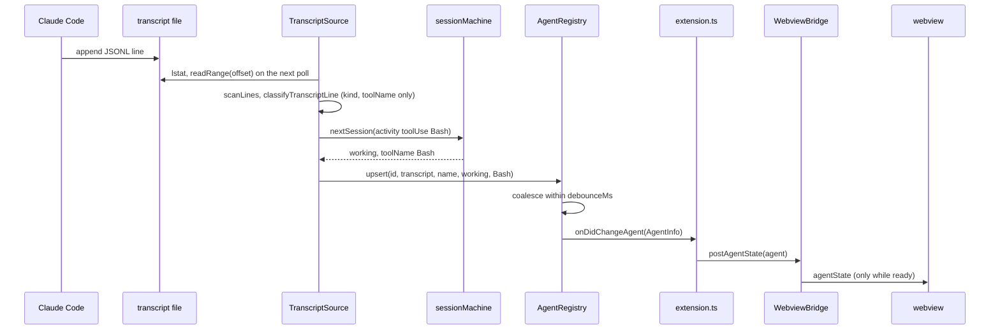
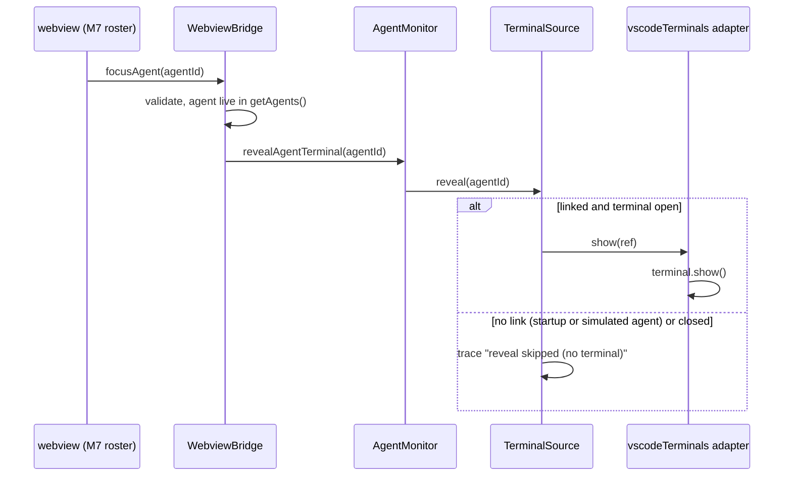

# M3 plan: Monitor

Purpose: the detailed, task-by-task plan for milestone M3 (Monitor): the read-only `AgentMonitor` with its transcript, terminal, and simulator sources, the session state machine and its settings, and the wiring into the M2 bridge. Written by the architect; the developer and tester work from it.
Related: [roadmap M3](../../engineering/roadmap.md#m3-monitor), [agent detection](../agent-detection.md), [ADR 0005 transcript watching](../adr/0005-transcript-watching.md), [M2 plan](m2-protocol.md), [host-webview protocol](../host-webview-protocol.md), [security and safety](../security-and-safety.md), [ADR 0007 allow-list protocol](../adr/0007-allow-list-protocol-pull-handshake.md), [ADR 0004 esbuild two bundles](../adr/0004-esbuild-two-bundles.md), [ADR 0006 test runner](../adr/0006-node-test-runner.md), [architecture overview](../overview.md), [coding standards](../../engineering/coding-standards.md), [testing strategy](../../engineering/testing-strategy.md), [glossary](../../glossary.md), [CLAUDE.md](../../../CLAUDE.md).

## 1. Goal

After M3 the host knows which Claude Code sessions exist and what they are doing, and tells the webview. `extension.ts` builds an `AgentMonitor` from three read-only sources: `TranscriptSource` (polls Claude Code JSONL transcripts and extracts only the five allow-listed fields), `TerminalSource` (links new sessions to terminals so `focusAgent` can reveal them; never a lifecycle input), and `SimulatorSource` (labelled fake agents when there are no real ones). The bridge's `getAgents` returns the monitor's list, every monitor change goes to `postAgentState`, and `revealAgentTerminal` calls `Terminal.show()` for a linked agent. The protocol does not change. Nothing new is drawn: the canvas stays blank until M4, so agents are observable through the protocol (tests) and the log channel at Trace (manual).

Layers touched: monitor (new), extension host glue (`extension.ts`), repo config (`package.json` settings, ESLint boundaries). Not touched: `src/shared/protocol.ts`, `src/host/webviewBridge.ts`, webview, game, data tables, sprites, CSP, esbuild config.

The full behaviour contract is [agent detection](../agent-detection.md); the rationale is [ADR 0005](../adr/0005-transcript-watching.md). This plan adds the interfaces, task list, and test notes.

### 1.1 M2 as built (checked against commit 1eb8c65)

- `src/extension.ts`: `activate` creates the `LogOutputChannel`, a `WebviewBridge` with `getAgents: () => NO_AGENTS`, `revealAgentTerminal: null`, and pushes exactly the channel, the provider, and the registration. `deactivate` is empty. No `workspace` API use.
- `src/host/webviewBridge.ts`: `postAgentState` drops unless `ready`; `#focusAgent` calls `revealAgentTerminal(id)` only for an id that `getAgents()` lists with `state !== 'despawned'`; errors are logged as `webview bridge error: <name>: <message>` (so a monitor error reaching it would leak its message; section 3.10 prevents that).
- `src/shared/protocol.ts`: `toAgentInfo`, `isAgentInfo`, `isAgentId`, `TOOL_NAME_PATTERN`, `MAX_AGENT_NAME_LENGTH` (64), `MAX_TOOL_NAME_LENGTH` (128), `MAX_AGENTS` (64). `toAgentInfo` does not repair, so the monitor normalizes.
- `eslint.config.mjs`: a host block for `src/extension.ts` and `src/monitor/**` bans only game and webview runtime imports; `src/host/**` bans `vscode`, Node built-ins, and `**/monitor`.
- `tsconfig.json` already includes `src/monitor/**/*.ts`.
- `package.json`: `activationEvents: []` (lazy, activates when the view opens), no `contributes.configuration`.
- Tests that pin M2-only behaviour M3 changes by design: `test/repo/readOnly.test.ts` ("touches no terminal at all in M2", "wires focusAgent to no reveal capability in M2"); `test/host/extension.test.ts` (three subscriptions, only two `window` members touched, logs nothing, `focusAgent` dropped); `test/integration/suite/protocol.itest.ts` (`agents: []`, nothing but `config` and `agentList` posted), which needs launcher settings (test note 16). `protocolStructure.test.ts` bans `process.env`, `registerCommand`, and test-hook names in `src/`; M3 respects all three.

### 1.2 Monitor runs from activation

The extension still activates lazily, when the view is first opened. The monitor starts in `activate` and runs until deactivation, also while the view is hidden (the bridge drops pushes; the next `ready` snapshot is current). No activation event is added.

## 2. Invariant check

| Invariant | How M3 respects it |
|---|---|
| 1 Heroes invulnerable | The monitor emits only `AgentInfo` (five fields, no health-like field). Nothing in M3 models damage. |
| 2 Lifecycle from host events only | Agent state comes only from transcript activity, silence thresholds, file removal, scope changes, and the simulator's own schedule. No input reaches the monitor from the webview or the game: the bridge's only call into the monitor is `revealAgentTerminal`, which cannot change state. Terminal close never changes state (decision H-2). |
| 3 Read-only monitor, reveal-only `focusAgent` | The core depends on `ReadOnlyFileSystem`, whose methods are `homedir`, `realpath`, `lstat`, `readdir`, and `readRange` only; the Node adapter opens with `O_RDONLY` (plus `O_NOFOLLOW` where defined), never with a create, write, append, or truncate flag, and closes in the same call. No `fs.watch`, no locks, no files created anywhere (M3 uses no extension storage either). The terminal adapter calls only `Terminal.show()`. No `executeCommand`, `sendText`, `child_process`, or `process.kill`. Grep and runtime tests (notes 10, 11, 12). |
| 4 Crash isolation | Every timer callback, poll step, listener call, and port event runs in try/catch; `getAgents()` and `revealAgentTerminal()` never throw; monitor construction in `activate` is wrapped so a failure leaves the M2 behaviour (empty list, no reveal). Per-file errors affect only that file. |
| 5 No image or audio files | None added. |
| 6 No runtime dependencies | Only `node:fs/promises`, `node:fs` (`constants`), `node:os`, `node:path`, and `vscode` types. No packages. |
| 7 Transcript privacy | Only `transcriptRecord.ts` looks inside a record, and it reads four properties and returns `{ kind, toolName }`. No transcript text survives a poll (partial lines are re-read, not buffered). Names come from folder or directory names plus a short id, never from transcript text. Errors are described only by `safeErrorCode` (never `message`, never `stack`), so V8 `SyntaxError` text and fs paths never reach a log. Nothing is persisted. Marker tests (note 9). |

## 3. Interfaces (signatures only)

All core files import only `src/shared/**` and sibling core files. Adapters are listed in section 3.11. Constants are those of [agent detection section 9](../agent-detection.md#9-limits-constants-not-settings), exported from the module that uses them.

### 3.1 `src/monitor/ports.ts`

```ts
export interface MonitorDisposable { dispose(): void; }

/** Subset of vscode.LogOutputChannel. Messages are fixed reasons plus allow-listed fields only. */
export interface MonitorLogger { trace(message: string): void; error(message: string): void; }

export interface Clock { now(): number; }

/** Returns a cancel function. Real implementations unref the timer. */
export interface TimerPort { setTimeout(callback: () => void, delayMs: number): () => void; }

/** The part of node:path the core uses; node:path and path.win32 satisfy it. */
export interface PathOps {
  readonly sep: string;
  isAbsolute(target: string): boolean;
  resolve(...segments: string[]): string;
  join(...segments: string[]): string;
  relative(from: string, to: string): string;
}

export type EntryKind = 'file' | 'directory' | 'symlink' | 'other';
export interface FileIdentity { readonly ino: number; readonly dev: number; }
export interface EntryStat extends FileIdentity { readonly kind: EntryKind; readonly size: number; readonly mtimeMs: number; }
export interface DirEntry { readonly name: string; readonly kind: EntryKind; }

/** Read-only by construction: no member can create, modify, lock, or delete anything. */
export interface ReadOnlyFileSystem {
  homedir(): string;
  realpath(target: string): Promise<string>;
  lstat(target: string): Promise<EntryStat>;
  readdir(directory: string): Promise<readonly DirEntry[]>;
  /**
   * Opens `file` read-only (O_RDONLY | O_NOFOLLOW where defined), rejects with code 'EIDENTITY'
   * if fstat differs from `expected` or is not a regular file, reads up to `length` bytes at
   * `position`, and closes the handle before settling. Never holds a handle across calls.
   */
  readRange(file: string, position: number, length: number, expected: FileIdentity): Promise<Uint8Array>;
}

export interface TerminalRef { readonly key: number; }
export interface TerminalPort extends MonitorDisposable {
  activeTerminal(): TerminalRef | null;
  onDidOpenTerminal(listener: (terminal: TerminalRef) => void): MonitorDisposable;
  onDidCloseTerminal(listener: (terminal: TerminalRef) => void): MonitorDisposable;
  /** Reveal only: Terminal.show(). False if closed or unknown. Never throws. */
  show(terminal: TerminalRef): boolean;
}

export interface WorkspaceFolderRef { readonly name: string; readonly fsPath: string; }
```

### 3.2 `src/monitor/monitorConfig.ts`

```ts
export const SETTINGS_SECTION = 'pixelAgents';
export type SimulatorMode = 'auto' | 'on' | 'off';
export type ProjectScope = 'workspace' | 'all';

export interface MonitorConfig {
  readonly simulator: SimulatorMode;
  readonly simulatorAgentCount: number;
  readonly projectScope: ProjectScope;
  readonly transcriptPath: string;
  readonly idleTimeoutMs: number;
  readonly toolTimeoutMs: number;
  readonly sessionEndTimeoutMs: number;
  readonly debounceMs: number;
  readonly pollIntervalMs: number;
}

type SettingScope = 'window' | 'machine';
export type SettingSpec =
  | { readonly key: string; readonly kind: 'integer'; readonly default: number; readonly minimum: number; readonly maximum: number; readonly scope: SettingScope }
  | { readonly key: string; readonly kind: 'string'; readonly default: string; readonly scope: SettingScope }
  | { readonly key: string; readonly kind: 'enum'; readonly values: readonly string[]; readonly default: string; readonly scope: SettingScope };

/** The nine settings of agent-detection.md section 6, keys without the section prefix. */
export const MONITOR_SETTINGS: readonly SettingSpec[];
export const DEFAULT_MONITOR_CONFIG: MonitorConfig;

/** Total: wrong type, NaN, or infinity gives the default; integers are rounded and clamped; enforces toolTimeout >= idleTimeout and sessionEndTimeout >= toolTimeout. */
export function readMonitorConfig(get: (key: string) => unknown): MonitorConfig;
```

### 3.3 `src/monitor/monitorLog.ts`

```ts
/** error.code if /^E[A-Z0-9_]{1,31}$/, else error.name if /^[A-Za-z]{1,40}$/, else 'unknown'. Never reads message or stack. Never throws. */
export function safeErrorCode(error: unknown): string;

/** Drops a message identical to one it logged within intervalMs. For reason lines only, not state transitions. */
export class RateLimitedLogger implements MonitorLogger {
  constructor(inner: MonitorLogger, clock: Clock, intervalMs: number);
  trace(message: string): void;
  error(message: string): void;
}
```

### 3.4 `src/monitor/projectPaths.ts`

```ts
export type TranscriptRoot =
  | { readonly ok: true; readonly root: string; readonly custom: boolean }
  | { readonly ok: false; readonly reason: 'notAbsolute' };

/** '' gives <home>/.claude/projects; '~/' or '~\' expands; otherwise must be absolute; result is path.resolve'd. */
export function resolveTranscriptRoot(setting: string, homedir: string, path: PathOps): TranscriptRoot;
/** Every character outside [A-Za-z0-9] becomes '-'. */
export function encodeProjectDir(folderPath: string): string;
/** True if candidate is root itself or below it (path.relative is neither absolute nor '..'-prefixed). */
export function isContained(root: string, candidate: string, path: PathOps): boolean;
/** Lower-cased UUID for '<uuid>.jsonl', else null (agent-*.jsonl and everything else). */
export function sessionIdFromFileName(fileName: string): string | null;
/** Not '.', '..', empty, longer than 255, or containing '/' or '\'. */
export function isProjectDirName(name: string): boolean;
/** Label for a project directory: the matching workspace folder name, else the tail heuristic of agent-detection.md section 3.1. */
export function projectLabel(dirName: string, folders: readonly { readonly name: string; readonly encodedNames: readonly string[] }[], caseInsensitive: boolean): string;
```

### 3.5 `src/monitor/agentNames.ts`

```ts
/** The name if it is a string, 1..MAX_TOOL_NAME_LENGTH long, matching TOOL_NAME_PATTERN; else null. No repair. */
export function normalizeToolName(raw: unknown): string | null;
/** `${label} ${first 4 chars of id}`: forbidden name characters become spaces, whitespace collapsed and trimmed, label shortened (never splitting a surrogate pair) so the result fits MAX_AGENT_NAME_LENGTH; blank label gives `Agent ${shortId}`. Always passes the protocol name rule. */
export function buildAgentName(label: string, agentId: string): string;
```

### 3.6 `src/monitor/transcriptLines.ts` and `transcriptRecord.ts`

```ts
export const MAX_LINE_BYTES = 256 * 1024;
export interface LineScan {
  /** Complete lines (without '\n' or a trailing '\r'), decoded as UTF-8, each at most maxLineBytes. */
  readonly lines: readonly string[];
  /** Bytes the caller may advance its offset by. Never includes a trailing partial line unless skipRemainder. */
  readonly consumedBytes: number;
  /** Complete lines dropped for exceeding maxLineBytes. */
  readonly oversizedLines: number;
  /** The trailing partial line already exceeds maxLineBytes: consume everything and skip to the next newline. */
  readonly skipRemainder: boolean;
}
/** skipLeadingPartial drops bytes up to and including the first '\n' (tail reads, skip mode). */
export function scanLines(bytes: Uint8Array, skipLeadingPartial: boolean, maxLineBytes: number): LineScan;

export type TranscriptSignalKind = 'prompt' | 'assistant' | 'toolUse' | 'toolResult' | 'turnEnd' | 'ignored' | 'unparseable';
export interface TranscriptSignal { readonly kind: TranscriptSignalKind; readonly toolName: string | null; }
/** The only code that looks inside a record (agent-detection.md section 3.1.1). Never throws. The parsed value never escapes; the JSON.parse error is discarded unread. */
export function classifyTranscriptLine(line: string): TranscriptSignal;
```

### 3.7 `src/monitor/sessionMachine.ts`

```ts
export type ActivityKind = 'prompt' | 'assistant' | 'toolUse' | 'toolResult' | 'turnEnd';
export type EndReason = 'fileRemoved' | 'outOfScope';
export interface SessionTimings { readonly debounceMs: number; readonly idleTimeoutMs: number; readonly toolTimeoutMs: number; readonly sessionEndTimeoutMs: number; }
export interface SessionSnapshot {
  readonly state: AgentState;
  readonly toolName: string | null;
  readonly lastActivityAt: number;
  readonly toolPending: boolean;
  readonly turnEnded: boolean;
  readonly spawnedAt: number;
}
export interface DiscoverInput { readonly type: 'discover'; readonly now: number; readonly lastActivityAt: number; readonly toolName: string | null; readonly toolPending: boolean; readonly turnEnded: boolean; }
export type SessionInput =
  | { readonly type: 'activity'; readonly now: number; readonly kind: ActivityKind; readonly toolName: string | null }
  | { readonly type: 'tick'; readonly now: number }
  | { readonly type: 'end'; readonly now: number; readonly reason: EndReason };

/** state 'spawned', or null if the file is stale (silence >= sessionEndTimeout). */
export function createSession(input: DiscoverInput, timings: SessionTimings): SessionSnapshot | null;
/** Pure; switch on input.type ends in assertNever. Returns a new snapshot (or the same one if nothing changed). */
export function nextSession(session: SessionSnapshot, input: SessionInput, timings: SessionTimings): SessionSnapshot;
```

### 3.8 `src/monitor/AgentRegistry.ts`

```ts
export type AgentOrigin = 'transcript' | 'simulator';
export interface AgentRegistryDeps { readonly clock: Clock; readonly timers: TimerPort; readonly logger: MonitorLogger; }

export class AgentRegistry implements MonitorDisposable {
  constructor(deps: AgentRegistryDeps, debounceMs: number);
  /** Insert or update; 'despawned' emits immediately and removes. Refuses (trace, rate-limited) beyond the per-origin cap. Returns false if refused. */
  upsert(id: string, origin: AgentOrigin, name: string, state: AgentState, toolName: string | null): boolean;
  has(id: string): boolean;
  count(origin: AgentOrigin): number;
  ids(origin: AgentOrigin): readonly string[];
  /** Cached frozen array built through toAgentInfo; insertion order; never throws. */
  snapshot(): readonly AgentInfo[];
  onDidChange(listener: (agent: AgentInfo) => void): MonitorDisposable;
  setDebounce(debounceMs: number): void;
  /** Cancels pending emissions; emits nothing afterwards. */
  dispose(): void;
}
```

### 3.9 Sources

```ts
// src/monitor/TranscriptSource.ts
export interface TranscriptSourceDeps {
  readonly fs: ReadOnlyFileSystem; readonly path: PathOps; readonly clock: Clock; readonly timers: TimerPort;
  readonly logger: MonitorLogger; readonly registry: AgentRegistry; readonly caseInsensitive: boolean;
}
export type TranscriptStatus = 'starting' | 'active' | 'unavailable' | 'off';
export class TranscriptSource implements MonitorDisposable {
  constructor(deps: TranscriptSourceDeps, config: MonitorConfig, folders: readonly WorkspaceFolderRef[]);
  start(): void;
  get status(): TranscriptStatus;
  /** Fires once, after the first scan completes or fails. */
  onDidFinishFirstScan(listener: () => void): MonitorDisposable;
  /** A session whose file appeared after the first scan (used for terminal linking). */
  onDidDiscoverNewSession(listener: (agentId: string) => void): MonitorDisposable;
  /** Applies thresholds now; rescans immediately if root or scope changed, ending out-of-scope sessions. */
  update(config: MonitorConfig, folders: readonly WorkspaceFolderRef[]): void;
  dispose(): void;
}

// src/monitor/TerminalSource.ts
export class TerminalSource implements MonitorDisposable {
  constructor(port: TerminalPort | null, clock: Clock, logger: MonitorLogger);
  linkNewSession(agentId: string): void;
  /** Named dropLink, not unlink: the read-only grep bans the word `unlink` in src/. */
  dropLink(agentId: string): void;
  /** Reveal only. Never throws. */
  reveal(agentId: string): void;
  /** Disposes its own port subscriptions only; never the port and never a terminal. */
  dispose(): void;
}

// src/monitor/SimulatorSource.ts
export const DEFAULT_SIMULATOR_SEED = 0x5049584c;
export const SIMULATED_ID_PREFIX = 'sim-';
export const SIMULATOR_TOOLS: readonly string[]; // Read, Grep, Edit, Bash, Write, Glob, WebFetch, Task
export interface SimulatorSourceDeps { readonly clock: Clock; readonly timers: TimerPort; readonly registry: AgentRegistry; readonly logger: MonitorLogger; readonly seed: number; }
export class SimulatorSource implements MonitorDisposable {
  constructor(deps: SimulatorSourceDeps);
  get running(): boolean;
  /** Idempotent for the same count; a new count restarts. */
  start(agentCount: number): void;
  /** Despawns every simulated agent (emits despawned) and cancels its timers. */
  stop(): void;
  /** Cancels timers; emits nothing. */
  dispose(): void;
}
```

### 3.10 `src/monitor/AgentMonitor.ts`

```ts
export interface AgentMonitorDeps {
  readonly fs: ReadOnlyFileSystem; readonly path: PathOps; readonly clock: Clock; readonly timers: TimerPort;
  readonly terminals: TerminalPort | null; readonly logger: MonitorLogger;
  readonly caseInsensitive: boolean; readonly simulatorSeed: number;
}
export class AgentMonitor implements MonitorDisposable {
  /** No I/O and no timers until start(). */
  constructor(deps: AgentMonitorDeps, config: MonitorConfig, folders: readonly WorkspaceFolderRef[]);
  start(): void;
  /** The registry snapshot. Never throws (falls back to the last good snapshot, else []). */
  getAgents(): readonly AgentInfo[];
  onDidChangeAgent(listener: (agent: AgentInfo) => void): MonitorDisposable;
  /** Reveal only, via TerminalSource. Never throws. */
  revealAgentTerminal(agentId: string): void;
  updateConfig(config: MonitorConfig): void;
  updateWorkspaceFolders(folders: readonly WorkspaceFolderRef[]): void;
  /** Idempotent. Stops every timer and source, emits nothing afterwards. Does not dispose the TerminalPort (extension.ts owns it). */
  dispose(): void;
}
```

Wiring inside `AgentMonitor`: registry change with `despawned` calls `terminals.dropLink(id)`; `TranscriptSource.onDidDiscoverNewSession` calls `terminals.linkNewSession(id)`; simulator control per [agent detection section 3.3](../agent-detection.md#33-simulator-source) (in `auto`: start after `onDidFinishFirstScan` if `registry.count('transcript') === 0`; stop when a transcript agent spawns; restart `SIMULATOR_RESUME_MS` after the count returns to 0).

### 3.11 Adapters (`src/monitor/adapters/`)

```ts
// nodeFileSystem.ts: imports node:fs/promises (open, lstat, readdir, realpath), node:fs (constants), node:os (homedir) only.
export function createNodeFileSystem(): ReadOnlyFileSystem;

// nodeRuntime.ts: imports node:path only; uses the global setTimeout/clearTimeout and Date.
export const NODE_CLOCK: Clock;
export const NODE_TIMERS: TimerPort;   // setTimeout(...).unref(); cancel = clearTimeout
export const NODE_PATH: PathOps;       // node:path
export const CASE_INSENSITIVE_FS: boolean; // process.platform === 'win32' || 'darwin' (process.platform, never process.env)

// vscodeTerminals.ts: `import type * as vscode from 'vscode'` only; no runtime import.
export type TerminalWindow = Pick<typeof vscode.window, 'terminals' | 'activeTerminal' | 'onDidOpenTerminal' | 'onDidCloseTerminal'>;
export function createVscodeTerminalPort(window: TerminalWindow): TerminalPort;
```

`readRange` in the Node adapter: `const handle = await open(file, READ_FLAGS)` where `READ_FLAGS = constants.O_RDONLY | (constants.O_NOFOLLOW ?? 0)`; in `try`: `await handle.stat()` must be a file with matching `ino`/`dev` (when both non-zero), else reject with an `Error` whose `code` is `'EIDENTITY'`; `await handle.read(Buffer.alloc(length), 0, length, position)`; return the `bytesRead` slice; `finally`: `await handle.close()`. `Buffer.alloc` (zeroed), not `allocUnsafe`.

The terminal adapter keeps `Map<number, vscode.Terminal>` and `WeakMap<vscode.Terminal, number>`, seeds them from `window.terminals`, adds on open, deletes on close, and `show(ref)` calls `terminal.show()` only when `terminal.exitStatus === undefined`. Its own event subscriptions are held in an array named `subscriptions` (never a name starting with `terminal`, because the read-only grep flags `terminal*.dispose(`).

### 3.12 `src/extension.ts` changes

```ts
export function activate(context: vscode.ExtensionContext): void; // unchanged signature, still returns void
```

In order:

1. Create `log` (unchanged).
2. `const monitor = createMonitor(context, log)`: a private function that, inside one try/catch, creates `terminalPort = createVscodeTerminalPort(vscode.window)` (pushed to `context.subscriptions`), reads `readConfig()` (`vscode.workspace.getConfiguration(SETTINGS_SECTION)` into `readMonitorConfig`), builds `workspaceFolderRefs()` (only `uri.scheme === 'file'`, `{ name, fsPath }`), and constructs `new AgentMonitor({ fs: createNodeFileSystem(), path: NODE_PATH, clock: NODE_CLOCK, timers: NODE_TIMERS, terminals: terminalPort, logger: log, caseInsensitive: CASE_INSENSITIVE_FS, simulatorSeed: DEFAULT_SIMULATOR_SEED }, config, folders)`, pushes it, and returns it. On any error: `log.error('monitor failed to start (' + safeErrorCode(error) + ')')` and return `null`.
3. Create the bridge: `getAgents: monitor === null ? () => NO_AGENTS : () => monitor.getAgents()`, `revealAgentTerminal: monitor === null ? null : (agentId) => monitor.revealAgentTerminal(agentId)`, `getConfig` and `logger` unchanged. Keep `NO_AGENTS` (comment: fallback when the monitor could not start).
4. If `monitor !== null`: push `monitor.onDidChangeAgent((agent) => bridge.postAgentState(agent))`, `vscode.workspace.onDidChangeConfiguration((event) => { if (event.affectsConfiguration(SETTINGS_SECTION)) monitor.updateConfig(readConfig()); })`, and `vscode.workspace.onDidChangeWorkspaceFolders(() => monitor.updateWorkspaceFolders(workspaceFolderRefs()))`, each listener body in try/catch logging `safeErrorCode`; then `monitor.start()`.
5. Provider and registration (unchanged).

`extension.ts` never calls `dispose()` on the terminal port or a terminal itself; everything is owned by `context.subscriptions`. It does not touch `globalState`, `workspaceState`, `globalStorageUri`, `storageUri`, `logUri`, or `secrets` in M3. The `focusAgent` path is exactly bridge to `monitor.revealAgentTerminal` to `TerminalSource.reveal` to `TerminalPort.show` to `Terminal.show()`.

### 3.13 `package.json`

`contributes.configuration`: `{ "title": "Pixel Agents", "properties": { ... } }` with the nine settings of [agent detection section 6](../agent-detection.md#6-configuration), each with `type` (`integer`, `string`, or `string` plus `enum` and `enumDescriptions`), `default`, `minimum`/`maximum` for integers, `scope`, and a `markdownDescription`. Descriptions must say: `projectScope` `all` reads transcripts of every project on this machine (five fields only, nothing leaves the machine); `transcriptPath` is read-only, never followed through symbolic links, and must be absolute or start with `~/`; `simulator` agents are named `Sim ...` and are not real sessions. No other manifest change (activation stays lazy, no commands).

## 4. Data flow (M3)





## 5. Developer task list

Do the tasks in order; each is independently verifiable. No new packages. Work on `feat/m3-monitor`.

**Which checks to run during the tasks.** As in M2, some M2 tests pin behaviour M3 changes by design (task 20 lists them). "Typecheck passes" means `npx tsc -p tsconfig.json && npx tsc -p tsconfig.webview.json`. `npm run lint` and `npm run build` must pass throughout. Any other red test is a real regression. Never point anything at your real `~/.claude`: local experiments use a temp directory of synthetic JSONL through `pixelAgents.transcriptPath`.

0. **Start.** Set roadmap M3 `Status: in progress` (milestone line and summary row 3).
   Check: only those two lines changed.
1. **`src/monitor/ports.ts`.** Section 3.1. Types only.
   Check: typecheck passes; no import other than `../shared/protocol` types (if any).
2. **`monitorLog.ts`.** Section 3.3.
   Check: typecheck; `safeErrorCode(new SyntaxError('x MARK'))` is `'SyntaxError'`; an error with `code: 'EACCES'` gives `'EACCES'`; `code: 'eacces; rm'` falls through to the name.
3. **`monitorConfig.ts` and `package.json` `contributes.configuration`.** Section 3.2 and 3.13, values from agent detection section 6.
   Check: typecheck; `readMonitorConfig(() => undefined)` deep-equals `DEFAULT_MONITOR_CONFIG`; the nine manifest keys, defaults, ranges, enums, and scopes equal `MONITOR_SETTINGS` (eyeball now; the tester automates it).
4. **`projectPaths.ts`.** Section 3.4.
   Check: `encodeProjectDir('/Users/me/My Repo.x')` is `-Users-me-My-Repo-x`; `encodeProjectDir('C:\\work\\app')` is `C--work-app`; `isContained('/r', '/r-evil/x', posix)` is false.
5. **`agentNames.ts`.** Section 3.5.
   Check: every output of `buildAgentName` on a few nasty labels (bidi, 200 chars, emoji at the cut, blank) passes `isAgentInfo` when put in a record.
6. **`transcriptLines.ts` and `transcriptRecord.ts`.** Section 3.6 and agent detection 3.1.1. `classifyTranscriptLine` reads properties with bracket access (`record['message']`), never `.message`, so the structural ban on `.message` in `src/monitor/**` (test note 10) holds.
   Check: the fixture lines in test note 3 classify as listed.
7. **`sessionMachine.ts`.** Section 3.7 and agent detection section 4.
   Check: typecheck; the `switch (input.type)` ends in `assertNever`.
8. **`AgentRegistry.ts`.** Section 3.8 and agent detection section 5.
   Check: typecheck; snapshot entries pass `isAgentInfo`.
9. **`TranscriptSource.ts`.** Section 3.9 and agent detection 3.1. Every `await` is followed by a disposed check. Polls chain through `timers.setTimeout` after completion. Uses `RateLimitedLogger` for reason lines.
   Check: typecheck; lint (no floating promises).
10. **`TerminalSource.ts`.** Section 3.9 and agent detection 3.2.
11. **`SimulatorSource.ts`.** Section 3.9 and agent detection 3.3. mulberry32 inline (no package, no `Math.random`).
12. **`AgentMonitor.ts`.** Section 3.10.
    Check: typecheck; constructing it does no I/O (a fake fs records zero calls until `start()`).
13. **`adapters/nodeFileSystem.ts` and `adapters/nodeRuntime.ts`.** Section 3.11.
    Check: `readRange` on a temp file returns the requested bytes and leaves its mtime and size unchanged; a symlink path rejects (`ELOOP` on macOS and Linux).
14. **`adapters/vscodeTerminals.ts`.** Section 3.11.
15. **`eslint.config.mjs`.** After the existing host block (later blocks override `no-restricted-imports` for matching files, so each new block repeats the game and webview groups):
    - core `files: ['src/monitor/*.ts']`: `paths: [VSCODE_PATH, ...NODE_BUILTIN_PATHS]`, `patterns: [NODE_SCHEME_PATTERN, { group: ['**/game', '**/game/**', '**/webview', '**/webview/**', '**/extension', '**/host', '**/host/**', './adapters', './adapters/**', '**/adapters/**'], message: 'src/monitor core imports only src/shared/ and sibling core files.' }]`;
    - `files: ['src/monitor/adapters/nodeFileSystem.ts', 'src/monitor/adapters/nodeRuntime.ts']`: ban `vscode` and every Node built-in except `fs`, `fs/promises`, `os`, `path` (and their `node:` forms), plus the game, webview, host, and extension groups;
    - `files: ['src/monitor/adapters/vscodeTerminals.ts']`: ban Node built-ins and `NODE_SCHEME_PATTERN`, plus the same groups; `vscode` allowed (type-only in practice).
    Check: `npm run lint` passes; temporarily importing `vscode` into `sessionMachine.ts`, `node:fs` into `TranscriptSource.ts`, `./adapters/nodeRuntime` into `AgentMonitor.ts`, or `node:child_process` into `nodeFileSystem.ts` each fails lint (revert all).
16. **`src/extension.ts`.** Section 3.12. Update the header comment (M3: monitor wiring, reveal).
    Check: `npm run build`; `dist/extension.js` contains `AgentMonitor` and `classifyTranscriptLine`; `dist/webview.js` contains neither (development build).
17. **Local fixture run.** In a scratch directory create `<tmp>/projects/<encodeProjectDir(your test workspace)>/<uuid>.jsonl` with synthetic lines (section 7, note 3), set `pixelAgents.transcriptPath` to `<tmp>/projects` in the Extension Development Host's user settings, F5 with `--disable-extensions`, open the Pixel Agents tab, set the output channel to Trace, and append lines with `echo ... >> file`. Expect `monitor: agent <uuid> spawned`, then `working (Bash)`, `idle` after `idleTimeoutSeconds`, and `despawned` after deleting the file.
    Check: also append a malformed line containing `PIXEL_MARKER_DEV`; the output channel never shows it.
18. **Manual F5 check** (record results in the handoff): with `transcriptPath` empty and `simulator: auto`, a workspace without sessions shows `Sim ...` agents spawning, working with tool names, idling, and despawning in the Trace log; starting a real `claude` in this workspace's integrated terminal makes the simulated agents despawn and the real session spawn with tool names; the `claude` terminal is never typed into, closed, or hidden; `~/.claude/settings.json` and the transcript files' modification times are not changed by the extension (compare `ls -l` before and after a session with the extension open and closed); confirm the encoded directory name for this repo's path (it contains spaces) matches `encodeProjectDir`. If `pablodelucca.pixel-agents` is installed, run once with it enabled too: ours still works and touches nothing of its hooks.
19. **`CHANGELOG.md` and `README.md`.** CHANGELOG `### Added`: "Read-only agent monitor: Claude Code transcripts, terminal reveal, labelled simulator; settings under `pixelAgents.*`." README: a configuration table (the nine settings), a "Privacy" paragraph (only id, name, state, tool name, timestamp; workspace scope by default and what `all` means; nothing persisted or sent), and how to set `transcriptPath` if Claude Code's config directory is relocated.
20. **Hand off to the tester** with section 7. M2 tests M3 breaks by design (not code bugs):
    - `test/repo/readOnly.test.ts`: "touches no terminal at all in M2" (now: terminal APIs only in `adapters/vscodeTerminals.ts`) and "wires focusAgent to no reveal capability in M2" (now: wired to `monitor.revealAgentTerminal`).
    - `test/host/extension.test.ts`: subscription count; `window` members touched (now also `terminals`, `activeTerminal`, `onDidOpenTerminal`, `onDidCloseTerminal`, through the adapter); "logs nothing" (the fake `vscode` has no `workspace`, so the monitor start fails, contained, with one `monitor failed to start (TypeError)` line until the fake grows `workspace`); "`focusAgent` is dropped".
    - `test/integration/suite/protocol.itest.ts`: `agents: []` and "nothing else posted" hold only once the launcher passes settings with `simulator: off` and an empty temp transcript root (note 16). Until then, expect those assertions red; `view.itest.ts` must stay green.
    Any other failure is a code bug.
21. **Commit after reviewer Approve.** Set roadmap M3 `Status: done` and summary row 3; stage every agent's M3 work including this plan's doc pass; one commit `feat: add read-only agent monitor with transcript, terminal, and simulator sources`; `git switch main && git merge --ff-only feat/m3-monitor`. No push without the human.

## 6. Ownership split

| File or area | Owner |
|---|---|
| `src/monitor/**`, `src/extension.ts`, `package.json` (`contributes.configuration`), `eslint.config.mjs`, `CHANGELOG.md`, `README.md` | developer |
| `test/**` (unit, structural, fixtures under `test/fixtures/transcripts/`, `test/simulation/`, `test/integration/**` including `run.mjs` settings and env), `testing-strategy.md`, the `test` and `test:integration` scripts | tester |
| this plan, `agent-detection.md`, ADR 0005, ADR 0004 M3 notes, `security-and-safety.md`, `host-webview-protocol.md`, `overview.md`, `coding-standards.md`, `roadmap.md` (except status), `docs/index.md`, `docs/glossary.md`, `CLAUDE.md` (except Core invariants) | architect |
| git operations, roadmap M3 status lines | developer |

## 7. Test notes for the tester

Unit suites import only core monitor modules and `src/shared/**`, with in-memory fakes: a `FakeFileSystem` (a tree of directories, files with `ino`/`dev`/`mtimeMs`, symlink entries, per-path error injection, a call log, and an optional delay per call), a `FakeClock` plus `FakeTimers` (manual advance, pending-timer count), a recording `MonitorLogger`, and a `FakeTerminalPort` (put them in `test/support/`). Fixtures under `test/fixtures/transcripts/` are synthetic, hand-written JSONL; never copy a real transcript, and no test may read the real home directory (`os.homedir()` is never the fixture root). Suggested files: `test/monitor/*.test.ts`, `test/simulation/simulator.test.ts`, `test/repo/monitorReadOnly.test.ts`, `test/integration/suite/monitor.itest.ts`.

1. **Paths.** `resolveTranscriptRoot`: `''` gives `<home>/.claude/projects` (`custom: false`); `~/x` and `~\x` (win32) expand; `relative/x` and `./x` give `notAbsolute`; `/a/../b` resolves to `/b`. `encodeProjectDir` literal cases: spaces, dots, underscores, non-ASCII (each UTF-16 unit outside `[A-Za-z0-9]` becomes `-`), Windows drive paths, a trailing separator. `isContained` with `path.posix` and `path.win32`: root itself, child, `..` escape, sibling prefix (`/root-evil`), other drive (`D:\` versus `C:\`), case on win32. `sessionIdFromFileName`: UUID upper and lower case accepted (lower-cased), `agent-1a2b.jsonl`, `x.jsonl`, `<uuid>.json`, `<uuid>.jsonl.bak` rejected; every accepted id passes `isAgentId`. `isProjectDirName` rejects `.`, `..`, separators. `projectLabel`: workspace match wins; tail heuristic for unmatched names; never empty.
2. **Line scanning.** Complete lines; CRLF; trailing partial not consumed; `skipLeadingPartial`; a line of exactly `maxLineBytes` kept, one byte more dropped and counted; a partial tail over the limit sets `skipRemainder` and consumes all; multi-byte UTF-8 characters split across reads are never decoded half (because partial lines are re-read); empty buffer.
3. **Classification fixtures.** `{"type":"assistant","message":{"content":[{"type":"tool_use","name":"Bash","input":{"command":"MARK"}}]}}` gives `toolUse`/`Bash`; two `tool_use` blocks give the last name; `name: "Bash tool"`, `""`, 129 chars, a number, or `"mcp__x__y"` (accepted) per `TOOL_NAME_PATTERN`; `stop_reason: "end_turn"` without tool gives `turnEnd`; plain assistant text gives `assistant`; user with `tool_result` gives `toolResult`; user string content gives `prompt`; `summary`, `system`, `file-history-snapshot`, unknown types, arrays, numbers, `null`, strings give `ignored`; truncated JSON gives `unparseable`; `{"__proto__":{"type":"assistant"}}` gives `ignored` and `Object.prototype` is unchanged; 10,000-deep nesting does not throw. Every result has exactly the keys `kind` and `toolName`, and `JSON.stringify(result)` never contains any fixture's text other than the tool name.
4. **State machine** (pure, explicit `now` values, default timings and `debounceMs = 750`): fresh discover gives `spawned`, `working` on the first tick at or after 750 ms; discover with silence over `idleTimeout` gives `idle` after the debounce; discover with silence at or over `sessionEndTimeout` gives `null`; `working` to `idle` exactly at `idleTimeout` silence (not 1 ms before); a pending tool keeps `working` until `toolTimeout`; `toolResult` clears pending; `turnEnd` gives `idle` after `debounceMs` quiet and new activity inside that window cancels it; `idle` to `working` on each activity kind except `turnEnd`; `despawned` at `sessionEndTimeout` from both `working` and `idle`; `end` from every live state including `spawned`; future `lastActivityAt` counts as zero silence; `toolName` survives `idle`; the input switch is exhaustive (type-level test).
5. **Config.** `readMonitorConfig` defaults; each integer clamped at both bounds; floats rounded; strings, `NaN`, `Infinity`, objects fall back; invalid enums fall back; `toolTimeout >= idleTimeout` and `sessionEndTimeout >= toolTimeout` enforced. Structural: `package.json` `contributes.configuration.properties` has exactly the nine `pixelAgents.*` keys and each equals its `MONITOR_SETTINGS` row (type, default, minimum, maximum, enum, scope); `projectScope` and `transcriptPath` are `machine`-scoped; every property has a description.
6. **Registry and coalescing** (fake clock and timers): `spawned` emitted immediately; tool changes every 100 ms for 3 s give at most one emission per 750 ms with the last value; identical snapshots not re-emitted; `despawned` immediate, cancels a pending emission, and removes the agent from `snapshot()`; `debounceMs = 0` emits every change; timestamps non-decreasing per agent and equal to the clock at the change; per-origin caps (49th transcript agent and 17th simulated agent refused, one trace); `snapshot()` is frozen, in insertion order, passes `isAgentInfo` per entry, and survives `createAgentListMessage` unchanged; a throwing listener does not stop the next listener and is not rethrown; after `dispose()` nothing is emitted and no timer is pending.
7. **Transcript source with `FakeFileSystem`.**
   - Discovery: workspace scope reads only the encoded directories of the given folders (including the `realpath` variant), never a sibling (`<enc>-old`) and never the root listing; `all` scope lists the root; ignores `agent-*.jsonl`, non-UUID files, subdirectories, symlinked project directories, and symlinked files; a file whose `realpath` leaves the root is never passed to `readRange`; a root that is itself a symlink works.
   - Startup files with recent mtime are discovered with `readRange` starting at `max(0, size - 64 KiB)`; stale files are not discovered and are re-checked at most every 10 s, at most 500 per scan.
   - A new file after the first scan fires `onDidDiscoverNewSession`; startup files do not.
   - Appends produce activity in order; a partial line is not parsed until completed and is re-read (assert the second `readRange` starts at the partial line's offset); no read exceeds 1 MiB; an oversized line is skipped across several polls and counted as activity once.
   - Truncation and an `ino` change reset the offset without `despawned`; `ino: 0` disables the identity check.
   - Removal gives `despawned`; `ELOOP` gives `despawned`; `EACCES` on one file skips only that file and logs one rate-limited error with the code only; `EACCES` on the root sets status `unavailable` and logs once; `ENOENT` on the root traces once and keeps rescanning; an `EIDENTITY` rejection is handled as rotation.
   - With a slow fake (each call delayed), polls never overlap (at most one in flight) and the next poll is scheduled only after the previous finishes.
   - `update` with a new root or scope rescans immediately and despawns out-of-scope sessions; new thresholds apply on the next tick.
   - `dispose()` during an in-flight poll: no emission afterwards, no further fs calls after advancing time, no pending timers.
   - `projectScope: 'workspace'` with no folders reads nothing (zero fs calls under the root).
8. **Terminal source and adapter.** Linker with `FakeTerminalPort`: a new session links to the active terminal; with no active terminal, to the most recent unlinked terminal opened within 30 s, else none; startup and simulated agents never link; one terminal never links two live agents; `dropLink` on despawn; terminal close removes the link and emits nothing (agent state unchanged); `reveal` calls `show` exactly once for a linked open terminal and never otherwise, with one trace for skips; a throwing port does not escape `reveal`. Adapter with fake `vscode.window` (terminals whose `sendText`, `dispose`, `hide`, `processId` getters and methods fail the test if touched): `show(ref)` calls `terminal.show()` once and nothing else; closed or exited terminals return `false`; disposing the port removes its listeners and calls no terminal method.
9. **Privacy marker (S1, invariant 7).** Use a marker such as `PIXEL_MARKER_9f2c` in: message text, `tool_use` `input`, a `tool_result` body, a `summary` line, a malformed line (`{"type":"user","message":"PIXEL_MARKER_9f2c` without a closing brace, so V8's `SyntaxError` message quotes it), a tool name with a space (`"PIXEL_MARKER_9f2c tool"`, so it becomes `null`), and in the `message` of every error the `FakeFileSystem` throws (`realpath`, `lstat`, `readdir`, `readRange`), including errors with a `code` and errors without one. Drive a full `AgentMonitor` (fake fs, clock, timers, terminal port) wired to a real `WebviewBridge` with a fake port in `ready`, and assert the marker appears in: no logger call at any level (including the bridge's logger), no posted message (`JSON.stringify` of every post), no `getAgents()` result, and no `onDidChangeAgent` payload. Repeat through `src/extension.ts` with the fake `vscode` (fixture root via `pixelAgents.transcriptPath` in the fake configuration) and assert the marker is in no `FakeLogOutputChannel` call, and that `context.globalState.update`, `workspaceState.update`, and `secrets.store` were never called (M3 persists nothing). The fs fake exposes no write method, so nothing can be written by type.
10. **Read-only structural (extends `readOnly.test.ts` and `protocolStructure.test.ts` to `src/monitor/**`).**
    - The existing `FORBIDDEN_IN_SRC` list now scans the monitor files too (assert the scan includes every new file).
    - In `src/monitor/**`: no `fs.watch`, `watchFile`, `mkdir`, `rename`, `copyFile`, `cp(`, `symlink`, `link(`, `chmod`, `chown`, `utimes`, `truncate`, `ftruncate`, `fsync`, `O_CREAT`, `O_WRONLY`, `O_RDWR`, `O_APPEND`, `O_TRUNC`, or an `open` flag string (`'w'`, `'a'`, `'r+'`, `'wx'`, ...); `nodeFileSystem.ts` imports exactly `open`, `lstat`, `readdir`, `realpath` from `node:fs/promises`, `constants` from `node:fs`, and `homedir` from `node:os`, and its only `open(` call passes `READ_FLAGS`.
    - Terminal APIs (`terminals`, `activeTerminal`, `onDidOpenTerminal`, `onDidCloseTerminal`, `exitStatus`, `.show(`) appear only in `src/monitor/adapters/vscodeTerminals.ts`; the only method called on a terminal is `show()`; no `sendText`, `sendSequence`, `hide(`, `processId`, or `dispose(` on a terminal anywhere.
    - No `executeCommand`, `child_process`, `process.kill`, `process.env`, `process.argv` in `src/monitor/**` or `src/extension.ts`.
    - Error hygiene in `src/monitor/**`: no `.message` and no `.stack` property access, no `String(` applied to a caught value, no `JSON.stringify`, no template interpolation of `e`, `err`, `error`, or `cause`, no `console.`.
    - Boundaries: core files (`src/monitor/*.ts`) import only `src/shared/**` and sibling core files; adapters import only their allowed modules; `src/host/**` imports nothing from `src/monitor/**`; webview and game import nothing from `src/monitor/**`; `dist/webview.js` contains no `AgentMonitor`, `TranscriptSource`, or `classifyTranscriptLine` (bundle test).
    - Storage: no `globalState`, `workspaceState`, `globalStorageUri`, `storageUri`, or `secrets` in `src/` (M3; E1 replaces this with its own rule).
    - Exhaustive switches: extend note 1 of the M2 scan to `src/monitor/**` (every `switch` on `.type`, `.kind`, or `.state` ends in `assertNever`).
    - The `focusAgent` wiring in `extension.ts` is exactly `revealAgentTerminal: ... (agentId) => monitor.revealAgentTerminal(agentId)` with the `null` fallback.
11. **Runtime read-only check (real disk).** Build a temp tree of synthetic fixtures (root, two project dirs, live and stale session files, an `agent-*.jsonl`, a symlink to a file outside the root, a symlinked project dir), record every path's size, mtime, mode, and the full directory listing, run an `AgentMonitor` with `createNodeFileSystem()` and real timers (short `pollIntervalMs`) while the test appends lines, then dispose. Assert: no new or removed entries anywhere in the temp tree except the test's own appends, sizes and mtimes of untouched files unchanged, modes unchanged, the outside file was never opened (wrap the adapter in a spy that records `readRange` paths), and no handle stays open after dispose (on Windows CI, deleting every file right after dispose succeeds).
12. **Simulator.** Deterministic: two runs with the same seed and fake clock produce identical emission sequences; a different seed differs. Ids match `/^sim-\d+-\d+$/`, names start with `Sim` and a space, tool names are in `SIMULATOR_TOOLS`, every emission passes `isAgentInfo`. Each slot goes spawned, working (with tool changes), idle, ..., despawned and respawns with `generation + 1`. Modes: `auto` starts only after the first scan and only with zero transcript agents, despawns all simulated agents when a transcript agent spawns, and restarts 10 s after the last one despawns; `on` runs beside real agents; `off` never runs; changing `simulatorAgentCount` restarts with the new count; `dispose` emits nothing and leaves no timer.
13. **Simulation integration** (`test/simulation/`, `node:test`, testing strategy section 6): `AgentMonitor` with only the simulator (fake fs root `ENOENT`, `simulator: 'on'`, count 3, fixed seed, `debounceMs` 100) wired to `WebviewBridge` with a fake port after `ready`. Advance 10 simulated minutes. Assert: every post passes `parseHostMessage`; per agent the `agentState` sequence matches `spawned (working)+ idle ((working)+ idle)* ... despawned` with no state after `despawned`; the first lifecycle of `sim-0-0` equals a golden sequence recorded once from the fixed seed (states, tool names, timestamps); after each post, a fresh `HostStateMirror` fed `createAgentListMessage(monitor.getAgents())` equals the mirror fed every post so far (reload rebuild); a second `ready` at any point posts `config` then an `agentList` equal to `getAgents()`.
14. **Disposal.** `AgentMonitor.dispose()` after `start()` with every source active leaves zero pending fake timers, zero listeners on the fake terminal port, and no fs calls after advancing time an hour; double `dispose()` is harmless. Through `extension.ts` with the fake `vscode`: every disposable `activate` creates is in `context.subscriptions`, and disposing them all leaves no live listener on any fake event.
15. **`extension.ts` glue** (fake `vscode` extended with `workspace.getConfiguration`, `onDidChangeConfiguration`, `workspaceFolders`, `onDidChangeWorkspaceFolders`, and `window.terminals`, `activeTerminal`, `onDidOpenTerminal`, `onDidCloseTerminal`; fake config points `transcriptPath` at a temp fixture root and sets `simulator: 'off'` unless the test needs it): `activate` still returns `void` and registers the view; a `ready` now answers with the monitor's agents; a monitor change while `ready` posts one `agentState`; a configuration change for `pixelAgents` applies (for example switching `simulator` to `on` spawns simulated agents) and a change to another section does nothing; workspace folder changes rescan; `focusAgent` for a linked agent calls the fake terminal's `show()` exactly once, and for a simulated or unknown agent calls nothing; if `getConfiguration` throws, `activate` still registers the view, `ready` answers `agentList []`, `focusAgent` is dropped, and one `monitor failed to start (<code>)` line is logged.
16. **Extension-host integration** (`monitor.itest.ts`, after the protocol suite). Launcher (`test/integration/run.mjs`): create `<temp>/home` and `<temp>/claude/projects`; write `<user-data-dir>/User/settings.json` with `pixelAgents.transcriptPath: <temp>/claude/projects`, `pixelAgents.simulator: "off"`, `pixelAgents.pollIntervalMs: 250`, `pixelAgents.debounceMs: 100`, `pixelAgents.idleTimeoutSeconds: 5`; add `USERPROFILE` set to `<temp>/home` and `PIXEL_AGENTS_IT_TRANSCRIPT_ROOT` to `extensionTestsEnv` (test-side only; the extension reads no environment variable). As built, `HOME` is deliberately not overridden: overriding it on macOS with VS Code 1.141 stopped the webview from ever sending `ready` (5 M1/M2 integration tests failed; they pass without the override). The real guard against reading the real `~/.claude` is the temp `pixelAgents.transcriptPath` in the temp `settings.json`, which `monitor.itest.ts` asserts is in effect and not under the real `~/.claude`; the `USERPROFILE` override only protects on Windows. Even if the setting failed to apply, the scope is the workspace on a temp folder, so at most one nonexistent project directory is probed, and the monitor is read-only. With these settings the M2 assertions (`agents: []`, only `config` and `agentList` posted) hold unchanged. The suite computes the project directory independently of the source (`realpathSync(workspaceFolders[0].uri.fsPath).replace(/[^A-Za-z0-9]/g, '-')`). Cases:
    - Real session: create a terminal from the test and show it, then write `<uuid>.jsonl` with a user line and an assistant `tool_use` `Bash` line: the post recorder sees `agentState` `spawned` then `working` with `toolName: 'Bash'` for that id; with no further writes, `idle` after about 5 s; deleting the file gives `despawned`.
    - Privacy: lines carrying a marker plus a malformed marker line produce no marker in the log file and no marker in any post.
    - Reveal: show a second test terminal, then send `focusAgent` for the live session through the real provider's public `resolveWebviewView` with a fake view (as the M2 positive control does; run this last): the active terminal becomes the first one; both terminals are still open (`exitStatus` undefined) and their count is unchanged. Note: the session links to the first terminal only if it is active when the file appears.
    - Simulator: update `pixelAgents.simulator` to `on` (`ConfigurationTarget.Global`) and `simulatorAgentCount` to 2: `sim-0-0` and `sim-1-0` spawn and go `working` within about 3 s; set `off`: both `despawned`. Then `auto` while a real session file exists: no simulated agent spawns.
    - Read-only: the temp transcript tree (names, sizes, mtimes) is unchanged except for the test's own writes; nothing was written into the workspace folder or the workspace root's parent (replaces the original "nothing created under `<temp>/home`" check, since `HOME` is not overridden).
    - Still true: no `pixelAgents.*` command; the extension created no terminal (only the test's two exist).
17. **Manual QA** (testing strategy section 7.3, adapted because M3 draws nothing): the two M3 items are checked through the "Pixel Agents" output channel at Trace (developer task 18 lists the steps): simulated agents spawn, work, idle, and despawn with no configuration and no sessions; a real session in this workspace's terminal is followed, the simulated agents leave, and the terminal is never typed into, stopped, or closed; `~/.claude/settings.json` and transcript mtimes are unchanged by the extension; the encoded directory for a path with spaces matches.

Not automated in M3: the real Claude Code transcript format on the human's machine (manual, task 18) and visible heroes (M4).

## 8. Gates for M3

| Gate | M3 meaning |
|---|---|
| G1 | `npm run build`, `lint`, `typecheck` (all three projects), `test`, and `test:integration` pass |
| G2 | not applicable before H1 |
| G3 | invariants intact (section 2); notes 9, 10, 11 pass; M2 structural tests still pass |
| G4 | no new packages; no assets |
| G5 | `CHANGELOG.md` entry; README configuration table and privacy paragraph; `agent-detection.md` matches the code |
| G6 | `CLAUDE.md` directory map lists `src/monitor/` core and `adapters/` |
| G7 | reviewer Approve; one commit on `feat/m3-monitor`; roadmap M3 ticked |

**Done when** (the [roadmap M3](../../engineering/roadmap.md#m3-monitor) criteria, made concrete): G1 and G3 to G7 hold; note 10 proves the read-only grep over `src/monitor/**` and the `focusAgent` path; note 11 proves nothing is written or created on a real disk; note 9 proves the marker reaches no log, post, snapshot, or storage; notes 4, 6, and 7 prove debouncing, the idle timeout, and despawn on session end; note 7 proves `transcriptPath` containment and no symlink following; note 14 proves disposal; notes 13 and 16 prove the simulation and real-session message sequences.

## 9. Risks, assumptions, defaults

- **Transcript format drift.** The encoder and classifier mirror Claude Code's layout as observed (ADR 0005). Both are small and fixture-tested; task 18 checks the human's machine. Fallbacks: `projectScope: all`, `transcriptPath`.
- **Long encoded paths.** If Claude Code shortens or hashes very long directory names, workspace scope will not find them. Assumption: not handled in M3; `all` scope works.
- **Inference errors.** See agent detection section 10. Defaults favour calm: 60 s idle, 300 s with a pending tool, 30 min to despawn.
- **Polling cost.** Workspace scope: one `lstat` per tracked file and one `readdir` per project directory per second, plus bounded reads. `all` scope with hundreds of directories: one root listing per 5 s and `lstat` of directories, bounded stale re-checks. Runs in the extension host, never on the webview's frame budget, so the 60fps target is unaffected.
- **Memory.** No transcript text is retained between polls; the largest transient buffer is 1 MiB per file per poll, released after the poll. Tracked state per session is a few numbers.
- **Timers keep nothing alive.** Real timers are unref'd, so a missed dispose in a unit test cannot hang `node:test`; production disposal is still explicit through `context.subscriptions`.
- **CSP and bundles.** No webview change; the monitor is host-bundle only and the bundle test asserts it stays out of `dist/webview.js`.
- **Persistence and migrations.** None in M3; offsets and links are rebuilt from transcript tails on activation.
- **Protocol.** Unchanged (`PROTOCOL_VERSION` stays 1). New convention, not a shape change: ids starting `sim-` are simulated agents (the M7 roster can label them).
- **Read-only grep traps.** The existing bans match the words `unlink` and `terminal*.dispose(`; hence `TerminalSource.dropLink` and the `subscriptions` naming rule (sections 3.9, 3.11).
- **Defaults chosen:** workspace scope; simulator `auto` with 3 agents; thresholds as in agent detection section 6; constants as in its section 9; names `<label> <4-char id>`; terminal links only for sessions that start while this window runs; simulator seed `0x5049584c`; no persistence; settings prefix `pixelAgents.*`.

## 10. Decisions for the human

Each has a default so work can proceed; changing one later is cheap except H-3.

| # | Question | Default chosen | Alternative |
|---|---|---|---|
| H-1 | Which project directories are read by default? | `workspace`: only this window's workspace folders. Least data read; panel shows only this project's sessions. | `all`: every project on the machine, in every window |
| H-2 | Should closing a session's terminal despawn its hero? | No. Terminals are for reveal only (as briefed); links are heuristic, and a wrong link would make a live agent vanish. Heroes despawn on file removal, scope change, or 30 min of silence. | Yes, for linked sessions only, with respawn on new activity |
| H-3 | Settings prefix: the unrelated `pablodelucca.pixel-agents` may also contribute `pixelAgents.*` settings or the `pixelAgents` view ids; duplicates conflict when both are installed. | Keep `pixelAgents.*` (matches CLAUDE.md and existing view ids). Renaming after M3 means a settings migration for users. | Rename the prefix (and possibly view ids) now, before settings ship |
| H-4 | Simulator default | `auto`: labelled `Sim ...` heroes on a fresh install with no sessions, gone as soon as a real session appears | `off` by default |
| H-5 | Agent names | Folder or project label plus a 4-character id; never transcript text (Claude Code's session titles and summaries are conversation content) and never terminal names | Allow session titles (would need an invariant 7 ruling) |
| H-6 | Relocated Claude config (`CLAUDE_CONFIG_DIR`) | Not read (no environment access in `src/`); users set `pixelAgents.transcriptPath` | Read the environment variable (needs a change to the "no env switch" rule) |
| H-7 | Subagent transcripts (`agent-*.jsonl`) | Ignored; their activity inside the main session file counts for the main hero | Show subagents as their own heroes |

## 11. Art needs

None. M3 draws nothing. Confirmed against the [roadmap](../../engineering/roadmap.md#m3-monitor).

## 12. Architect doc pass (applied before development)

- New: [agent detection](../agent-detection.md) (components, sources, state machine diagram, settings, errors, platform notes, limits); [ADR 0005](../adr/0005-transcript-watching.md); this plan.
- [Security and safety](../security-and-safety.md): B1 and B4 made concrete, T5 to T7 controls and tests, new threats T16 to T19, data inventory rows for name and tool name, reveal wiring in section 5.
- [Host-webview protocol](../host-webview-protocol.md): `agentList` is the monitor's list from M3, flows 6.4 and 6.5 name the M3 participants, the `sim-` id convention.
- [Architecture overview](../overview.md): containers and data flow for the monitor core and adapters; current state M2 committed, M3 in progress.
- [ADR 0004](../adr/0004-esbuild-two-bundles.md): implementation notes (M3) for the monitor core and adapters.
- [Coding standards](../../engineering/coding-standards.md): boundary rows for monitor core and adapters, monitor error-description rule, settings units and scopes, the grep-trap naming rule.
- [Roadmap](../../engineering/roadmap.md): M3 plan link, file list, settings list; open issue on the settings prefix now points to H-3.
- [Docs index](../../index.md), [glossary](../../glossary.md), and [CLAUDE.md](../../../CLAUDE.md) directory map.
