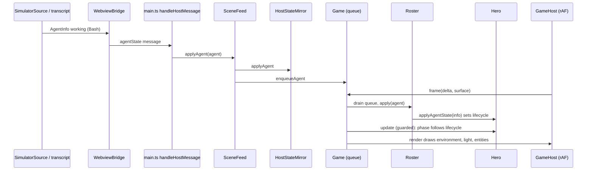

# M4 plan: Engine

Purpose: the detailed, task-by-task plan for milestone M4 (Engine): the DOM-free game runtime in `src/game/**`, its thin webview host, the base `Hero` and `Campfire`, Stage 1, and the art batch A0 the engine renders. Written by the architect; the pixel-artist, developer, and tester work from it.
Related: [roadmap M4](../../engineering/roadmap.md#m4-engine), [game engine](../game-engine.md), [data model](../data-model.md), [ADR 0008 DOM-free engine](../adr/0008-dom-free-engine-behind-ports.md), [ADR 0009 hero lifecycle isolation](../adr/0009-hero-lifecycle-isolation.md), [ADR 0010 split room layout](../adr/0010-split-room-stage-layout.md), [ADR 0002 no hero health](../adr/0002-no-hero-health.md), [ADR 0003 procedural sprites](../adr/0003-procedural-sprites.md), [ADR 0004 esbuild two bundles](../adr/0004-esbuild-two-bundles.md), [M3 plan](m3-monitor.md) (template), [host-webview protocol](../host-webview-protocol.md), [security and safety](../security-and-safety.md), [architecture overview](../overview.md), [art style guide](../../design/art-style-guide.md), [sprite spec](../../design/sprite-spec.md), [coding standards](../../engineering/coding-standards.md), [testing strategy](../../engineering/testing-strategy.md), [glossary](../../glossary.md), [CLAUDE.md](../../../CLAUDE.md).

## 1. Goal

After M4 the "Pixel Agents" panel shows the dungeon. Every agent the host reports (real or simulated) is a pixel hero: it warps in, walks to the corridor and advances while `working` (the corridor scrolls, the hero swings a plain sword at nothing), walks to the campfire and rests in changing poses while `idle`, and does a victory pose and warps out on `despawned`. Stage 1, "The Forgotten Cellar", is the only room; torches and the campfire light it; water drips. There are no enemies, no classes, no combat, no text, and no sound. The protocol does not change.

The engine is a DOM-free library behind two ports ([ADR 0008](../adr/0008-dom-free-engine-behind-ports.md)); the webview host owns the animation frame. Hero lifecycle changes in exactly one method fed by queued host events ([ADR 0009](../adr/0009-hero-lifecycle-isolation.md)). The room geometry is fixed ([ADR 0010](../adr/0010-split-room-stage-layout.md)). Full design: [game engine](../game-engine.md).

Layers touched: webview UI (`main.ts`, three new files), game engine (new), data tables (stages, animations, tuning), sprites (A0 art plus factory and validator), repo config (`eslint.config.mjs`). Not touched: `src/shared/protocol.ts`, the host (`extension.ts`, `src/host/`, `src/monitor/`), CSP, `esbuild.mjs`, `package.json` (no new setting, no dependency).

### 1.1 M3 as built (checked against commit 6a022d5)

- `src/webview/main.ts`: owns `INTERNAL_WIDTH/HEIGHT`, `CLEAR_COLOR` (`#14101c`), the inline `layout(canvas)` integer scaling, the single `reportError` crash reporter, a `HostStateMirror`, a message listener (`handleHostMessage(event.data, mirror)`), `ready` after the listener, and `pagehide` cleanup. It paints one clear and runs no loop. Its header says the constants "move to Renderer in M4".
- `src/webview/hostMessages.ts`: `HostMessageTarget` (`replaceAgents`, `applyAgent`, `applyConfig`); `hostState.ts`: `HostStateMirror implements HostMessageTarget` with `agents()` (a fresh array), `getAgent`, `agentCount`.
- `src/shared/protocol.ts`: `AgentInfo`, `AgentState`, `MAX_AGENTS` 64. Ids starting `sim-` are simulated. Unchanged by M4.
- `tsconfig.webview.json` already includes `src/game/**`; `eslint.config.mjs` already has a webview-and-game block (no `vscode`, Node, monitor, host, extension, or `index.html` imports). `src/game/` and `scripts/` do not exist yet.
- The simulator (`pixelAgents.simulator: auto`, 3 agents; setting range 1-16) is the M4 demo and benchmark source. Nothing about it changes.
- Tests that pin M3-only behavior and must change with M4 (by design, not bugs): `test/webview/main.test.ts` ("one full-canvas clear", "no animation loop", dark clear), `test/repo/readOnly.test.ts` ("`requestAnimationFrame` is still absent everywhere"), the DOM-free-module list in `test/repo/protocolStructure.test.ts` (add `sceneFeed.ts`, `gameHost.ts`), `test/support/fakeDom.ts` (needs `requestAnimationFrame`, `cancelAnimationFrame`, `ImageData`, canvas `drawImage`, `visibilitychange`).

## 2. Invariant check

| Invariant | How M4 respects it |
|---|---|
| 1 Heroes invulnerable | `Hero` has `lifecycle` and cosmetic `phase`; no field, method, or art for HP, mana, damage, death, downed, retreat, or any gauge. Hero drawing calls only bitmap draws. The art validator rejects hero animations named like hurt, downed, or death. Nothing in M4 damages anything (no enemies). Structural scan of `src/game/entities/**` and `Roster.ts` for the banned words (note 10). |
| 2 Lifecycle from host events only | `Hero.applyAgentState` is the only writer of `lifecycle` and is called only from `Roster`, fed by `Game`'s queue drain of `enqueueAgent`/`enqueueSnapshot`, which only `SceneFeed` calls, from validated host messages. `phase` is derived and never feeds back. Engagement, camera, lighting, particles, pathfinding, and the loop cannot reach `Roster`. Hero-invariant test (note 9). |
| 3 Read-only monitor, reveal-only `focusAgent` | No host or monitor change. The engine has no host channel and no `postMessage`; `GameHost` and `SceneFeed` never call `HostChannel.send`. M4 sends no new message (the roster click is M7). Structural scan (note 10). |
| 4 Crash isolation | Per-entity guard with quarantine, try/catch around each step and render, and an rAF callback that schedules the next frame first. Errors go only to `onError`, reported once per distinct message; they never touch hero state. Webview reload rebuilds the scene from the host list. Boot failure leaves the mirror working. Notes 7, 8, 9. |
| 5 No image or audio files | Sprites are templates; light, beams, shadows, and particles are generated. No new file types. G4 test unchanged. |
| 6 No runtime dependencies | None added. Uses only browser APIs in two adapter files (`canvasSurface.ts`, `main.ts`). |
| 7 Transcript privacy | The engine sees only `AgentInfo` (five fields). The name is stored on the hero for the M7 roster but is not drawn in M4. Nothing is persisted. Error text in `src/game/**` is a fixed string (note 10). |

## 3. Interfaces (signatures only)

All of `src/game/**` imports only `src/shared/**` and sibling game files. Constants and defaults are in [data model section 5](../data-model.md#5-animation-timings-and-tuning-m4).

### 3.1 `src/game/ports.ts`, `layout.ts`, `rng.ts`

```ts
export interface Bitmap { readonly width: number; readonly height: number; }
export type Composite = 'source-over' | 'multiply' | 'lighter';
export interface Surface {
  readonly width: number;
  readonly height: number;
  clear(color: string): void;
  fillRect(color: string, x: number, y: number, w: number, h: number): void;
  drawBitmap(bitmap: Bitmap, dx: number, dy: number, flipX: boolean): void;
  drawBitmapRegion(bitmap: Bitmap, sx: number, sy: number, sw: number, sh: number,
                   dx: number, dy: number, dw: number, dh: number): void;
  setComposite(op: Composite): void;   // 'source-over' is the default after every draw call that changed it
  setAlpha(alpha: number): void;       // 0..1; callers restore 1
}
export interface OffscreenSurface extends Surface { readonly bitmap: Bitmap; }
export interface BitmapFactory {
  fromRgba(width: number, height: number, rgba: Uint8ClampedArray): Bitmap;
  createOffscreen(width: number, height: number): OffscreenSurface;
}
export type ErrorScope = 'boot' | 'step' | 'update' | 'render' | 'draw' | 'host';
export type ErrorSink = (error: unknown, scope: ErrorScope) => void;

// layout.ts: INTERNAL_WIDTH 320, INTERNAL_HEIGHT 180, TILE 16, WALL_ROWS 8, FLOOR_ROWS 2,
// WALL_Y 0, FLOOR_Y 128, FOREGROUND_Y 160, ALCOVE_WIDTH 128, DOOR_X 128, CORRIDOR_X 144,
// CORRIDOR_SEGMENT_PX 384, FOOT_Y_MIN 140, FOOT_Y_MAX 158.
export function computeIntegerScale(viewWidth: number, viewHeight: number, devicePixelRatio: number): number;

// rng.ts
export type Rng = () => number;                 // [0, 1)
export function mulberry32(seed: number): Rng;
export function hashId(id: string): number;     // FNV-1a over UTF-16 units, unsigned 32-bit
```

### 3.2 Math and world pieces

```ts
// Collision.ts
export interface Aabb { readonly x: number; readonly y: number; readonly w: number; readonly h: number; }
export function overlaps(a: Aabb, b: Aabb): boolean;
export function containsPoint(box: Aabb, x: number, y: number): boolean;

// Camera.ts
export class Camera {
  advance(dtMs: number, scrollPxPerS: number): void;
  get scrollX(): number;
  corridorOffset(): number;               // whole pixels, scrollX mod CORRIDOR_SEGMENT_PX
  parallaxOffset(factor: number, periodPx: number): number;   // whole pixels
}

// Pathfinding.ts
export class NavGrid {
  constructor(cols: number, rows: number, cellPx: number, originX: number, originY: number);
  block(box: Aabb): void;
  isBlocked(col: number, row: number): boolean;
  cellAt(x: number, y: number): number;            // index, or -1 outside the grid
}
export class PathBuffer { constructor(capacity: number); readonly xs: Float32Array; readonly ys: Float32Array; length: number; }
/** A*, octile cost, 8 neighbours, no corner cutting. Writes cell centres into out; returns the count, 0 if unreachable. No allocation after the first call. */
export function findPath(grid: NavGrid, fromX: number, fromY: number, toX: number, toY: number, out: PathBuffer): number;

// Particles.ts
export type ParticleKind = 'ember' | 'spark' | 'drip' | 'splash';
export class Particles {
  constructor(capacity: number, rng: Rng);
  emit(kind: ParticleKind, x: number, y: number, vx: number, vy: number, lifeMs: number): boolean;  // false when full
  update(dtMs: number): void;
  draw(surface: Surface, colors: ParticleColors): void;     // ParticleColors: kind -> CSS colour ramp
  get count(): number;
  clear(): void;
}

// Lighting.ts
export interface LightSource { x: number; y: number; radius: number; intensity: number; colorIndex: number; }
export class Lighting {
  constructor(bitmaps: BitmapFactory, palette: Palette, ambientChar: string, lightChars: readonly string[]);
  begin(): void;                          // clears the light map to the ambient colour
  add(light: LightSource): boolean;       // false past MAX_LIGHTS
  compose(target: Surface): void;         // lighter into the 80x45 map, then multiply onto target, smoothing off
}
```

### 3.3 Sprites

```ts
// spriteFactory.ts
export interface HeroLook { readonly skin: number; readonly hair: number; readonly accent: string | null; }
export interface FrameSet { readonly w: number; readonly h: number; readonly anchor: { readonly x: number; readonly y: number }; readonly frames: readonly Bitmap[]; }
export type HeroSprites = Readonly<Record<string, FrameSet>>;     // by animation name
export interface ArtSet {                                          // assembled in main.ts from the artist's exports
  readonly palette: Palette; readonly skinTones: readonly Palette[]; readonly hairColors: readonly Palette[];
  readonly baseHero: HeroLayerSet; readonly campfire: CampfireSprites;
  readonly stageSprites: Readonly<Record<string, StageSprites>>;
  readonly particlePalette: Readonly<Record<ParticleKind, readonly string[]>>;
  readonly lightChars: { readonly torch: string; readonly campfire: string };
  readonly stageAmbientChar: Readonly<Record<string, string>>;
  readonly stageClearChar: Readonly<Record<string, string>>;
}
/** Pure: row strings to RGBA. '.' is transparent; an unknown character throws RangeError with a fixed message. */
export function rasterizeFrame(rows: readonly string[], w: number, h: number, palette: Palette): Uint8ClampedArray;
/** Extents (in pixels) left of, right of, above, and below the anchor that cover every layer, frame, and animation, so all animations share one anchor. */
export interface Bounds { readonly left: number; readonly right: number; readonly up: number; readonly down: number; }
export interface LayerFrame { readonly rows: readonly string[]; readonly w: number; readonly h: number; readonly anchor: { readonly x: number; readonly y: number }; }
export function heroBounds(layers: HeroLayerSet): Bounds;
/** Pure, in character space: layers in order body, head, gear, weapon, aligned on anchor, later layers overwrite where not '.'. Swaps are applied afterwards by the palette used in rasterizeFrame. */
export function compositeHeroFrame(layers: readonly LayerFrame[], bounds: Bounds): string[];
export class SpriteCache {
  constructor(bitmaps: BitmapFactory, art: ArtSet);
  hero(look: HeroLook, layers: HeroLayerSet): HeroSprites;        // cached by skin, hair, accent, layer ids
  sheet(template: SpriteTemplate): FrameSet;                       // cached by template id
}

// spriteValidator.ts
export const REQUIRED_HERO_ANIMATIONS: Readonly<Record<string, number>>;   // idle 2, walk 4, attack 3, sit 2, eat 2, sleep 2, polish 2, read 2, warmHands 2, victory 2
export function validateTemplate(t: SpriteTemplate, palette: Palette, allowedChars: string | null, maxColors: number): readonly string[];
export function validateHeroLayers(layers: HeroLayerSet, palette: Palette): readonly string[];
export function validateArtSet(art: ArtSet): readonly string[];    // everything above plus stage and campfire checks
```

The behavior contract is [game engine section 13](../game-engine.md#13-sprites). Error strings contain only template ids and indexes.

### 3.4 Stage, entities, roster, game

```ts
// data/stages.ts (see data-model section 4): StageDef, PropPlacement, STAGES, validateStages (in Stage.ts)
// Stage.ts
export interface StageRuntime {
  readonly def: StageDef;
  readonly alcoveStrip: Bitmap;            // 128x180
  readonly corridorStrip: Bitmap;          // 384x180
  readonly backdrop: FrameSet;
  readonly nav: NavGrid;
  readonly lights: readonly LightSource[]; // positions in zone space; the renderer offsets corridor lights by the scroll
  readonly livePropsBehind: readonly PlacedProp[];   // animated or entity-sorted props drawn live
  readonly clearColor: string;
}
export function buildStage(def: StageDef, art: ArtSet, cache: SpriteCache, bitmaps: BitmapFactory): StageRuntime;
export function validateStages(stages: readonly StageDef[], art: ArtSet): readonly string[];

// Engagement.ts
export interface Engagement {
  update(dtMs: number, workingHeroes: number): void;
  readonly scrollPxPerS: number;
  readonly isEngaged: boolean;
}
export class TimedEngagement implements Engagement { /* ADVANCE_MS, ENGAGE_MS, SCROLL_EASE_MS */ }

// entities/Entity.ts
export interface World {
  readonly stage: StageRuntime; readonly campfire: Campfire; readonly particles: Particles;
  readonly engagement: Engagement; readonly rng: Rng; readonly cache: SpriteCache;
}
export interface DrawContext { readonly surface: Surface; readonly camera: Camera; readonly world: World; }
export interface Entity {
  readonly sortY: number;
  readonly shadowWidth: number;                     // 0 for none
  update(dtMs: number, world: World): void;
  draw(ctx: DrawContext): void;
}
/** Runs fn under the quarantine rules (faults, FAULT_LIMIT, once-per-message report). Never throws. */
export function guarded(entity: Guardable, scope: 'update' | 'draw', fn: () => void, onError: ErrorSink): void;

// entities/Hero.ts
export type HeroPhase = 'warpIn' | 'standby' | 'travel' | 'advance' | 'attack' | 'rest' | 'victory' | 'warpOut';
export interface HeroInit { readonly info: AgentInfo; readonly slot: number; readonly instant: boolean; readonly look: HeroLook; }
export class Hero implements Entity {
  constructor(init: HeroInit);
  readonly id: string; readonly name: string; readonly slot: number;
  get lifecycle(): AgentState;
  get phase(): HeroPhase;
  get exiting(): boolean;                 // lifecycle despawned
  get removable(): boolean;               // exit animation finished
  /** The ONLY writer of lifecycle. Called only from Roster. */
  applyAgentState(info: AgentInfo): void;
}
export type HeroFactory = (init: HeroInit) => Hero;       // H1-H3 swap in subclasses

// entities/Campfire.ts
export class Campfire implements Entity {
  setRestingCount(count: number): void;   // the only input; cosmetic
}

// Roster.ts
export class Roster {
  constructor(factory: HeroFactory, onError: ErrorSink);
  apply(agent: AgentInfo, world: World): void;                   // the table in game-engine section 5
  reconcile(agents: readonly AgentInfo[], world: World): void;   // snapshot, instant rebuild
  update(dtMs: number, world: World): void;                      // heroes under guarded(); then removal rules
  heroes(): readonly Hero[];                                     // stable order; reused array
}

// Renderer.ts
export class Renderer {
  constructor(bitmaps: BitmapFactory, art: ArtSet);
  render(surface: Surface, world: World, heroes: readonly Entity[], camera: Camera): void;
}

// Game.ts
export interface AgentEventSink {
  enqueueAgent(agent: AgentInfo): void;
  enqueueSnapshot(agents: readonly AgentInfo[]): void;
}
export interface GameDeps {
  readonly art: ArtSet; readonly stages: readonly StageDef[]; readonly bitmaps: BitmapFactory;
  readonly onError: ErrorSink; readonly seed: number;
  readonly agentSource: () => readonly AgentInfo[];     // the mirror's agents(), used only for overflow resync
  readonly heroFactory?: HeroFactory;                   // default creates Hero; tests and H1-H3 inject
}
export interface HeroSnapshot { readonly id: string; readonly lifecycle: AgentState; readonly exiting: boolean; }
export class Game implements AgentEventSink {
  constructor(deps: GameDeps);
  frame(deltaMs: number, surface: Surface): void;       // accumulate, step, render; never throws
  step(): void;                                         // one fixed step (STEP_MS); never throws
  render(surface: Surface): void;                       // never throws
  heroSnapshot(): readonly HeroSnapshot[];              // read-only observation
  dispose(): void;
}
```

### 3.5 Webview side

```ts
// sceneFeed.ts (DOM-free)
export class SceneFeed implements HostMessageTarget {
  constructor(mirror: HostStateMirror, sink: AgentEventSink | null);   // null if the engine failed to boot
  replaceAgents(agents: readonly AgentInfo[]): void;   // mirror first, then sink.enqueueSnapshot
  applyAgent(agent: AgentInfo): void;                  // mirror first, then sink.enqueueAgent
  applyConfig(config: ConfigSnapshot): void;           // mirror only
}

// canvasSurface.ts (touches the DOM)
export function createCanvasSurface(canvas: HTMLCanvasElement, ctx: CanvasRenderingContext2D): Surface;
export function createCanvasBitmaps(createCanvas: () => HTMLCanvasElement): BitmapFactory;   // putImageData from RGBA; no blob or data URLs

// gameHost.ts (DOM-free: browser functions are injected)
export interface FrameScheduler { request(cb: (nowMs: number) => void): number; cancel(handle: number): void; }
export interface GameHostDeps { readonly game: Game; readonly surface: Surface; readonly scheduler: FrameScheduler; readonly onError: ErrorSink; readonly isHidden: () => boolean; }
export class GameHost {
  constructor(deps: GameHostDeps);
  start(): void;                  // idempotent
  setHidden(hidden: boolean): void;   // visibilitychange: cancel when hidden, resume with the last timestamp cleared
  stop(): void;                   // cancels the frame; idempotent
}
```

`main.ts` composes: the canvas and context (unchanged `getContext('2d', { alpha: false })`), `createCanvasBitmaps`, `ART` from the artist's exports, `new Game(...)` inside a try/catch (failure: `reportError`, `sink = null`), `new SceneFeed(mirror, game)`, the `message` listener with the feed as target, `new GameHost(...)`, `pagehide` calling `host.stop()` and `game.dispose()`, `visibilitychange` calling `host.setHidden(...)`. It still sends `ready` after the message listener exists and after the game is built. `layout()` calls `computeIntegerScale` from `layout.ts`.

## 4. Data flow (M4)



Reload: a new document boots, builds a new `Game` and `SceneFeed`, sends `ready`, and the host answers `config` then `agentList`; `enqueueSnapshot` becomes an instant `reconcile` on the next step.

## 5. Developer task list

Do the tasks in order; each is independently verifiable. No new packages. Work on `feat/m4-engine`. A0 art must be delivered and validated by the pixel-artist before task 5; tasks 1 to 4 need no art.

**Which checks to run during the tasks.** As in M3, a few existing tests pin M3-only behavior (section 1.1, task 17 lists them). "Typecheck passes" means `npx tsc -p tsconfig.json && npx tsc -p tsconfig.webview.json`. `npm run lint` and `npm run build` must pass throughout. Any other red test is a real regression.

0. **Start.** Set roadmap M4 `Status: in progress` (milestone line and summary row 4). Check: only those two lines changed.
1. **Foundations.** `src/game/ports.ts`, `layout.ts`, `rng.ts` (section 3.1). Move the integer-scale computation out of `main.ts` into `computeIntegerScale` (same results: largest integer device-pixel scale that fits, minimum 1). Check: typecheck passes; `computeIntegerScale(1280, 300, 2)` is 3; `mulberry32(1)` twice gives the same sequence; `hashId('a')` is stable.
2. **Collision, Camera, Pathfinding.** Section 3.2. `findPath` uses preallocated typed arrays for its open set (binary heap) and cost tables sized by the grid. Check: typecheck; a 40x4 grid with a blocked column of two cells routes around it; an enclosed goal returns 0; diagonals do not cut corners.
3. **Particles.** Section 3.2. Struct-of-arrays pool with a free list; `emit` returns `false` when full; no allocation in `update`/`draw`. Check: emitting 1000 particles into a pool of 384 leaves `count` 384 and does not throw; expired particles are reused.
4. **Tuning and animations.** `src/game/data/tuning.ts`, `animations.ts` with the defaults of [data model section 5](../data-model.md#5-animation-timings-and-tuning-m4), each constant with a unit in its name and an `Assumption:` comment where a default is a guess. Check: typecheck.
5. **Sprite factory and validator** (needs A0). `spriteFactory.ts`, `spriteValidator.ts` (section 3.3). Hero bitmaps are built lazily per look and cached. Check: `validateArtSet` over the shipped A0 art returns no errors; changing one character in a copy of a template to one outside the palette produces exactly one error naming the template id.
6. **Stage.** `data/stages.ts` (Stage 1 row: id `forgotten-cellar`, name "The Forgotten Cellar", placements for the A0 props including one door frame at the door column, two or more wall torches with lights, barrels and crates as `solid` floor props away from the slot cells, the drip ambient), `Stage.ts` (`buildStage`, `validateStages`, the nav grid from solids and the campfire pit, strip pre-render with deterministic tile variants). Check: `validateStages` passes on Stage 1 and fails on a copy with a solid prop covering the door; the strips are 128x180 and 384x180.
7. **Lighting.** `Lighting.ts`. Radial banded bitmaps are generated from pixel math at construction (a few radii per light color). Check: with a counting fake surface, one `compose` produces one multiply blit; more than `MAX_LIGHTS` lights are refused.
8. **Entities.** `entities/Entity.ts` (`guarded`), `Campfire.ts`, `Hero.ts` with the phase machine of [game engine section 6](../game-engine.md#6-hero-behavior). `Hero` stores `lifecycle`, derives `phase` in `update`, never exposes a way to set `lifecycle` other than `applyAgentState`. Hero drawing uses `drawBitmap` and `drawBitmapRegion` only. Check: typecheck; stepping a hero created `working` (instant) keeps `lifecycle` `working` for 10 simulated minutes.
9. **Engagement and Roster.** `Engagement.ts` (`TimedEngagement`), `Roster.ts` (the table in [game engine section 5](../game-engine.md#5-events-in-heroes-out), stable slot allocation, removal rules, `EXIT_FAILSAFE_MS`). Check: a `despawned` event followed by 1.8 s of steps removes the hero; no other path removes one.
10. **Renderer.** `Renderer.ts` with the draw order of [game engine section 8](../game-engine.md#8-rendering); shadows as flat translucent `fillRect`s; strips blitted twice for the corridor; entities sorted by foot y in a reused array. Check: with a recording surface, the first call is `clear`, the multiply blit comes after the last environment draw and before the first entity draw, and draw-call counts with 8 heroes are under the budget.
11. **Game.** `Game.ts`: queue (cap 256, overflow resync through `agentSource`), accumulator, steps, render, `heroSnapshot`, `dispose`, all inside try/catch with `onError`. Check: `frame(1000, surface)` runs 5 steps; a throwing `onError` does not escape `frame`.
12. **Webview glue.** `canvasSurface.ts`, `sceneFeed.ts`, `gameHost.ts`, and the `main.ts` changes of section 3.5. Keep the `ready` ordering and the crash reporter. Check: `npm run build`; F5 with `--disable-extensions` shows the cellar, simulated heroes arriving, and the campfire.
13. **ESLint.** Add, after the existing webview-and-game block, a `src/game/**/*.ts` block repeating that block's import bans and adding `**/webview`, `**/webview/**`, plus `no-restricted-globals` (`document`, `window`, `requestAnimationFrame`, `cancelAnimationFrame`, `setTimeout`, `setInterval`, `fetch`, `localStorage`, `performance`, `acquireVsCodeApi`) and `no-restricted-properties` (`Math.random`, `Date.now`). Check: `npm run lint` passes; temporarily adding `Math.random()` to `Particles.ts` or `import ... from '../webview/main'` to `Game.ts` fails lint (revert both).
14. **Local benchmark and checks.** F5, `pixelAgents.simulator: on`, `simulatorAgentCount` 8; record 60 s in the DevTools Performance panel at the reference panel size ([testing strategy section 8](../../engineering/testing-strategy.md#8-performance-benchmarks)). Hide and re-show the tab; run "Developer: Reload Webviews". Temporarily make `Hero.update` throw (do not commit) and confirm: one error line in the console, the hero stays drawn, the other heroes keep moving.
15. **`CHANGELOG.md` and `README.md`.** Added: "Animated pixel dungeon: heroes follow agent state (working advances, idle rests at the campfire, despawn warps out); Stage 1." README: what the panel shows and how to try the simulator.
16. **Docs drift.** Flag in the handoff anything in [game engine](../game-engine.md) or [data model](../data-model.md) that the code changed.
17. **Hand off to the tester** with section 7. M3-era tests M4 changes by design (not code bugs): `main.test.ts` single-clear and no-loop checks, `readOnly.test.ts` rAF rule (now: `requestAnimationFrame` only in `main.ts`, passed to `GameHost` as a scheduler), `protocolStructure.test.ts` DOM-free list, `fakeDom.ts`. Any other failure is a code bug.
18. **Commit after reviewer Approve.** Set roadmap M4 `Status: done` and summary row 4; stage every agent's M4 work including this plan's doc pass and the A0 art; one commit `feat: add pixel dungeon engine with base heroes and Stage 1`; `git switch main && git merge --ff-only feat/m4-engine`. No push without the human.

## 6. Ownership split

| File or area | Owner |
|---|---|
| `src/game/sprites/palettes.ts`, `spriteTemplates.ts`, `docs/design/art-style-guide.md`, `docs/design/sprite-spec.md` | pixel-artist |
| `src/game/**` (everything else), `src/webview/main.ts`, `canvasSurface.ts`, `gameHost.ts`, `sceneFeed.ts`, `eslint.config.mjs`, `CHANGELOG.md`, `README.md` | developer |
| `test/**` (`test/game/`, `test/webview/`, `test/simulation/`, `test/repo/`, `test/support/`), `testing-strategy.md` | tester |
| this plan, `game-engine.md`, `data-model.md`, ADRs 0008 to 0010, `security-and-safety.md`, `overview.md`, `coding-standards.md`, `roadmap.md` (except status), `docs/index.md`, `docs/glossary.md`, `CLAUDE.md` (except Core invariants) | architect |
| git operations, roadmap M4 status lines | developer |

## 7. Test notes for the tester

Unit suites import `src/game/**` and `src/shared/**` only, with small fakes in `test/support/`: a `RecordingSurface` (logs every call in order, counts per method), a `FakeBitmaps` (`BitmapFactory` returning handles that record their RGBA, offscreen surfaces that record their own calls), a `FakeScheduler`, and a tiny test `ArtSet` (a 4x4 hero layer set and one-tile stage) so engine tests do not depend on A0 art. Separate art tests run the validators over the real shipped art. Suggested files: `test/game/*.test.ts`, `test/game/heroInvariant.test.ts`, `test/webview/sceneFeed.test.ts`, `test/webview/gameHost.test.ts`, `test/simulation/scene.test.ts`, `test/repo/engineStructure.test.ts`.

1. **Math.** `computeIntegerScale` cases (moved from the old `main.test.ts` layout tests); `mulberry32` determinism per seed; `hashId` stable and well spread over 1,000 UUIDs (all four skins and six hairs occur); `overlaps`, `containsPoint` edges; `Camera.corridorOffset` wraps at 384 and is a whole number; `parallaxOffset` whole.
2. **Pathfinding.** Straight, around an obstacle, diagonal without corner cutting, unreachable (0), start equals goal, goal in a blocked cell (0), buffer capacity respected; repeated calls do not grow memory (heap array identity unchanged). Stage 1 connectivity: from the door to every seat and formation cell.
3. **Particles.** Capacity honored, `emit` false when full, expired slots reused, deterministic with the same seed, `update` and `draw` allocate nothing (compare array identities), colors follow the ramp by age.
4. **Sprites and validator.** `rasterizeFrame` exact RGBA for a 3x3 case; `.` transparent; unknown character throws a fixed message. Compositing order body, head, gear, weapon; anchor alignment with a larger weapon layer; union bounds identical across animations; skin and hair swaps change only their characters; the cache returns the identical object. Validator failures for each rule: row length, frame count, frame size, unknown character, more than 12 colors, missing required animation, wrong frame count, mismatched layer frame counts, anchor out of bounds, a stage template using a character outside its stage set, and any animation name matching `/hurt|downed|death|dead|die/i`. The shipped A0 art passes `validateArtSet`; the master palette defines `o s h e c d b k m w a`.
5. **Stage.** `validateStages` accepts Stage 1 and rejects each crafted fault in [data model section 4](../data-model.md#4-stages-m4); `buildStage` makes strips of the planned sizes; tile variant choice is deterministic; lights are positioned from placements; solids block the nav grid.
6. **Lighting and renderer order.** On a recording surface: `clear` first; environment draws; exactly one multiply blit; entities after it; foreground; particles; composite restored to `source-over` and alpha to 1 after every frame; entities drawn in ascending foot y with stable ties; heroes are never drawn before the light pass; draw-call budgets with 8 heroes (at most 120 bitmap draws, 450 fills) and with 32 heroes (documented higher bound).
7. **Loop.** `frame` accumulates and clamps (`1000` ms gives 5 steps, then drops the rest); `step` is fixed; a hidden-then-visible `GameHost` resumes with delta 0 and does not catch up; `GameHost` schedules the next frame before calling `game.frame` (a throwing `frame` still leaves a pending request); `stop` cancels; `setHidden(true)` cancels and `false` restarts; double `start` is harmless.
8. **Crash isolation (invariant 4).** A hero subclass injected through `heroFactory` that throws in `update`, one that throws in `draw`, a throwing `Campfire`, a `Surface` that throws once, and a throwing `onError`: `frame` never throws; the next frame renders; after three consecutive faults the entity is frozen but still listed and (if `draw` works) still drawn; a clean call resets the count; the same message is reported once; a lifecycle event unfreezes. A frozen `despawned` hero is removed after `EXIT_FAILSAFE_MS` of game time.
9. **Hero-invariant test** (`test/game/heroInvariant.test.ts`, design in [testing strategy section 5](../../engineering/testing-strategy.md#5-hero-invariant-test-from-m4)). M4 stimuli, each repeated for 10 simulated minutes with 1, 8, 32, and 64 heroes in `spawned`, `working`, and `idle`: engagement advance/engage cycles; rest-pose changes; slot overflow beyond 32 heroes; an identical snapshot re-applied every minute; a snapshot with changed order; event-queue overflow (300 events in one frame) and resync; entity faults in `update` and `draw`; `frame` with absurd deltas (0, negative, `NaN`, `Infinity`, 1e9); `dispose` is last; pathfinding failure (a goal cell blocked by a crafted stage); particle pool exhaustion; lights past `MAX_LIGHTS`. After each: `heroSnapshot()` equals the pre-stimulus snapshot (ids, lifecycles, no hero `exiting` or removed), and nothing was sent (the engine has no channel; assert `SceneFeed` was given only an `AgentEventSink` and the fake `HostChannel` has zero calls). Then each event: `spawned` creates (animated), `working` and `idle` set lifecycle on the next step, `despawned` sets `exiting`, plays victory then warp-out, and removes after about 1.8 s; applied during `warpIn`, `travel`, and `victory` the lifecycle changes on the next step; `working` for an unknown id creates without warp-in; `despawned` for an unknown id is ignored; `spawned` for an exiting id replaces it. Extended in every later milestone; never narrowed.
10. **Structural** (`engineStructure.test.ts`). In `src/game/entities/**` and `Roster.ts`: no word-boundary match for `hp`, `health`, `mana`, `dead`, `downed`, `retreat`, `damage`, `gauge`; `Hero.ts` and `Campfire.ts` call no `fillRect` and no `strokeRect`; `applyAgentState(` is called only in `Roster.ts` and defined only in `Hero.ts`; `Roster` is constructed and called only from `Game.ts`; `lifecycle` is assigned only inside `applyAgentState` and the constructor. In `src/game/**`: no `document`, `window`, `requestAnimationFrame`, `setTimeout`, `setInterval`, `fetch`, `performance`, `Math.random`, `Date.now`, `localStorage`, `postMessage`, `acquireVsCodeApi`, `console.`, `innerHTML`; no import of `src/webview/**`, `hostChannel`, `vscode`, or `node:*`; `Error`/`RangeError` messages are string literals with no interpolation; every `switch` on `.state`, `.phase`, `.kind`, `.type` ends in `assertNever`. In `src/webview/`: `sceneFeed.ts` and `gameHost.ts` are DOM-free; `requestAnimationFrame` appears only in `main.ts`; `HostChannel.send` is called only with `ready` (and, from M7, `focusAgent`) and never from `src/game/**`, `sceneFeed.ts`, or `gameHost.ts`.
11. **SceneFeed and reload.** Each host message reaches the mirror first, then the sink; `config` never reaches the sink; with a `null` sink the mirror still works; after any message sequence from the simulation, a fresh `Game` fed `enqueueSnapshot(mirror.agents())` yields a `heroSnapshot()` equal (as a set of id and lifecycle) to the running game's after both settle; heroes' slot indexes match when list order matches.
12. **Simulation integration** (`test/simulation/scene.test.ts`, extends [testing strategy section 6](../../engineering/testing-strategy.md#6-simulation-integration-test-m3-extended-in-m4)): the M3 rig (monitor with simulator, bridge, port) now feeds the bridge's posts through `handleHostMessage` into a `SceneFeed` over a real `Game` on a recording surface. After every post and 1 s of steps, `heroSnapshot()` matches `getAgents()` by id and lifecycle (despawned agents may still be `exiting` for up to 1.8 s); 10 simulated minutes with 8 agents render without a reported error; a second `ready` replaces the snapshot without duplicating heroes.
13. **Art and no assets.** `noAssets.test.ts` stays green (no image, audio, or font files); the shipped templates contain no hex colors (only palette characters); template files contain no `data:` URI.
14. **Bundles.** `dist/webview.js` contains `Game`, `Roster`, `Renderer` and not `WebviewBridge` or `AgentMonitor`; `dist/extension.js` contains none of the game classes; the webview bundle still requires nothing and contains no `eval` or `new Function`; record the production webview bundle size in the handoff (assumption: under 300 KB).
15. **Performance** (node, soft): with a counting surface, 8 heroes plus 10 simulated minutes of `frame(16.67)` average under 1 ms of CPU per frame on the reference machine (report the number; fail only above 4 ms); allocation is not asserted in node (use the DevTools check). Frame time in the real webview is the manual benchmark of [testing strategy section 8](../../engineering/testing-strategy.md#8-performance-benchmarks): 8 simulated heroes, 60 s, steady 60 fps, no frame over 33 ms.
16. **Existing integration suites stay green** (`view.itest.ts`, `protocol.itest.ts`, `monitor.itest.ts`): hide/show cycles and Reload Webviews now run an animation loop and a `pagehide` cleanup; exactly one `ready` per document load must still hold; the log has no error line.
17. **Manual QA** (testing strategy section 7.3, M4 items): the cellar renders crisp at three panel sizes and two zoom levels; simulated heroes warp in, advance with a scrolling corridor, rest at the campfire in varied poses, and warp out; torches and campfire light the room, heroes stay bright; the campfire grows with three resting heroes; no text, bar, or gauge appears on or near any hero; hiding the tab and returning rebuilds the same heroes; a temporary forced exception (developer step 14) shows one console error and the scene keeps running.

Not automated in M4: rendered pixels (manual glance), real-canvas compositing, and DevTools frame time.

## 8. Gates for M4

| Gate | M4 meaning |
|---|---|
| G1 | `npm run build`, `lint`, `typecheck` (all three projects), `test`, and `test:integration` pass |
| G2 | not applicable before H1 |
| G3 | invariants intact (section 2); the hero-invariant test exists and passes; notes 8, 9, 10 pass; M2 and M3 structural tests still pass |
| G4 | no new packages; no image, audio, or font files |
| G5 | `CHANGELOG.md` entry; README updated; `game-engine.md` and `data-model.md` match the code; art docs match the art |
| G6 | `CLAUDE.md` directory map lists the new `src/game/` files and `src/webview/` files |
| G7 | reviewer Approve; one commit on `feat/m4-engine`; roadmap M4 ticked |

**Done when** (the [roadmap M4](../../engineering/roadmap.md#m4-engine) criteria, made concrete): G1 and G3 to G7 hold; note 9 proves only the four host events change hero state and a thrown error in the update loop changes nothing and reaches no host; note 10 proves `Hero` and its files carry no `hp`, `health`, `mana`, `dead`, `downed`, or `retreat` and no gauge is drawn on heroes; note 8 proves a forced entity exception is caught, reported, and the next frame renders; note 11 proves a reload rebuilds the same heroes from the host list; note 4 proves the templates pass the validator (row lengths, frame sizes, palette characters, 12-color limit); the manual benchmark (note 15) holds 60 fps with 8 simulated heroes on the reference machine.

## 9. Risks, assumptions, defaults

- **Performance (60 fps, 8+ heroes now, 30+ enemies later).** Mitigations by design: pre-rendered strips (3 blits for the whole room), cached hero bitmaps, a quarter-resolution light map with one multiply blit, pooled particles, no per-frame allocation, fixed budget numbers (game engine section 15) asserted against a counting surface. Risks: `multiply` composite cost on weak GPUs (fallback: lighting off, a one-line change in `Renderer`); `drawImage` with a flip transform per hero (acceptable for under 100 sprites); first-use hero bitmap builds (about 28 frames each, lazily; keep under a few ms per look).
- **Frame pacing.** 144 Hz displays redraw state updated at 60 Hz without interpolation; motion is whole-pixel snapped, so judder is limited to the 60 Hz step. Accepted.
- **CSP.** No change. Bitmaps are made with `ImageData` and `putImageData` on canvases; no `blob:` or `data:` image URLs, no `img-src`. `canvas.style` is set through the CSSOM as in M1.
- **Bundle boundaries.** `src/game/**` imports only `src/shared/**` and itself; the new lint block forbids it importing `src/webview/**`. The webview bundle grows by the engine and sprite data (watched, assumption under 300 KB production).
- **Persistence and migrations.** None. Nothing is stored; heroes are rebuilt from the host list. `globalState` arrives in E1 ([data model section 7](../data-model.md#7-persisted-progress-planned-e1)).
- **Art/engine contract drift.** The validator is the single source of truth for the contract; the pixel-artist runs it (or the tester's suite does) before the developer starts. If the format must change, the artist updates the [sprite spec](../../design/sprite-spec.md) and tells the developer.
- **Photosensitivity.** Flame and torch flicker are slow (animation frames at 110 to 130 ms, light radius changes by at most one band); there is no full-screen flash in M4. Reduce-motion options arrive in M7.
- **Error text.** Messages thrown in `src/game/**` are fixed strings, so the webview crash reporter (which prints `error.message`) cannot echo agent data.
- **Defaults chosen:** split-room layout; scrolling corridor; formation and seat formulas of game engine section 7; stable slot per hero (lowest free index); name not drawn; cosmetic timings as constants, not settings; no frame-time counters (DevTools plus a node cost test); seeded generator with a fixed engine seed (`0x50415845`); lighting applies to the environment, not to heroes; `sleep` pose only after 30 s of rest.

## 10. Art needs (batch A0)

The engine cannot start until the pixel-artist delivers the following, validated against the rules in the [sprite spec](../../design/sprite-spec.md) and [data model section 3](../data-model.md#3-art-data-contract-batch-a0). Everything is `src/game/sprites/palettes.ts` and `spriteTemplates.ts` (the artist may add more template files in that folder). Characters only, no hex in templates; transparent is `.`; heroes face right; at most 12 colors per template (stage templates: only the stage's 8 tile characters).

**Change from the roadmap A0 list (decision H-4.1):** add the hero `attack` animation (3 frames) and a plain default `weapon` layer. The roadmap lists nine animations but the M4 behavior needs a generic attack cycle. A0 therefore delivers ten hero animations.

### 10.1 Palette exports (`palettes.ts`)

| Export | Content |
|---|---|
| `MASTER_PALETTE` | about 32 colors, single-character keys; defines every hero character (`o s h e c d b k m w a`) and every character used by Stage 1 and the campfire; a near-black for the clear color (relative luminance under 0.02 so the existing dark-canvas expectation holds) |
| `SKIN_TONES` | exactly 4 partial palettes overriding the skin character(s) |
| `HAIR_COLORS` | exactly 6 partial palettes overriding the hair character(s) |
| `STAGE_TILE_CHARS` | `{ 'forgotten-cellar': '<8 characters>' }`: the Stage 1 tile palette, damp stone gray-brown plus torch orange |
| `STAGE_CLEAR_CHAR` | `{ 'forgotten-cellar': '<char>' }`: the background fill (near-black) |
| `STAGE_AMBIENT_CHAR` | `{ 'forgotten-cellar': '<char>' }`: the darkness tint multiplied over the environment (a dark cool gray-blue; the environment is never fully black) |
| `LIGHT_CHARS` | `{ torch: '<char>', campfire: '<char>' }`: warm light colors |
| `PARTICLE_PALETTE` | ramps (bright to dim, 3 to 4 characters each) for `ember`, `spark`, `drip`, `splash` |
| `Palette` type | `Record<string, string>` |

### 10.2 Hero (`BASE_HERO: HeroLayerSet`)

Layers `body`, `head`, `gear` (`null` in A0), `weapon`. All share the same animation names and frame counts; layers may contain all-transparent frames. `body` and `head` are 16x20 with the same `anchor` (the foot pixel under the character's center); `weapon` may be wider (for the swing) with its anchor aligned to the same foot pixel. The factory composites on anchors, so offsets are free.

| Animation | Frames | Notes |
|---|---|---|
| `idle` | 2 | 1 px bob |
| `walk` | 4 | two-step bounce |
| `attack` | 3 | wind-up, strike, recover; plain short sword; a swing in the air |
| `sit` | 2 | resting by the fire |
| `eat` | 2 | |
| `sleep` | 2 | includes a small "z" |
| `polish` | 2 | polishing the weapon (the weapon layer is visible) |
| `read` | 2 | |
| `warmHands` | 2 | |
| `victory` | 2 | pose before warp-out |

No `hurt`, `downed`, `death`, or `dead` animations (the validator rejects those names). The default hero is classless: neutral cloth with the `a` accent in a neutral color; skin and hair swap by palette.

### 10.3 Campfire (`CAMPFIRE: CampfireSprites`)

| Template | Size | Notes |
|---|---|---|
| `logs` | about 48x12, 1 frame `idle` | logs and stones; decorative flanking logs; anchor at the center of the pit's front edge |
| `flameSmall` | about 8x12, 4 frames `idle` | loop; anchor at its base center |
| `flameLarge` | about 12x20, 4 frames `idle` | used from 3 resting heroes; anchor at its base center |

Ember behavior is `PARTICLE_PALETTE.ember`. Warm light color is `LIGHT_CHARS.campfire`. The campfire is drawn identically in every stage (master characters, up to 12 colors).

### 10.4 Stage 1 "The Forgotten Cellar" (`STAGE_SPRITES['forgotten-cellar']`)

All stage templates use the animation name `idle` (one frame for static), only the stage's 8 characters, and join cleanly side by side (left and right edges of variants in a set match).

| Item | Count and size | Notes |
|---|---|---|
| `tiles.wallTop` | 2 or more, 16x16 | ceiling edge row |
| `tiles.wallMid` | 4 or more, 16x16 | damp stone variants; at least one has transparent pixels (a barred window to the distance) so the backdrop shows |
| `tiles.wallBase` | 2 or more, 16x16 | wall-to-floor edge |
| `tiles.floorBack` | 3 or more, 16x16 | far floor row |
| `tiles.floorFront` | 3 or more, 16x16 | near floor row |
| `tiles.foreground` | 2 or more, 16x16 | dark front lip, drawn over everything |
| `backdrop` | 128x128, anchor (0,0) | distant arches and dark depth, tiles horizontally with matching edges; shown through transparent wall pixels |
| props | the eight below; anchors at the base center for floor props and the top-left for wall props | |

Required props (6 is the roadmap floor; 8 give the dev enough to place):

| Prop id | Size | Layer | Notes |
|---|---|---|---|
| `barrel` | 16x16 | floor | solid |
| `crate` | 16x16 | floor | solid |
| `bonePile` | 16x8 | floor | decoration |
| `puddle` | 16x4 | floor | drip target; a 2-frame ripple is optional |
| `cobweb` | 16x16 | wall | corner |
| `chains` | 8x24 | wall | |
| `torch` | 8x16, 4 frames `idle` | wall | light source; flame loop |
| `doorFrame` | 16x128 | wall | the door column between the alcove and the corridor |

Ambient: dripping water is the `drip` and `splash` ramps plus the `puddle` prop; no other asset.

### 10.5 What the engine draws itself (no art)

Warp beam and sparkles (rectangles in `w` and the `spark` ramp), hero shadows, hero reveal (region draws), the light map and its radial bitmaps, particles, the parallax and strip layout. The master palette must define `w`.

### 10.6 Docs the pixel-artist updates

[Art style guide](../../design/art-style-guide.md): the room layout and tile rows (ADR 0010), the A0 additions (attack and weapon), the Stage 1 tile characters, prop list, and light/particle characters, and which palette characters the skin and hair swaps override. [Sprite spec](../../design/sprite-spec.md): anchor means the foot pixel and mirroring keeps it fixed (`flipped x = x - (w - 1 - anchor.x)`); layers composite on anchors over union bounds; non-hero sprites use the `idle` animation name; swaps are partial palettes; the exact exports of section 10.1 to 10.4. An optional dev-only preview under `tools/` is welcome and never ships.

## 11. Decisions for the human

Each has a default so work can proceed; changing one later is cheap except H4-2.

| # | Question | Default chosen | Alternative |
|---|---|---|---|
| H4-1 | A0 art scope: add `attack` (3 frames) and a plain `weapon` layer to the roadmap A0 list so working heroes can swing | Add them (roadmap A0 and art lines updated) | Working heroes only walk; attack arrives with H1, M4 looks flatter |
| H4-2 | Scene layout: split room (static campfire alcove, scrolling corridor, fixed 320x180) per [ADR 0010](../adr/0010-split-room-stage-layout.md) | Split room | One long scrolling dungeon with a following camera (needs world coordinates, hides idle heroes when the camera follows the party; changes all art tile rows) |
| H4-3 | Reference machine and panel for the 60 fps benchmark | The human's development machine, panel 1280x300 CSS px at device pixel ratio 2 (integer scale 3); the developer records the machine in the handoff | Name a specific machine or a lower-end laptop |
| H4-4 | Draw agent names above heroes in M4 | No (no pixel font until U1; the roster in M7 shows names) | Draw names with a small M4-only glyph set (extra art, then replaced in U1) |
| H4-5 | Cosmetic timings (rest poses, warp, scroll rhythm) as constants, not `pixelAgents.*` settings | Constants in `tuning.ts` (they are not thresholds that change meaning); reduce-motion and density options come with M7 | Expose some as settings now (more manifest surface, harder to change) |
| H4-6 | Frame-time counters in M4 | None; DevTools Performance for the real check plus a node cost test (a counter needs a visible readout and there is no font until U1) | Add a dev-only on-canvas readout with a tiny digit set |
| H4-7 | More than 32 heroes | Extra heroes share slots and overlap (protocol cap is 64; real use is single digits) | Add rows or shrink spacing (more art-dependent layout) |
| H4-8 | Webview bundle size budget | Assumption: under 300 KB production through E5; report it each milestone | Set a hard CI limit now |

## 12. Architect doc pass (applied before development)

- New: [game engine](../game-engine.md), [data model](../data-model.md), [ADR 0008](../adr/0008-dom-free-engine-behind-ports.md), [ADR 0009](../adr/0009-hero-lifecycle-isolation.md), [ADR 0010](../adr/0010-split-room-stage-layout.md), this plan.
- [Roadmap](../../engineering/roadmap.md): M4 plan link, A0 art line adds the hero `attack` animation and default weapon, file list, done-when pointer.
- [Security and safety](../security-and-safety.md): threats T20 and T21, crash-isolation section for the engine.
- [Architecture overview](../overview.md): webview containers, data flow step 4, current state M4 in progress.
- [Coding standards](../../engineering/coding-standards.md): `src/game/**` DOM-free rule and boundary row, game error-text rule, webview performance wording.
- [Docs index](../../index.md), [glossary](../../glossary.md), [CLAUDE.md](../../../CLAUDE.md) directory map.
- For the tester: [testing strategy](../../engineering/testing-strategy.md) sections 4.2, 6, 7.3, and 8 (the "frame-time counters" sentence is replaced by decision H4-6).
