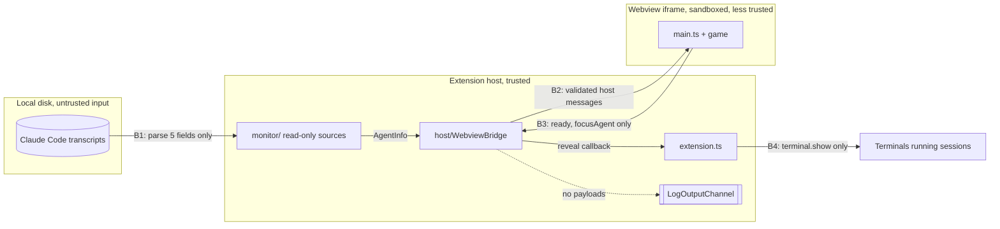

# Security and safety

Purpose: the threat model for Pixel Agents and the controls that keep real agent sessions, transcripts, and the user's machine safe from the game, from a compromised webview, and from our own bugs. Each control names the invariant it serves and the test that enforces it.
Related: [architecture overview](overview.md#6-security-boundary), [host-webview protocol](host-webview-protocol.md), [ADR 0007 allow-list protocol and pull handshake](adr/0007-allow-list-protocol-pull-handshake.md), [ADR 0001 bottom-panel webview](adr/0001-bottom-panel-webview.md), [ADR 0002 no hero health](adr/0002-no-hero-health.md), [ADR 0003 procedural sprites](adr/0003-procedural-sprites.md), [ADR 0004 esbuild two bundles](adr/0004-esbuild-two-bundles.md), [coding standards](../engineering/coding-standards.md), [M2 plan](plans/m2-protocol.md), [agent detection](agent-detection.md) (planned, M3), [CLAUDE.md](../../CLAUDE.md).

## 1. What we protect

| Asset | Why it matters | Worst outcome to prevent |
|---|---|---|
| Running Claude Code sessions | real work by the user | the extension stops, kills, types into, or otherwise steers a session |
| Transcript content | prompts, code, secrets, file contents | any of it is stored, logged, posted to the webview, or sent off the machine |
| The user's machine and workspace | files, processes, network | the extension writes files, runs processes, or opens network connections |
| The user's trust in the display | the panel is a status display | the game shows an agent as hurt, dead, or gone when it is not ([ADR 0002](adr/0002-no-hero-health.md)) |

## 2. Trust boundaries

| Boundary | Direction | Rule |
|---|---|---|
| B1 transcript to monitor (M3) | in | read-only; extract only session id, name, state, tool name, timestamp; discard the rest immediately ([agent detection](agent-detection.md) (planned, M3), ADR 0005 in M3) |
| B2 host to webview | out | only messages built by the protocol creators, which copy the five allow-listed `AgentInfo` keys |
| B3 webview to host | in | the webview is treated as untrusted: exact-key validation, two message types, bounded strings, drop on any doubt, never throw |
| B4 host to terminal (M3) | out | `Terminal.show()` for a live agent the host itself lists; no other terminal or process API |

The webview runs our own bundle under a strict CSP, so it is not expected to be hostile. It is still treated as untrusted at B3 because a bug in game code, a future UI feature, or a CSP mistake must not be able to reach a session.

## 3. Threats and controls

| # | Threat | Control | Invariant | Enforced by | Since |
|---|---|---|---|---|---|
| T1 | Webview sends a message that stops or types into a session | Webview-to-host union is exactly `ready`, `focusAgent`; no controlling type may be added; unknown types dropped | 3 | protocol tests: exact type list, banned-word check on message types | M2 |
| T2 | `focusAgent` used for more than reveal | handler calls only `revealAgentTerminal(id)`, only for a live, host-listed id; the bridge has no `vscode` access; reveal is `terminal.show()` | 3 | bridge tests (spy called once or not at all), grep for `sendText`, `sendSequence`, `executeCommand`, `child_process`, `process.kill` in `src/host/**` and `extension.ts` | M2, reveal wiring M3 |
| T3 | Malformed or hostile webview payload crashes the host or smuggles data | total validators, exact keys, no inherited or symbol keys, length before regex, new object returned, try/catch around dispatch | 3, 4 | validator cases and seeded fuzz | M2 |
| T4 | Transcript text leaks to the webview | `AgentInfo` has exactly five keys; creators copy only those; host validators reject extra keys; `id` and `toolName` patterns forbid spaces so free text cannot hide in them | 7 | allow-list tests, round-trip tests | M2 |
| T5 | Transcript text leaks to logs | logs carry fixed reason strings and `error.name: message` from our own code only; never payloads, `event.data`, or transcript lines | 7 | log-content assertions in bridge tests; monitor privacy test | M2, M3 |
| T6 | Monitor writes to or signals a process or file | monitor uses only read APIs and watchers | 3 | grep test over `src/monitor/**` | M3 |
| T7 | `transcriptPath` setting escapes its directory or follows symlinks | path containment and `realpath` check | 3, 7 | monitor tests | M3 |
| T8 | Script injection into the webview | CSP `default-src 'none'; script-src 'nonce-<N>'; style-src 'nonce-<N>'; base-uri 'none'; form-action 'none'`; per-load random nonce; escaped script URI; no inline handlers | 4 | CSP builder tests | M1 |
| T9 | Agent name used as markup (session or folder names are user-controlled) | names are bounded and stripped of control and bidi characters at the protocol layer; renderers draw them as canvas text or `textContent`, never `innerHTML` or `insertAdjacentHTML` | 4 | protocol name tests; M7 structural check bans `innerHTML` in `src/webview/**` | M2, M7 |
| T10 | Webview loads remote content or exfiltrates over the network | CSP has no `connect-src`, `img-src`, `media-src`, `font-src`; `localResourceRoots` is `dist/` only; command URIs and forms disabled | 5, 7 | CSP tests, manifest tests | M1 |
| T11 | Supply-chain compromise through a runtime package | `dependencies` empty; small, pinned devDependency allow-list; lockfile committed | 6 | manifest test | M1 |
| T12 | Game bug changes or hides a hero | hero state changes only through host `agentState`/`agentList`; webview has no message that reports game state; update loop in try/catch; rebuild from host list on reload | 1, 2, 4 | hero-invariant test, structural hero check | M4 |
| T13 | Webview spams `ready` to load the host | each answer is bounded (one config, at most 64 agents) | 4 | bridge tests (bounded output) | M2 |
| T14 | Persisted progress corrupts or grows unbounded | schema version, migrations, validation on load (E1) | 4 | persistence tests | E1 |
| T15 | Untrusted workspace content executed | the extension never executes workspace content; `untrustedWorkspaces.supported: true` is therefore safe | 3 | review | M1 |

## 4. Data inventory (Core invariant 7)

| Datum | Source | Where it may go | Where it must never go |
|---|---|---|---|
| session id | transcript path or terminal (M3), simulator | host memory, webview, logs | disk, network |
| name | derived in M3 (rule set there; must not be an absolute path) | host memory, webview, logs | disk, network |
| state | monitor state machine | host memory, webview, logs | disk, network |
| tool name | transcript tool-use record (name only) | host memory, webview, logs | disk, network |
| timestamp | transcript record or clock | host memory, webview, logs | disk, network |
| any other transcript content (messages, tool input or output, file paths, cwd) | transcript | **nowhere**: read, used to derive the five fields, discarded | memory beyond the parse call, logs, webview, disk, network |
| game progress (E1) | game | host `globalState` | network |

## 5. Read-only and reveal-only guarantees

- The only host API that touches a terminal is `Terminal.show()` (M3), reached only through `focusAgent` for a live agent.
- No code under `src/monitor/**`, `src/host/**`, or the `focusAgent` path in `extension.ts` uses `sendText`, `sendSequence`, `executeCommand` with terminal commands, `child_process`, `process.kill`, `fs.write*`, `fs.append*`, `fs.unlink`, or `dispose()` on a terminal. Watcher disposal is the only allowed `dispose()`.
- `WebviewBridge` holds no `vscode` reference. Its single outward capability is the `revealAgentTerminal` callback, which `extension.ts` supplies; in M2 it is `null`.

## 6. Crash isolation

- Host handlers never throw across `onDidReceiveMessage`.
- The webview catches errors in its message handler (M2) and its update loop (M4); errors are reported once per distinct message and never change hero state.
- The webview is never a source of truth: `retainContextWhenHidden: false`, no `getState`/`setState`, and every load rebuilds from the host snapshot.

## 7. Review checklist for changes near a boundary

- Does a new message cross B2 or B3? Follow [host-webview protocol section 10](host-webview-protocol.md#10-adding-or-changing-a-message).
- Does any new field carry text that could come from a transcript? It must be one of the five allow-listed fields.
- Does any new host code call a terminal, process, or file-write API? Reject unless it is watcher disposal or `Terminal.show()`.
- Does any new log line include a payload, path, or transcript text? Reject.
- Does any new webview code render host text with `innerHTML`? Reject.
