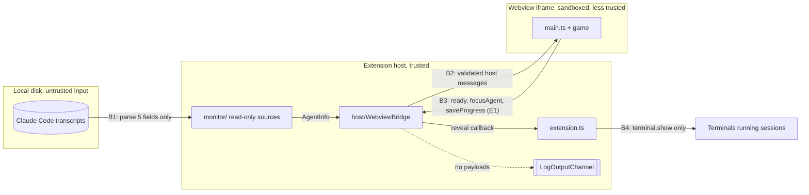

# Security and safety

Purpose: the threat model for Pixel Agents and the controls that keep real agent sessions, transcripts, and the user's machine safe from the game, from a compromised webview, and from our own bugs. Each control names the invariant it serves and the test that enforces it.
Related: [architecture overview](overview.md#6-security-boundary), [host-webview protocol](host-webview-protocol.md), [ADR 0007 allow-list protocol and pull handshake](adr/0007-allow-list-protocol-pull-handshake.md), [ADR 0001 bottom-panel webview](adr/0001-bottom-panel-webview.md), [ADR 0002 no hero health](adr/0002-no-hero-health.md), [ADR 0003 procedural sprites](adr/0003-procedural-sprites.md), [ADR 0004 esbuild two bundles](adr/0004-esbuild-two-bundles.md), [coding standards](../engineering/coding-standards.md), [M2 plan](plans/m2-protocol.md), [M3 plan](plans/m3-monitor.md), [M4 plan](plans/m4-engine.md), [E1 plan](plans/e1-enemies.md), [ADR 0012](adr/0012-host-owned-versioned-progress.md), [ADR 0013](adr/0013-enemy-health-and-hero-reaction-board.md), [game engine](game-engine.md), [ADR 0009 hero lifecycle isolation](adr/0009-hero-lifecycle-isolation.md), [agent detection](agent-detection.md), [ADR 0005 transcript watching](adr/0005-transcript-watching.md), [CLAUDE.md](../../CLAUDE.md).

## 1. What we protect

| Asset | Why it matters | Worst outcome to prevent |
|---|---|---|
| Running Claude Code sessions | real work by the user | the extension stops, kills, types into, or otherwise steers a session |
| Transcript content | prompts, code, secrets, file contents | any of it is stored, logged, posted to the webview, or sent off the machine |
| The user's machine and workspace | files, processes, network | the extension writes files, runs processes, or opens network connections |
| The user's trust in the display | the panel is a status display | the game shows an agent as hurt, dead, or gone when it is not ([ADR 0002](adr/0002-no-hero-health.md)) |

## 2. Trust boundaries

| Boundary | Direction | Rule |
|---|---|---|
| B1 transcript to monitor (M3) | in | transcripts are untrusted input. Read-only polling through the `ReadOnlyFileSystem` port (`realpath`, `lstat`, `readdir`, `readRange`); no symlink followed below the resolved root; bounded reads and line lengths; only `transcriptRecord.ts` looks inside a record and it returns `{ kind, toolName }`; no transcript text survives a poll ([agent detection section 3.1](agent-detection.md#31-transcript-source), [ADR 0005](adr/0005-transcript-watching.md)) |
| B2 host to webview | out | only messages built by the protocol creators, which copy the five allow-listed `AgentInfo` keys |
| B3 webview to host | in | the webview is treated as untrusted: exact-key validation, a closed message list (`ready`, `focusAgent`; from E1 also `saveProgress`, five bounded integers that reach only `globalState`), bounded strings and integers, drop on any doubt, never throw |
| B4 host to terminal (M3) | out | `Terminal.show()` only, for a live agent the host itself lists and that the monitor linked to a terminal; the call chain is bridge, `AgentMonitor.revealAgentTerminal`, `TerminalSource.reveal`, `vscodeTerminals` adapter; no other terminal or process API ([agent detection section 3.2](agent-detection.md#32-terminal-source)) |

The webview runs our own bundle under a strict CSP, so it is not expected to be hostile. It is still treated as untrusted at B3 because a bug in game code, a future UI feature, or a CSP mistake must not be able to reach a session.

## 3. Threats and controls

| # | Threat | Control | Invariant | Enforced by | Since |
|---|---|---|---|---|---|
| T1 | Webview sends a message that stops or types into a session | Webview-to-host union is exactly `ready`, `focusAgent`, `saveProgress` (E1; `saveProgress` names no agent, terminal, or command); no controlling type may be added; unknown types dropped | 3 | protocol tests: exact type list, banned-word check on message types | M2, E1 |
| T2 | `focusAgent` used for more than reveal | handler calls only `revealAgentTerminal(id)`, only for a live, host-listed id; the bridge has no `vscode` access; reveal is `terminal.show()` | 3 | bridge tests (spy called once or not at all), grep for `sendText`, `sendSequence`, `executeCommand`, `child_process`, `process.kill` in `src/host/**` and `extension.ts` | M2, reveal wiring M3 |
| T3 | Malformed or hostile webview payload crashes the host or smuggles data | total validators, exact keys, no inherited or symbol keys, length before regex, new object returned, try/catch around dispatch | 3, 4 | validator cases and seeded fuzz | M2 |
| T4 | Transcript text leaks to the webview | `AgentInfo` has exactly five keys; creators copy only those; host validators reject extra keys; `id` and `toolName` patterns forbid spaces so free text cannot hide in them | 7 | allow-list tests, round-trip tests | M2 |
| T5 | Transcript text leaks to logs | logs carry fixed reason strings and `error.name` only (the bridge never logs `error.message`, since dependency messages can carry paths); never payloads, `event.data`, or transcript lines. Monitor code describes errors only with `safeErrorCode` (`error.code` such as `EACCES`, else `error.name` such as `SyntaxError`), never `message` or `stack`, because V8 `JSON.parse` messages quote their input and fs messages embed paths. `getAgents()` and `revealAgentTerminal()` never throw, so no monitor error reaches the bridge's logger | 7 | log-content assertions in bridge tests; monitor marker test (M3 plan note 9): a marker in transcript text, a malformed line, and fs error messages appears in no log line, post, snapshot, or storage; grep bans `.message`, `.stack`, `JSON.stringify`, and error interpolation in `src/monitor/**` | M2, M3 |
| T6 | Monitor writes to, creates, or locks a file, or signals a process | the core sees only the `ReadOnlyFileSystem` port, which has no write member; the Node adapter opens with `O_RDONLY` (plus `O_NOFOLLOW`), closes in the same call, never holds a handle between polls; no `fs.watch`, no extension storage in M3 | 3 | grep over `src/monitor/**` (write, create, rename, chmod, open-flag bans; import allow-list of the fs adapter); real-disk test that the fixture tree is unchanged | M3 |
| T7 | `transcriptPath` setting escapes its directory or follows symlinks | the root is `realpath`ed once per scan; below it every entry is `lstat`ed and links are skipped; each file's `realpath` must be inside the root (`path.relative` check); `fstat` identity check on open | 3, 7 | monitor tests with symlinked directories and files, `..` paths, sibling-prefix roots, win32 paths | M3 |
| T16 | A repository's `.vscode/settings.json` widens what the monitor reads | `pixelAgents.projectScope` and `pixelAgents.transcriptPath` are `machine`-scoped (user or remote settings only) | 7 | manifest test on setting scopes | M3 |
| T17 | A huge or hostile transcript stalls the host | at most 64 KiB on discovery and 1 MiB per file per poll; lines over 256 KiB skipped unparsed; at most 256 content blocks scanned; polls never overlap; stale-file re-checks batched | 4 | transcript-source tests with oversized lines, slow fake fs, deep nesting | M3 |
| T18 | Interference with Claude Code or other extensions' hooks (for example `pablodelucca.pixel-agents`) | the monitor reads only `<root>/<project dir>/<uuid>.jsonl`; it never reads or writes `~/.claude/settings.json`, hooks, or other extensions' files, and depends on none of them | 3 | grep (no write APIs), real-disk unchanged-tree test, manual check with the other extension enabled | M3 |
| T19 | Reveal used to act on the wrong or a foreign terminal | reveal can only `show()`; links are made only for sessions that appear while this window runs, one live agent per terminal; closing a terminal only drops the link | 3 | terminal source and adapter tests (fake terminals fail on any other member) | M3 |
| T8 | Script injection into the webview | CSP `default-src 'none'; script-src 'nonce-<N>'; style-src 'nonce-<N>'; base-uri 'none'; form-action 'none'`; per-load random nonce; escaped script URI; no inline handlers | 4 | CSP builder tests | M1 |
| T9 | Agent name used as markup (session or folder names are user-controlled) | names are bounded and stripped of control and bidi characters at the protocol layer; renderers draw them as canvas text or `textContent`, never `innerHTML` or `insertAdjacentHTML` | 4 | protocol name tests; M7 structural check bans `innerHTML` in `src/webview/**` | M2, M7 |
| T10 | Webview loads remote content or exfiltrates over the network | CSP has no `connect-src`, `img-src`, `media-src`, `font-src`; `localResourceRoots` is `dist/` only; command URIs and forms disabled | 5, 7 | CSP tests, manifest tests | M1 |
| T11 | Supply-chain compromise through a runtime package | `dependencies` empty; small, pinned devDependency allow-list; lockfile committed | 6 | manifest test | M1 |
| T12 | Game bug changes or hides a hero | hero state changes only through host `agentState`/`agentList`; webview has no message that reports game state; update loop in try/catch; rebuild from host list on reload | 1, 2, 4 | hero-invariant test, structural hero check | M4 |
| T13 | Webview spams `ready` to load the host | each answer is bounded (one config, at most 64 agents) | 4 | bridge tests (bounded output) | M2 |
| T14 | Persisted progress corrupts or grows unbounded | one key holding six bounded integers; `schemaVersion` plus forward-only migrations; exact-key validation on load and on every save; invalid data becomes defaults (one fixed log line); a newer version is left untouched and read-only; writes are monotonic, coalesced (one per 2 s), and failure-swallowing ([ADR 0012](adr/0012-host-owned-versioned-progress.md)) | 4, 7 | persistence tests (`progressMigrations`, `progressStore`, integration with a hand-written `schemaVersion: 99`) | E1 |
| T22 | A hostile or buggy webview floods `saveProgress`, rewinds progress, or smuggles data in it | `saveProgress` has no string field (nothing can ride in it); validated like every B3 message; the webview-side saver throttles to one per 15 s except boss defeats; the host coalesces writes and ignores a save below the stored `totalKills`; the webview never saves before it has applied a `progress` message (a `progress` that arrives after the engine's boot gate is still applied once and only then opens the saver, so counters earned on defaults are never written); the webview builds each save with `createSaveProgressMessage`, which copies only the six allow-listed keys | 3, 7 | bridge and store tests with fuzzed and flooded saves; saver tests; protocol fuzz | E1 |
| T23 | Combat or a boss changes, hides, or removes a hero | the engine's enemy side has no hero reference and no `AgentInfo`; the two buffers between the sides are plain numbers; the only hero-facing output is a cosmetic reaction board that `Hero.draw` reads; structural import-direction and vocabulary tests; the extended hero-invariant test ([ADR 0013](adr/0013-enemy-health-and-hero-reaction-board.md)). Failure containment as built: `Combat.update` runs in its own try/catch in `Game` and `Combat.recordFault()` disables combat on the third fault (the timed rhythm takes over); each enemy runs under `guarded` with the game's `ErrorSink` passed to `Combat`; the drop pass, the stage fade, the stage director, and the `onProgress` callback each have their own catch (the drop pass and fade stop after `PASS_FAULT_LIMIT` 3); a first-sight baseline stops a hero that enters the fighter buffer from injecting strikes | 1, 2, 4 | `combatStructure.test.ts`, `heroInvariantCombat.test.ts` | E1 |
| T20 | A faulty entity, bad art data, or an event flood in the engine takes down the scene, hides a hero, or stalls the panel | per-entity quarantine (frozen, never removed), try/catch per step and render, a frame callback that schedules the next frame first, a bounded event queue (256) that resyncs from the mirror, a bounded particle pool and light list, the `despawned` failsafe removal, the art validator run by tests, boot failure leaving the mirror working | 2, 4 | engine crash-isolation tests, hero-invariant test (faults, absurd deltas, queue overflow, pool exhaustion), art validator tests | M4 |
| T21 | The engine reaches the host or an agent, or renders untrusted text as markup | `src/game/**` has no host channel, no `postMessage`, no `acquireVsCodeApi`, no DOM, timer, network, or storage access (lint and structural scan); `SceneFeed` and `GameHost` never call `HostChannel.send`; the engine draws no text in M4 (names and tool names are canvas text only, from M7); error messages in `src/game/**` are fixed strings | 3, 4, 7 | structural scan of `src/game/**` and the two webview files; `HostChannel` call-site test | M4 |
| T15 | Untrusted workspace content executed | the extension never executes workspace content; `untrustedWorkspaces.supported: true` is therefore safe | 3 | review | M1 |

## 4. Data inventory (Core invariant 7)

| Datum | Source | Where it may go | Where it must never go |
|---|---|---|---|
| session id | transcript file base name (a UUID, M3); `sim-<slot>-<generation>` for simulated agents | host memory, webview, logs | disk, network |
| name | workspace folder name or project directory label plus the first 4 characters of the id (M3); `Sim <Name>` for simulated agents. Never transcript text, never an absolute path | host memory, webview, logs | disk, network |
| state | monitor state machine | host memory, webview, logs | disk, network |
| tool name | `message.content[].name` of a `tool_use` block, kept only if it matches `TOOL_NAME_PATTERN` | host memory, webview, logs | disk, network |
| timestamp | the monitor's clock at the last state or tool change (not read from the transcript) | host memory, webview, logs | disk, network |
| byte offset, file identity, mtime, last-activity time, tool-pending flag | monitor bookkeeping (no content) | host memory | logs, webview, disk, network |
| any other transcript content (messages, tool input or output, summaries, titles, file paths, cwd) | transcript | **nowhere**: read, used to derive the five fields, discarded inside the parse call; partial lines are re-read rather than buffered | memory beyond the parse call, logs, webview, disk, network |
| game progress (E1): `stageIndex`, `killsInStage`, `totalKills`, `bossesDefeated`, `cycle` | game counters, sent by the webview as `saveProgress` | host `globalState` (own key, not synced), the webview (`progress`), logs only as "invalid" or "future version" fixed lines | network, any per-agent datum (id, name, class, tool, state) |

## 5. Read-only and reveal-only guarantees

- The only host API that touches a terminal is `Terminal.show()` (M3), reached only through `focusAgent` for a live agent, and called only in `src/monitor/adapters/vscodeTerminals.ts`. The monitor otherwise only listens to terminal open, close, and active-terminal events and reads `exitStatus`.
- The monitor's file access is the `ReadOnlyFileSystem` port: `homedir`, `realpath`, `lstat`, `readdir`, and `readRange` (open read-only, read, close). Only `src/monitor/adapters/nodeFileSystem.ts` imports `node:fs`, and only those read functions. M3 uses no extension storage at all; E1 introduces `globalState` for game progress only (`src/host/progressStore.ts`, which writes only through a `KeyValueStore` port; no file is written, and the monitor never touches it).
- No code under `src/monitor/**`, `src/host/**`, or the `focusAgent` path in `extension.ts` uses `sendText`, `sendSequence`, `executeCommand` with terminal commands, `child_process`, `process.kill`, `fs.write*`, `fs.append*`, `fs.unlink`, or `dispose()` on a terminal. The only allowed `dispose()` calls are on disposables the extension itself created: its own event-listener subscriptions (for example the view's `onDidReceiveMessage`, `onDidChangeVisibility`, and `onDidDispose` listeners in `extension.ts`), its own registrations and output channel, and (from M3) its own file watchers and timers. Disposing, closing, or hiding a terminal, or anything else owned by an agent session, is never allowed.
- `WebviewBridge` holds no `vscode` reference. Its single outward capability is the `revealAgentTerminal` callback, which `extension.ts` supplies; in M2 it was `null`; from M3 it is `(agentId) => monitor.revealAgentTerminal(agentId)` (still `null` if the monitor failed to start).
- No test-only control surface ships: no test command, exported test API, or environment switch. Tests observe the extension through public events (the integration provider spy subscribes to `onDidReceiveMessage`) and through fakes, never through a production hook that could become a control path.

## 6. Crash isolation

- The monitor (M3) catches errors in every timer callback, poll step, port event, and listener call; a per-file error affects only that file; a failure to construct the monitor in `activate` leaves the view working with an empty agent list.
- Host handlers never throw across `onDidReceiveMessage`. The bridge's error logging and its `postMessage` rejection handler each wrap the logger call in their own try/catch, so even a throwing logger cannot escape as an exception or an unhandled rejection.
- The webview catches errors in its message handler (M2) and its update loop (M4); errors are reported once per distinct message and never change hero state. The engine isolates faults per entity, per step, per render, and per frame callback, and cannot send anything to the host ([game engine section 4](game-engine.md#4-the-loop-and-crash-isolation), [ADR 0009](adr/0009-hero-lifecycle-isolation.md)).
- The webview is never a source of truth: `retainContextWhenHidden: false`, no `getState`/`setState`, and every load rebuilds from the host snapshot.

## 7. Review checklist for changes near a boundary

- Does a new message cross B2 or B3? Follow [host-webview protocol section 10](host-webview-protocol.md#10-adding-or-changing-a-message).
- Does any new field carry text that could come from a transcript? It must be one of the five allow-listed fields.
- Does any new host code call a terminal, process, or file-write API? Reject unless it is `Terminal.show()` or disposal of a disposable the extension itself created (listener, registration, output channel, watcher, timer); never a terminal or anything an agent session owns.
- Does any new log line include a payload, path, or transcript text? Reject.
- Does monitor code read a new transcript property, keep transcript text past a parse call, describe an error other than through `safeErrorCode`, or touch a file outside `<root>/<project dir>/<uuid>.jsonl`? Reject unless an architect plan and [agent detection](agent-detection.md) cover it.
- Does any new webview code render host text with `innerHTML`, `outerHTML`, `insertAdjacentHTML`, or `document.write`? Reject.
- Does any new production code exist only to make a test easier (a command, export, or env flag)? Reject; observe through public events or fakes instead.
