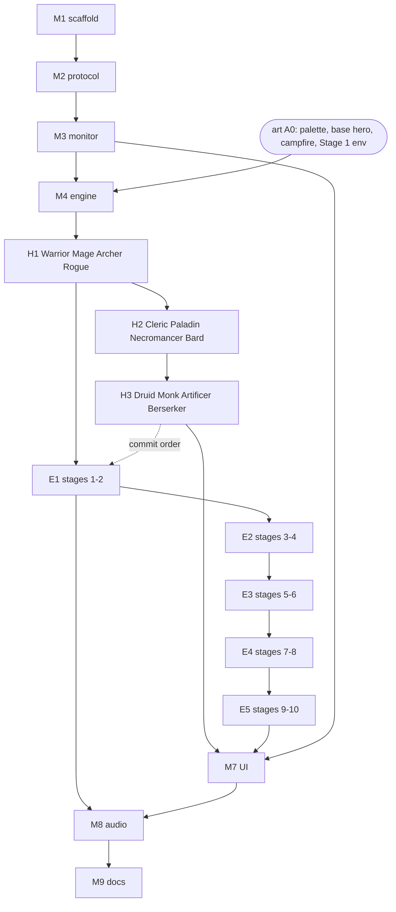

# Roadmap

Purpose: the ordered list of milestones and content batches that take Pixel Agents from an empty repo to a packaged extension, with scope, files, art, dependencies, and exit criteria for each. Owned by the architect; the developer only flips status lines after each commit.
Related: [CLAUDE.md](../../CLAUDE.md), [team workflow](team-workflow.md), [coding standards](coding-standards.md), [testing strategy](testing-strategy.md) (M1, tester), [art style guide](../design/art-style-guide.md), [sprite spec](../design/sprite-spec.md), [architecture overview](../architecture/overview.md), [docs index](../index.md), [M1 plan](../architecture/plans/m1-scaffold.md), [M2 plan](../architecture/plans/m2-protocol.md), [host-webview protocol](../architecture/host-webview-protocol.md), [security and safety](../architecture/security-and-safety.md), [glossary](../glossary.md), [M3 plan](../architecture/plans/m3-monitor.md), [agent detection](../architecture/agent-detection.md), [M4 plan](../architecture/plans/m4-engine.md), [game engine](../architecture/game-engine.md) (M4 design), [data model](../architecture/data-model.md) (M4 design), ADRs [0008](../architecture/adr/0008-dom-free-engine-behind-ports.md), [0009](../architecture/adr/0009-hero-lifecycle-isolation.md), [0010](../architecture/adr/0010-split-room-stage-layout.md).

## 1. How to use this file

- Work top to bottom. Each milestone (M) or batch (H, E) runs the full loop in [team workflow](team-workflow.md#2-milestone-loop): architect plan, pixel-artist art (if listed), developer, architect docs sync (if flagged), tester, reviewer, developer commit.
- **Commit granularity**: one Conventional Commit per milestone; heroes and enemies commit **once per batch** (each batch is reviewed and committed on its own `feat/*` branch). See assumption A1.
- **Status**: the developer sets `Status: in progress` when starting a milestone or batch and `Status: done` after its commit. That is the developer's only edit here; the architect keeps everything else accurate.
- The architect writes a detailed plan (task list, interfaces, test notes) for one milestone at a time. This file is the outline, not the plan.

## 2. Standard gates (apply to every milestone and batch)

A milestone or batch is done only when all of these hold, plus its own "Done when" list.

- **G1** `npm run build`, `lint`, `typecheck`, and `test` pass.
- **G2** `npm run docs:tables` leaves no diff (from H1 onward; before H1 there are no data tables and the script does not exist yet, see A4).
- **G3** All seven Core invariants intact. From M4 onward the hero-invariant test exists and passes.
- **G4** `package.json` `dependencies` is empty; the repo contains no image or audio files (no `.png`, `.gif`, `.jpg`, `.jpeg`, `.webp`, `.bmp`, `.ico`, `.svg`, `.wav`, `.mp3`, `.ogg`, `.flac`, `.m4a`, `.aac`, or font files `.ttf`, `.otf`, `.woff`, `.woff2`). Checked by tests from M1.
- **G5** Matching docs updated in the same change (protocol, data tables, classes, config, art), and a `CHANGELOG.md` entry exists.
- **G6** `CLAUDE.md` directory map, commands, and ownership table match the repo (architect syncs if the developer flags drift).
- **G7** Reviewer verdict is Approve with no open Critical findings; committed on a `feat/*`, `fix/*`, or `docs/*` branch with a Conventional Commit; status line ticked.

## 3. Ordering decision: protocol before monitor

The default commit order is scaffold, monitor, protocol, engine, heroes, enemies, UI, audio, docs. This roadmap moves **protocol ahead of monitor**. Everything else keeps the default order.

Why the reorder is a true dependency, not a preference:

- The monitor's output *is* protocol data. `AgentMonitor` emits `spawned`, `working`, `idle`, `despawned` events carrying session id, name, state, tool name, and timestamp. Those types (`AgentState`, `AgentInfo`, `AgentStateEvent`) must be shared by both bundles, so they belong in `src/shared/protocol.ts`, not in `src/monitor/`.
- Building the monitor first would force one of two bad options: define the types inside `src/monitor/` and move them later (a churn refactor across a just-reviewed milestone), or let the webview bundle import from `src/monitor/` (crosses the host/webview bundle boundary).
- The protocol fixes two invariants the monitor must then honor: the transcript-privacy field allow-list (invariant 7) and the absence of any control message (invariant 3, `focusAgent` only reveals). Writing that contract first lets the monitor milestone be reviewed against it.
- The protocol milestone needs nothing from the monitor: it is types, runtime validators for webview-to-host messages, and the host/webview handshake, all testable in isolation.

Other orderings considered and kept:

- **Engine before heroes**: kept. The engine milestone includes the base `Hero` entity and its lifecycle state machine (no class), because scene rebuild from the agent list and the hero-invariant test need a hero to exist. Classes come in H1-H3.
- **Heroes before enemies**: kept. Combat needs heroes with attack frames to target enemies; heroes do not need enemies (working heroes advance and play attack cycles in an empty room until E1 adds targets).
- **UI before audio**: kept. Audio needs the mute toggle and settings surface from UI.

## 4. Milestones

### M1. Scaffold

- **Plan**: [M1 scaffold plan](../architecture/plans/m1-scaffold.md) (task list, interfaces, test notes).
- **Scope**: repo skeleton that builds, lints, typechecks, tests, and opens an empty "Pixel Agents" bottom-panel webview view. Two esbuild bundles (host Node CJS, webview browser IIFE). Strict CSP with nonce, minimal `localResourceRoots`. Test runner (`node:test`, [ADR 0006](../architecture/adr/0006-node-test-runner.md)) with smoke tests for the CSP builder, manifest, `.vscodeignore`, no-assets rule, and bundles, plus extension-host integration tests in a downloaded VS Code via `@vscode/test-electron` (approved after the M1 review, ADR 0006 amendment). CI workflow running all gates plus a package-contents check. ESLint, Prettier, markdownlint, `.vscode/launch.json` for F5.
- **Files**: `package.json`, `tsconfig.base.json`, `tsconfig.json`, `tsconfig.webview.json`, `tsconfig.tools.json`, `esbuild.mjs`, ESLint/Prettier/markdownlint config, `.vscode/`, `.github/` (ci, release, issue templates, PR template, CODEOWNERS), `.gitignore`, `.gitattributes`, `.editorconfig`, `.nvmrc`, `.vscodeignore`, `src/extension.ts` (activation and view provider only), `src/webview/index.html.ts`, `src/webview/main.ts` (blank canvas), `README.md`, `CONTRIBUTING.md`, `CHANGELOG.md`, `LICENSE`, `CODE_OF_CONDUCT.md`. Tester: `test/run.mjs`, smoke tests, the `test` script, `docs/engineering/testing-strategy.md`. Architect (done in the planning pass): the plan, `docs/architecture/overview.md`, ADRs 0001-0004 (0001 and 0004 gained M1 implementation notes), new ADR 0006 (test runner), `docs/engineering/coding-standards.md`, `team-workflow.md`, `docs/index.md`, `CLAUDE.md` sync.
- **Art**: none.
- **Depends on**: nothing.
- **Done when**: G1, G3-G7; `git init` with `main` default and first commit is the scaffold (made only after the reviewer approves and the human authorizes it); F5 shows the empty panel; `npm run package` produces a `.vsix` holding only the manifest, README, CHANGELOG, LICENSE, and the two bundles; CSP has no `unsafe-inline` or `unsafe-eval` for scripts; `.vscodeignore` excludes `src/`, `test/`, `docs/`, `tools/`; `dependencies` is empty, only allowed devDependencies present; CI runs every gate.
- Status: done

### M2. Protocol

- **Plan**: [M2 protocol plan](../architecture/plans/m2-protocol.md) (task list, interfaces, test notes; refreshed against M1 as built).
- **Scope**: typed host/webview message unions in `src/shared/protocol.ts`. Host to webview: full agent list snapshot, single agent-state event, config snapshot. Webview to host: `ready`, `focusAgent` (reveal only). Shared `AgentState = 'spawned' | 'working' | 'idle' | 'despawned'` and `AgentInfo` limited to the privacy allow-list (id, name, state, tool name, timestamp). Exact-key runtime validators in both directions and host-side creators that copy only allow-listed keys ([ADR 0007](../architecture/adr/0007-allow-list-protocol-pull-handshake.md)). A vscode-free `WebviewBridge` in the new `src/host/` folder routes webview messages; the host drops anything invalid. Pull handshake: the webview sends `ready` on every document load; the host answers with `config` then `agentList` (empty until M3). The "Pixel Agents" `LogOutputChannel` is introduced. Nothing new is drawn.
- **Files**: `src/shared/assertNever.ts`, `src/shared/protocol.ts`, `src/host/webviewBridge.ts`, `src/extension.ts` (output channel, bridge wiring, view listeners), `src/webview/main.ts` (message listener, `ready`), `src/webview/hostChannel.ts`, `hostMessages.ts`, `hostState.ts`, `tsconfig.json` (`src/host/**`), `eslint.config.mjs` (`src/host/**` boundary block), `CHANGELOG.md`, `README.md`. Tester: `test/shared/`, `test/host/webviewBridge.test.ts`, `test/webview/hostMessages.test.ts`, `test/repo/protocolStructure.test.ts`, updates to the M1-only assertions in `extension.test.ts`, `readOnly.test.ts`, `main.test.ts` and to `fakeVscode.ts`, `fakeDom.ts`, a `ready`-observing extension of `test/integration/support/providerSpy.ts` plus protocol integration tests, `testing-strategy.md`. Architect (done before development): `host-webview-protocol.md` with a sequence diagram per flow, `security-and-safety.md`, ADR 0007, ADR 0004 M2 notes, overview, coding standards, index, glossary, `CLAUDE.md` sync.
- **Art**: none.
- **Depends on**: M1.
- **Done when**: G1, G3-G7, with G1 including `npm run test:integration`; tests prove the message unions are exhaustive (a `never` check per switch); no message type can control, stop, write to, or send input to a session; `focusAgent` is the only webview-initiated action and its handler can only reveal; invalid or unknown webview messages are rejected without throwing; `AgentInfo` has exactly the allow-listed fields; host glue registers its message listener before setting `html` and disposes view listeners; the integration suite observes exactly one `ready` per webview document load (first open and after every re-show) through `onDidReceiveMessage`, with no production test hook.
- Status: done

### M3. Monitor

- **Plan**: [M3 monitor plan](../architecture/plans/m3-monitor.md) (task list, interfaces, test notes, decisions for the human); behaviour contract in [agent detection](../architecture/agent-detection.md); rationale in [ADR 0005](../architecture/adr/0005-transcript-watching.md).
- **Scope**: `AgentMonitor` aggregating three read-only sources: `TranscriptSource` (polls Claude Code transcripts under `~/.claude/projects`, workspace folders only by default, extracts only allow-listed fields, bounded incremental reads, no symlinks followed), `TerminalSource` (links new sessions to terminals for `focusAgent` reveal only; never a lifecycle input), `SimulatorSource` (labelled `Sim ...` agents, `auto` by default: only while no real session exists). Pure session state machine (spawned, working, idle, despawned) with debounce, idle timeout, pending-tool timeout, and session-end timeout; `despawned` on file removal, scope change, or session-end silence. Emission coalescing per agent. Host posts agent-state events through the M2 protocol, unchanged. Nine `pixelAgents.*` settings. Monitor core is vscode- and Node-free; adapters are the only files touching `node:fs` or `vscode`. No persistence.
- **Files**: `src/monitor/` core (`ports.ts`, `monitorConfig.ts`, `monitorLog.ts`, `projectPaths.ts`, `agentNames.ts`, `transcriptLines.ts`, `transcriptRecord.ts`, `sessionMachine.ts`, `AgentRegistry.ts`, `TranscriptSource.ts`, and its helpers `transcriptFiles.ts`, `transcriptDiscovery.ts`, `transcriptScope.ts`, `staleFiles.ts` (added during development, [plan section 13](../architecture/plans/m3-monitor.md#13-as-built-architect-drift-sync)), `TerminalSource.ts`, `SimulatorSource.ts`, `AgentMonitor.ts`), `src/monitor/adapters/` (`nodeFileSystem.ts`, `nodeRuntime.ts`, `vscodeTerminals.ts`), `src/extension.ts` (build adapters, wire monitor into the bridge and reveal, configuration and workspace-folder listeners), `package.json` `contributes.configuration` (`pixelAgents.simulator`, `simulatorAgentCount`, `projectScope`, `transcriptPath`, `idleTimeoutSeconds`, `toolTimeoutSeconds`, `sessionEndTimeoutMinutes`, `debounceMs`, `pollIntervalMs`), `eslint.config.mjs` (monitor core and adapter boundary blocks), `CHANGELOG.md`, `README.md` (config table, privacy paragraph). Tester: `test/monitor/`, `test/simulation/`, `test/fixtures/transcripts/` (synthetic only), fakes in `test/support/`, extended structural suites, `test/integration/run.mjs` settings and env, `monitor.itest.ts`, `testing-strategy.md`. Architect (done before development): the plan, `agent-detection.md` with a state machine diagram, ADR 0005, ADR 0004 M3 notes, `security-and-safety.md`, `host-webview-protocol.md`, overview, coding standards, index, glossary, `CLAUDE.md` sync.
- **Notes from M2** (the M3 plan makes them concrete):
  - M3 plugs into the M2 bridge without changing the protocol: `extension.ts` replaces the empty `NO_AGENTS` snapshot with the monitor's current list (`getAgents`), forwards each monitor event to `WebviewBridge.postAgentState`, and replaces `revealAgentTerminal: null` with a reveal callback built on `TerminalSource` that only calls `Terminal.show()` (B4 in [security and safety](../architecture/security-and-safety.md#2-trust-boundaries)).
  - `AgentMonitor` builds `AgentInfo` through `toAgentInfo` (or values that pass `isAgentInfo`) and normalizes names and tool names to the protocol limits itself; the bridge refuses invalid records rather than repairing them.
  - Monitor modules import `src/shared/**` for types; whether pure monitor logic also needs a vscode-free split (like `src/host/`) is decided in the M3 plan (decided: a vscode- and Node-free core plus `src/monitor/adapters/`, [ADR 0004 M3 notes](../architecture/adr/0004-esbuild-two-bundles.md#implementation-notes-m3)). `src/host/**` must not import `src/monitor/**` (lint, from M2).
  - Once `getAgents` is monitor-backed, a thrown error can embed transcript text (for example, V8's `JSON.parse` `SyntaxError` message quotes its input). Monitor-originated errors (transcript reading and parsing) must never reach the bridge's logger with their `message`: log only `error.name` or a fixed reason string ([security and safety T5](../architecture/security-and-safety.md#3-threats-and-controls)). M3 tests feed a malformed transcript line containing a marker string and assert that the marker appears in no log line.
  - The "no controlling message types" and host grep tests from M2 extend to `src/monitor/**`. The M2 integration `ready` observer is the base for the simulator integration checks (posted `agentList` and `agentState` sequences).
- **Art**: none.
- **Depends on**: M2 (emits protocol types).
- **Done when**: G1 (including `test:integration`), G3-G7; **read-only monitor**: a test greps `src/monitor/**` and the `focusAgent` path for `sendText`, `child_process`, `process.kill`, `fs.write*`, `fs.append*`, `fs.unlink`, create, rename, and write open flags, `.dispose()` on terminals, and finds none, and a real-disk test shows the fixture tree unchanged; **transcript privacy**: a test feeds transcript lines (including a malformed one) and fs errors carrying a marker and asserts the emitted records hold only id, name, state, tool name, timestamp, and the marker appears in no log line, posted message, snapshot, or storage; debouncing, idle timeout, and despawn-on-session-end are tested; the `transcriptPath` setting cannot escape its directory or follow symlinks out of it; all timers and listeners are disposed on deactivate; the simulation integration test drives `SimulatorSource` through spawned, working, idle, despawned and asserts the posted messages; the extension-host suite follows a synthetic session in a temp transcript root (never the real `~/.claude`). Details: [M3 plan section 8](../architecture/plans/m3-monitor.md#8-gates-for-m3).
- Status: done

### M4. Engine

- **Plan**: [M4 engine plan](../architecture/plans/m4-engine.md) (task list, interfaces, test notes, exact A0 art list, decisions for the human); design in [game engine](../architecture/game-engine.md) and [data model](../architecture/data-model.md); rationale in ADRs [0008](../architecture/adr/0008-dom-free-engine-behind-ports.md), [0009](../architecture/adr/0009-hero-lifecycle-isolation.md), [0010](../architecture/adr/0010-split-room-stage-layout.md).
- **Scope**: the game runtime in the webview: `Game` (fixed-step update, render, pause when hidden), `Renderer` (320x180 internal buffer, integer scaling, no smoothing, devicePixelRatio and resize), `Camera`, `Lighting` (torch and campfire light), `Pathfinding`, `Collision`, `Particles` (pooled), `spriteFactory` (template to canvas, layer compositing, palette swaps) and `spriteValidator`. Entities: base `Hero` (no class) with a lifecycle state machine that changes only on host agent-state events, `Campfire`. Data: `stages.ts` with Stage 1 only. Behaviors: working heroes advance and play a generic attack cycle; idle heroes walk to the campfire and use rest poses; despawned heroes play victory and warp out. Update loop wrapped in try/catch; on reload the scene is rebuilt from the host agent list. The engine is DOM-free behind `Surface` and `BitmapFactory` ports; the webview host owns the animation frame.
- **Files**: `src/game/` (`ports.ts`, `layout.ts`, `rng.ts`, `Game.ts`, `Roster.ts`, `Engagement.ts`, `Renderer.ts`, `Camera.ts`, `Lighting.ts`, `Pathfinding.ts`, `Collision.ts`, `Particles.ts`, `Stage.ts`), `src/game/entities/` (`Entity.ts`, `Hero.ts`, `Campfire.ts`), `src/game/data/` (`stages.ts`, `animations.ts`, `tuning.ts`), `src/game/sprites/` (`spriteFactory.ts`, `spriteValidator.ts`), `src/webview/` (`main.ts`, `canvasSurface.ts`, `gameHost.ts`, `sceneFeed.ts`), `eslint.config.mjs` (game block), `CHANGELOG.md`, `README.md`. Pixel-artist: `src/game/sprites/palettes.ts`, `src/game/sprites/spriteTemplates.ts`, art docs. Tester: `test/game/`, `test/webview/`, `test/simulation/scene.test.ts`, `test/repo/engineStructure.test.ts`, support fakes, `testing-strategy.md`. Architect (done in the planning pass): the plan, `game-engine.md`, `data-model.md`, ADRs 0008 to 0010, security, overview, coding standards, index, glossary, `CLAUDE.md` sync.
- **Art (batch A0)**: master palette (about 32 colors, 4 skin and 6 hair swaps); base hero body and default head layers with `idle`, `walk`, `attack` (3 frames, added in the M4 plan, decision H4-1), `sit`, `eat`, `sleep`, `polish`, `read`, `warmHands`, `victory`, plus a plain default weapon layer; campfire with 3-4 frame flame loop (two sizes) and ember spec; Stage 1 "The Forgotten Cellar" tile palette, floor and back-wall tiles, 6+ props (8 listed), parallax backdrop, dripping-water ambient. No hurt, downed, or death frames. The exact exports, sizes, and counts are in [M4 plan section 10](../architecture/plans/m4-engine.md#10-art-needs-batch-a0).
- **Depends on**: M3 (agent events and simulator drive the scene), A0 art.
- **Done when**: G1-G7 (G2 not yet applicable); **hero-invariant test** exists: only `spawned`, `working`, `idle`, `despawned` change hero state, and a thrown error inside the update loop does not change hero state or reach the host; **structural check**: `Hero` and its file contain no `hp`, `health`, `mana`, `dead`, `downed`, `retreat`, and no gauge is drawn on heroes; **crash isolation**: a forced exception in an entity is caught, logged without transcript content, and the next frame renders; webview reload rebuilds the same heroes from the host list; sprite templates pass the validator (row lengths, frame sizes, palette chars, 12-color limit); simulator with 8 heroes holds 60fps on the reference machine (measured as documented in testing strategy; the reference machine and panel size are [M4 decision H4-3](../architecture/plans/m4-engine.md#11-decisions-for-the-human)). Details: [M4 plan section 8](../architecture/plans/m4-engine.md#8-gates-for-m4).
- Status: todo

### M5. Heroes (3 batches)

Heroes are split into three batches of four classes, in style-guide table order, so each batch mixes melee, ranged, and caster silhouettes. Each class adds a `classes.ts` row, `classMap.ts` entries, a `Hero` subclass with its attack and ability behavior, and art layers (head/hair, gear, weapon) with `attack` (3-4 frames) and `ability` (3 frames). `classMap.ts` maps tools and activities only to classes delivered so far; assignment is sticky per session, and the fallback is deterministic over the delivered set (see A5).

#### H1. Warrior, Mage, Archer, Rogue

- **Scope**: class data table and class map introduced; four class subclasses; sticky class assignment; `npm run docs:tables` script introduced and generates the class table in `docs/design/classes.md`; CI step for stale generated docs.
- **Files**: `src/game/entities/` (four class files), `src/game/data/classes.ts`, `src/game/data/classMap.ts`, `src/game/entities/Hero.ts` (class hook), `scripts/generate-doc-tables.ts`, `package.json` (`docs:tables` script), `.github/workflows/ci.yml`, `docs/design/classes.md`, `docs/design/game-design.md`. Pixel-artist: `spriteTemplates.ts` (or a per-class template file in `src/game/sprites/`), `palettes.ts`, art docs.
- **Art (batch H1)**: Warrior (red + steel, plumed helm, sword + round shield), Mage (blue + gold, pointy hat, orb staff), Archer (forest green + brown, hood, quiver, bow), Rogue (slate + purple, hood + mask, twin daggers); layers and attack/ability frames; projectile and spell effect sprites used by these classes.
- **Depends on**: M4, H1 art.
- **Done when**: G1-G7; class-mapping tests: each mapped tool resolves to the expected class, assignment stays sticky across working/idle cycles, fallback is deterministic; hero-invariant and structural checks extended to the four subclasses; each class reads by silhouette (reviewer eyeballs the dev preview or F5); class attacks with no enemies present never change hero state.
- Status: todo

#### H2. Cleric, Paladin, Necromancer, Bard

- **Scope**: four classes; `Summon` entity introduced for the Necromancer (see A6). Buff visuals for Cleric, Paladin, Bard are decorative icons, never a resource bar.
- **Files**: `src/game/entities/` (four class files, `Summon.ts`), `classes.ts`, `classMap.ts`, regenerated `docs/design/classes.md`. Pixel-artist: templates, palettes, art docs.
- **Art (batch H2)**: Cleric (white + gold, hood or mitre, mace), Paladin (gold + white, winged helm, kite shield, glowing sword), Necromancer (dark purple + sickly green, skull staff) plus skeleton summon, Bard (teal + magenta, feathered hat, lute); buff and note effect sprites.
- **Depends on**: H1.
- **Done when**: G1-G7; summons have no effect on hero state and despawn with their owner hero only via the owner's `despawned` event; buff icons are not gauges (structural check covers `Summon` and buffs); class-mapping tests cover the new rows.
- Status: todo

#### H3. Druid, Monk, Artificer, Berserker

- **Scope**: final four classes; `Summon` extended for Druid and Artificer; class table complete (12 rows) and class map covers all tools.
- **Files**: `src/game/entities/` (four class files, `Summon.ts`), `classes.ts`, `classMap.ts`, regenerated `docs/design/classes.md`. Pixel-artist: templates, palettes, art docs.
- **Art (batch H3)**: Druid (earth brown + leaf green, antler or leaf crown, wooden staff) plus beast summon, Monk (orange + cream, headband, glowing fists), Artificer (copper + teal, goggles, gear pack, wrench/bomb) plus turret summon, Berserker (fur brown + war-paint red, spiky hair, oversized axe). Berserker rage is a cosmetic aura, never tied to being hit.
- **Depends on**: H2.
- **Done when**: G1-G7; a test asserts exactly 12 unique class ids and every class has a complete template set; class map fallback covers all 12; no class behavior reads enemy attacks as a trigger for hero state (rage and similar effects are timer or ability driven).
- Status: todo

### M6. Enemies (5 batches)

Each batch delivers two stages: per stage 4 regular enemies plus exactly 1 boss, the stage environment, drops, and scaling. Enemies come from a compact row table plus per-stage scaling formulas in `enemies.ts`, not hand-written objects. Stage environment art for Stage 1 already shipped in A0.

**Incremental validation default (A3)**: the startup validator checks the stages delivered so far. For every stage present in `stages.ts`: exactly 5 enemies, exactly 1 boss, all ids globally unique, every enemy's stage exists, all required fields present, and the total equals 5 x delivered stages. In E5 the validator is pinned to the full contract (exactly 10 stages, exactly 50 enemies, 50 unique ids) and the incremental mode is removed. Stage progression is by cumulative work, not wall-clock time; after the last delivered stage progression wraps to Stage 1 until E5 introduces New Game+ after Stage 10.

#### E1. Stage 1 The Forgotten Cellar, Stage 2 Goblin Mine Shafts

- **Scope**: `Enemy`, `Boss` (intro pose, 2-frame telegraph, phase variants), `Combat` (heroes deal damage to enemies; enemy attacks cause only cosmetic white flash, 1-2px knockback, spark), enemy health bars, drops, compact enemy table, scaling formulas, startup validator, stage progression by cumulative work. Persisted progress (`globalState`) introduced with schema version 1 and a migration runner; new protocol messages for loading and saving progress.
- **Files**: `src/game/entities/Enemy.ts`, `Boss.ts`, `src/game/Combat.ts`, `src/game/data/enemies.ts`, `stages.ts`, `drops.ts`, `src/shared/protocol.ts`, `src/extension.ts` (progress store; a new host module for it is named in the E1 plan and added to the CLAUDE.md map), `scripts/generate-doc-tables.ts` (enemy table), `docs/design/enemies-and-stages.md`. Architect: `host-webview-protocol.md`, `data-model.md`, ADR for persistence and migrations. Pixel-artist: per-stage template files, palettes, art docs.
- **Art (batch E1)**: Stage 1 four enemies and boss; Stage 2 tile palette, tiles, 6+ props, backdrop, dust-mote ambient, four enemies and boss; enemy hit-flash, death dissolve, drop sprites, enemy health bar frame.
- **Depends on**: H3 (commit order; the technical dependency is H1 for attack frames), E1 art.
- **Done when**: G1-G7; **hero invulnerability**: hero-invariant test covers enemy hits, boss phases, boss defeat, and stage progression, and none changes hero state or despawns a hero; `Combat` has no code path that writes to a hero other than cosmetic flash/knockback/spark fields; validator passes for stages 1-2 and fails on a crafted table with 6 enemies in a stage, 2 bosses, or a duplicate id; persistence tests cover fresh install and the v1 schema; generated enemy tables match.
- Status: todo

#### E2. Stage 3 Toxic Slime Caverns, Stage 4 Ancient Catacombs

- **Scope**: two stages of rows, scaling verified, any new enemy behaviors (for example splitting slimes) as data-driven variants of `Enemy`.
- **Files**: `enemies.ts`, `stages.ts`, `drops.ts`, enemy entity files only if a new behavior type is needed, regenerated `docs/design/enemies-and-stages.md`. Pixel-artist: per-stage template files, palettes, art docs.
- **Art (batch E2)**: Stage 3 and Stage 4 tile palettes, tiles, 6+ props each, backdrops, ambients (rising bubbles; low fog and dust), four enemies and a boss per stage with distinct silhouettes.
- **Depends on**: E1.
- **Done when**: G1-G7; validator passes for stages 1-4 (20 enemies); progression wraps after Stage 4; hero-invariant test still covers all new behaviors.
- Status: todo

#### E3. Stage 5 Enchanted Forest Ruins, Stage 6 Molten Core

- **Scope**: two stages; environmental hazards (lava) are visual only for heroes.
- **Files**: as E2.
- **Art (batch E3)**: Stage 5 and Stage 6 environments (fireflies; embers and lava glow), four enemies and a boss per stage.
- **Depends on**: E2.
- **Done when**: G1-G7; validator passes for stages 1-6 (30 enemies); lava and other hazards cannot affect hero state; 60fps holds with 8 heroes and 30 enemies (first point where 30 distinct enemy types exist).
- Status: todo

#### E4. Stage 7 Frozen Citadel, Stage 8 Shadow Realm

- **Scope**: two stages; status-like enemy effects (freeze, shadow) on heroes are cosmetic tints and icons only, never slows to hero lifecycle.
- **Files**: as E2.
- **Art (batch E4)**: Stage 7 and Stage 8 environments (falling snow; shadow wisps), four enemies and a boss per stage; cosmetic frost and shadow overlay effects that are not hurt tints (no red, no low-health look).
- **Depends on**: E3.
- **Done when**: G1-G7; validator passes for stages 1-8 (40 enemies); freeze and similar effects do not delay or alter `working`/`idle` transitions (test: event applied during an effect takes effect on the next update).
- Status: todo

#### E5. Stage 9 Dragon's Lair, Stage 10 Void Spire

- **Scope**: final two stages; New Game+ loop after Stage 10 with scaling; validator switched to the full contract.
- **Files**: as E2, plus `enemies.ts` validator mode change and `stages.ts` New Game+ rule.
- **Art (batch E5)**: Stage 9 and Stage 10 environments (heat shimmer; pulsing void rifts), four enemies and a boss per stage, large-boss 64x48 variants if used.
- **Depends on**: E4.
- **Done when**: G1-G7; startup validator enforces exactly 10 stages, 50 enemies, 50 unique ids, 5 per stage, exactly one boss per stage, and the incremental mode no longer exists; New Game+ looping covered by the hero-invariant test; 60fps with 8+ heroes and 30+ enemies on screen; generated enemy table lists all 50.
- Status: todo

### M7. UI

- **Scope**: webview overlay UI (agent roster with class and state, click to `focusAgent`, stage name and progress, achievements panel, settings shortcuts, reduce-motion and colorblind-safe options), status bar item in the host, commands (show panel, toggle simulator, reset progress with confirmation), achievements data and persistence (schema migration to the next version).
- **Files**: `src/webview/ui.ts`, `src/webview/main.ts`, `src/extension.ts` (status bar, commands), `src/game/data/achievements.ts`, `src/shared/protocol.ts` (if new messages), `package.json` (`contributes.commands`, configuration), `docs/design/ui-ux.md`, `docs/design/accessibility.md`, README config table. Architect: protocol and data-model docs if changed. Pixel-artist: UI glyph templates, palettes, art docs.
- **Art (batch U1)**: pixel font or glyph set, class icons for the roster, achievement badges, buff/status icons, panel frame tiles. No hero gauge or health icon of any kind.
- **Depends on**: H3 and E5 (roster shows all classes; achievements reference all stages and bosses), M3 (`focusAgent`).
- **`executeCommand` rule** (carried from M2): M2's grep test bans `executeCommand` in `src/host/**` and `src/extension.ts` outright. M7 may need it for its own commands (for example "show panel" calling `pixelAgents.view.focus`), so the M7 plan replaces the outright ban with an allow-list: host code may call `vscode.commands.executeCommand` only with string-literal command ids from a fixed list of Pixel Agents view and container commands (`pixelAgents.*`, `workbench.view.extension.pixelAgents`); never a `workbench.action.terminal.*` command, never a computed id, never an id taken from a webview message, and never from the `focusAgent` path. Registering commands (`registerCommand`) is unaffected. The test is replaced, not loosened.
- **Done when**: G1-G7; clicking a roster entry only reveals the terminal (test asserts the host handler calls reveal and nothing else); the `executeCommand` allow-list test above passes; no UI element shows hero HP, mana, or any hero gauge (structural check over `ui.ts`); no `innerHTML`, `outerHTML`, `insertAdjacentHTML`, or `document.write` in `src/webview/**` (host-provided text is drawn as canvas text or `textContent`); persistence migration from v1 tested; reduce-motion and theme changes verified on the manual QA checklist; every new threshold under `pixelAgents.*`.
- Status: todo

### M8. Audio

- **Scope**: Web Audio synthesized sound effects and ambient loops (hits, boss intro, stage ambience, campfire crackle). Muted by default. Volume and enable settings. Respect panel visibility (suspend when hidden).
- **Files**: `src/webview/audio.ts`, `src/webview/main.ts`, `src/webview/ui.ts` (mute toggle), `package.json` configuration, `docs/design/audio-design.md`, README config table.
- **Art**: none.
- **Depends on**: M7 (mute toggle and settings), E1 (combat events to voice).
- **Done when**: G1-G7; G4 confirms no audio files; sound is off by default on a fresh install; the AudioContext is created only after a user gesture and an audio error is caught without stopping the game loop; no sound is tied to a hero being hurt (hit sounds play on enemies only, hero hits use a neutral clink).
- Status: todo

### M9. Docs

- **Scope**: final documentation pass and release readiness. Complete and cross-link all architecture docs and ADRs, `docs/index.md`, `docs/glossary.md`; developer docs (`docs/development/*`: setup, adding content, contributing, release); `docs/engineering/performance.md` and `observability.md`; README with feature overview, ASCII wireframe, and config table; `npm run package` produces a `.vsix`.
- **Files**: `docs/**`, `README.md`, `CONTRIBUTING.md`, `CHANGELOG.md`, `CLAUDE.md` sync (architect), `.github/workflows/release.yml` check.
- **Art**: none.
- **Depends on**: M8.
- **Done when**: G1-G7; every doc starts with a purpose line and related links; relative links pass the link check; markdownlint passes; `docs/index.md` lists every doc; `npm run package` succeeds and the `.vsix` contains no `src/`, `test/`, `tools/`, image, or audio files; the human has settled the marketplace display name and publisher (see open issues); every milestone and batch above is `done`.
- Status: todo

## 5. Dependency diagram

Solid arrows are technical dependencies; the linear commit order is the summary table below.

## 6. Summary

Owner sequence key: Ar architect, Px pixel-artist, Dv developer, Te tester, Rv reviewer. "(Ar)" is the docs sync step, run only when the developer flags drift.

| # | Milestone | Batch | Owner sequence | Status |
|---|---|---|---|---|
| 1 | M1 scaffold | none | Ar, Dv, Te, Rv, Dv commit | done |
| 2 | M2 protocol | none | Ar, Dv, (Ar), Te, Rv, Dv commit | done |
| 3 | M3 monitor | none | Ar, Dv, (Ar), Te, Rv, Dv commit | done |
| 4 | M4 engine | A0 art | Ar, Px, Dv, (Ar), Te, Rv, Dv commit | todo |
| 5 | M5 heroes | H1 Warrior, Mage, Archer, Rogue | Ar, Px, Dv, (Ar), Te, Rv, Dv commit | todo |
| 6 | M5 heroes | H2 Cleric, Paladin, Necromancer, Bard | Ar, Px, Dv, (Ar), Te, Rv, Dv commit | todo |
| 7 | M5 heroes | H3 Druid, Monk, Artificer, Berserker | Ar, Px, Dv, (Ar), Te, Rv, Dv commit | todo |
| 8 | M6 enemies | E1 stages 1-2 | Ar, Px, Dv, (Ar), Te, Rv, Dv commit | todo |
| 9 | M6 enemies | E2 stages 3-4 | Ar, Px, Dv, (Ar), Te, Rv, Dv commit | todo |
| 10 | M6 enemies | E3 stages 5-6 | Ar, Px, Dv, (Ar), Te, Rv, Dv commit | todo |
| 11 | M6 enemies | E4 stages 7-8 | Ar, Px, Dv, (Ar), Te, Rv, Dv commit | todo |
| 12 | M6 enemies | E5 stages 9-10 | Ar, Px, Dv, (Ar), Te, Rv, Dv commit | todo |
| 13 | M7 UI | U1 art | Ar, Px, Dv, (Ar), Te, Rv, Dv commit | todo |
| 14 | M8 audio | none | Ar, Dv, (Ar), Te, Rv, Dv commit | todo |
| 15 | M9 docs | none | Ar, Dv, Te, Rv, Dv commit | todo |

The developer updates both the milestone's `Status:` line and its row here after each commit.

## 7. Assumptions and defaults

- **A1 Commit per batch.** Heroes and enemies commit once per batch (15 commits total), because each batch has its own art, review, and exit criteria. [Team workflow](team-workflow.md#2-milestone-loop) step 7 states the same rule. The developer definition still says "one commit per milestone"; the batch commit is the finer-grained reading of it.
- **A2 Protocol before monitor.** See section 3.
- **A3 Incremental enemy validation.** The validator checks the stages delivered so far and switches to the full 50-enemy contract in E5; progression wraps to Stage 1 after the last delivered stage until E5.
- **A4 `docs:tables` starts in H1.** No data tables exist before H1, so the script, the `package.json` command, and the CI stale-docs check are introduced in H1 and gate G2 applies from H1 onward. E1 extends the script with the enemy table.
- **A5 Class map over delivered classes.** `classMap.ts` only references classes in `classes.ts`; each hero batch extends it. Sticky assignments made earlier are kept when later batches add classes.
- **A6 Summoning classes.** Necromancer (skeleton), Druid (beast), and Artificer (turret) use `Summon`. Summons are cosmetic allies with no health shown and no effect on hero state.
- **A7 Base hero in engine.** The class-less `Hero` entity and its lifecycle live in M4 so scene rebuild, crash isolation, and the hero-invariant test exist before any class work.
- **A8 Stage 1 environment in A0.** The engine needs a real room to render, so Stage 1 environment art ships with the engine; E1 adds Stage 1 enemies and all Stage 2 art.
- **A9 Combat in E1.** `Combat.ts` arrives with the first enemies; before that working heroes play attack cycles with no target.
- **A10 Persistence in E1.** The first persisted data is stage progress, so `globalState` schema v1 and the migration runner ship in E1; UI (achievements) adds v2 with a migration.
- **A11 Names.** Class and stage names come from the [art style guide](../design/art-style-guide.md). Enemy names and ids are set by the developer in `enemies.ts` per batch and mirrored by the pixel-artist.

## 8. Open issues

- `SPEC.md` does not exist; this roadmap is derived from `CLAUDE.md`, the agent definitions, and the art docs.
- The developer definition lists the commit order monitor then protocol; this roadmap reorders them (section 3). The human may want the developer definition aligned.
- Human inputs with defaults in the [M1 plan](../architecture/plans/m1-scaffold.md#9-risks-assumptions-defaults): `publisher` id (default `pixel-agents`), LICENSE copyright holder (default "Pixel Agents contributors"), Code of Conduct contact, GitHub handle for `CODEOWNERS` (default comment-only), and a `repository` URL (until then `npm run package` passes `--allow-missing-repository --no-rewrite-relative-links`; both flags are removed once the URL exists).
- **M9 / publishing: marketplace name collision.** An unrelated marketplace extension, `pablodelucca.pixel-agents`, already uses the display name "Pixel Agents" (it loaded alongside ours in the human's F5 run). Our manifest uses `name: pixel-agents`, `displayName: "Pixel Agents"`, and the placeholder `publisher: pixel-agents`. Before any publish, the human decides the display name and publisher id (and whether `name` changes); view, container, setting, and command ids (`pixelAgents.*`) can stay as they are unless the human wants them renamed too, which is cheaper before M3 adds settings. M3 ships nine `pixelAgents.*` settings, so this is now [M3 decision H-3](../architecture/plans/m3-monitor.md#10-decisions-for-the-human) (default: keep the prefix). Until then, manual F5 checks use `--disable-extensions` or a clean profile.
- **Dev-only `npm audit` advisories (accepted, M1).** `npm audit` reports 9 dev-only advisories (5 high, 1 moderate, 3 low), all through the `markdownlint-cli2` dependency chain (`braces`, `micromatch`, `fast-glob`, `globby`, `smol-toml`, `katex`). `npm audit --omit=dev` is clean. The tool only lints trusted repo Markdown and never ships in the `.vsix`. The fix npm offers is a breaking downgrade to `markdownlint-cli2` 0.21.0, so the advisories are accepted for now. Recheck when a `markdownlint-cli2` release fixes them.

Resolved:

- Extension-host integration tests: the human approved `@vscode/test-electron` (exact-pinned, dev-only) after the M1 review. Integration tests run in a downloaded VS Code with `--disable-extensions`, CI runs them under `xvfb-run -a` ([ADR 0006 amendment](../architecture/adr/0006-node-test-runner.md#amendment-m1-review-extension-host-integration-tests), [coding standards section 11](coding-standards.md#11-dependencies)). Closed before M3, as required.

- Agent definitions now live in `.claude/agents/`, matching `CLAUDE.md` (closed in the M1 planning pass).
- Team workflow and A1 now state the same commit granularity: one commit per milestone, one per hero or enemy batch (closed in the M1 planning pass).
