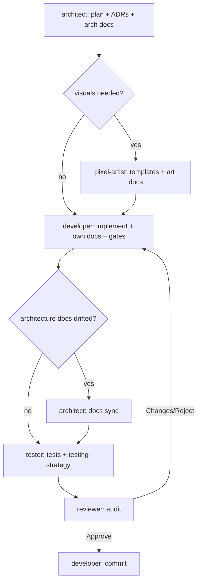

# Team workflow

Purpose: how the Claude Code subagents hand work to each other, what each one reads and writes, and when to stop and ask the human. Owned by the architect.
Related: [CLAUDE.md](../../CLAUDE.md), [roadmap](roadmap.md), [coding standards](coding-standards.md), [testing strategy](testing-strategy.md), [contributing](../../CONTRIBUTING.md), [art style guide](../design/art-style-guide.md), [docs index](../index.md).

## 1. The team

| Agent | Role | Reads | Writes |
|---|---|---|---|
| architect | plans each milestone, owns structure and decisions | CLAUDE.md, code, all docs | `docs/architecture/**`, ADRs, `docs/index.md`, `docs/glossary.md`, `coding-standards.md`, `roadmap.md`, this file, and `CLAUDE.md` (except the Core invariants section) |
| pixel-artist | designs heroes, enemies, stages | CLAUDE.md, art docs, data tables | `src/game/sprites/palettes.ts`, `spriteTemplates.ts`, `art-style-guide.md`, `sprite-spec.md`, optional dev-only preview under `tools/` (never shipped) |
| developer | implements, owns repo, tooling, remaining docs, and git | CLAUDE.md, plan, standards | all other `src/**`, `scripts/`, config, `.github/`, README and other docs, commits |
| tester | verifies behavior and invariants | CLAUDE.md, plan, handoffs, code | `test/**` (including `test/run.mjs`), `testing-strategy.md`, the `test` and `test:integration` scripts ([ADR 0006](../architecture/adr/0006-node-test-runner.md): `node:test`, no runner package; integration tests launch VS Code via `@vscode/test-electron`, whose exact pin the developer owns) |
| reviewer | read-only audit and gatekeeper | everything | nothing |

## 2. Milestone loop

Milestones follow the commit order in the [roadmap](roadmap.md): scaffold, protocol, monitor, engine, heroes (3 batches), enemies (5 batches), UI, audio, docs. Protocol comes before monitor because the monitor emits protocol types (see [roadmap section 3](roadmap.md#3-ordering-decision-protocol-before-monitor)). Each milestone and each hero or enemy batch runs this loop once.



1. **Plan.** The architect explores the code, checks the plan against the invariants, updates ADRs and architecture docs, and hands the developer a numbered task list plus art needs and test notes. Each plan is saved as `docs/architecture/plans/<id>-<name>.md` (for example [m1-scaffold](../architecture/plans/m1-scaffold.md)) and rides in that milestone's commit.
2. **Art.** If the plan lists art needs, the pixel-artist delivers validated templates and updates the art docs first.
3. **Implement.** The developer works the task list, runs `build`, `lint`, `typecheck`, `test`, and `docs:tables`, updates the docs it owns, and flags any architecture-doc drift.
4. **Docs sync.** If flagged, the architect updates the architecture docs and ADRs.
5. **Test.** The tester writes and runs tests, including the hero-invariant test, and reports code bugs to the developer without fixing them.
6. **Review.** The reviewer runs all gates, audits invariants, security, docs drift, and the PR checklist, and returns a verdict.
7. **Commit.** On Approve, the developer sets the milestone or batch `Status: done` in [roadmap.md](roadmap.md) (milestone line and summary row), stages all of that milestone's work from every agent, and makes **exactly one** Conventional Commit on a `feat/*`, `fix/*`, or `docs/*` branch. Granularity: **one commit per milestone; heroes and enemies commit once per batch** (H1, H2, H3, E1 to E5), each batch on its own branch, 15 commits in total (this is the rule recorded as [roadmap A1](roadmap.md#7-assumptions-and-defaults)). Fixes requested by the reviewer are folded into that same commit, never a second one. The status flip rides in the same commit so the tree is clean afterwards.
8. **Integrate.** The developer fast-forwards local `main` to the branch (`git switch main && git merge --ff-only <branch>`). For the very first commit, `main` is unborn, so it is created at the scaffold commit instead (`git branch main`). Pushing, adding a remote, deleting branches, or any history rewrite needs explicit human approval.

## 3. Handoff block

Every agent ends its reply with:

```text
Handoff
- Done: what was completed
- Files: created / changed
- Gates: build, lint, typecheck, test, docs:tables results
- Open issues: blockers, assumptions, drift to sync
- Next: which agent goes next and why
```

## 4. Ownership rules

- Write only what you own. If something outside your files must change, request it in the handoff.
- Docs are part of done: a change to the protocol, data tables, classes, or config updates its doc in the same change.
- Generated tables come from `npm run docs:tables`. Never hand-edit them.
- Only the developer runs git write commands.
- **Autofix only what you own.** Agents run formatters and linters in fix mode (`prettier --write`, `eslint --fix`, `markdownlint-cli2 --fix`) only on explicit file paths they own, never on the whole repo, and never via `npm run format` unless every changed file is theirs. Check-mode runs (`npm run lint`) are always fine. Trap: `.markdownlint-cli2.jsonc` sets `globs: ["**/*.md"]`, and markdownlint-cli2 merges config globs with command-line arguments, so `markdownlint-cli2 --fix some-file.md` still rewrites every Markdown file in the repo, including other agents' docs and the `CLAUDE.md` Core invariants section. So never run markdownlint with `--fix`; fix your own Markdown findings by hand, then rerun the check. Report findings in files you do not own to their owner instead of fixing them.
- Source of truth: the Core invariants in `CLAUDE.md` always win, then `docs/`, then `SPEC.md` (the original brief, possibly outdated). Only the human edits the invariants.
- The architect keeps `CLAUDE.md` (directory map, commands, ownership table) and `roadmap.md` accurate; the developer ticks a milestone or batch off in `roadmap.md` as part of its single commit (step 7).
- The `test` and `test:integration` scripts in `package.json` belong to the tester (the runner is built-in `node:test`, so there is no runner devDependency, [ADR 0006](../architecture/adr/0006-node-test-runner.md)); every other `package.json` field, including devDependency pins such as `@vscode/test-electron`, belongs to the developer.

## 5. When to escalate to the human

Stop and ask when:

- a task seems to require breaking an invariant (hero HP, a combat event changing hero state, monitor writes or process control, external assets, runtime dependencies);
- the reviewer rejects the same milestone twice;
- the spec is ambiguous in a way that is costly to reverse (an ADR-worthy decision with no clear default);
- a new dependency, a push, a remote, a publish, or any destructive git operation is needed;
- the architect and developer disagree on a plan after one round.

For ordinary ambiguity, choose a sensible default, record the assumption in a code comment or the relevant doc, and continue.
