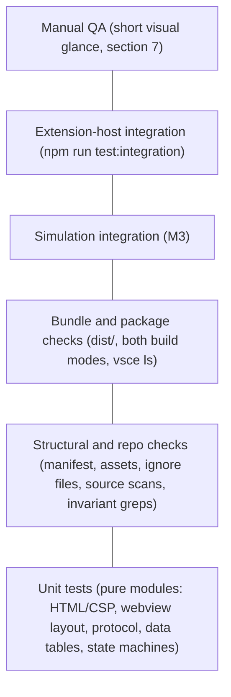

# Testing strategy

Purpose: how Pixel Agents is tested: the unit runner and the extension-host integration runner, the folder layout, the test pyramid, what each suite covers and when it arrives, the hero-invariant and simulation integration tests, the manual QA checklist, and the performance benchmarks. Owned by the tester.
Related: [CLAUDE.md](../../CLAUDE.md), [ADR 0006 test runner](../architecture/adr/0006-node-test-runner.md), [ADR 0004 esbuild two bundles](../architecture/adr/0004-esbuild-two-bundles.md), [ADR 0007 allow-list protocol](../architecture/adr/0007-allow-list-protocol-pull-handshake.md), [coding standards](coding-standards.md), [team workflow](team-workflow.md), [roadmap](roadmap.md), [M1 plan](../architecture/plans/m1-scaffold.md), [M2 plan](../architecture/plans/m2-protocol.md), [M3 plan](../architecture/plans/m3-monitor.md), [agent detection](../architecture/agent-detection.md), [host-webview protocol](../architecture/host-webview-protocol.md), [architecture overview](../architecture/overview.md), [security and safety](../architecture/security-and-safety.md), [docs index](../index.md).

## 1. Runner

Tests use Node's built-in `node:test` and `node:assert/strict`. No test-runner package is installed, so invariant 6 holds without an exception ([ADR 0006](../architecture/adr/0006-node-test-runner.md)). Node 22 (`.nvmrc`) is the runtime.

`npm run test` runs `node test/run.mjs`, which:

1. Finds every `test/**/*.test.ts`. Finding none is a failure.
2. Bundles each file with esbuild (`platform: 'node'`, `format: 'cjs'`, `target: 'node22'`, inline sourcemaps) into `out/test/`, mirroring the `test/` layout. This is the same transform that builds the shipped bundles, so there is no second TypeScript pipeline. A compile error fails the run.
3. Aliases the `vscode` module to the in-memory fake in `test/support/fakeVscode.ts`, so thin host code such as `src/extension.ts` is unit tested without an extension host.
4. Runs the bundles through `node:test`'s `run()` and prints them with the `spec` reporter.
5. Sets exit code 1 on any failed test, crashed file, or compile error.

Rules for test code:

- Tests read repo files relative to the repo root (`process.cwd()`), never absolute paths. Helpers live in `test/support/repo.ts`.
- `describe` and `it` return promises that the runner tracks. Top-level and nested calls are written `void describe(...)` and `void it(...)` to satisfy `@typescript-eslint/no-floating-promises`.
- Tests assert behavior and contracts, not implementation details. An assertion is never deleted, skipped, or loosened to get green; a failure is either a test bug (fixed by the tester) or a code bug (reported to the developer).
- Tests are type-checked by `tsconfig.tools.json` and linted like production code.

The bundle, package, and webview `main` suites read `dist/`, so run `npm run build` before `npm run test`. CI and every gate run do this. The bundle suite fails with an explicit message if `dist/` is missing or older than `src/`. The sourcemap suite never touches the repo's `dist/`: it runs `esbuild.mjs` in temp directories (whose `src` is a symlink to the repo's), so `dist/` stays the development build that F5 and the integration tests load.

### 1.1 Extension-host integration runner

The human approved `@vscode/test-electron` (exact-pinned, dev-only; [ADR 0006 amendment](../architecture/adr/0006-node-test-runner.md#amendment-m1-review-extension-host-integration-tests)). `npm run test:integration` runs `node test/integration/run.mjs`, which:

1. Fails unless `dist/extension.js` and `dist/webview.js` exist and are newer than `src/` (run `npm run build` first, exactly as F5 does).
2. Bundles `test/integration/suite/index.ts` with esbuild (`platform: 'node'`, `format: 'cjs'`, `vscode` external) into `out/integration/index.js`.
3. Downloads VS Code into `.vscode-test/` on the first run (network needed; later runs reuse the cache) and launches it with `--disable-extensions`, a fresh temp `--user-data-dir` and `--extensions-dir`, and an empty temp workspace. Only the development build of Pixel Agents loads; the unrelated marketplace extension `pablodelucca.pixel-agents` (also displayed as "Pixel Agents") cannot. The temp profile is deleted afterwards.
4. Exits 1 if the build is stale, the suite fails to compile, or any test fails.

Inside the Extension Development Host, `node:test`'s `run()` cannot work (it spawns `process.execPath`, which there is Electron without the `vscode` module). So the suite uses a minimal in-host harness, `test/integration/support/harness.ts`, with the same `describe` / `it` shape and `node:assert/strict`. It runs tests in registration order (the lazy-activation checks must run before anything opens the view), applies a per-test timeout, prints a TAP-style report, and rejects if any test failed or none ran. No mocha or other runner is installed.

Observation without production hooks: the extension host gives one `vscode` API object per extension, chosen by the requiring file's path. The suite is compiled into `out/integration/`, inside the extension development path, so it shares the extension's API object. `test/integration/support/providerSpy.ts` wraps `window.registerWebviewViewProvider` before activation and forwards every call unchanged, which lets the suite see the registration options, each `WebviewView`, the HTML as served, visibility changes, and disposal.

From M2 the spy also, before forwarding each `resolveWebviewView`, subscribes to the view's public `webview.onDidReceiveMessage` (the event accepts any number of subscribers) and replaces `webview.postMessage` with a recorder that forwards every call unchanged. Received messages, posts, and visibility changes go on one timeline per resolution, so the suite checks "one `ready` per document load, answered by `config` then `agentList`, nothing while hidden" ([M2 plan section 1.2](../architecture/plans/m2-protocol.md#12-ready-is-the-observable-script-ran-signal)). If a VS Code build ever makes `postMessage` read-only, the outgoing-message checks print `# SKIPPED ...` with the reason instead of passing silently; on stable and 1.90.0 the recorder installs. The spy also keeps the real provider object, which the last protocol test calls through its public `resolveWebviewView` with a fake view.

The launcher starts VS Code with `--log pixel-agents.pixel-agents:trace` and passes the temp user-data-dir to the suite as `PIXEL_AGENTS_IT_USER_DATA_DIR` (`extensionTestsEnv`; test-side only, production reads no environment variable). The suite reads the "Pixel Agents" log channel's file from `<user-data-dir>/logs/**/pixel-agents.pixel-agents/` to assert that open, hide/show, and Reload Webviews log no error and no dropped-message trace, with a positive control proving the file is written at trace level.

M3 launcher settings ([M3 plan test note 16](../architecture/plans/m3-monitor.md#7-test-notes-for-the-tester)): the run must never read the real `~/.claude`. Before VS Code starts, `run.mjs` creates `<temp>/claude/projects` and writes `<user-data-dir>/User/settings.json` with `pixelAgents.transcriptPath` set to that directory, `pixelAgents.simulator` `off` (so the M1 and M2 assertions of an empty `agentList` and only `config` and `agentList` posts still hold), `pollIntervalMs` 250, `debounceMs` 100, and `idleTimeoutSeconds` 5. The root is also passed to the suite as `PIXEL_AGENTS_IT_TRANSCRIPT_ROOT` (test-side only). `USERPROFILE` points at an empty `<temp>/home`, which is effective on Windows only (on macOS and Linux `os.homedir()` reads `HOME`, so it does nothing there). `HOME` is deliberately not overridden: on macOS an empty `HOME` stops the real webview from ever sending `ready` (observed on VS Code 1.141, it fails the M1 and M2 suites), so the real guard is the temp `pixelAgents.transcriptPath` in the temp `settings.json`, and the suite asserts the setting took effect.

`monitor.itest.ts` (after `protocol.itest.ts`) hands the real provider a fake view, as the M2 positive control does, so it controls `ready` and `focusAgent` and records every post, and it uses real terminals and real files in the temp root. It is the only suite that creates terminals, which is why it runs last.

Options:

- `PIXEL_AGENTS_VSCODE_VERSION` selects the VS Code build (default `stable`; `1.90.0` tests the `engines.vscode` minimum).
- Electron needs a display. macOS and Windows need nothing; headless Linux (CI) runs `xvfb-run -a npm run test:integration`.
- If a VS Code terminal exported `ELECTRON_RUN_AS_NODE`, the launcher removes it so Electron does not start as plain Node.

In-host test files are named `*.itest.ts`, never `*.test.ts`, because `test/run.mjs` collects every `*.test.ts` and would run them against the fake `vscode` module.

## 2. Folder layout

```text
test/
  run.mjs                 runner (section 1)
  support/                shared helpers, not tests
    repo.ts               repo-relative file reading and walking
    source.ts             comment stripping, import and block scanning for structural tests
    fakeVscode.ts         in-memory `vscode` module: provider registration, LogOutputChannel,
                          WebviewView with message, visibility, and dispose events; M3: workspace
                          configuration, folders, events, and strict FakeTerminal (only show() is
                          allowed, any other member records itself in forbiddenUse and throws)
    monitorFakes.ts       FakeTime (virtual clock plus timers), FakeFileSystem (read-only port, symlinks,
                          error injection, pause gate, call log), RecordingLogger, FakeTerminalPort,
                          synthetic transcript line builders, the privacy MARKER
    monitorRig.ts         builders: a TranscriptSource on fakes, a full AgentMonitor wired to a real
                          WebviewBridge whose port records posts
    fakeDom.ts            fake window/document/canvas and acquireVsCodeApi; runs dist/webview.js
                          in a node:vm context and can build payloads in the bundle's realm
  shared/                 protocol validators, creators, type-level proofs, seeded fuzz (src/shared/)
  host/                   src/host/ bridge, and src/extension.ts against the fake vscode module
  webview/                unit tests mirroring src/webview/
  monitor/                src/monitor/ on fakes: paths, parsing, state machine, registry, sources, privacy
  simulation/             SimulatorSource end to end through the monitor and bridge (node:test, virtual time)
  fixtures/transcripts/   synthetic JSONL only, never a real transcript (README.md states the rule)
  repo/                   structural and repo checks: manifest, assets, ignore files, source scans
  build/                  checks on dist/, on both build modes, and on the packaged file list
  integration/            extension-host tests (section 1.1), not run by `npm run test`
    run.mjs               launcher: build check, esbuild, @vscode/test-electron
    support/              in-host harness and the provider spy
    suite/                index.ts (entry VS Code calls) and *.itest.ts suites
```

Later areas mirror `src/`: `test/game/`, `test/game/data/`, `test/game/entities/`. `test/simulation/` is a `node:test` suite run by `npm run test`, not an extension-host test.

## 3. Test pyramid



- **Unit** (largest): pure modules with no `vscode` and no DOM. The logic worth testing is kept out of `vscode`-importing files so it can be tested here (from M2: `src/shared/protocol.ts`, `src/host/webviewBridge.ts`, and the DOM-free webview modules).
- **Structural and repo**: read source and config as text or JSON and assert invariants that types cannot express (no assets, no runtime dependencies, no process-control APIs, no hero health fields).
- **Bundle and package**: inspect the esbuild output and the real `vsce ls` file list.
- **Simulation integration** (M3): drives `SimulatorSource` end to end through the monitor, bridge, and protocol, and checks the webview-side mirror; the scene joins in M4.
- **Extension-host integration**: the real extension in a downloaded VS Code (section 1.1). Slow (seconds, plus a one-time download), so it holds only what needs a real workbench: contribution, activation, the served HTML, view lifecycle, and (M2) the real `ready` handshake and the log channel's contents.
- **Manual QA**: what automation cannot see (pixels on screen, motion, sound, theme).

## 4. Suites

### 4.1 Current suites (M1 to M3)

| File | Level | Covers |
|---|---|---|
| `test/webview/indexHtml.test.ts` | unit | `buildCsp` returns the exact planned policy, lists exactly five directives, and has no unsafe keyword, wildcard, scheme source, or resource directive. `buildCsp` and `buildWebviewHtml` both throw `RangeError` on every invalid nonce (empty, short, quotes, `;`, whitespace, `<>`, base64url, bad padding, injection). The HTML has the planned element order, one CSP meta tag, one nonce-bearing script with no inline body, one nonce-bearing style, one accessible canvas, no `on*=` or `style=` attributes, and no other external reference. The nonce appears only in the CSP, script, and style. The script URI is attribute-escaped and cannot break out of its tag. An empty script URI throws. Output is pure. |
| `test/webview/main.test.ts` | unit (fake DOM, shipped bundle) | Runs `dist/webview.js` in a `node:vm` context. The backing store is 320x180; the 2d context is opaque with smoothing off; one full-canvas clear with a dark colour (relative luminance under 0.02). Layout picks the largest integer device-pixel scale that fits, never below 1, with equal X and Y scale: exact cases plus a sweep over sizes and `devicePixelRatio` 1 to 3; a missing ratio counts as 1. Resize and zoom re-lay out without redrawing; `pagehide` removes the `resize`, `message`, and `pagehide` listeners. Errors in boot or resize are reported through `console.error` and never thrown (invariant 4); no canvas or no context does not throw. M2: `acquireVsCodeApi` is called once per boot and exactly one `{ type: 'ready' }` is posted, after the `message` listener is registered; host messages trigger no posts; valid same-realm messages and invalid ones (`stopAgent`, `null`, a 1 MB string, extra keys, wrong version, cross-realm objects) produce no output and never print `event.data`. If `acquireVsCodeApi` is missing or throws, or its `postMessage` throws, boot prints exactly one `Pixel Agents webview error:` line, the canvas is still cleared, and nothing throws. The reporter prints a same-realm and a cross-realm `Error`'s message, prints `non-error thrown` for a thrown string or plain object (never the value), prints a repeated message once per page load, starts fresh on a new load, and keeps listening after an error. |
| `test/host/extension.test.ts` | unit (fake `vscode`) | `activate` registers exactly one provider for the contributed view id with `retainContextWhenHidden: false`, creates exactly one `"Pixel Agents"` output channel with `{ log: true }`, hands exactly eight disposables (channel, terminal port, monitor, three monitor listeners, provider, registration) to `context.subscriptions` (M3), touches only the read-only window API it needs (`terminals`, the two terminal events, `activeTerminal`) besides `createOutputChannel` and `registerWebviewViewProvider`, logs nothing, returns `undefined`, and the module exports only `activate`, `deactivate`, `PixelAgentsViewProvider`, `VIEW_TYPE`. `resolveWebviewView` sets exactly `enableScripts: true`, `enableCommandUris: false`, `enableForms: false`, `localResourceRoots: [dist/]`, loads `dist/webview.js` through `asWebviewUri`, and uses a valid nonce that is fresh on every load. M2 wiring: exactly one message listener exists when `html` is assigned; one visibility and one dispose subscription; nothing is posted before a message; `ready` posts exactly `[config, agentList []]` (every time); controlling or garbage messages post nothing, throw nothing, and trace payload-free to the channel; `focusAgent` for an agent the monitor does not list is dropped with one trace (M3 wires the reveal); hiding drops pushes until the next `ready`; after dispose a `ready` posts nothing and no listener is left; re-resolving disposes the first view's three listeners, and that view's messages, visibility, and dispose no longer affect the bridge; `provider.dispose()` detaches; a rejected `postMessage` causes no unhandled rejection. |
| `test/host/webviewBridge.test.ts` | unit | `WebviewBridge` (M2 plan note 7): detached until `attach`; loading drops pushes; `ready` posts exactly `config` then `agentList` and is answered every time; snapshots go through the creators (extra fields stripped) and are bounded (64 agents) under `ready` spam; `markHidden` and the next `ready`; `detach`; a second port receives all later posts. `postAgentState` posts one allow-listed `agentState` only when ready, in order, and refuses an invalid agent with one payload-free error. Ten invalid or controlling messages: no post, no reveal, one fixed trace. `focusAgent`: no capability means one trace; a live listed agent (spawned, working, idle) is revealed exactly once with nothing posted; unknown, despawned, near-miss ids, and stale lists are not revealed; a throwing reveal or `getAgents` is contained. Dependency failures: `getConfig` throwing posts nothing and logs one `RangeError: ...` line; `getAgents` throwing while answering `ready` posts only `config` and logs one error; a non-`Error` throw logs `non-error thrown`; a throwing port or logger never escapes. Rejected posts (promise or bare thenable), even with a throwing logger, cause no unhandled rejection. |
| `test/repo/manifest.test.ts` | structural | No `dependencies`, `optionalDependencies`, `peerDependencies`, or bundled dependencies (invariant 6). devDependencies are on the allow-list and exact-pinned (including `@vscode/test-electron`); `@types/vscode` equals the `engines.vscode` minimum; `@types/node` is 20.x. `package-lock.json` matches and holds only dev packages. `main`, the `pixelAgents` panel container with a `$(codicon)` icon, the `pixelAgents.view` webview view, lazy activation, no top-level `icon`, no image references (invariant 5). The required scripts exist, `test` is `node test/run.mjs`, `test:integration` is `node test/integration/run.mjs`, `package` is `vsce package --no-dependencies` (other flags allowed), and `vscode:prepublish` is a production build. |
| `test/repo/vscodeignore.test.ts` | structural | The patterns `src/**`, `test/**`, `docs/**`, `tools/**`, `**/*.map` are listed; sample source, test, doc, tooling, sourcemap, CI, agent, config, integration output, and `.vscode-test/` paths are excluded; the manifest, README, CHANGELOG, LICENSE, and both bundles are kept. |
| `test/repo/ignores.test.ts` | structural | `.vscode-test/` is ignored by git (`.gitignore`), vsce (`.vscodeignore`), Prettier (`.prettierignore` and `prettier --file-info`), ESLint (`ESLint#isPathIgnored` with the repo config, with `src/extension.ts` as a not-ignored control), and markdownlint (`.markdownlint-cli2.jsonc` ignores). |
| `test/repo/noAssets.test.ts` | structural | No image, audio, or font file anywhere in the repo (dot-directories included; `node_modules`, `.git`, `dist`, `out`, `.vscode-test` skipped), and no asset data URI or asset file name in `src/` (invariant 5). |
| `test/repo/readOnly.test.ts` | structural | No `src/` file uses `child_process`, `kill`, `sendText`, `sendSequence`, file writes or deletes, network APIs, `eval`, `new Function`, `createTerminal`, `executeCommand`, `process.exit`, or a terminal `dispose()`; the vscode terminal API (`window.terminals`, `activeTerminal`, the open and close events, `exitStatus`) appears only in `src/monitor/adapters/vscodeTerminals.ts`; `focusAgent` is wired to `monitor.revealAgentTerminal` with a `null` fallback (invariants 3 and 7). `monitorReadOnly.test.ts` is the full M3 extension. M2 replaced the M1 "no message channel" checks with placement rules: `acquireVsCodeApi` only in `src/webview/main.ts`, called once; `postMessage` only in `src/webview/hostChannel.ts`, `src/host/webviewBridge.ts`, and the one-line port adapter in `src/extension.ts`; `onDidReceiveMessage` only in `src/extension.ts`, once, into `bridge.handleMessage`. `requestAnimationFrame` is still absent everywhere (until M4); no `getState`/`setState`. `main.ts` wraps boot, the resize handler, and the message handler in try/catch and never rethrows (invariant 4). |
| `test/repo/protocolStructure.test.ts` | structural | Note 6: exactly the five planned message types are declared; no message type or field name contains `kill`, `stop`, `terminate`, `signal`, `send`, `write`, `input`, `exec`, `run`, `command`, `dispose`, or `close`; `src/host/**` and `src/extension.ts` use no terminal-input, process, command, or file-write API. Boundaries: `src/host/**` imports only `src/shared/**`; `src/shared/**` imports only itself; the DOM-free webview modules touch no `window`, `document`, or `acquireVsCodeApi`; webview code does not import `src/host/**`. No optional property or `\| undefined` in any protocol type. Note 1: every `switch` on `.type` or `.state` in `src/shared/**`, `src/host/**`, `src/webview/host*.ts` has a `default` calling `assertNever` (at least three found); the two `parse*` raw-string switches default to `undefined`; `assertNever` is defined once. No `innerHTML`, `outerHTML`, `insertAdjacentHTML`, `document.write`, or `createContextualFragment` in webview or game code (T9). No test-only surface: no `process.env`/`process.argv`, no registered or contributed command, no test-hook names, `activate` returns `void`, and the bridge's public members are exactly the planned six. |
| `test/shared/protocol.test.ts` | unit | Notes 1, 2, 3, 5: the type, state, and key lists; `assertNever` throws `TypeError('Unexpected variant')` without the value. `parseWebviewMessage` and `parseHostMessage` reject, without throwing, every case in the plan plus 32 container and key attacks per message type (primitives, functions, symbols, arrays, case and whitespace variants, extra, symbol, and non-enumerable keys, own `__proto__`, `constructor`, class instances, inherited keys, `Map`, `Date`, boxed strings, throwing getters, throwing Proxies); every `AgentInfo` field rule at and around its boundary; `agents` holes, duplicates, 65 entries; config version and key rules. 1,000,000-character ids, names, and tool names are rejected in under 50 ms. Accepted messages are new objects at every level, with exactly the expected keys, never aliased to or mutating (even frozen) input; extra properties on the `agents` array are not copied. Cross-realm: a plain object from another `node:vm` realm is rejected, the same data after `structuredClone` is accepted, and a null-prototype foreign object is accepted. Creators copy exactly the five keys in order, never repair, never throw, drop invalid entries, keep the first duplicate, cap at 64, leak no extra value, and every output survives `structuredClone` and parses back deep-equal. |
| `test/shared/protocolTypes.test.ts` | unit (type level) | Compiled by `tsconfig.tools.json`, so `npm run typecheck` fails if a proof breaks: references `HostTypesComplete`, `WebviewTypesComplete`, `AgentInfoKeysComplete`; restates the planned unions, `AgentInfo` keys, message keys, and "no optional properties" independently; exhaustive switches over both type unions, `AgentState`, and `WebviewToHostMessage` ending in `assertNever`; `@ts-expect-error` proves `stopAgent`, a `focusAgent` with `command`, an `AgentInfo` with `hp` or `text`, a missing `toolName`, and state `dead` cannot be expressed. |
| `test/shared/protocolFuzz.test.ts` | unit (seeded fuzz) | Note 4: mulberry32 with a fixed seed, 10,000 iterations per parser over random JSON-like values to depth 3 and mutations of valid messages (drop, add, retype, swap `type`, oversize, duplicate an agent). Every result must deep-equal an independent reference oracle written from the protocol doc (catches false accepts and false rejects), never throw, never return its input, have exactly the expected keys, and (host) equal the creators' output. Requires more than 500 acceptances and 2,000 rejections so the run is not vacuous. Seed and iteration are printed on failure. |
| `test/webview/hostMessages.test.ts` | unit | Note 8: `handleHostMessage` with `HostStateMirror`: `config` stores; `agentList` replaces (and an empty one clears); `agentState` for an unknown id inserts, `idle` updates in place keeping order, `despawned` deletes; a full lifecycle follows host messages only; 24 invalid messages return `false` and leave the mirror unchanged; the mirror never holds a sender's object; `agents()` is a fresh array; a fresh mirror fed the same `agentList` equals the old one (reload rebuild); target errors propagate to the caller; each type reaches exactly one target method. `createHostChannel` posts exactly what it is given, once. |
| `test/build/bundles.test.ts` | bundle | `dist/` exists and is newer than `src/`. `dist/webview.js` requires nothing: no `vscode`, no `node:*`, no CommonJS exports. `dist/extension.js` evaluates as CommonJS exporting `activate` and `deactivate`, and requires only `vscode` and `node:*` built-ins. M2: `dist/webview.js` contains `acquireVsCodeApi` and the shared parser but no `WebviewBridge` or `onDidReceiveMessage`; `dist/extension.js` contains `WebviewBridge`, `onDidReceiveMessage`, and `createOutputChannel` but no `acquireVsCodeApi` or `HostStateMirror` (development build, names kept). |
| `test/build/sourcemaps.test.ts` | bundle (temp builds) | Development build: `webview.js` ends with an inline `data:application/json;base64` sourcemap that decodes to a v3 map of `src/webview/main.ts`, there is no `webview.js.map`, and `extension.js.map` exists, maps `src/extension.ts`, and is referenced by `extension.js`; `dist/` holds exactly those three files. Production build: no `.map` file, exactly the two bundles, and no `sourceMappingURL` in either. |
| `test/build/package.test.ts` | package | `vsce ls --no-dependencies` lists exactly `package.json`, `README.md`, `CHANGELOG.md`, `LICENSE`, `dist/extension.js`, `dist/webview.js`. |
| `test/integration/suite/view.itest.ts` | extension host | Environment: Pixel Agents is the development extension, `pablodelucca.pixel-agents` is not loaded, and no other non-built-in extension is. Lazy activation: inactive 2 s after startup with no provider registered; the `pixelAgents.view.focus` and `workbench.view.extension.pixelAgents` commands exist without activating it; focusing the view activates it (`activate()` resolves, so `activate` did not throw) and resolves a visible `pixelAgents.view`. Exactly one provider registration with `retainContextWhenHidden: false`; no `pixelAgents.*` command added on activation (M1 only); no terminal created. Served webview: the planned options and `localResourceRoots` of `dist/`; exactly one CSP meta tag, starting `default-src 'none'` and equal to `buildCsp(nonce)`; one script tag with that nonce whose `src` is `asWebviewUri(dist/webview.js)`. Hide and re-show: closing the panel hides the view (so it lives in the panel), focusing shows it again with valid HTML (from M2 every show also waits for the new document's `ready`, so each cycle is a complete load); showing the Problems view hides it; five more close/focus cycles leave it active, registered once, and never disposed; `onDidChangeVisibility` reports every hide and show; every resolved HTML has its own valid nonce. |
| `test/integration/suite/protocol.itest.ts` | extension host | M2 plan note 11 and task 10, after `view.itest.ts`: the first load sent exactly one message, `{ type: 'ready' }`, which passes `parseWebviewMessage` (the automated proof that `main.ts` ran under the real CSP); every received message is a valid `ready`; on the single resolution the `ready` count is 1 + the number of shows (at least 7), with exactly one per visible load and none while hidden; each `ready` is immediately followed by posts of exactly `config { protocolVersion: 1 }` then `agentList { agents: [] }`, both passing `parseHostMessage`, and nothing else is ever posted, and nothing while hidden; an explicit hide sees no traffic for 1.5 s and the next show exactly one `ready` and two posts; "Developer: Reload Webviews" gives exactly one more `ready` answered the same way without disposing the view; the view is resolved once; no own command, no terminal. The "Pixel Agents" log (trace level) has no error, dropped, invalid, or failed-post line after open, hide/show, and reload; a positive control sends a garbage message through the real provider's public `resolveWebviewView` with a fake view and sees the payload-free trace line reach the log file. |
| `test/monitor/paths.test.ts` | unit | M3 note 1 and 5: `resolveTranscriptRoot` (default, `~/`, `~\` on win32, relative rejected, `..` resolved); `encodeProjectDir` literal cases (spaces, dots, underscores, non-ASCII, emoji, Windows drive, trailing separator); `isContained` on `path.posix` and `path.win32` (root, child, `..` escape, sibling prefix, other drive, case); `sessionIdFromFileName`, `isProjectDirName`, `projectLabel`; `normalizeToolName` and `buildAgentName` (never repairs a tool name; names always pass the protocol rule, no lone surrogate); `readMonitorConfig` (defaults, unit conversion, clamping at both bounds, rounding, wrong types, NaN, enums, ordering of the three timeouts, throwing getter); `package.json` `contributes.configuration` equals `MONITOR_SETTINGS` row by row (type, default, range, enum, scope, description) and `projectScope` and `transcriptPath` are machine-scoped. |
| `test/monitor/transcriptParsing.test.ts` | unit | M3 notes 2 and 3: `scanLines` (CRLF, partial tail not consumed, skip modes, exact-limit line kept and one byte more dropped and counted, split multi-byte character never half-decoded, empty buffer); `classifyTranscriptLine` for every kind, last `tool_use` wins, invalid names give `null`, `__proto__` and 10,000-deep nesting are safe, at most 256 blocks scanned, results have exactly `kind` and `toolName` and never contain fixture text; the two fixture files classify as documented. |
| `test/monitor/sessionMachine.test.ts` | unit (pure) | M3 note 4: spawned to working at exactly the debounce, idle at exactly `idleTimeout` (not 1 ms before), a pending tool holds `working` until `toolTimeout`, `toolResult` clears it, `turnEnd` goes idle after the debounce and new activity cancels it, idle returns to working on every kind except `turnEnd`, tool name survives idle, `despawned` only at `sessionEndTimeout` of silence (idle alone never despawns), `end` from every live state, future timestamps count as zero silence, `despawned` is terminal, and the input switch is exhaustive. |
| `test/monitor/registry.test.ts` | unit (virtual time) | M3 note 6: first emission immediate; 31 tool changes in 3 s emit at most once per 750 ms and end on the last value; identical snapshots and reverted changes are not emitted; `despawned` is immediate, cancels a pending emission, and removes the agent; `debounceMs` 0; timestamps; caps (49th transcript and 17th simulated agent refused with one trace); invalid fields refused; the snapshot is frozen, ordered, valid, equal to `createAgentListMessage`, and holds what was last emitted; a throwing listener or logger is contained; `dispose` leaves no timer. |
| `test/monitor/transcriptSource.test.ts` | unit (fake file system) | M3 note 7: workspace scope reads only the encoded folder directories (and the realpath variant), never the root listing or a sibling, and nothing at all with no folders; `all` scope ignores `agent-*`, non-UUID names, subdirectories, symlinked files and symlinked project directories; a file whose realpath leaves the root is never read; a symlinked root works; startup tail read of 64 KiB; stale files re-checked every 10 s in batches of at most 500; new-session and first-scan events; debounce, idle timeout, pending tool, turn end; `despawned` only on session end (30 min) or removal; truncation, inode change, `EIDENTITY`, `ino` 0; partial lines re-read from their own offset; reads capped at 1 MiB; an oversized line counts as activity once; `EACCES`, `ENOENT`, `ELOOP` handling with code-only, rate-limited logs; polls never overlap; `update` rescans and despawns out-of-scope sessions; `dispose` during an in-flight poll. |
| `test/monitor/terminals.test.ts` | unit | M3 note 8: linking rules (active terminal, else the newest unlinked terminal within 30 s, never simulated, one terminal one live agent), `dropLink`, close removes the link and changes no state, reveal calls `show` once and never otherwise, a throwing port is contained, dispose removes only its own listeners. The vscode adapter against a strict fake terminal: `show()` is the only member used, exited or closed terminals return `false`, dispose removes subscriptions and touches no terminal. |
| `test/monitor/agentMonitor.test.ts` | unit | M3 notes 8 and 14: no I/O and no timers before `start()`; the `focusAgent` path reveals a linked terminal exactly once and nothing for startup, simulated, or unknown agents; closing a terminal changes no agent state; the event stream a hero sees is exactly the transcript's lifecycle; a configuration update never spawns or despawns; `dispose` leaves zero timers and zero terminal listeners, does not dispose the port, and nothing runs for an hour afterwards. |
| `test/monitor/privacy.test.ts` | unit | M3 note 9: a marker in prompts, tool input, tool results, summaries, a malformed line, an invalid tool name, and in the message of every fs error (with and without a code) reaches no log line at any level, no post, no snapshot, no change payload; emitted records have exactly the five allow-listed keys; `safeErrorCode` never reads `message` or `stack`. Positive controls prove the error paths ran. |
| `test/monitor/realDisk.test.ts` | integration (real temp disk) | M3 note 11: a real-adapter monitor over a temp tree (live, stale, `agent-*`, a symlink to an outside file, a symlinked project directory) creates, removes, resizes, re-times, and re-modes nothing except the test's own append; only the two live regular files are opened; links are never followed; after `dispose` the tree can be deleted and no read happens; `readRange` refuses a symlink (`ELOOP`) and a changed identity (`EIDENTITY`). |
| `test/monitor/fixtureReplay.test.ts` | unit | The synthetic files in `test/fixtures/transcripts/` replayed at startup and appended line by line. |
| `test/simulation/simulator.test.ts` | simulation integration | M3 notes 12 and 13: determinism per seed; id, name, and tool shape; spawned, working, idle, despawned, respawn with generation + 1; staggered slots; modes `on`, `off`, `auto` (starts after the first scan, leaves when a real agent spawns with the real spawn observed first, returns 10 s after the last one leaves); count change restarts; dispose. Then the integration test of section 6. |
| `test/host/extensionMonitor.test.ts` | unit (fake `vscode`, real adapters, temp dir) | M3 notes 9, 14, 15: `ready` answers with the monitor's agents; a change posts one `agentState`; a `pixelAgents` configuration change applies and another section does not; workspace folder changes rescan; `focusAgent` reveals once and only for a linked agent; `getConfiguration` throwing leaves a working view, an empty list, and one `monitor failed to start (TypeError)` line; no `globalState`, `workspaceState`, `secrets`, or storage access; disposing `context.subscriptions` leaves no listener; end-to-end privacy through the real fs adapter. |
| `test/repo/monitorReadOnly.test.ts` | structural | M3 note 10 over `src/monitor/**` and `src/extension.ts`: the scan covers every file; no watch, mkdir, rename, copy, link, chmod, utimes, truncate, fsync, write-class call, write-class `O_*` flag, `open` flag string, `sendText`, `child_process`, `kill`, `executeCommand`, `process.env`, network API; the Node adapter imports exactly the read functions and its only `open(` passes `READ_FLAGS`; the port has exactly five read members; terminal APIs live only in the adapter and the only method called is `show()`; error hygiene (no `.message`, `.stack`, `JSON.stringify`, `console.`, interpolated errors; every catch goes through `safeErrorCode`); import boundaries; no storage APIs; exhaustive switches; no throw in core files; injected clock and timers only; the webview bundle holds no monitor code. |
| `test/integration/suite/monitor.itest.ts` | extension host | M3 note 16 (VS Code 1.141.0 stable; run on 1.90.0 with `PIXEL_AGENTS_VSCODE_VERSION`): the launcher's temp root and thresholds are in effect; a session file in the workspace's project directory gives `spawned`, `working` with `Bash`, `idle` after about 5 s, and `despawned` on delete; a marker session reaches neither the log file nor any post; `focusAgent` makes the first terminal active again and closes none; control messages change nothing; the simulator through settings (`on` with two agents, `off`, and `auto` beside a real session); the transcript tree holds exactly the files the suite wrote at exactly those sizes; nothing written into the workspace folder; no own command and no extension-created terminal. |

M2 replaced the M1-only "no message channel" checks with the M2 rule each one became (placement rules in `readOnly.test.ts`, wiring tests in `extension.test.ts` and `main.test.ts`); none was deleted without a replacement. The "no animation loop" check stays until the M4 engine suite replaces it.

### 4.2 Required suites by milestone

| Suite | Arrives in | Asserts |
|---|---|---|
| Protocol types | M2 (done; section 4.1) | Message unions are exhaustive (a `never` check per switch); no message type can control, stop, write to, or send input to a session; `focusAgent` only reveals; invalid or unknown webview messages are rejected without throwing; `AgentInfo` has exactly the allow-listed fields. Extended whenever a message is added ([protocol section 10](../architecture/host-webview-protocol.md#10-adding-or-changing-a-message)). |
| Monitor | M3 (done; section 4.1) | State debouncing and idle timeout with a virtual clock (`FakeTime`; `mock.timers` cannot drive the async poll loop deterministically); `despawned` only on real session end; no write, kill, signal, or send-input call in `src/monitor/**` or the `focusAgent` path; transcript privacy (a line with message text yields only session id, name, state, tool, timestamp, and nothing is logged); `transcriptPath` cannot escape its directory or follow symlinks out; every watcher, timer, and listener is disposed on deactivate. |
| Simulation integration | M3 (done) | Section 6. |
| Hero-invariant | M4 (extended in H1-H3, E1-E5) | Section 5. |
| Structural hero check | M4 (extended in H1-H3, M7) | `Hero`, every subclass, `Summon`, buffs, and `ui.ts` contain no `hp`, `health`, `mana`, `dead`, `downed`, or `retreat`, and no gauge is drawn on heroes. |
| Class mapping | H1 (extended in H2, H3) | Each tool and activity maps to the class in `classMap.ts`; assignment is sticky across working and idle cycles; fallback is deterministic; H3 adds exactly 12 unique class ids with complete template sets. |
| Enemy table validator | E1 (final form in E5) | Exactly 10 stages, 50 enemies, 50 unique ids, 5 per stage, exactly one boss per stage, all required fields present; crafted bad tables (6 in a stage, 2 bosses, duplicate id) fail. |
| Persistence | E1 (extended in M7) | `globalState` carries a schema version; fresh install and a migration from every prior version produce the current schema. |
| Generated docs | H1 | `npm run docs:tables` leaves no diff in the generated enemy and class tables. |

### 4.3 Known gaps (M3)

- The real Claude Code transcript format on a developer's machine is not automated (fixtures are synthetic by rule). The manual check is section 7.3.
- A leaked file handle after `dispose` is proven indirectly (the tree can be deleted and no read follows). Windows CI is where an open handle would block deletion; macOS and Linux cannot observe it without `lsof`.
- The integration launcher cannot override `HOME` (it breaks the real webview on macOS), so "the real `~/.claude` is never read" rests on the temp transcript-root setting taking effect, which `monitor.itest.ts` asserts. The `USERPROFILE` override is Windows-only and is not a guard on macOS or Linux.
- The extension-host suite needs a display, a one-time VS Code download, and real terminals; it has been run on macOS with VS Code 1.141.0 only.
- Real-timer tests (`extensionMonitor.test.ts`, `realDisk.test.ts`) wait up to 8 s on slow machines; they poll for a condition rather than sleeping a fixed time, except for short "nothing happens" windows.

## 5. Hero-invariant test (from M4)

Purpose: prove invariants 1 and 2. Hero state changes only on host agent-state events, and nothing in the game can hurt, down, or despawn a hero.

Design:

1. Build a scene with heroes in each state (`working`, `idle`) and record a snapshot of every hero's lifecycle state and existence.
2. Apply each non-lifecycle event many times: enemy hits on every hero, boss phase changes, boss defeat, stage progression, the wrap after the last stage, New Game+ looping, class abilities with and without enemies, summons, buffs, and freeze-like effects.
3. Throw an error from an entity inside the update loop and step more frames.
4. Assert the snapshot is unchanged: same heroes, same states, nothing despawned, no message to the host. The next frame still renders.
5. Apply `spawned`, `working`, `idle`, `despawned` and assert each one changes state exactly as specified, including when applied during an effect (it takes effect on the next update).

Each new hero class, enemy batch, and effect adds its events to step 2. The test is never narrowed.

## 6. Simulation integration test (M3, extended in M4)

Purpose: prove the scene follows host events only, end to end, with zero configuration.

Design (`test/simulation/simulator.test.ts`, virtual time): an `AgentMonitor` with only the simulator (`simulator: 'on'`, 3 agents, fixed seed, `debounceMs` 100, transcript root absent) is wired to a real `WebviewBridge` whose port records posts, after a `ready`. Ten simulated minutes later:

1. every post passes `parseHostMessage`;
2. per agent, the `agentState` letters match `^SW+(IW+)*I?D?$` (spawned, working with tool changes, idle, working again, ..., despawned) and no state is posted after `despawned`;
3. the first lifecycle of `sim-0-0` equals a golden sequence (state, tool, millisecond offset) recorded once from the default seed, so an accidental schedule change is caught (update the golden only for a deliberate schedule change);
4. after every post, a fresh `HostStateMirror` fed `createAgentListMessage(monitor.getAgents())` equals the mirror fed every post so far (webview reload rebuild, invariant 4);
5. a second `ready` at any point posts `config` then an `agentList` equal to `getAgents()`;
6. control messages from the webview (`stopAgent`, `despawn`, a forged `agentState`, `sendText`) are dropped and change nothing;
7. a throwing consumer of the change stream does not disturb the simulation.

From M4, feed the same messages into the webview scene and assert the hero list and states after each message match the host's agent list, and that rebuilding the scene from the host list gives the same heroes.

## 7. Manual QA checklist

Items marked with a later milestone apply from that milestone on. Each M1 item is either automated (and named here with its suite) or left as a short manual glance.

Any manual or F5 run must load only our extension: launch the Extension Development Host with `--disable-extensions` (add it to the `args` of the launch configuration you use, or run `code --disable-extensions --extensionDevelopmentPath=<repo>`) or use a clean profile. Otherwise the Extension Development Host inherits installed extensions, and the unrelated marketplace `pablodelucca.pixel-agents`, also displayed as "Pixel Agents", appears next to ours ([M1 plan section 9](../architecture/plans/m1-scaffold.md#9-risks-assumptions-defaults)). The integration runner always passes `--disable-extensions`.

### 7.1 Automated (M1, M2)

| Checklist item | Covered by |
|---|---|
| The bottom panel has a "Pixel Agents" view container and webview view | `view.itest.ts` (container and focus commands exist; closing the panel hides the view, so it lives in the panel); `manifest.test.ts` (contribution, `$(flame)`-style codicon) |
| Opening it shows a dark canvas | `main.test.ts` (opaque 320x180 canvas, one full clear in a dark colour); `view.itest.ts` (the served HTML loads `dist/webview.js` with the nonce) |
| Integer scaling at any panel size and zoom | `main.test.ts` (largest fitting integer device scale, sweep over sizes and `devicePixelRatio`; resize and zoom re-lay out) |
| No CSP violation for our script or style | `view.itest.ts` (served CSP equals `buildCsp`, starts `default-src 'none'`, script nonce matches); `indexHtml.test.ts` (exact policy, nonce only on our script and style); `sourcemaps.test.ts` (dev webview sourcemap is inline, so DevTools never fetches a `.map` that `default-src 'none'` would block) |
| Hiding and re-showing the tab works | `view.itest.ts` (close panel, switch to Problems, re-focus, five more cycles; stays active, never disposed, visibility events for every change) |
| Lazy activation | `view.itest.ts` (inactive until the view is focused, then active); `manifest.test.ts` (no `*` or `onStartupFinished`) |
| Only Pixel Agents loads in the test host | `view.itest.ts` (environment suite) |
| (M2) `main.ts` actually ran inside the real webview, on every load | `protocol.itest.ts` (exactly one `ready` per document load, through the public `onDidReceiveMessage`; also after Reload Webviews) |
| (M2) The host answers with `config` then `agentList`, and nothing while hidden | `protocol.itest.ts` (post recorder); `extension.test.ts`, `webviewBridge.test.ts` (against fakes) |
| (M2) Opening, hiding and re-showing, and Reload Webviews log no error and no "dropped webview message" line at Trace level | `protocol.itest.ts` (reads the "Pixel Agents" log file at trace level, with a positive control) |
| (M2) The webview drops malformed host messages without errors | `main.test.ts`, `hostMessages.test.ts` |

| (M3) The monitor follows a real session (spawned, working with the tool, idle, despawned) and the simulator works through settings | `monitor.itest.ts`; `transcriptSource.test.ts`, `simulator.test.ts` (against fakes) |
| (M3) The monitor only reads: no write, no kill, no input, no link following, nothing leaked | `monitorReadOnly.test.ts`, `realDisk.test.ts`, `privacy.test.ts`, `monitor.itest.ts` (tree unchanged, marker absent from the log file) |
| (M3) `focusAgent` reveals the linked terminal and closes nothing | `monitor.itest.ts` (real terminals), `agentMonitor.test.ts`, `terminals.test.ts` |

Not observable from outside without a production hook, so not automated: real CSP violation reports and other webview DevTools console output, and the rendered pixels.

### 7.2 Manual (M1, M2): a short visual glance

Build, then F5 with `--disable-extensions` (or a clean profile), open the Pixel Agents tab, and look:

- [ ] The canvas is dark and crisp (hard pixel edges, no blur) at three panel sizes (small, medium, tall) and at two zoom levels ("View: Zoom In" once, then "View: Reset Zoom").
- [ ] (M2) "Developer: Open Webview Developer Tools": the console shows no error, no CSP violation from our script or style (VS Code's own injected default style may still report one, as noted in M1), and no sourcemap fetch error, on open, after hiding and re-showing the tab, and after "Developer: Reload Webviews". This is the only M2 item that needs eyes; the output channel check is automated (section 7.1).

### 7.3 Later milestones

- [ ] (M3) With no configuration and no Claude Code sessions, simulation mode spawns, works, idles, and despawns simulated agents. M3 draws nothing, so check the "Pixel Agents" output channel at Trace ("Developer: Set Log Level..." for it): `monitor: agent sim-0-0 spawned`, then `working (Read)` and so on. From M4 the heroes are visible on the canvas.
- [ ] (M3) With a real Claude Code session in this workspace's terminal, the channel shows that session spawn and work, the simulated agents leave, and the extension never types into, stops, or closes the terminal. `~/.claude/settings.json` and the transcript modification times are unchanged by the extension.
- [ ] (M3) A workspace path with spaces: the encoded project directory under `~/.claude/projects` matches what the monitor reads (the session is found).
- [ ] (M7) Clicking a roster entry only reveals the agent's terminal.
- [ ] (M7) With the OS or VS Code reduce-motion setting on, screen shake, flashes, and large particle bursts are reduced or off.
- [ ] (M8) Sound is muted by default on a fresh install, and stays off until the user enables it.
- [ ] (M7) Switching between a dark, a light, and a high-contrast theme keeps the panel background and UI text readable.
- [ ] (M4) A forced error in the game (dev build) shows the error once, the next frame renders, and agents are unaffected.

From M2, the integration suite takes over what the protocol makes observable (the webview's `ready` after each show, the host's answers, the log channel), and these items move to 7.1 as they become automated.

## 8. Performance benchmarks

Not exercised in M1: the webview draws one solid frame and runs no loop, so it does no per-frame work. Benchmarks start with the engine loop.

| Benchmark | Arrives in | Target |
|---|---|---|
| Simulator with 8 heroes | M4 | 60 fps sustained on the reference machine |
| 8+ heroes and 30+ enemies on screen | E5 | 60 fps sustained; no frame over 33 ms in a 60 s run |

How to measure (finalized with the M4 engine, which adds the frame-time counters):

1. F5 with `--disable-extensions` (section 7), open the Pixel Agents tab, and enable simulation mode with the hero count set for the benchmark.
2. Wait 10 s for the scene to settle, then run "Developer: Open Webview Developer Tools", open the Performance panel, and record 60 s.
3. Pass when the frames track shows a steady 60 fps (16.7 ms per frame) and no long task over 33 ms during steady state.
4. Record the machine, OS, VS Code version, panel size, and result in the milestone handoff. The reference machine is the one named in the M4 plan.
