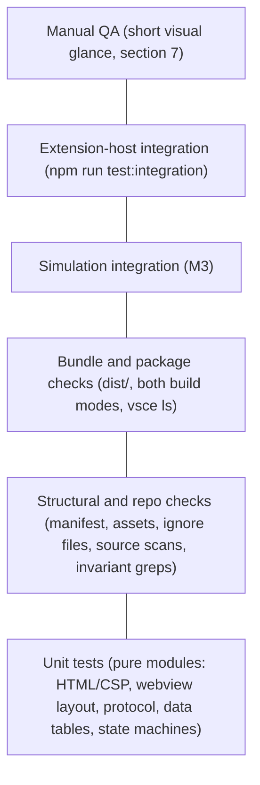

# Testing strategy

Purpose: how Pixel Agents is tested: the unit runner and the extension-host integration runner, the folder layout, the test pyramid, what each suite covers and when it arrives, the hero-invariant and simulation integration tests, the manual QA checklist, and the performance benchmarks. Owned by the tester.
Related: [CLAUDE.md](../../CLAUDE.md), [ADR 0006 test runner](../architecture/adr/0006-node-test-runner.md), [ADR 0004 esbuild two bundles](../architecture/adr/0004-esbuild-two-bundles.md), [ADR 0007 allow-list protocol](../architecture/adr/0007-allow-list-protocol-pull-handshake.md), [coding standards](coding-standards.md), [team workflow](team-workflow.md), [roadmap](roadmap.md), [M1 plan](../architecture/plans/m1-scaffold.md), [M2 plan](../architecture/plans/m2-protocol.md), [M3 plan](../architecture/plans/m3-monitor.md), [M4 plan](../architecture/plans/m4-engine.md), [H1 plan](../architecture/plans/h1-classes.md), [H2 plan](../architecture/plans/h2-classes.md), [H3 plan](../architecture/plans/h3-classes.md), [ADR 0011 summons](../architecture/adr/0011-summons-are-leased-cosmetic-entities.md), [E1 plan](../architecture/plans/e1-enemies.md), [E2 plan](../architecture/plans/e2-stages-3-4.md), [ADR 0012 host-owned versioned progress](../architecture/adr/0012-host-owned-versioned-progress.md), [ADR 0013 enemy health and the hero reaction board](../architecture/adr/0013-enemy-health-and-hero-reaction-board.md), [enemies and stages](../design/enemies-and-stages.md), [data model](../architecture/data-model.md), [classes](../design/classes.md), [game engine](../architecture/game-engine.md), [agent detection](../architecture/agent-detection.md), [host-webview protocol](../architecture/host-webview-protocol.md), [architecture overview](../architecture/overview.md), [security and safety](../architecture/security-and-safety.md), [docs index](../index.md).

## 1. Runner

Tests use Node's built-in `node:test` and `node:assert/strict`. No test-runner package is installed, so invariant 6 holds without an exception ([ADR 0006](../architecture/adr/0006-node-test-runner.md)). Node 22 (`.nvmrc`) is the runtime.

`npm run test` runs `node test/run.mjs`, which:

1. Finds every `test/**/*.test.ts`. Finding none is a failure.
2. Bundles each file with esbuild (`platform: 'node'`, `format: 'cjs'`, `target: 'node22'`, inline sourcemaps) into `out/test/`, mirroring the `test/` layout. This is the same transform that builds the shipped bundles, so there is no second TypeScript pipeline. A compile error fails the run.
3. Aliases the `vscode` module to the in-memory fake in `test/support/fakeVscode.ts`, so thin host code such as `src/extension.ts` is unit tested without an extension host.
4. Runs the bundles through `node:test`'s `run()` and prints them with the `spec` reporter.
5. Sets exit code 1 on any failed test, crashed file, or compile error.

Rules for test code:

- Tests read repo files relative to the repo root (`process.cwd()`), never absolute paths. Helpers live in `test/support/repo.ts`.
- `describe` and `it` return promises that the runner tracks. Top-level and nested calls are written `void describe(...)` and `void it(...)` to satisfy `@typescript-eslint/no-floating-promises`.
- Tests assert behavior and contracts, not implementation details. An assertion is never deleted, skipped, or loosened to get green; a failure is either a test bug (fixed by the tester) or a code bug (reported to the developer).
- Tests are type-checked by `tsconfig.tools.json` and linted like production code.

The bundle, package, and webview `main` suites read `dist/`, so run `npm run build` before `npm run test`. CI and every gate run do this. The bundle suite fails with an explicit message if `dist/` is missing or older than `src/`. The sourcemap suite never touches the repo's `dist/`: it runs `esbuild.mjs` in temp directories (whose `src` is a symlink to the repo's), so `dist/` stays the development build that F5 and the integration tests load.

### 1.1 Extension-host integration runner

The human approved `@vscode/test-electron` (exact-pinned, dev-only; [ADR 0006 amendment](../architecture/adr/0006-node-test-runner.md#amendment-m1-review-extension-host-integration-tests)). `npm run test:integration` runs `node test/integration/run.mjs`, which:

1. Fails unless `dist/extension.js` and `dist/webview.js` exist and are newer than `src/` (run `npm run build` first, exactly as F5 does).
2. Bundles `test/integration/suite/index.ts` with esbuild (`platform: 'node'`, `format: 'cjs'`, `vscode` external) into `out/integration/index.js`.
3. Downloads VS Code into `.vscode-test/` on the first run (network needed; later runs reuse the cache) and launches it with `--disable-extensions`, a fresh temp `--user-data-dir` and `--extensions-dir`, and an empty temp workspace. Only the development build of Pixel Agents loads; the unrelated marketplace extension `pablodelucca.pixel-agents` (also displayed as "Pixel Agents") cannot. The temp profile is deleted afterwards.
4. Exits 1 if the build is stale, the suite fails to compile, or any test fails.

Inside the Extension Development Host, `node:test`'s `run()` cannot work (it spawns `process.execPath`, which there is Electron without the `vscode` module). So the suite uses a minimal in-host harness, `test/integration/support/harness.ts`, with the same `describe` / `it` shape and `node:assert/strict`. It runs tests in registration order (the lazy-activation checks must run before anything opens the view), applies a per-test timeout, prints a TAP-style report, and rejects if any test failed or none ran. No mocha or other runner is installed.

Observation without production hooks: the extension host gives one `vscode` API object per extension, chosen by the requiring file's path. The suite is compiled into `out/integration/`, inside the extension development path, so it shares the extension's API object. `test/integration/support/providerSpy.ts` wraps `window.registerWebviewViewProvider` before activation and forwards every call unchanged, which lets the suite see the registration options, each `WebviewView`, the HTML as served, visibility changes, and disposal.

From M2 the spy also, before forwarding each `resolveWebviewView`, subscribes to the view's public `webview.onDidReceiveMessage` (the event accepts any number of subscribers) and replaces `webview.postMessage` with a recorder that forwards every call unchanged. Received messages, posts, and visibility changes go on one timeline per resolution, so the suite checks "one `ready` per document load, answered by `config`, `agentList`, then `progress` (E1), nothing while hidden" ([M2 plan section 1.2](../architecture/plans/m2-protocol.md#12-ready-is-the-observable-script-ran-signal)). If a VS Code build ever makes `postMessage` read-only, the outgoing-message checks print `# SKIPPED ...` with the reason instead of passing silently; on stable and 1.90.0 the recorder installs. The spy also keeps the real provider object, which the last protocol test calls through its public `resolveWebviewView` with a fake view.

The launcher starts VS Code with `--log pixel-agents.pixel-agents:trace` and passes the temp user-data-dir to the suite as `PIXEL_AGENTS_IT_USER_DATA_DIR` (`extensionTestsEnv`; test-side only, production reads no environment variable). The suite reads the "Pixel Agents" log channel's file from `<user-data-dir>/logs/**/pixel-agents.pixel-agents/` to assert that open, hide/show, and Reload Webviews log no error and no dropped-message trace, with a positive control proving the file is written at trace level.

M3 launcher settings ([M3 plan test note 16](../architecture/plans/m3-monitor.md#7-test-notes-for-the-tester)): the run must never read the real `~/.claude`. Before VS Code starts, `run.mjs` creates `<temp>/claude/projects` and writes `<user-data-dir>/User/settings.json` with `pixelAgents.transcriptPath` set to that directory, `pixelAgents.simulator` `off` (so the M1 and M2 assertions of an empty `agentList` and only `config` and `agentList` posts still hold), `pollIntervalMs` 250, `debounceMs` 100, and `idleTimeoutSeconds` 5. The root is also passed to the suite as `PIXEL_AGENTS_IT_TRANSCRIPT_ROOT` (test-side only). `USERPROFILE` points at an empty `<temp>/home`, which is effective on Windows only (on macOS and Linux `os.homedir()` reads `HOME`, so it does nothing there). `HOME` is deliberately not overridden: on macOS an empty `HOME` stops the real webview from ever sending `ready` (observed on VS Code 1.141, it fails the M1 and M2 suites), so the real guard is the temp `pixelAgents.transcriptPath` in the temp `settings.json`, and the suite asserts the setting took effect.

`monitor.itest.ts` (after `protocol.itest.ts`) hands the real provider a fake view, as the M2 positive control does, so it controls `ready` and `focusAgent` and records every post, and it uses real terminals and real files in the temp root. It is the only suite that creates terminals, which is why it runs last.

Options:

- `PIXEL_AGENTS_VSCODE_VERSION` selects the VS Code build (default `stable`; `1.90.0` tests the `engines.vscode` minimum).
- Electron needs a display. macOS and Windows need nothing; headless Linux (CI) runs `xvfb-run -a npm run test:integration`.
- If a VS Code terminal exported `ELECTRON_RUN_AS_NODE`, the launcher removes it so Electron does not start as plain Node.

In-host test files are named `*.itest.ts`, never `*.test.ts`, because `test/run.mjs` collects every `*.test.ts` and would run them against the fake `vscode` module.

## 2. Folder layout

```text
test/
  run.mjs                 runner (section 1)
  support/                shared helpers, not tests
    repo.ts               repo-relative file reading and walking
    source.ts             comment stripping, import and block scanning for structural tests
    fakeVscode.ts         in-memory `vscode` module: provider registration, LogOutputChannel,
                          WebviewView with message, visibility, and dispose events; M3: workspace
                          configuration, folders, events, and strict FakeTerminal (only show() is
                          allowed, any other member records itself in forbiddenUse and throws)
    monitorFakes.ts       FakeTime (virtual clock plus timers), FakeFileSystem (read-only port, symlinks,
                          error injection, pause gate, call log), RecordingLogger, FakeTerminalPort,
                          synthetic transcript line builders, the privacy MARKER
    monitorRig.ts         builders: a TranscriptSource on fakes, a full AgentMonitor wired to a real
                          WebviewBridge whose port records posts
    fakeDom.ts            fake window/document/canvas and acquireVsCodeApi; runs dist/webview.js
                          in a node:vm context and can build payloads in the bundle's realm; M4: a
                          manually stepped requestAnimationFrame, visibilitychange, createElement
                          canvases, a recording 2d context (drawImage, putImageData, setTransform), ImageData
    engineFakes.ts        M4: RecordingSurface (logs and counts draws, can throw), FakeBitmaps, FakeScheduler,
                          gameRig (a real Game over SHIPPED_ART on fakes; H1: an `art` option; E1: a `deps` option for onProgress, awaitProgress, enemies, stages), heroLog, feed/run/steps helpers
    classRig.ts           H1: makeWorld (a hand-built World with a manual engagement and a spawn log, so one hero
                          can be driven update by update), art variants without class layers or effect art,
                          idsOfClass and mixedIds (session ids of a chosen class), trackBitmaps (tells hero and
                          effect bitmaps apart in a draw log); H2: the World it builds includes a `SummonPool`; H3: `partyState(i)`
                          (decorrelates agent state from the 12-class cycle, see section 5); E2: `makeWorld(art, seed, stageIndex)` builds the world for any shipped stage (default 1)
    color.ts              H3: isRedHex (hue-based red test shared by the art suites)
    summonRig.ts          H2: spyOnPools (captures the pool a `Game` built and counts raise and renew calls),
                          patchSummon and patchPoolUpdate (prototype patches that undo themselves)
    combatRig.ts          E1: makeCombat (a real `Combat` over real `Progression`, `HitReactions`, and
                          `FighterBuffer` with a scripted party: step, hammer, until), party(n), untilEngaged
    sides.ts              E1: the two sides of the seam as literal arrays (the eight ENEMY_SIDE files, the hero-
                          and enemy-side vocabulary bans, the forbidden enemy identifiers, the wiring files)
  shared/                 protocol validators, creators, type-level proofs, seeded fuzz (src/shared/)
  host/                   src/host/ bridge, and src/extension.ts against the fake vscode module
  webview/                unit tests mirroring src/webview/ (M4: sceneFeed, gameHost, canvasSurface, main)
  game/                   M4: engine suites (src/game/**) on fakes; heroInvariant.test.ts is the invariant test
  monitor/                src/monitor/ on fakes: paths, parsing, state machine, registry, sources, privacy
  simulation/             SimulatorSource end to end through the monitor and bridge (node:test, virtual time)
  fixtures/transcripts/   synthetic JSONL only, never a real transcript (README.md states the rule)
  repo/                   structural and repo checks: manifest, assets, ignore files, source scans
  build/                  checks on dist/, on both build modes, and on the packaged file list
  integration/            extension-host tests (section 1.1), not run by `npm run test`
    run.mjs               launcher: build check, esbuild, @vscode/test-electron
    support/              in-host harness and the provider spy
    suite/                index.ts (entry VS Code calls) and *.itest.ts suites
```

M4 adds `test/game/` (engine suites over fakes, no DOM). Later areas extend it. `test/simulation/` is a `node:test` suite run by `npm run test`, not an extension-host test.

## 3. Test pyramid



- **Unit** (largest): pure modules with no `vscode` and no DOM. The logic worth testing is kept out of `vscode`-importing files so it can be tested here (from M2: `src/shared/protocol.ts`, `src/host/webviewBridge.ts`, and the DOM-free webview modules).
- **Structural and repo**: read source and config as text or JSON and assert invariants that types cannot express (no assets, no runtime dependencies, no process-control APIs, no hero health fields).
- **Bundle and package**: inspect the esbuild output and the real `vsce ls` file list.
- **Simulation integration** (M3): drives `SimulatorSource` end to end through the monitor, bridge, and protocol, and checks the webview-side mirror; the scene joins in M4.
- **Extension-host integration**: the real extension in a downloaded VS Code (section 1.1). Slow (seconds, plus a one-time download), so it holds only what needs a real workbench: contribution, activation, the served HTML, view lifecycle, and (M2) the real `ready` handshake and the log channel's contents.
- **Manual QA**: what automation cannot see (pixels on screen, motion, sound, theme).

## 4. Suites

### 4.1 Current suites (M1 to M3)

| File | Level | Covers |
|---|---|---|
| `test/webview/indexHtml.test.ts` | unit | `buildCsp` returns the exact planned policy, lists exactly five directives, and has no unsafe keyword, wildcard, scheme source, or resource directive. `buildCsp` and `buildWebviewHtml` both throw `RangeError` on every invalid nonce (empty, short, quotes, `;`, whitespace, `<>`, base64url, bad padding, injection). The HTML has the planned element order, one CSP meta tag, one nonce-bearing script with no inline body, one nonce-bearing style, one accessible canvas, no `on*=` or `style=` attributes, and no other external reference. The nonce appears only in the CSP, script, and style. The script URI is attribute-escaped and cannot break out of its tag. An empty script URI throws. Output is pure. |
| `test/webview/main.test.ts` | unit (fake DOM, shipped bundle) | Runs `dist/webview.js` in a `node:vm` context. The backing store is 320x180; the 2d context is opaque with smoothing off; one full-canvas dark clear at boot and a dark first engine frame (relative luminance under 0.02). Layout picks the largest integer device-pixel scale that fits, never below 1, with equal X and Y scale: exact cases plus a sweep over sizes and `devicePixelRatio` 1 to 3; a missing ratio counts as 1. Resize and zoom re-lay out without redrawing; `pagehide` removes the `resize`, `message`, and `pagehide` listeners. Errors in boot or resize are reported through `console.error` and never thrown (invariant 4); no canvas or no context does not throw. M2: `acquireVsCodeApi` is called once per boot and exactly one `{ type: 'ready' }` is posted, after the `message` listener is registered; host messages trigger no posts; valid same-realm messages and invalid ones (`stopAgent`, `null`, a 1 MB string, extra keys, wrong version, cross-realm objects) produce no output and never print `event.data`. If `acquireVsCodeApi` is missing or throws, or its `postMessage` throws, boot prints exactly one `Pixel Agents webview error:` line, the canvas is still cleared, and nothing throws. The reporter prints a same-realm and a cross-realm `Error`'s message, prints `non-error thrown` for a thrown string or plain object (never the value), prints a repeated message once per page load, starts fresh on a new load, and keeps listening after an error. |
| `test/host/extension.test.ts` | unit (fake `vscode`) | `activate` registers exactly one provider for the contributed view id with `retainContextWhenHidden: false`, creates exactly one `"Pixel Agents"` output channel with `{ log: true }`, hands exactly eight disposables (channel, terminal port, monitor, three monitor listeners, provider, registration) to `context.subscriptions` (M3), touches only the read-only window API it needs (`terminals`, the two terminal events, `activeTerminal`) besides `createOutputChannel` and `registerWebviewViewProvider`, logs nothing, returns `undefined`, and the module exports only `activate`, `deactivate`, `PixelAgentsViewProvider`, `VIEW_TYPE`. `resolveWebviewView` sets exactly `enableScripts: true`, `enableCommandUris: false`, `enableForms: false`, `localResourceRoots: [dist/]`, loads `dist/webview.js` through `asWebviewUri`, and uses a valid nonce that is fresh on every load. M2 wiring: exactly one message listener exists when `html` is assigned; one visibility and one dispose subscription; nothing is posted before a message; `ready` posts exactly `[config, agentList [], progress]` (every time; config is protocol v2 with the three game fields); controlling or garbage messages post nothing, throw nothing, and trace payload-free to the channel; `focusAgent` for an agent the monitor does not list is dropped with one trace (M3 wires the reveal); hiding drops pushes until the next `ready`; after dispose a `ready` posts nothing and no listener is left; re-resolving disposes the first view's three listeners, and that view's messages, visibility, and dispose no longer affect the bridge; `provider.dispose()` detaches; a rejected `postMessage` causes no unhandled rejection. |
| `test/host/webviewBridge.test.ts` | unit | `WebviewBridge` (M2 plan note 7): detached until `attach`; loading drops pushes; `ready` posts exactly `config`, `agentList`, then `progress` and is answered every time; snapshots go through the creators (extra fields stripped) and are bounded (64 agents) under `ready` spam; `markHidden` and the next `ready`; `detach`; a second port receives all later posts. `postAgentState` posts one allow-listed `agentState` only when ready, in order, and refuses an invalid agent with one payload-free error. Ten invalid or controlling messages: no post, no reveal, one fixed trace. `focusAgent`: no capability means one trace; a live listed agent (spawned, working, idle) is revealed exactly once with nothing posted; unknown, despawned, near-miss ids, and stale lists are not revealed; a throwing reveal or `getAgents` is contained. Dependency failures: `getConfig` throwing posts nothing and logs one `RangeError: ...` line; `getAgents` throwing while answering `ready` posts only `config` and logs one error; a non-`Error` throw logs `non-error thrown`; a throwing port or logger never escapes. Rejected posts (promise or bare thenable), even with a throwing logger, cause no unhandled rejection. |
| `test/repo/manifest.test.ts` | structural | No `dependencies`, `optionalDependencies`, `peerDependencies`, or bundled dependencies (invariant 6). devDependencies are on the allow-list and exact-pinned (including `@vscode/test-electron`); `@types/vscode` equals the `engines.vscode` minimum; `@types/node` is 20.x. `package-lock.json` matches and holds only dev packages. `main`, the `pixelAgents` panel container with a `$(codicon)` icon, the `pixelAgents.view` webview view, lazy activation, no top-level `icon`, no image references (invariant 5). The required scripts exist, `test` is `node test/run.mjs`, `test:integration` is `node test/integration/run.mjs`, `package` is `vsce package --no-dependencies` (other flags allowed), and `vscode:prepublish` is a production build. |
| `test/repo/vscodeignore.test.ts` | structural | The patterns `src/**`, `test/**`, `docs/**`, `tools/**`, `**/*.map` are listed; sample source, test, doc, tooling, sourcemap, CI, agent, config, integration output, and `.vscode-test/` paths are excluded; the manifest, README, CHANGELOG, LICENSE, and both bundles are kept. |
| `test/repo/ignores.test.ts` | structural | `.vscode-test/` is ignored by git (`.gitignore`), vsce (`.vscodeignore`), Prettier (`.prettierignore` and `prettier --file-info`), ESLint (`ESLint#isPathIgnored` with the repo config, with `src/extension.ts` as a not-ignored control), and markdownlint (`.markdownlint-cli2.jsonc` ignores). |
| `test/repo/noAssets.test.ts` | structural | No image, audio, or font file anywhere in the repo (dot-directories included; `node_modules`, `.git`, `dist`, `out`, `.vscode-test` skipped), and no asset data URI or asset file name in `src/` (invariant 5). |
| `test/repo/readOnly.test.ts` | structural | No `src/` file uses `child_process`, `kill`, `sendText`, `sendSequence`, file writes or deletes, network APIs, `eval`, `new Function`, `createTerminal`, `executeCommand`, `process.exit`, or a terminal `dispose()`; the vscode terminal API (`window.terminals`, `activeTerminal`, the open and close events, `exitStatus`) appears only in `src/monitor/adapters/vscodeTerminals.ts`; `focusAgent` is wired to `monitor.revealAgentTerminal` with a `null` fallback (invariants 3 and 7). `monitorReadOnly.test.ts` is the full M3 extension. M2 replaced the M1 "no message channel" checks with placement rules: `acquireVsCodeApi` only in `src/webview/main.ts`, called once; `postMessage` only in `src/webview/hostChannel.ts`, `src/host/webviewBridge.ts`, and the one-line port adapter in `src/extension.ts`; `onDidReceiveMessage` only in `src/extension.ts`, once, into `bridge.handleMessage`. `requestAnimationFrame` is still absent everywhere (until M4); no `getState`/`setState`. `main.ts` wraps boot, the resize handler, and the message handler in try/catch and never rethrows (invariant 4). |
| `test/repo/protocolStructure.test.ts` | structural | Note 6: exactly the five planned message types are declared; no message type or field name contains `kill`, `stop`, `terminate`, `signal`, `send`, `write`, `input`, `exec`, `run`, `command`, `dispose`, or `close`; `src/host/**` and `src/extension.ts` use no terminal-input, process, command, or file-write API. Boundaries: `src/host/**` imports only `src/shared/**`; `src/shared/**` imports only itself; the DOM-free webview modules touch no `window`, `document`, or `acquireVsCodeApi`; webview code does not import `src/host/**`. No optional property or `\| undefined` in any protocol type. Note 1: every `switch` on `.type` or `.state` in `src/shared/**`, `src/host/**`, `src/webview/host*.ts` has a `default` calling `assertNever` (at least three found); the two `parse*` raw-string switches default to `undefined`; `assertNever` is defined once. No `innerHTML`, `outerHTML`, `insertAdjacentHTML`, `document.write`, or `createContextualFragment` in webview or game code (T9). No test-only surface: no `process.env`/`process.argv`, no registered or contributed command, no test-hook names, `activate` returns `void`, and the bridge's public members are exactly the planned six. |
| `test/shared/protocol.test.ts` | unit | Notes 1, 2, 3, 5: the type, state, and key lists; `assertNever` throws `TypeError('Unexpected variant')` without the value. `parseWebviewMessage` and `parseHostMessage` reject, without throwing, every case in the plan plus 32 container and key attacks per message type (primitives, functions, symbols, arrays, case and whitespace variants, extra, symbol, and non-enumerable keys, own `__proto__`, `constructor`, class instances, inherited keys, `Map`, `Date`, boxed strings, throwing getters, throwing Proxies); every `AgentInfo` field rule at and around its boundary; `agents` holes, duplicates, 65 entries; config version and key rules. 1,000,000-character ids, names, and tool names are rejected in under 50 ms. Accepted messages are new objects at every level, with exactly the expected keys, never aliased to or mutating (even frozen) input; extra properties on the `agents` array are not copied. Cross-realm: a plain object from another `node:vm` realm is rejected, the same data after `structuredClone` is accepted, and a null-prototype foreign object is accepted. Creators copy exactly the five keys in order, never repair, never throw, drop invalid entries, keep the first duplicate, cap at 64, leak no extra value, and every output survives `structuredClone` and parses back deep-equal. |
| `test/shared/protocolTypes.test.ts` | unit (type level) | Compiled by `tsconfig.tools.json`, so `npm run typecheck` fails if a proof breaks: references `HostTypesComplete`, `WebviewTypesComplete`, `AgentInfoKeysComplete`; restates the planned unions, `AgentInfo` keys, message keys, and "no optional properties" independently; exhaustive switches over both type unions, `AgentState`, and `WebviewToHostMessage` ending in `assertNever`; `@ts-expect-error` proves `stopAgent`, a `focusAgent` with `command`, an `AgentInfo` with `hp` or `text`, a missing `toolName`, and state `dead` cannot be expressed. |
| `test/shared/protocolFuzz.test.ts` | unit (seeded fuzz) | Note 4: mulberry32 with a fixed seed, 10,000 iterations per parser over random JSON-like values to depth 3 and mutations of valid messages (drop, add, retype, swap `type`, oversize, duplicate an agent). Every result must deep-equal an independent reference oracle written from the protocol doc (catches false accepts and false rejects), never throw, never return its input, have exactly the expected keys, and (host) equal the creators' output. Requires more than 500 acceptances and 2,000 rejections so the run is not vacuous. Seed and iteration are printed on failure. |
| `test/webview/hostMessages.test.ts` | unit | Note 8: `handleHostMessage` with `HostStateMirror`: `config` stores; `agentList` replaces (and an empty one clears); `agentState` for an unknown id inserts, `idle` updates in place keeping order, `despawned` deletes; a full lifecycle follows host messages only; 24 invalid messages return `false` and leave the mirror unchanged; the mirror never holds a sender's object; `agents()` is a fresh array; a fresh mirror fed the same `agentList` equals the old one (reload rebuild); target errors propagate to the caller; each type reaches exactly one target method. `createHostChannel` posts exactly what it is given, once. |
| `test/build/bundles.test.ts` | bundle | `dist/` exists and is newer than `src/`. `dist/webview.js` requires nothing: no `vscode`, no `node:*`, no CommonJS exports. `dist/extension.js` evaluates as CommonJS exporting `activate` and `deactivate`, and requires only `vscode` and `node:*` built-ins. M2: `dist/webview.js` contains `acquireVsCodeApi` and the shared parser but no `WebviewBridge` or `onDidReceiveMessage`; `dist/extension.js` contains `WebviewBridge`, `onDidReceiveMessage`, and `createOutputChannel` but no `acquireVsCodeApi` or `HostStateMirror` (development build, names kept). |
| `test/build/sourcemaps.test.ts` | bundle (temp builds) | Development build: `webview.js` ends with an inline `data:application/json;base64` sourcemap that decodes to a v3 map of `src/webview/main.ts`, there is no `webview.js.map`, and `extension.js.map` exists, maps `src/extension.ts`, and is referenced by `extension.js`; `dist/` holds exactly those three files. Production build: no `.map` file, exactly the two bundles, and no `sourceMappingURL` in either. |
| `test/build/package.test.ts` | package | `vsce ls --no-dependencies` lists exactly `package.json`, `README.md`, `CHANGELOG.md`, `LICENSE`, `dist/extension.js`, `dist/webview.js`. |
| `test/integration/suite/view.itest.ts` | extension host | Environment: Pixel Agents is the development extension, `pablodelucca.pixel-agents` is not loaded, and no other non-built-in extension is. Lazy activation: inactive 2 s after startup with no provider registered; the `pixelAgents.view.focus` and `workbench.view.extension.pixelAgents` commands exist without activating it; focusing the view activates it (`activate()` resolves, so `activate` did not throw) and resolves a visible `pixelAgents.view`. Exactly one provider registration with `retainContextWhenHidden: false`; no `pixelAgents.*` command added on activation (M1 only); no terminal created. Served webview: the planned options and `localResourceRoots` of `dist/`; exactly one CSP meta tag, starting `default-src 'none'` and equal to `buildCsp(nonce)`; one script tag with that nonce whose `src` is `asWebviewUri(dist/webview.js)`. Hide and re-show: closing the panel hides the view (so it lives in the panel), focusing shows it again with valid HTML (from M2 every show also waits for the new document's `ready`, so each cycle is a complete load); showing the Problems view hides it; five more close/focus cycles leave it active, registered once, and never disposed; `onDidChangeVisibility` reports every hide and show; every resolved HTML has its own valid nonce. |
| `test/integration/suite/protocol.itest.ts` | extension host | M2 plan note 11 and task 10, after `view.itest.ts`: the first load sent exactly one message, `{ type: 'ready' }`, which passes `parseWebviewMessage` (the automated proof that `main.ts` ran under the real CSP); every received message is a valid `ready`; on the single resolution the `ready` count is 1 + the number of shows (at least 7), with exactly one per visible load and none while hidden; each `ready` is immediately followed by posts of exactly `config { protocolVersion: 2, enemiesEnabled: true, killsPerStage: 30, maxEnemies: 6 }`, `agentList { agents: [] }`, then the default `progress`, all passing `parseHostMessage`, and nothing else is ever posted (posts = 3 x readies), and nothing while hidden; an explicit hide sees no traffic for 1.5 s and the next show exactly one `ready` and three posts; "Developer: Reload Webviews" gives exactly one more `ready` answered the same way without disposing the view; the view is resolved once; no own command, no terminal. The "Pixel Agents" log (trace level) has no error, dropped, invalid, or failed-post line after open, hide/show, and reload; a positive control sends a garbage message through the real provider's public `resolveWebviewView` with a fake view and sees the payload-free trace line reach the log file. |
| `test/monitor/paths.test.ts` | unit | M3 note 1 and 5: `resolveTranscriptRoot` (default, `~/`, `~\` on win32, relative rejected, `..` resolved); `encodeProjectDir` literal cases (spaces, dots, underscores, non-ASCII, emoji, Windows drive, trailing separator); `isContained` on `path.posix` and `path.win32` (root, child, `..` escape, sibling prefix, other drive, case); `sessionIdFromFileName`, `isProjectDirName`, `projectLabel`; `normalizeToolName` and `buildAgentName` (never repairs a tool name; names always pass the protocol rule, no lone surrogate); `readMonitorConfig` (defaults, unit conversion, clamping at both bounds, rounding, wrong types, NaN, enums, ordering of the three timeouts, throwing getter); `package.json` `contributes.configuration` equals `MONITOR_SETTINGS` row by row (type, default, range, enum, scope, description) and `projectScope` and `transcriptPath` are machine-scoped. |
| `test/monitor/transcriptParsing.test.ts` | unit | M3 notes 2 and 3: `scanLines` (CRLF, partial tail not consumed, skip modes, exact-limit line kept and one byte more dropped and counted, split multi-byte character never half-decoded, empty buffer); `classifyTranscriptLine` for every kind, last `tool_use` wins, invalid names give `null`, `__proto__` and 10,000-deep nesting are safe, at most 256 blocks scanned, results have exactly `kind` and `toolName` and never contain fixture text; the two fixture files classify as documented. |
| `test/monitor/sessionMachine.test.ts` | unit (pure) | M3 note 4: spawned to working at exactly the debounce, idle at exactly `idleTimeout` (not 1 ms before), a pending tool holds `working` until `toolTimeout`, `toolResult` clears it, `turnEnd` goes idle after the debounce and new activity cancels it, idle returns to working on every kind except `turnEnd`, tool name survives idle, `despawned` only at `sessionEndTimeout` of silence (idle alone never despawns), `end` from every live state, future timestamps count as zero silence, `despawned` is terminal, and the input switch is exhaustive. |
| `test/monitor/registry.test.ts` | unit (virtual time) | M3 note 6: first emission immediate; 31 tool changes in 3 s emit at most once per 750 ms and end on the last value; identical snapshots and reverted changes are not emitted; `despawned` is immediate, cancels a pending emission, and removes the agent; `debounceMs` 0; timestamps; caps (49th transcript and 17th simulated agent refused with one trace); invalid fields refused; the snapshot is frozen, ordered, valid, equal to `createAgentListMessage`, and holds what was last emitted; a throwing listener or logger is contained; `dispose` leaves no timer. |
| `test/monitor/transcriptSource.test.ts` | unit (fake file system) | M3 note 7: workspace scope reads only the encoded folder directories (and the realpath variant), never the root listing or a sibling, and nothing at all with no folders; `all` scope ignores `agent-*`, non-UUID names, subdirectories, symlinked files and symlinked project directories; a file whose realpath leaves the root is never read; a symlinked root works; startup tail read of 64 KiB; stale files re-checked every 10 s in batches of at most 500; new-session and first-scan events; debounce, idle timeout, pending tool, turn end; `despawned` only on session end (30 min) or removal; truncation, inode change, `EIDENTITY`, `ino` 0; partial lines re-read from their own offset; reads capped at 1 MiB; an oversized line counts as activity once; `EACCES`, `ENOENT`, `ELOOP` handling with code-only, rate-limited logs; polls never overlap; `update` rescans and despawns out-of-scope sessions; `dispose` during an in-flight poll. |
| `test/monitor/terminals.test.ts` | unit | M3 note 8: linking rules (active terminal, else the newest unlinked terminal within 30 s, never simulated, one terminal one live agent), `dropLink`, close removes the link and changes no state, reveal calls `show` once and never otherwise, a throwing port is contained, dispose removes only its own listeners. The vscode adapter against a strict fake terminal: `show()` is the only member used, exited or closed terminals return `false`, dispose removes subscriptions and touches no terminal. |
| `test/monitor/agentMonitor.test.ts` | unit | M3 notes 8 and 14: no I/O and no timers before `start()`; the `focusAgent` path reveals a linked terminal exactly once and nothing for startup, simulated, or unknown agents; closing a terminal changes no agent state; the event stream a hero sees is exactly the transcript's lifecycle; a configuration update never spawns or despawns; `dispose` leaves zero timers and zero terminal listeners, does not dispose the port, and nothing runs for an hour afterwards. |
| `test/monitor/privacy.test.ts` | unit | M3 note 9: a marker in prompts, tool input, tool results, summaries, a malformed line, an invalid tool name, and in the message of every fs error (with and without a code) reaches no log line at any level, no post, no snapshot, no change payload; emitted records have exactly the five allow-listed keys; `safeErrorCode` never reads `message` or `stack`. Positive controls prove the error paths ran. |
| `test/monitor/realDisk.test.ts` | integration (real temp disk) | M3 note 11: a real-adapter monitor over a temp tree (live, stale, `agent-*`, a symlink to an outside file, a symlinked project directory) creates, removes, resizes, re-times, and re-modes nothing except the test's own append; only the two live regular files are opened; links are never followed; after `dispose` the tree can be deleted and no read happens; `readRange` refuses a symlink (`ELOOP`) and a changed identity (`EIDENTITY`). |
| `test/monitor/fixtureReplay.test.ts` | unit | The synthetic files in `test/fixtures/transcripts/` replayed at startup and appended line by line. |
| `test/simulation/simulator.test.ts` | simulation integration | M3 notes 12 and 13: determinism per seed; id, name, and tool shape; spawned, working, idle, despawned, respawn with generation + 1; staggered slots; modes `on`, `off`, `auto` (starts after the first scan, leaves when a real agent spawns with the real spawn observed first, returns 10 s after the last one leaves); count change restarts; dispose. Then the integration test of section 6. |
| `test/game/math.test.ts` | unit | `computeIntegerScale` (cases and a dense sweep for the largest fitting integer, non-finite inputs), `mulberry32` per-seed determinism, `hashId` stability and spread (all 4 skins and 6 hairs over 1,000 ids), `hashCell`, AABB edges, `Camera` (whole-pixel wrap at 384, ignores negative or non-finite input), slot formulas. |
| `test/game/pathfinding.test.ts` | unit | `findPath`: cells after the start through the goal, one cell for the same cell, around an obstacle, no corner cutting, 0 for blocked, enclosed, outside, or too long, blocked start allowed, no allocation across calls; Stage 1 seats and formation cells reachable from the door. |
| `test/game/particles.test.ts` | unit | Pool of 384, `emit` false when full, slot reuse, ramp by age, drip gravity and splash, determinism per seed, `clear`. |
| `test/game/lighting.test.ts` | unit | 80x45 map, banded radial bitmaps, `lighter` adds, `MAX_LIGHTS` 16, bad lights refused, `compose` is exactly one multiply blit. |
| `test/game/sprites.test.ts`, `spriteValidator.test.ts` | unit | `rasterizeFrame` exact RGBA and fixed errors, compositing order and anchors, union bounds, swaps change only their character, cache identity; `validateArtSet(SHIPPED_ART)` is empty and each rule rejects a crafted fault (names the template, never pixels), including hurt, downed, and death animation names; H1: eleven required hero animations including `ability` 3. |
| `test/game/stage.test.ts` | unit | `validateStages` accepts Stage 1 and rejects solid door or corridor props, out-of-bounds, unknown props, missing door frame, light radius outside 8 to 96, blocked seats; `buildStage` strip sizes, lights, solids block the nav grid; deterministic tile variants; barred windows only in wall row 3, never first, last, or adjacent, about 1 in 6. |
| `test/game/roster.test.ts` | unit | The game-engine section 5 table, phases, slots, snapshots (instant rebuild, synthetic `despawned`), removal only after `despawned` plus exit, `lifecycle` read-only. |
| `test/game/gameLoop.test.ts` | unit | `frame` clamping (100 ms, 5 steps, NaN and negative to 0), queue overflow resync, snapshot rebuild equals the running scene (reload), boot validation, determinism per seed, no host surface on `Game`. |
| `test/game/crashIsolation.test.ts` | unit | Throwing hero update and draw (separate counters, 3-fault quarantine, a clean call resets, once-per-message), campfire faults, throwing surface and reporter, throwing hero factory, bounded report set, failsafe removal. |
| `test/game/heroInvariant.test.ts` | invariant | Section 5. |
| `test/game/renderer.test.ts` | unit | Clear first, one multiply blit between environment and entities, heroes never lit, ascending foot y, lip then particles, state restored, draw-call budgets (H1: ceiling 144 bitmap draws, H2: 152, the 8 summons added; hero bitmaps are recorded from `SpriteCache.hero`, so lazily built effect sheets are never counted as heroes). |
| `test/game/rosterReplace.test.ts` | unit | Regression for 0ea8ddb. For a hero exiting in `victory` and in `warpOut`: `working` or `idle` yields exactly one new non-exiting hero with the same id, created instantly (no warp-in or beam, placed at its formation or seat), keeping the freed slot, old instance gone, in `advance` or `rest`, with the neighbour's slot untouched and nothing left stuck exiting; `spawned` replaces too but plays the warp-in. `working` and `idle` for a live hero update the same instance. `reconcile`: a live entry replaces an exiting hero, a `despawned` entry leaves it exiting (exit still completes), absence does not restart its exit clock, a live hero updates in place, and a `despawned`, `working`, `idle` sequence ends with one live hero. |
| `test/game/rendererLightFault.test.ts` | unit | Regression for 0ea8ddb. A lighting path that throws (a surface failing the multiply blit) is reported once with scope `render`; after `LIGHT_FAULT_LIMIT` (3) faults the light pass is skipped (no more multiply composite or reports, even if the surface recovers); entity, foreground, and particle draws match a healthy frame during and after faults; the surface ends each frame at `source-over` alpha 1; healthy lighting gives exactly one multiply blit per frame. |
| `test/game/classMap.test.ts` | unit | H1 note 1: `classFor` is pure and total (empty, 10 KB, non-ASCII, NUL ids), matches an independent FNV-1a reference and pinned answers; 1,000 UUID-like ids use all twelve classes with each between 50 and 130 (H3; 20,000 random strings stay in range with no `warrior` fallback skew); `sim-0-0` to `sim-7-0` use at least five classes including an H3 class and a summoner; the class slice is `hashId >>> 20` (pinned: changing it reshuffles every hero); pinned answers (`''` mage, `a` warrior, `alpha` druid, `sim-0-0` necromancer, `sim-1-0` rogue, `sim-3-0` mage, `sim-6-0` cleric); the documented H2-to-H3 reshuffle property (slice modulo 24 below 8 keeps its class); every skin and class pair (48) and hair and class pair (72) occurs; `DELIVERED_CLASSES` equals `CLASS_IDS` (twelve, H3 four last, no unreachable fallback index). Through `Game`: `classId` is unchanged after 10 simulated minutes of working and idle cycles, after a replacement, after snapshot rebuilds, and in a fresh `Game` fed the same list. |
| `test/game/classData.test.ts` | unit | H1 note 2: twelve rows in order, names equal the art style guide, exact key sets including `summon` (so `hp` or `mana` cannot be added; `summon` is `null` for nine rows, a skeleton at (18, 1) for the Necromancer, a beast at (16, 1) for the Druid, a turret at (14, 1) for the Artificer, each kind used by exactly one class), the Cleric blessing and the Berserker roar (a ring and two puffs at the feet) are the only shots centered on or behind the hero, shot bounds (life, offset, speed, at most 4), every effect used; `validateClasses` rejects an unknown effect, a duplicate id, any extra key (`hp`, `mana`, `health`, `power`), a missing row, out-of-bounds shots, an extra summon key, an unknown summon kind, and a summon offset of 60, one error naming the class each. |
| `test/game/classArt.test.ts` | unit | H1 note 3: `validateArtSet(SHIPPED_ART)` and `validateClassArt` are clean; eleven animations and 26 frames per layer for the base hero and every class (twelve); class palettes override only `a c d b k m`; at most 12 colors in every class look under all 24 skin and hair swaps; no red body cloth (judged by hue, so fur brown passes); effect templates (`idle` only, 32x32, 8 colors); crafted faults (palette overriding `s`, short `ability`, forbidden animation names, a 13th color, an effect with a second animation, oversized or mis-id'd effect, missing or stray class art). |
| `test/game/classHero.test.ts` | unit | H1 note 5, one hero driven update by update: shot positions (floored foot pixel plus offsets), velocities, and life for every class strike and ability; mirrored `dx` and `vx` and `flipX` when facing left; one strike per 390 ms cycle for Mage and Archer, none for Warrior and Rogue; the first ability not before 4 s of attack time and intervals within 4 to 8 s; deterministic per seed; the timer does not advance while advancing, resting, or traveling; hooks receive a `World` with exactly eight fields (H2 adds `summons`); the missing-class-art fallback is pixel-identical to the base hero; each class draws a distinct look and only bitmaps. |
| `test/game/abilityPhase.test.ts` | unit | H1 note 4, a scripted `Hero` subclass: `ability` is entered only from `attack` over a full lifecycle and never while resting, traveling, advancing, or warping; the base `Hero` never enters it; it lasts `ABILITY_TOTAL_MS` and returns to `attack` (engaged) or `advance`; one release per ability; `idle`, `despawned`, and `spawned` during `ability` take effect on the next update (victory then removal in about 1.8 s); `Roster.countFighting` counts it and the engagement rhythm survives all heroes casting. |
| `test/game/effects.test.ts` | unit | H1 note 6: capacity 24 (100 spawns leave 24, refused spawns drop silently), slot reuse, unknown effect or bad life refused, culling beyond the margin on both sides without sparks, two sparks at the end of a projectile (none for a burst, dropped silently when the particle pool is full), `drawBitmap` only, floored positions and flip math, missing effect art skipped, static effects hold the last frame and moving ones loop, `clear`, determinism. |
| `test/game/rendererEffects.test.ts` | unit | H1 note 7: effects draw after the last entity and before the foreground strips and particles, unlit (`source-over`, alpha 1); a throwing `EffectPool.draw` is isolated (foreground and particles still draw), reported once with scope `render`, disabled after 3 faults, and resets composite and alpha; a throwing `EffectPool.update` is reported once with scope `update` and leaves heroes fighting and unchanged. |
| `test/game/classCrash.test.ts` | unit | H1 note 8: a `ClassHero` whose strike, trigger, or release hook throws never escapes `frame`, is reported once for the game, stays listed and drawn; three consecutive trigger faults freeze that hero only, a host lifecycle event unfreezes it; the lifecycle is unchanged throughout. |
| `test/game/heroInvariantClasses.test.ts` | invariant | Section 5, class extension: casting, pool exhaustion, missing class and effect art, throwing hooks, throwing effect update and draw at 1, 8, 32, 64 mixed-class heroes; the four host events on each class, including during `ability`; a hook that scribbles on its `World` cannot change any lifecycle. |
| `test/game/classBudget.test.ts` | unit, soft benchmark | H1 note 7 and 13: 8 class heroes (and, in H3, 8 heroes of classes 4 to 11) with a full effect pool stay within 152 bitmap draws (H2; 144 in H1), 450 fills, and one multiply blit (also 64 heroes, and warp-in then fight); look cost; CPU cost of class heroes (fails only above 4 ms per frame). |
| `test/simulation/classScene.test.ts` | simulation integration | Section 6: the default `createHero` factory over 10 simulated minutes of 8 simulated agents; `classId` is `classFor(id)` and constant at every second, at least three classes and three effects appear, lifecycles follow the host, a second `ready` rebuilds the same classes. |
| `test/repo/classStructure.test.ts` | structural | H1 note 10: no `hp`, `health`, `mana`, `dead`, `downed`, `retreat`, `damage`, or `gauge` in entities, `Roster`, `Effects`, or the class data (and no cooldown or resource words in the class files); the class interfaces have only cosmetic fields; no `fillRect` or text primitive in `ClassHero.ts` or `Effects.ts`; `ClassHero` imports no roster, host, or protocol and never mentions `lifecycle`; `World` has exactly eight fields (H2: `summons`); `ClassHero` and the class, effect, and summon files import and name no `Combat`, `Enemy`, or `Boss` (H3, so E1 cannot regress it); the class rows carry the cosmetic keys plus `summon` (a `kind`, `dx`, `dy` only); hooks take only a `World`; `classFor` imports only `hashId` and the class list; every phase switch lists `ability` and ends in `assertNever`. |
| `test/repo/docsTables.test.ts` | structural, integration | H1 note 11 (gate G2): `classes.md` has the markers once, the region equals `renderClassTable(CLASSES)`, `main(['--check'])` returns 1 on a stale scratch copy and 0 when fresh (silent), a normal run fixes it and writes only that file, setup errors return 2; the generator imports only `node:fs`, `node:path`, and the pure class data; the real runner leaves no diff; H3: the header reads `Delivered classes: 12 of 12.` with twelve rows, and only the Necromancer, Druid, and Artificer ability cells mention a summon (`summons a skeleton`, `a beast`, `a turret`); the CI step exists after Test. |
| `test/build/classBundle.test.ts` | bundle | H1 note 12: `ClassHero`, `EffectPool`, `classFor` in `dist/webview.js` with the class table text; none of it in `dist/extension.js`; no `eval`, `new Function`, or external asset URL. |
| `test/game/summons.test.ts` | unit | H2 note 4: the `SummonPool` alone. One summon per slot; `raise` of the same kind on `rise` or `active` is a no-op; on `sink` it restarts at `rise`; a full pool (8) drops silently; NaN, infinite, and unknown-kind input is ignored; `renew` on a missing or sinking summon does nothing; the lease sinks a summon 250 ms after the last renewal, and it is freed within 700 ms; `rise` becomes `active` after 440 ms under renewals; `update` and `entities()` allocate nothing (stable array and pooled objects, flat heap over 200,000 updates); `clear`; determinism; a summon whose `update` throws three times is freed and the pool keeps working. |
| `test/game/summonHero.test.ts` | unit | H2 notes 5 and 6, one Necromancer driven update by update: no summon before the first ability (not earlier than 4 s of attack time); the ability raises exactly one at the floored foot pixel plus (18, 1), mirrored when facing left; `advance` gives pose `walk`, `attack` and `ability` give `attack`; `working` to `idle` and `despawned` remove it within 0.7 s while the lifecycle is exactly what the host set; a frozen (quarantined) Necromancer's summon is gone within 0.7 s; every class whose row has `summon: null` and a Necromancer row with `summon` replaced by `null` never call `raise` or `renew`; phase, lifecycle, class, position, and facing are identical over 3 simulated minutes with the summon system on and off; `heroSnapshot` identical on and off in a `Game`; replacement for the same id never leaves two summons; a reused slot with a mage never renews. |
| `test/game/summonKinds.test.ts` | unit | H3 notes 4 to 6: the kind-aware pool (mixed kinds side by side; a `raise` of another kind restarts the slot as the new kind in `rise` and `active`; a mismatched `renew` is a no-op, so the old summon sinks within lease plus sink total; NaN and unknown kinds ignored; a full pool drops silently; per-kind `shadowWidth`, skeleton default when unset); owner binding for the Necromancer, Druid, and Artificer (no summon before the first ability, floored foot pixel plus the class offset, mirrored, poses, removed within 0.7 s on `idle` and `despawned`, identical hero trace with summons on and off); Monk and Berserker never touch the pool; a reused slot with a different class never keeps the previous kind (all six ordered pairs); capacity with 8, 32, and 64 summoner-heavy heroes (live count at most 8, dropped raises leave `heroSnapshot()` equal to a no-summon run, a hero whose raise was dropped gets its summon at a later ability). |
| `test/game/berserker.test.ts` | unit, structural | H3 notes 3 and 7 (the Berserker is not a meter): Battle Roar is the same shots on cast 1 and cast 100, the interval between casts lies in 4 to 8 s of attack time alone or among seven others, nothing outlives 480 ms and the pool is empty afterwards, host events during the roar leave the lifecycle exactly as the event says; the war paint is exactly two `a` pixels in the head layer of all 26 frames (and in each composited frame) with one constant shape, no effect uses a red color (keyed to the class palette, since effects use the master `a` sand-gold), no other class uses the paint color; the Monk effects are static and end without sparks, Druid and Artificer strikes end in two sparks; 8 Druids, 8 Artificers, 8 Monks keep the effect pool at 24 or fewer; no identifier word is `rage`, `meter`, or `enrage` in entities, class data, and the H3 art files (camelCase aware, so `storage` is fine); `ClassHero` imports no `Combat`, `Enemy`, `Roster`, or `Summons` and never reads the effect pool. |
| `test/game/summonRender.test.ts` | unit | H2 note 8 and 3: summons draw in y order with markers (heroes), anchor and flip math, one 2 px tall translucent shadow each whose width follows the kind (skeleton 8, beast 12, turret 10, `SUMMON_SHADOW_PX`), bitmaps only, effects still after the last entity and before the foreground, `source-over` and alpha 1 after every frame, missing summon art skipped (shadow kept), a throwing `Summon.draw` reported once per summon and quarantined; 8 heroes (classes 4 to 11) + 8 summons of all three kinds + a full effect pool + a full particle pool stay within 152 bitmap draws and 450 fills; `SpriteCache.summon` (16 bitmaps built once, cached, null for unknown or missing, master palette only); `validateSummonArt` accepts the shipped skeleton, beast, and turret (5 animations with 2, 4, 3, 4, 3 frames, 24x24, 8 colors, anchor inside, master palette at most 48) and each crafted fault gives the errors naming the id. |
| `test/game/heroInvariantSummons.test.ts` | unit | H2 note 9, the hero-invariant test for summons (section 5): ten stimuli at 1, 8, 32, and 64 heroes for 10 simulated minutes, rotating through all three summon kinds (H3); then all four host events while a skeleton, a beast, and a turret are each rising, active, and sinking (36 cases); after a pool fault heroes keep advancing and keep their classes. |
| `test/repo/summonStructure.test.ts` | structural | H2 note 10: widened word ban (adds `heal regen restore revive resurrect`) on the summon files and on all of `src/game`; `Summon.ts` and `Summons.ts` import no hero, roster, engagement, or game, mention no `lifecycle`, `applyAgentState`, `fillRect`, or `strokeRect`; no `SummonPool` method takes a `Hero`, `AgentInfo`, or an id string; `Summon extends GuardedEntity`; only `ClassHero` calls `raise` and `renew`, only `Game` calls `update` and `clear`; `lifecycle` and `applyAgentState` writers unchanged; `ClassHero` imports `SummonPose` only as a type; every phase switch ends in `assertNever`; `Combat.ts` (when E1 lands) must not import the pool; summon sources hold no hex or file reference. |
| `test/game/performance.test.ts` | soft benchmark | Node cost of 8 heroes over 10 simulated minutes (fails only above 4 ms per frame on average). |
| `test/webview/sceneFeed.test.ts`, `gameHost.test.ts`, `canvasSurface.test.ts` | unit | Mirror before sink; config never reaches the engine; null sink; GameHost schedules before work, pauses when hidden, no catch-up, contains scheduler faults; the canvas adapter (flip math, composite, `putImageData`). |
| `test/repo/engineStructure.test.ts` | structural | Section 5 structural check, one lifecycle writer (H1: heroes are built only by `createHero` in `ClassHero.ts`, imported by `Game.ts`; no `new Hero(` in the engine), DOM-free and deterministic `src/game/**`, fixed error text, exhaustive switches, glue sends only `ready`, templates carry characters only. |
| `test/build/engineBundle.test.ts` | bundle | Engine classes in `dist/webview.js` only; no host or monitor code there; no `eval`. |
| `test/simulation/scene.test.ts` | simulation integration | Section 6. |
| `test/host/extensionMonitor.test.ts` | unit (fake `vscode`, real adapters, temp dir) | M3 notes 9, 14, 15: `ready` answers with the monitor's agents; a change posts one `agentState`; a `pixelAgents` configuration change applies and another section does not; workspace folder changes rescan; `focusAgent` reveals once and only for a linked agent; `getConfiguration` throwing leaves a working view, an empty list, and one `monitor failed to start (TypeError)` line; no `globalState`, `workspaceState`, `secrets`, or storage access; disposing `context.subscriptions` leaves no listener; end-to-end privacy through the real fs adapter. |
| `test/repo/monitorReadOnly.test.ts` | structural | M3 note 10 over `src/monitor/**` and `src/extension.ts`: the scan covers every file; no watch, mkdir, rename, copy, link, chmod, utimes, truncate, fsync, write-class call, write-class `O_*` flag, `open` flag string, `sendText`, `child_process`, `kill`, `executeCommand`, `process.env`, network API; the Node adapter imports exactly the read functions and its only `open(` passes `READ_FLAGS`; the port has exactly five read members; terminal APIs live only in the adapter and the only method called is `show()`; error hygiene (no `.message`, `.stack`, `JSON.stringify`, `console.`, interpolated errors; every catch goes through `safeErrorCode`); import boundaries; no storage APIs; exhaustive switches; no throw in core files; injected clock and timers only; the webview bundle holds no monitor code. |
| `test/integration/suite/monitor.itest.ts` | extension host | M3 note 16 (VS Code 1.141.0 stable; run on 1.90.0 with `PIXEL_AGENTS_VSCODE_VERSION`): the launcher's temp root and thresholds are in effect; a session file in the workspace's project directory gives `spawned`, `working` with `Bash`, `idle` after about 5 s, and `despawned` on delete; a marker session reaches neither the log file nor any post; `focusAgent` makes the first terminal active again and closes none; control messages change nothing; the simulator through settings (`on` with two agents, `off`, and `auto` beside a real session); the transcript tree holds exactly the files the suite wrote at exactly those sizes; nothing written into the workspace folder; no own command and no extension-created terminal. |
| `test/game/enemyData.test.ts` | unit | E1 note 1 and E2 note 2: the shipped table (20 rows, 4 stages, 4 regular plus 1 boss each, 20 unique kebab-case ids, exactly the eight documented fields, the documented default rows, no health field on a row); `validateEnemies` rejects, with fixed text, six enemies in a stage, two bosses, no boss, a duplicate id (also across stages), an unknown stage, a boss row of the wrong tier, no minion, out-of-range `vigor` and `pace` (and the boundary values accepted), an unknown tier, gait, or drop, a bad id or empty name, nineteen or twenty-one rows (fixed text "expected 20 enemies for 4 stages"), and junk or a hostile table without throwing; `healthOf` constants and spot values (minion 10 and 14, boss 120 and 414, Foreman 162; E2: Stage 3 is 18, 22, 16, 57, 219 and Stage 4 is 25, 20, 27, 71, 295, bosses with eight fighters 755 and 1019), the stage-local `enemiesForStage` and `bossFor` lists, nothing for stage 5 and beyond, monotone in stage and cycle, capped, party-dependent for bosses only; the drop table. The "exactly 50 over 10 stages" form is E5. |
| `test/game/combat.test.ts` | unit | E1 note 4 and drift 13.1: `Combat` over a scripted party. Waves (none with no fighters or while disabled, the 1.2 s gap, size `min(maxEnemies, 1 + floor(fighters / 2))`, capacity 12, stage rows only, stand positions); strike counting (first-sight baseline counts nothing, one bump is one strike, at most 2 per step, a backwards serial restarts, a slot absent for a step re-baselines, slots above the bound ignored); targeting (nearest engaged, never an approaching one, ability hits up to 3 for power 2, a no-op with nothing engaged, two sparks per hit); kills (one progress call per regular kill, dissolve then release, determinism per seed); the boss (gate, empty field, frozen health, intro engaged but untargetable, one urgent progress call and no kill credit, the hold, `onStageClear` once, wrap with cycle + 1 (E2: from Stage 4; Stages 1 to 3 advance with no new cycle), cycle-scaled health, a withdrawn boss restarts at full health with the pending flag kept, the drop burst fades away); withdrawal after 2 s; attacks land only as a reaction (one of the three nearest, push left, a slam reaches exactly 3 at 2 px, nothing with no fighters, a slot flashes at most once per 500 ms); a throwing `Enemy.update` quarantines only that enemy; three faults disable combat; `setTransitioning` pauses spawning only; summons are never targets. |
| `test/game/enemy.test.ts` | unit | E1 plan 3.4.3 and drift 13.3: `Enemy` and `Boss` driven update by update. Movement at tier speed times pace plus scroll, stop at the stand position, `strike` as the only health mutator (true exactly once, power 0, negative, and NaN ignored, no setter), withdraw, the 4-frame dissolve, the attack cadence (`takeAttackFrame` once per swing on the strike frame), draw (no bar when healthy, bar after damage for 2.5 s with two rectangles, a boss bar always while engaged, the white flash for 100 ms, mirrored only when withdrawing, bob and hop offsets only on the draw), missing art draws nothing; the boss intro (1.2 s, untargetable), the telegraph animation before the swing, phase 2 below half health (faster attacks, the phase sprite), reuse after a withdrawal. |
| `test/game/combatParts.test.ts` | unit | E1 notes 5, 6, 8: `FighterBuffer`; `Roster.collectFighters` (only advance, attack, and ability heroes, writes nothing to a hero, an idle hero never listed, a despawned hero gone in the same step); `HitReactions` (100 ms flash, 1 px or 2 px strong slide decaying inside 160 ms, whole pixels only, the 500 ms gap, per-slot independence, wrap and hostile slots, only `flashing` and `offsetPx` readable); `Hero.draw` with the board (the silhouette is one white color, only the draw x slides, x, y, phase, and lifecycle never change, warp phases ignore it, one bitmap and no rectangle ever); `Progression` (kills, boss, wrap with cycle + 1, load wraps a high stage, saturation, frozen snapshot); `StageDirector` (fade 0 to 1 to 0 over 800 ms, swap at the peak, a 1 to 2 to 3 to 4 to 1 walk, indexes 5 and 6 wrap to Stages 1 and 2, `onSwap` after the swap, runtimes cached, `show` instant and silent, `begin` ignored mid-fade); `CombatEngagement` (contact and a fighter, the 300 ms ease, the exact M4 numbers when disabled); `Drops` (capacity 16, lifetime, fade alpha restored, missing art). |
| `test/game/gameCombat.test.ts` | unit | E1 notes 1, 7, 8, 9: `Game` with `awaitProgress` (only the clear colour and no combat until `progress` or 1.5 s; a late `progress` is applied once and restores the stored stage; invalid progress ignored; a stored stage above the delivered count wraps: 10 to Stage 2, 5 to 1, 6 to 2, 3 and 4 stay), `onProgress` (valid frozen objects, monotone, one urgent call per boss, a throwing callback reported once), `applyConfig` (off clears the field, on resumes, `maxEnemies` caps the wave, never touches the roster), an invalid enemy table (one `boot` report, combat disabled, heroes unchanged), three combat faults fall back to the M4 rhythm (attack at about 5 s, back at 2.4 s later), `Renderer` extras (renders without them, the fade is last and dark and clamped, drop pass and fade each reported once and switched off after 3 faults, foes y-sorted with heroes), and a full boss defeat through the fade into Stage 2. |
| `test/game/heroInvariantStages.test.ts` | invariant | E2 note 6, the per-stage extension (section 5): for each of the four stages, twin runs with enemies on and off (1, 8, and 32 heroes, 90 s of seeded random host events) have the same `heroSnapshot()` every second and the enemies come from that stage first and then follow the stage order; a boss fight per stage (eight working heroes, walk-in, defeat, hold, fade, swap) leaves the snapshot unchanged, the right boss appears, and no hero is recreated; a full 1 to 2 to 3 to 4 to 1 sequence plus 30 s of the next cycle (cycle + 1) keeps every hero's lifecycle, phase, x, y, slot, and class identical to a run with the reaction board muted; waves of every stage flash only fighter slots and summons are never in the enemy list; `Ambience.update` and the `Enemy.draw` of a Stage 3 or 4 enemy throwing on every call at 1, 8, 32, and 64 heroes leave the snapshot unchanged, report the fault, and keep the scene drawing. |
| `test/game/ambience.test.ts` | unit | E2 note 5: `Ambience` bubbles and fog on a seeded rng (70 bubbles, 40 wisps and 30 motes in 10 s, +- 1, in the stated bands and sizes, the same seed gives the same field, wisps drift left, bubbles rise and wobble); the debt cap after one huge step and after a mid-run bubbles to fog to bubbles switch; a full pool drops without throwing; steady-state load far below the pool; each of the seven particle kinds is exactly one `fillRect` with its size, kinds are told apart by ramp, and the `KIND_NAMES` order keeps the old indices (checked in the source). |
| `test/game/stagesE2Art.test.ts` | unit | E2 note 4: `validateStages` and `validateArtSet` empty over four stages; the required props, a 2-frame `glowShroom` and 4-frame `candelabra`, placements (at most 8 lights, one door frame, solids only as alcove floor props at foot y 134, no prop named `puddle` in Stage 3), light flicker rules, stage palettes override exactly `1` to `8`, `g`, `T`, master palette at 37 (cap 48), the bubble and wisp ramps; ten new enemy templates at the tier sizes with the animation sets, distinct silhouettes, no duplicated idle frame, anchor-aligned idle overlap ratio under 0.85 for Tomb Scarab vs Ore Beetle, Wailing Ghost vs Cave Bat, Bone Soldier vs the skeleton summon, and for each new minion vs older same-size minions (ten known pairs pinned as a ratchet that may not worsen); `validateEnemyArt` boss-has-no-phase-palette negatives (missing or empty entry, one error per boss, non-bosses never); Stage 3 and 4 enemies rasterize through their own stage palette (swapping palettes changes them, older stages unaffected) and boss phase palettes lay over it; negative cases (missing props, short flame loops, foreign characters, a missing boss template or telegraph); the vocabulary scan (`hp health mana dead downed retreat damage gauge hurt dying`, comments included) and a no-status-word scan over `stage3Templates`, `stage4Templates`, `enemiesStage3`, `enemiesStage4`, `oozeQueenTemplate`, `tombLichTemplate`, `palettesE2`, `Ambience`, and `Particles`; no hex or data URI in the template files. |
| `test/game/stageBudget.test.ts` | unit, soft benchmark | E2 notes 5 and 9: the 200 bitmap and 520 fill ceilings once per stage (an engineered worst case with that stage's enemies and all seven particle kinds, and 8 heroes under hard combat for 90 simulated seconds), bubbles reach the screen as 2x2 rects in the bubble ramp and wisps as 6x2 in the wisp ramp (and not in Stages 1 and 2), and the node CPU average per stage under 4 ms. Numbers are printed as diagnostics. |
| `test/game/heroInvariantCombat.test.ts` | invariant | Section 5, E1 extension. |
| `test/game/enemyArt.test.ts` | unit | E1 note 11: the shipped art passes `validateEnemyArt`, `validateDropArt`, and `validateArtSet` (20 enemy templates with the documented animations and sizes, 4 drops at most 12x12 and 8 colors, bar frames with a transparent interior, the 3-color `mote` ramp, master palette at most 48 colors, stage palettes overriding only `1` to `8`, `g`, and `T`, phase palettes for the four bosses); each rule rejects a crafted fault (missing, extra, forbidden, or wrong-count animations, a boss without telegraph or intro, oversize tiers, more than 12 colors, a foreign character, more than 4 phase overrides, a drop with `walk`, a missing required Stage 2 prop, a 2-frame lantern); the Stage 2 palette fix (a Stage 2 enemy rasterizes with the mine colors and differs from the master resolution, a Stage 1 enemy is unchanged, a stage-only character passes on Stage 2 and fails on Stage 1, a boss phase palette is laid over the stage palette and changes only what it overrides); the engine-generated flash (one white color over the source silhouette) and dissolve (4 frames, strictly fewer opaque pixels, seeded); no hex or data URI in the new art files (E2: the list now includes the Stage 3 and 4 environment and boss files). |
| `test/game/combatBudget.test.ts` | unit, soft benchmark | E1 note 15: the engineered worst case (8 heroes, 12 damaged enemies with bars, 16 drops, 24 effects, 8 summons, 384 particles, a fade) within 200 bitmap draws and 520 fills, hard-combat games within the ceiling, a flashing hero adds no draw, CPU average under 4 ms for 8 and for 64 heroes over simulated minutes, bounded heap. The measured numbers are printed as diagnostics. |
| `test/webview/progressSaver.test.ts` | unit | E1 note 9: nothing before `markLoaded`, urgent sends at once, ordinary saves once per 15 s with the latest value (trailing), `flush` and `dispose`. |
| `test/shared/progress.test.ts`, `test/host/progressMigrations.test.ts`, `test/host/progressStore.test.ts`, `test/host/gameConfig.test.ts` | unit | E1 note 2 (persistence): `isProgress` shape and range rules and `toProgress`; the migration runner (fresh, stored, invalid, future, a fake two-step chain, a throwing or invalid step; the registry length equals the schema version minus one, so a new version cannot ship without its step); `ProgressStore` (validated, monotonic, coalesced to one write per 2 s, flushed on dispose, read-only on a newer version, failures contained, fixed log lines); the game settings clamp and match `package.json`; and, as of the tester run, that a second `ready` returns the progress saved since the first. |
| `test/repo/combatStructure.test.ts` | structural | E1 note 10: the eight-file enemy side; no hero-side file imports it (wiring files excepted, the sprite cache reads `ENEMIES` only); the enemy side imports only allowed support modules and names no hero, roster, summon, effect, lifecycle, or agent type; `HitReactions.flash(` is called only from `Combat.#landAttack` with push sign -1; `Hero.ts` only reads `flashing` and `offsetPx`; the serials are bumped by increment only; `Combat.update` is guarded in `Game`; `World` keeps its eight fields; drops are decoration; persistence boundaries (the engine takes only `MAX_AGENTS` by value from the protocol, host files import no game or monitor code, the progress files have no string field). |
| `test/build/enemyBundle.test.ts` | bundle | E1 note 13: the enemy classes and table in `dist/webview.js` only (E2: every stage id, including `toxic-slime-caverns` and `ancient-catacombs`); `ProgressStore` and the progress key in `dist/extension.js` only, with no enemy data; one `globalState.update`; no `eval`; no dependency. |
| `test/integration/suite/progress.itest.ts` | extension host | E1 note 14 (after `monitor.itest.ts`): a clean globalState answers `ready` with `config`, `agentList`, and the default `progress`; invalid and controlling saves are dropped and traced; a valid save is persisted and a second `ready` returns it; a lower `totalKills` never rewinds it; saving posts nothing; the log carries no counters. |

M2 replaced the M1-only "no message channel" checks with the M2 rule each one became (placement rules in `readOnly.test.ts`, wiring tests in `extension.test.ts` and `main.test.ts`); none was deleted without a replacement. The "no animation loop" check stays until the M4 engine suite replaces it.

### 4.2 Required suites by milestone

| Suite | Arrives in | Asserts |
|---|---|---|
| Protocol types | M2 (done; section 4.1) | Message unions are exhaustive (a `never` check per switch); no message type can control, stop, write to, or send input to a session; `focusAgent` only reveals; invalid or unknown webview messages are rejected without throwing; `AgentInfo` has exactly the allow-listed fields. Extended whenever a message is added ([protocol section 10](../architecture/host-webview-protocol.md#10-adding-or-changing-a-message)). |
| Monitor | M3 (done; section 4.1) | State debouncing and idle timeout with a virtual clock (`FakeTime`; `mock.timers` cannot drive the async poll loop deterministically); `despawned` only on real session end; no write, kill, signal, or send-input call in `src/monitor/**` or the `focusAgent` path; transcript privacy (a line with message text yields only session id, name, state, tool, timestamp, and nothing is logged); `transcriptPath` cannot escape its directory or follow symlinks out; every watcher, timer, and listener is disposed on deactivate. |
| Simulation integration | M3 (done), M4 (scene; done) | Section 6. |
| Hero-invariant | M4 (done; H1 in `heroInvariantClasses.test.ts`; H2 in `heroInvariantSummons.test.ts`; E1 in `heroInvariantCombat.test.ts`; E2 in `heroInvariantStages.test.ts`; extended in E3-E5) | Section 5. `test/game/heroInvariant.test.ts`. |
| Structural hero check | M4 (done; `test/repo/engineStructure.test.ts`, H1: `classStructure.test.ts`, H2: `summonStructure.test.ts`; extended in H3, M7) | `Hero`, every subclass, `Summon`, buffs, and `ui.ts` contain no `hp`, `health`, `mana`, `dead`, `downed`, or `retreat`, and no gauge is drawn on heroes. |
| Class mapping | H1 (done; H2 eight classes; H3 done: twelve classes, slice `>>> 20`) | Class mapping is id-based, not tool-based (decision H1-1): `classFor(sessionId)` in `classMap.ts` is a pure, total hash of the id, independent of tool names, transcript content, skin, and hair. Assignment is sticky across working and idle cycles, replacement, snapshot rebuild, and a fresh `Game` (reload); the fallback look is deterministic. H2 and H3 extend the id list; H3 adds exactly 12 unique class ids with complete template sets. `test/game/classMap.test.ts`, `classData.test.ts`, `classArt.test.ts`. |
| Enemy table validator | E1, E2 (done, incremental form: five rows and one boss per delivered stage; final form in E5) | Exactly one boss and five rows per delivered stage (E2: 20 rows, 4 stages), unique kebab-case ids, all required fields present; crafted bad tables (6 in a stage, 2 bosses, duplicate id, missing stage, out-of-range numbers) fail with fixed text. The "exactly 10 stages, 50 enemies, 50 unique ids" form is pinned in E5. `test/game/enemyData.test.ts`. |
| Persistence | E1 (done; extended in M7) | `globalState` carries a schema version (v1, five counters); a fresh install gives the default; the migration runner steps a stored older version to the current schema (fake chain; the registry length is pinned to the schema version); a newer version is read-only and never overwritten; saves are validated, monotonic, and coalesced; the host and the webview each validate both ways. `progress.test.ts`, `progressMigrations.test.ts`, `progressStore.test.ts`, `progress.itest.ts`. |
| Generated docs | H1 (class table), E1 (enemy table; both done) | `npm run docs:tables` leaves no diff in the generated class and enemy tables; `--check` fails on a stale file (count line, missing row, edited cell) in either doc; the enemy table header is "Delivered enemies: 20 of 50." and its health column equals `healthOf`; the CI step exists. `test/repo/docsTables.test.ts`. |

### 4.3 Known gaps (M3)

- The real Claude Code transcript format on a developer's machine is not automated (fixtures are synthetic by rule). The manual check is section 7.3.
- A leaked file handle after `dispose` is proven indirectly (the tree can be deleted and no read follows). Windows CI is where an open handle would block deletion; macOS and Linux cannot observe it without `lsof`.
- The integration launcher cannot override `HOME` (it breaks the real webview on macOS), so "the real `~/.claude` is never read" rests on the temp transcript-root setting taking effect, which `monitor.itest.ts` asserts. The `USERPROFILE` override is Windows-only and is not a guard on macOS or Linux.
- The extension-host suite needs a display, a one-time VS Code download, and real terminals; it has been run on macOS with VS Code 1.141.0 only.
- Real-timer tests (`extensionMonitor.test.ts`, `realDisk.test.ts`) wait up to 8 s on slow machines; they poll for a condition rather than sleeping a fixed time, except for short "nothing happens" windows.

Known gaps (E1):

- Rendered pixels are not automated: that an enemy reads by silhouette, that the hero flash reads as theater and not as damage, that the bars and the fade look right, and Stage 2 reading as a different place stay in the manual checklist (section 7.3).
- Real frame time is measured by hand with DevTools (section 8); the node benchmarks use a counting surface.
- The integration suite cannot seed `globalState` before activation (the extension owns it and the test has no handle), so the read-only behavior for a hand-written `schemaVersion: 99` value is covered against the fake memento in `extension.test.ts` and `progressStore.test.ts`, and only checked by hand in the real host.
- `ClassHero.ts` being unedited by E1 is checked by content (no combat, enemy, boss, reaction, fighter, or progress word, no `draw`, no serial), not by git history.
- A second VS Code window writing the same key can interleave (accepted in ADR 0012); the monotonic rule is tested on one store.

Known gaps (E2):

- Rendered pixels are still manual: that fog reads as haze and not dashes (plan risk R4), that bubbles never read as a status, that the new enemies read by silhouette and are not lost against their stage (R5), and that the Wailing Ghost differs from the Cave Bat. The automated silhouette check only proves the ten new idle frames are not identical in tier, pixel count, and bounding box, and share no frame with an older enemy.
- `validateEnemyArt` now reports `<id>: boss has no phase palette` for a missing or empty boss entry; `stagesE2Art.test.ts` covers it with negatives, and the shipped key set is still pinned there.
- That `Combat`, `Enemy`, `Boss`, `Progression`, and `StageDirector` are unchanged by E2 is not testable here (the reviewer reads the diff); their behavior is covered by the unchanged suites.
- The master palette count is pinned at exactly 37 in `stagesE2Art.test.ts` (the plan says E2 adds none); a later batch that adds a master character restates that pin.
- The full test run takes about 105 s on a developer laptop, dominated by older suites (the webview scaling and the long invariant runs); the E2 suites add a few seconds in total, because the engine costs about 0.01 ms per frame on the counting surface.

## 5. Hero-invariant test (from M4)

Purpose: prove invariants 1 and 2. Hero state changes only on host agent-state events, and nothing in the game can hurt, down, or despawn a hero.

Implemented in `test/game/heroInvariant.test.ts` (behavior) and `test/repo/engineStructure.test.ts` (structure). Design:

1. Build a scene with heroes in `spawned`, `working`, and `idle` at 1, 8, 32, and 64 heroes and record a snapshot (`Game.heroSnapshot()`: id, lifecycle, exiting).
2. Apply each non-lifecycle stimulus for 10 simulated minutes: engagement cycles, rest-pose changes, slot overflow beyond 32 heroes, an identical snapshot every minute, a snapshot with changed order, event-queue overflow (300 events in one frame), entity faults in `update` and `draw`, a throwing campfire, a throwing surface and error reporter, absurd frame deltas (0, negative, NaN, Infinity, 1e9), pathfinding failure, particle-pool exhaustion, lights past `MAX_LIGHTS`, and `dispose` last.
3. Assert the snapshot is unchanged: same heroes, same lifecycles, nothing exiting or removed, no message on the host channel.
4. Apply `spawned`, `working`, `idle`, `despawned` and assert each changes state exactly as specified, including during `warpIn`, `travel`, and `victory` (it takes effect on the next step), an unknown id, and a replaced exiting hero. A `working`, `idle`, or `spawned` event for a hero still exiting replaces it (regression coverage for commit 0ea8ddb in `test/game/rosterReplace.test.ts`, below); the lifecycle is still written only by `Hero.applyAgentState`.
5. Structure: no `hp`, `health`, `mana`, `dead`, `downed`, `retreat`, `damage`, or `gauge` in `src/game/**` (comments stripped; only the art validator names the banned animation words, to reject them), `lifecycle` assigned only in the constructor and `applyAgentState`, which only `Roster` calls, and `Hero`, `Campfire`, and `Prop` draw only bitmaps.

H1 extension (`test/game/heroInvariantClasses.test.ts`, structure in `test/repo/classStructure.test.ts`): the scene uses ids chosen so all four classes appear, in `spawned`, `working`, and `idle`, at 1, 8, 32, and 64 heroes (`heroSnapshot()` now includes `classId`, so a changed class also fails). The extra stimuli, each for 10 simulated minutes: continuous attack and ability casting (the test asserts heroes really cast and, at 32 and 64, that every effect id was played); effect-pool exhaustion (every spawn repeated 30 times, asserting spawns were refused); a missing class art entry (the fallback look, no error); a missing effect art entry; throwing `onAttackStrike`, `shouldCastAbility`, and `onAbilityRelease`; a throwing `EffectPool.update`; a throwing `EffectPool.draw`; and a hook that mutates everything its `World` offers. Then each of the four events is checked on each of the eight classes, including `idle`, `despawned`, and `spawned` applied while the hero is in `ability` (takes effect on the next update). `ClassHero` cannot reach `applyAgentState` because the `World` it receives has exactly eight fields and no roster, and the structural test pins that.

H2 extension (`test/game/heroInvariantSummons.test.ts`, structure in `test/repo/summonStructure.test.ts`): the scene uses all eight classes at 1, 8, 32, and 64 heroes (the `heroSnapshot()` comparison is unchanged). New stimuli, each for 10 simulated minutes: natural Bone Call summons; raising and renewing a skeleton in every slot each second; pool exhaustion (64 slots asking for 8 places, five rounds a second); a throwing `Summon.update`; a throwing `Summon.draw` (reported with scope `draw`); a throwing `SummonPool.update` (reported with scope `update`, the pool cleared); missing summon art. After a pool fault the heroes still reach `attack` and `ability` and keep their classes. Then each of the four host events is applied to a Necromancer while its skeleton is `rise`, `active`, and `sink` (twelve cases): the hero's lifecycle follows the event on the very next step, `despawned` removes the hero after its warp-out as before, and the skeleton is gone afterwards unless the host said `working`. A `Game` rebuilt for a reload starts with an empty pool. The summon is the only new thing a hero's `update` pushes numbers into, and the structural test pins that it reads `phase`, `slot`, position, and facing only.

H3 extension (same files, plus `test/game/summonKinds.test.ts` and `test/game/berserker.test.ts`): the scene now holds all twelve classes. Because the class cycle (period 12) is a multiple of the three states, a plain `i % 3` would tie each class to one state and only four classes would ever fight; `partyState(i)` in `classRig.ts` rotates the state per round so that with 32 heroes every class has a worker (the test asserts every effect id was played). The summon stimuli rotate the kind per slot and per second, so a slot changes kind while live (a mismatched `raise` restarts, a mismatched `renew` is ignored), and the host-event cases run for the Necromancer, the Druid, and the Artificer. The Berserker roar is checked with each host event applied while it plays. Nothing about a Berserker, a beast, or a turret can reach the lifecycle: the structural tests pin that `ClassHero.ts` imports no `Combat`, `Enemy`, `Roster`, or `Summons`, and that no word in the class, effect, summon, or H3 art files is `rage` or `meter`.

E1 extension (`test/game/heroInvariantCombat.test.ts`, structure in `test/repo/combatStructure.test.ts`): the scene now fights. `applyConfig({ killsPerStage: 5, maxEnemies: 12 })` makes bosses arrive within a minute, and the tests prove that nothing on the enemy side can change a hero.

1. **Lifecycle follows a model.** At 1, 8, 32, and 64 heroes, 240 simulated seconds of seeded random `spawned`, `working`, `idle`, and `despawned` events run through waves, bosses, defeats, fades, and Stage 2. After every second each live hero has exactly the lifecycle the host last sent, the live set equals the model's, a despawned hero is only ever exiting, and nobody is duplicated. The test fails unless enemies and (from 8 heroes) a boss were really on screen.
2. **The four host events with a boss and a wave live.** `spawned` adds one warping hero, `working` and `idle` change only the named hero, `despawned` removes only that hero after its exit; the other heroes' snapshot entries are identical throughout.
3. **Combat stimuli.** Enemy attacks on every slot, boss telegraph and slam, phase change, defeat, hold, fade, `applyProgress`, and `applyConfig` with enemies off and on, for six rounds at each scale, leave `heroSnapshot()` unchanged. At 8 or more heroes at least one stage change must have happened. A stage swap while heroes travel between seats and the corridor changes no lifecycle and no class.
4. **Cosmetic only.** Two identical seeded runs, one with `HitReactions.flash` muted, leave every hero's id, lifecycle, phase, x, y, slot, and class identical on every frame for 90 seconds, while more than five attacks landed. A draw comparison shows the same number of bitmap draws, the same y and mirroring, and an x that differs by at most 2 px (the silhouette bitmap replaces the frame, nothing is added).
5. **Faults.** `Combat.update`, `Enemy.update`, `Enemy.draw`, the boss's update, the drop pass, and `HitReactions.update` each throw on every call (at 1, 8, and 32 heroes), a throwing `onProgress` together with the first four, and a throwing full-screen fade rectangle: the snapshot never changes, the error text names no agent, the next frame still renders. Three `Combat` faults disable combat at every scale and remove no hero (the M4 rhythm numbers are asserted in `gameCombat.test.ts`).
6. **Structure.** The sides meet only at the `FighterBuffer` and the `HitReactions` board; the enemy side imports no hero, roster, summon, effect, or protocol code and names no lifecycle; summons are never in the buffer; `World` still has eight fields. See `combatStructure.test.ts` and the widened vocabulary scans in `engineStructure.test.ts`, `classStructure.test.ts`, and `summonStructure.test.ts` (the hero-side ban list is unchanged; the eight enemy-side files may say health but still ban `mana`, `dead`, `downed`, `retreat`, `hurt`, `dying`, `gauge`, `heal`, `regen`, `restore`, `revive`, and `resurrect`).

E2 extension (`test/game/heroInvariantStages.test.ts`, structure in the vocabulary scan of `stagesE2Art.test.ts`): the E1 isolation runs once per stage, because Stages 3 and 4 add new enemies, bosses, ambients, and a longer stage sequence.

1. **Twin runs per stage.** For each of the four stages (the game starts there through stored progress) and at 1, 8, and 32 heroes, one run has enemies on and one has them off. The same seeded host events feed both for 90 seconds, and `heroSnapshot()` is identical every second. The combat run must have had enemies on screen, the first enemies must be of that stage, and later enemies must follow the stage order (a boss defeat is the only thing that moves on, and Stage 4 wraps to Stage 1).
2. **A boss fight per stage.** Eight working heroes, hard combat: the stage's own boss (Rat King, Goblin Foreman, Ooze Queen, Tomb Lich) walks in and falls, the hold and fade follow, and the snapshot never changes; the stored progress moves to the next stage (Stage 4: Stage 1 and cycle 1); no hero is ever recreated.
3. **The full sequence.** One run goes 1, 2, 3, 4, then 1 with cycle 1 and 30 more seconds of the new cycle, with eight working heroes. A second run mutes the reaction board. Every hero's id, lifecycle, phase, x, y, exiting flag, slot, and class are identical at every second, and every hero is still working. The stage order and the cycle counter are read from `onProgress`.
4. **Fighters only, per stage.** A wave of that stage flashes only fighter slots; summons raised in the world never appear in the enemy list or flash a non-fighter.
5. **Faults on the new stages.** `Ambience.update` (the bubbles and fog cases) and `Enemy.draw` for a Stage 3 or Stage 4 enemy throw on every call at 1, 8, 32, and 64 heroes: the snapshot and hero count are unchanged, the fault is reported with no agent text, and the next frame still draws. A throwing ambient does not stop kills or progress.

Each later enemy batch, hero class, and effect adds its stimuli here; the suite is never narrowed.

## 6. Simulation integration test (M3, extended in M4)

Purpose: prove the scene follows host events only, end to end, with zero configuration.

Design (`test/simulation/simulator.test.ts`, virtual time): an `AgentMonitor` with only the simulator (`simulator: 'on'`, 3 agents, fixed seed, `debounceMs` 100, transcript root absent) is wired to a real `WebviewBridge` whose port records posts, after a `ready`. Ten simulated minutes later:

1. every post passes `parseHostMessage`;
2. per agent, the `agentState` letters match `^SW+(IW+)*I?D?$` (spawned, working with tool changes, idle, working again, ..., despawned) and no state is posted after `despawned`;
3. the first lifecycle of `sim-0-0` equals a golden sequence (state, tool, millisecond offset) recorded once from the default seed, so an accidental schedule change is caught (update the golden only for a deliberate schedule change);
4. after every post, a fresh `HostStateMirror` fed `createAgentListMessage(monitor.getAgents())` equals the mirror fed every post so far (webview reload rebuild, invariant 4);
5. a second `ready` at any point posts `config`, an `agentList` equal to `getAgents()`, then `progress`;
6. control messages from the webview (`stopAgent`, `despawn`, a forged `agentState`, `sendText`) are dropped and change nothing;
7. a throwing consumer of the change stream does not disturb the simulation.

M4 (`test/simulation/scene.test.ts`): the same rig now feeds every post through `handleHostMessage` into a `SceneFeed` over a real `Game` on a recording surface. For 10 simulated minutes with 8 agents, after every second of host time and game time `heroSnapshot()` matches `getAgents()` by id and lifecycle (an exiting hero is allowed only for a despawned agent and for at most `EXIT_FAILSAFE_MS`), no hero is duplicated, and no error is reported. H1 (`test/simulation/classScene.test.ts`) repeats the 10-minute run with the default class factory and also asserts every hero's `classId` equals `classFor(id)` at every second and never changes, that at least three classes and three effect ids appear, and that a second `ready` rebuilds the same classes. A second `ready` replaces the snapshot without duplicating heroes; a fresh `Game` fed the mirror list has the same live heroes (reload); forged control messages change neither the host nor the scene; a game that throws on every frame leaves the simulation and the mirror intact.

## 7. Manual QA checklist

Items marked with a later milestone apply from that milestone on. Each M1 item is either automated (and named here with its suite) or left as a short manual glance.

Any manual or F5 run must load only our extension: launch the Extension Development Host with `--disable-extensions` (add it to the `args` of the launch configuration you use, or run `code --disable-extensions --extensionDevelopmentPath=<repo>`) or use a clean profile. Otherwise the Extension Development Host inherits installed extensions, and the unrelated marketplace `pablodelucca.pixel-agents`, also displayed as "Pixel Agents", appears next to ours ([M1 plan section 9](../architecture/plans/m1-scaffold.md#9-risks-assumptions-defaults)). The integration runner always passes `--disable-extensions`.

### 7.1 Automated (M1, M2)

| Checklist item | Covered by |
|---|---|
| The bottom panel has a "Pixel Agents" view container and webview view | `view.itest.ts` (container and focus commands exist; closing the panel hides the view, so it lives in the panel); `manifest.test.ts` (contribution, `$(flame)`-style codicon) |
| Opening it shows a dark canvas | `main.test.ts` (opaque 320x180 canvas, one full clear in a dark colour); `view.itest.ts` (the served HTML loads `dist/webview.js` with the nonce) |
| Integer scaling at any panel size and zoom | `main.test.ts` (largest fitting integer device scale, sweep over sizes and `devicePixelRatio`; resize and zoom re-lay out) |
| No CSP violation for our script or style | `view.itest.ts` (served CSP equals `buildCsp`, starts `default-src 'none'`, script nonce matches); `indexHtml.test.ts` (exact policy, nonce only on our script and style); `sourcemaps.test.ts` (dev webview sourcemap is inline, so DevTools never fetches a `.map` that `default-src 'none'` would block) |
| Hiding and re-showing the tab works | `view.itest.ts` (close panel, switch to Problems, re-focus, five more cycles; stays active, never disposed, visibility events for every change) |
| Lazy activation | `view.itest.ts` (inactive until the view is focused, then active); `manifest.test.ts` (no `*` or `onStartupFinished`) |
| Only Pixel Agents loads in the test host | `view.itest.ts` (environment suite) |
| (M2) `main.ts` actually ran inside the real webview, on every load | `protocol.itest.ts` (exactly one `ready` per document load, through the public `onDidReceiveMessage`; also after Reload Webviews) |
| (M2) The host answers with `config`, `agentList`, then `progress`, and nothing while hidden | `protocol.itest.ts` (post recorder); `extension.test.ts`, `webviewBridge.test.ts` (against fakes) |
| (M2) Opening, hiding and re-showing, and Reload Webviews log no error and no "dropped webview message" line at Trace level | `protocol.itest.ts` (reads the "Pixel Agents" log file at trace level, with a positive control) |
| (M2) The webview drops malformed host messages without errors | `main.test.ts`, `hostMessages.test.ts` |

| (M3) The monitor follows a real session (spawned, working with the tool, idle, despawned) and the simulator works through settings | `monitor.itest.ts`; `transcriptSource.test.ts`, `simulator.test.ts` (against fakes) |
| (M3) The monitor only reads: no write, no kill, no input, no link following, nothing leaked | `monitorReadOnly.test.ts`, `realDisk.test.ts`, `privacy.test.ts`, `monitor.itest.ts` (tree unchanged, marker absent from the log file) |
| (M3) `focusAgent` reveals the linked terminal and closes nothing | `monitor.itest.ts` (real terminals), `agentMonitor.test.ts`, `terminals.test.ts` |

Not observable from outside without a production hook, so not automated: real CSP violation reports and other webview DevTools console output, and the rendered pixels.

### 7.2 Manual (M1, M2): a short visual glance

Build, then F5 with `--disable-extensions` (or a clean profile), open the Pixel Agents tab, and look:

- [ ] The canvas is dark and crisp (hard pixel edges, no blur) at three panel sizes (small, medium, tall) and at two zoom levels ("View: Zoom In" once, then "View: Reset Zoom").
- [ ] (M2) "Developer: Open Webview Developer Tools": the console shows no error, no CSP violation from our script or style (VS Code's own injected default style may still report one, as noted in M1), and no sourcemap fetch error, on open, after hiding and re-showing the tab, and after "Developer: Reload Webviews". This is the only M2 item that needs eyes; the output channel check is automated (section 7.1).

### 7.3 Later milestones

- [ ] (M3) With no configuration and no Claude Code sessions, simulation mode spawns, works, idles, and despawns simulated agents. M3 draws nothing, so check the "Pixel Agents" output channel at Trace ("Developer: Set Log Level..." for it): `monitor: agent sim-0-0 spawned`, then `working (Read)` and so on. From M4 the heroes are visible on the canvas (see the M4 items below).
- [ ] (M3) With a real Claude Code session in this workspace's terminal, the channel shows that session spawn and work, the simulated agents leave, and the extension never types into, stops, or closes the terminal. `~/.claude/settings.json` and the transcript modification times are unchanged by the extension.
- [ ] (M3) A workspace path with spaces: the encoded project directory under `~/.claude/projects` matches what the monitor reads (the session is found).
- [ ] (M7) Clicking a roster entry only reveals the agent's terminal.
- [ ] (M7) With the OS or VS Code reduce-motion setting on, screen shake, flashes, and large particle bursts are reduced or off.
- [ ] (M8) Sound is muted by default on a fresh install, and stays off until the user enables it.
- [ ] (M7) Switching between a dark, a light, and a high-contrast theme keeps the panel background and UI text readable.
- [ ] (M4) A forced error in the game (dev build; temporarily make `Hero.update` throw) shows one console error, the hero stays drawn, the other heroes keep moving, and agents are unaffected.
- [ ] (M4) Panel visible: the cellar renders crisp at three panel sizes and two zoom levels.
- [ ] (M4) Simulation works at zero configuration: with no settings changed and no Claude Code session, simulated heroes warp in, advance with a scrolling corridor, rest at the campfire in varied poses, and warp out.
- [ ] (M4) Torches and the campfire light the room while heroes stay bright; the campfire grows with three resting heroes; no text, bar, or gauge appears on or near any hero.
- [ ] (M4) Hiding the tab and returning rebuilds the same heroes and the scene continues without a jump; "Developer: Reload Webviews" rebuilds the same heroes.
- [ ] (M4) Theme changes (dark, light, high contrast): the canvas stays the same near-black scene; the panel background around it stays readable.
- [ ] (M4, M7) Reduce-motion: the M4 engine has no reduce-motion option yet; confirm nothing flashes full screen (flame and torch flicker are slow). Reduce-motion handling arrives in M7.
- [ ] (M4, M8) Sound is muted by default: M4 has no audio; confirm the panel makes no sound.

- [ ] (H1) The four classes read by silhouette at three panel sizes and two zoom levels: Warrior (wide shoulders, red plume, round shield), Mage (tallest, pointy hat, orb staff), Archer (hood point, quiver bulge, bow), Rogue (low forward crouch, hood and mask, daggers).
- [ ] (H1) With the simulator at 8 agents, a mix of classes is visible; Mage and Archer release a small bolt or arrow into the empty corridor that ends in a spark; every few seconds a hero plays its ability (whirl ring, arcane burst, volley, dagger flurry). Effects are small and calm, never fill the screen, never flash, and never appear to hit or mark a hero.
- [ ] (H1) No text, bar, gauge, icon, or red tint appears on or near any hero while it fights or casts.
- [ ] (H1) Classes are unchanged after hiding and re-showing the tab and after "Developer: Reload Webviews"; the campfire still grows with three resting heroes.
- [ ] (H1) A temporary forced exception (dev build; make `ClassHero.onAttackStrike` throw, do not commit) shows one console error, the hero stays drawn and keeps its lifecycle, and the other heroes keep fighting.
- [ ] (H1, M7) Reduce-motion: effect density options arrive in M7 through `EffectPool` spawn gating; until then confirm effects never strobe (each ability is three frames at 90 ms, at least 4 s apart per hero).
- [ ] (H2) The four new classes read by silhouette at three panel sizes and two zoom levels: Cleric (rounded hood and glowing mace), Paladin (winged helm, tall kite shield, glowing sword), Necromancer (hunched hood, skull staff, skeleton beside it), Bard (big feathered hat, lute).
- [ ] (H2) Blessing, Radiant Smite, Bone Call, and Chorus effects are small and calm; nothing looks like damage, a heal bar, or a status icon; the Cleric blessing restores nothing and shows nothing persistent.
- [ ] (H2) The skeleton rises in a small green puff when Bone Call lands, follows the Necromancer's pose (walks while it advances, strikes while it fights), and sinks calmly within about half a second after the Necromancer goes to the fire or leaves; it never looks defeated, never flashes red, and no text, bar, or gauge appears on or near any hero or summon.
- [ ] (H2) With the simulator at 8 agents, a Necromancer is usually present; hide and re-show the tab and run "Developer: Reload Webviews": classes are unchanged and the skeleton returns only after the next Bone Call.
- [ ] (H2) Reduce-motion (M7): the same switch gates `SummonPool.raise` and `EffectPool` spawns; until then confirm the skeleton's rise (440 ms) and sink (300 ms) never strobe.
- [ ] (H3) The four new classes read by silhouette at three panel sizes and two zoom levels: Druid (antler or leaf crown, gnarled staff, beast beside it), Monk (orange gi, cream sash, bare fists), Artificer (goggles, gear backpack, wrench, turret beside it), Berserker (wild spiky hair, bare chest, oversized axe).
- [ ] (H3) The Berserker reads as a fighter in war paint and not as wounded: the two red stripes never move, grow, brighten, or pulse; no red anywhere else (the roar ring is warm tan and orange); the face is calm outside the roar; nothing about it changes with how long it has fought or what the enemies do.
- [ ] (H3) Wild Call, Chi Burst, Deploy Turret, and Battle Roar are small, calm, and one-shot; nothing looks like damage, a bar, or a status icon.
- [ ] (H3) The beast and turret rise, follow the owner's pose, and end by folding or sinking (never by collapsing); with 8 heroes in the single line a summon does not hide the next hero's face for long (plan risk R5); no text, bar, or gauge appears on or near any hero or summon.
- [ ] (H3) Classes unchanged after hide and show and "Developer: Reload Webviews"; the beast and turret return only after the owner's next ability.

- [ ] (E1) Enemies and bosses read by silhouette at three panel sizes and two zoom levels: Cellar Rat (low, long, tail), Cave Bat (wide wings), Web Spider (round, wide legs), Crate Mimic (boxy, jagged lid), Rat King; Goblin Miner, Goblin Scout, Ore Beetle, Rock Golem, Goblin Foreman.
- [ ] (E1) The hero hit flash is brief and calm (a white silhouette for a tenth of a second, a one or two pixel slide), never red, never a health impression, at most twice a second per hero; nothing is drawn on a hero except its shadow and sprite; no number, bar, gauge, or icon near any hero or summon.
- [ ] (E1) Bars appear only on damaged enemies (and always on an engaged boss); the dissolve and the stage fade are slow and dark; Stage 2 reads as a different place with the same hero line-up and drifting dust.
- [ ] (E1) Resting heroes at the campfire are never attacked or flashed; with every agent idle the enemies walk off after about 2 s and a boss returns at full health when work resumes.
- [ ] (E1) With the simulator at 8 agents a wave of up to 5 does not hide the heroes' faces for long (plan risk R5); a boss falls, the screen fades dark, and Stage 2 appears; hide and show and "Developer: Reload Webviews", with the latest saved counters, not the ones from when VS Code started (automated by `progress.itest.ts`, `extension.test.ts`, and `progressStore.test.ts`; confirm by eye).
- [ ] (E1) Settings: `pixelAgents.enemies` off leaves the party marching in an empty corridor with the M4 rhythm and back on resumes waves; `killsPerStage` 5 brings a boss quickly; `maxEnemies` 1 caps waves.
- [ ] (E1) Temporarily make `Combat.update`, `Enemy.draw`, and the `onProgress` callback throw (dev build, do not commit): one console error each, heroes keep their poses and lifecycle, and the scene keeps running. With a hand-edited `globalState` of `schemaVersion: 99` the extension logs one line, plays on defaults, and leaves the stored value untouched.
- [ ] (E2) The ten new enemies read by silhouette at three panel sizes and two zoom levels, against their own stage and against Stage 1 and 2 siblings: Green Slime (dome), Spore Shroom (umbrella cap), Toxic Toad (wide body), Jelly Cube (square block), Ooze Queen; Bone Soldier, Wailing Ghost (must not read as the Cave Bat), Tomb Scarab, Crypt Mummy, Tomb Lich. The Bone Soldier must not read as the Necromancer's skeleton summon.
- [ ] (E2) Stage 3 bubbles and Stage 4 fog are calm and non-flashing; bubbles never read as damage or a status effect; fog does not hide a hero's face for long and reads as haze rather than dashes; the glow shroom pulse is slow, the candelabra flickers like the torches; no green tint, icon, or effect is ever drawn on a hero.
- [ ] (E2) With `pixelAgents.killsPerStage` 5 and the simulator at 8 agents, watch Stage 1 to 4 and the wrap back to Stage 1: every fade is dark and slow, heroes' poses and seats are unchanged, enemies stay readable against each stage (R5), and the Stage 4 boss does not drag (R6). Hide and show and "Developer: Reload Webviews" restore Stage 3 or 4 from the saved progress.
- [ ] (E2) Record a 60 s DevTools trace at 8 heroes and a full wave in Stage 3 and in Stage 4 (the ambient stages): 60 fps, no long task over 33 ms.

From M2, the integration suite takes over what the protocol makes observable (the webview's `ready` after each show, the host's answers, the log channel), and these items move to 7.1 as they become automated.

## 8. Performance benchmarks

M4 adds the engine loop. There are no frame-time counters in the product (decision H4-6): real frame time is measured with DevTools, and a node test guards the CPU cost.

| Benchmark | Arrives in | Target |
|---|---|---|
| Draw-call budget with 8 heroes (counting `Surface`, `renderer.test.ts`, `classBudget.test.ts`, `summonRender.test.ts`) | M4, H1, H2 | at most 152 bitmap draws (120, plus the 24-effect cap, plus the 8-summon cap) and 450 fills per frame, exactly 1 multiply blit. Measured: 28 to 30 bitmap draws (about 34 with a warp) and under 175 fills; 8 class heroes with 24 live effects draw 54 bitmaps and 64 fills in the worst of 900 frames; 32 heroes add about one draw and one shadow per extra hero. |
| Node cost (`performance.test.ts`) | M4 | 8 heroes over 10 simulated minutes: average under 4 ms per frame (fails above); measured about 0.005 ms with a fake surface; boot under 1 s (measured about 6 ms). The real canvas dominates, so this only catches algorithmic regressions. |
| Node cost with class heroes (`classBudget.test.ts`) | H1 | 8 mixed-class heroes over 10 simulated minutes: average under 4 ms per frame (fails above; measured about 0.006 ms); 64 heroes with a full effect pool under 4 ms (measured about 0.04 ms); building 8 new class looks in one frame under 250 ms (measured about 4 ms). |
| Node cost with 12 classes and three summon kinds (`performance.test.ts`) | H3 | 12 mixed heroes (all twelve classes) over 10 simulated minutes: average under 4 ms per frame (fails above; target 1 ms). The draw ceiling stays 152 bitmap draws and 450 fills (H3 adds no per-frame cost: capacity stays 8 summons and 24 effects). |
| Node cost with summons (`performance.test.ts`) | H2 | 8 mixed heroes (all eight classes, so a Necromancer with a live skeleton) over 10 simulated minutes: average under 4 ms per frame (fails above; target 1 ms; measured about 0.005 ms with a fake surface). |
| Draw-call budget with enemies (`combatBudget.test.ts`) | E1 | at most 200 bitmap draws and 520 fills per frame with 8 heroes, 12 damaged enemies with bars, 16 drops, 24 effects, 8 summons, 384 particles, and a fade (the 152 and 450 pins in the older suites still pass with enemies on). Measured (engineered worst case): 99 bitmap draws and 438 fills; 8 heroes under hard combat with a flooded effect pool: 63 bitmaps and 109 fills in the worst of 9,000 frames; 64 heroes: 132 bitmaps and 212 fills. The plan's 192 and 487 are arithmetic on the old ceilings, not measurements. |
| Node cost with enemies (`combatBudget.test.ts`) | E1 | 8 heroes with waves, bosses, and stage swaps over 10 simulated minutes: average under 4 ms per frame (fails above; measured about 0.01 ms); 64 heroes with a wave of 12 under 4 ms (measured about 0.06 ms); heap growth over 10 simulated minutes bounded (soft). |
| Draw-call budget per stage (`stageBudget.test.ts`) | E2 | the same 200 bitmap draws and 520 fills in each of the four stages: the engineered worst case with that stage's enemies and a full pool of all seven particle kinds, and 8 heroes under hard combat for 90 simulated seconds. Measured: engineered worst case 87 bitmaps and 402 fills in Stage 1, 96 and 438 in Stages 2, 3, and 4; hard combat 45 to 46 bitmaps and 70 to 80 fills. |
| Node cost per stage (`stageBudget.test.ts`) | E2 | 8 heroes with waves and a boss over 3 simulated minutes in each stage: average under 4 ms per frame (fails above; measured about 0.012 ms; the worst steady frame about 1 to 2 ms). |
| Simulator with 8 heroes in the real panel | M4 | 60 fps sustained on the reference machine (manual) |
| 8+ heroes and 30+ enemies on screen (Stages 3 and 4 with their ambients included from E2) | E5 | 60 fps sustained; no frame over 33 ms in a 60 s run |

The reference machine is the human's development machine, with the panel at 1280x300 CSS px at device pixel ratio 2 (integer scale 3) (decision H4-3). Record the machine in the milestone handoff.

How to measure in the real panel:

1. F5 with `--disable-extensions` (section 7), open the Pixel Agents tab, and set `pixelAgents.simulator` to `on` and `pixelAgents.simulatorAgentCount` to 8 (or more for a stress run).
2. Wait 10 s for the scene to settle, then run "Developer: Open Webview Developer Tools", open the Performance panel, and record 60 s.
3. Pass when the frames track shows a steady 60 fps (16.7 ms per frame) and no long task over 33 ms during steady state. Also hide the tab for a minute and return: the loop must resume without a burst of catch-up work.
4. Record the machine, OS, VS Code version, panel size, and result in the milestone handoff.

Per-frame allocation is not asserted in node. Check it in the DevTools Memory panel (allocation timeline over 30 s): the heap should stay flat apart from garbage collection of event objects.
